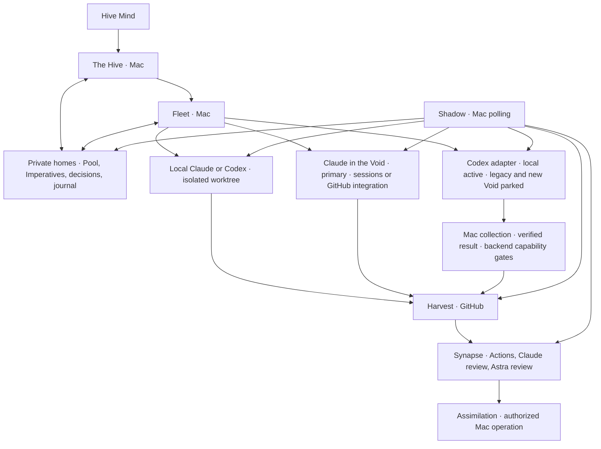

# Hive design

Design baseline: 2026-10-10. This is an implementation contract, not a claim that the components below already exist.

Product scope follows the Hive Mind's 2026-10-10 brainstorm rulings and later Codex findings and decisions, including the decision to park Codex Void work without model selection. The dated Claude and Codex measurements establish the capability evidence; the original firstmate supplies the inherited operational contracts.

Hive specializes firstmate for Claude Code and Codex. It retains their local execution and supervision contracts, owns the workflow natively, and adds execution in the Void. The Hive and its Fleets ordinarily run as Claude Code sessions on the Mac; local Codex supervision remains an inherited capability. Swarms and Lictors can run locally or in the Void. Synapse validates their work, and Assimilation stays on the Mac.

The approved tooling ruling narrows the inherited implementation to one repository and five core dependencies: Git, gh, tmux, Claude Code and Codex CLI. Local Swarms, owned worktrees and supervision remain; Hive builds its own workflow, GitHub gate and review surface. Project-specific test environments stay with their projects. The transitional gate and optional browser exceptions are defined in [Tooling](#tooling). This design does not alter the existing firstmate installation.

Claude is the primary Void executor, through Claude Code cloud sessions and the official GitHub integration. Codex remains a second executor behind the same Hive interface, with three interchangeable backends: local on the Mac, legacy Void, and new Void. Both Codex Void backends are parked; local Codex is the active route. Re-enabling Void work requires a supported command-line path that honors model selection and meets the collection contract. Interchangeability preserves the task contract; it does not imply equal capabilities or permission to change a task's model or placement silently.

The later Mind's word parks Codex Void work because the legacy path cannot choose the model. Its successful submission, status, diff and apply measurement and internal final-text retrieval remain useful evidence; they do not authorize dispatch without model control. Astra reviews stay on local Codex on the Mac. Codex usage, including compatibility probes, is command line only: no browser-driven tasks or GitHub mention or Action dispatch. Legacy retirement must leave Claude delivery and local Codex operational.

## Vocabulary and placement

| Name | Meaning and responsibility |
| --- | --- |
| Hive | The product. **The Hive** is its primary supervisor and the Hive Mind's point of contact. |
| Hive Mind | The operator; supplies intent, scope, decisions, and Assimilation authority. |
| Fleet | A persistent project supervisor, named after its project, with an isolated private home and a charter. |
| Swarm | A worker completing an authorized change through its chosen delivery path. |
| Lictor | An investigator producing evidence, a diagnosis, or a design report; research alone does not authorize implementation. |
| Imperative | The complete dispatch instructions for one assignment. |
| Pool | The durable work queue owned by the Hive or a Fleet. |
| Mind's word | An operator decision, recorded against a held Pool item. |
| Shadow | Supervision, durable observation and wake ownership. |
| Synapse | The review and validation gate. |
| Harvest | A pull request carrying a proposed change. |
| Assimilation | Authorized merging of a Harvest or landing of a local-only change. |
| Void | Cloud execution. Model names remain their real names. |
| Genestealer | The research role developing Hive; it does not create another level of runtime authority. |

Hive uses its own visual identity. Do not use Tyranid, Warhammer or Games Workshop artwork in its interface, documentation or promotional material.

GitHub delivers events to its Actions and vendor integrations. It does not deliver webhooks into the Mac supervisor session. The Shadow therefore polls and wakes the appropriate supervisor. No always-running supervisor or waiting loop is placed in a Void session.

## What Hive keeps from firstmate

The inheritance baseline is the original [firstmate operator contract](https://github.com/kunchenguid/firstmate/blob/fb75c1f94170df7e0751147ea61afabcf5d4e104/AGENTS.md), [architecture](https://github.com/kunchenguid/firstmate/blob/fb75c1f94170df7e0751147ea61afabcf5d4e104/docs/architecture.md), and [configuration](https://github.com/kunchenguid/firstmate/blob/fb75c1f94170df7e0751147ea61afabcf5d4e104/docs/configuration.md). This snapshot makes the comparison reproducible; implementation must review later upstream changes before porting them.

### Operator contract and hard rules

1. The Hive coordinates work; Swarms change projects. Fleets apply the same separation within their charters. Guarded initialization, synchronization, updates, and authorized Assimilation keep their narrow upstream exceptions. A concrete instruction from the Hive Mind can authorize a specific project operation, but cannot be broadened into standing authority.
2. Assimilation requires the Hive Mind's explicit word, or an explicitly granted project posture permitting autonomous Assimilation of green, in-scope work. A worker, reviewer, passing check, or completed Void session cannot grant that authority.
3. Preserve unlanded work. A dirty worktree, uncertain ownership, an uncollected result, or an unproved remote copy blocks cleanup. A Lictor's scratch copy can be retired only after its report is safely collected and its decision inventory recorded.
4. Swarms and Lictors report to their dispatching supervisor. Fleets relay outcomes through their registered parent channel. Direct intervention by the Hive Mind remains authoritative and is reconciled into the durable record.
5. Report outcomes faithfully: distinguish an accepted launch, observed activity, published change, passing Synapse, and completed Assimilation. Missing evidence is unknown, not success.

The Hive presents concrete outcomes and the decisions needed from the Hive Mind, including a Harvest's full URL when relevant. An idle Fleet does not invent audits or improvement work. Research is dispatched separately only when requested or when uncertainty could change whether or what to build; bounded research can remain within an already authorized implementation task.

### Retained capabilities

| Capability | Hive contract |
| --- | --- |
| Local Claude and Codex | Preserve verified launch, steering, interruption, exit, resume, recovery, model/effort configuration, permission modes, and tool restrictions. Harness choice and runtime placement are separate axes. |
| Isolated worktrees and terminal runtime | Preserve disposable copies, durable ownership and visible sessions through the Hive-owned worktree pool and tmux. Runtime interfaces remain extensible, but additional terminal installations are not part of the selected profile. |
| Synapse continuity | Retain no-mistakes as a transitional plugin until Hive's native gate proves the required route's validation and custody contracts. A worker drives the selected executor's gates and does not edit around an active run. |
| Delivery choices | Model placement, validation, publication and Assimilation authority independently. Preserve the upstream `no-mistakes`, `direct-PR` and `local-only` inputs through explicit translation; local-only publication never disables validation by implication. |
| Project-specific proof | Each project supplies its test commands, execution environments and capacity management. Hive collects revision-bound results without owning that infrastructure. macOS behavior still requires native macOS proof; a Linux Void session cannot establish it. |
| Persistent Fleets | Preserve charters, isolated homes, scope routing, correlated parent replies, guarded provisioning and recovery. Existing remote-home capability remains optional; the chosen deployment starts with supervisors on the Mac. |
| Supervision and continuity | Preserve durable inboxes, status events, wake acknowledgments, current-state reconciliation, turn-end guards, away/quiet operation, stow, and guarded restart/update behavior for Claude and Codex. |
| Project and operational tooling | Keep project registration, branch/base selection, GitHub binding, native Pool, usage-aware admission and guarded synchronization for Claude/Codex work. Preserve validated local-only delivery without introducing unselected forge, communication or queue dependencies. |

Local-only work stays under the Hive's local landing authority. A direct Harvest does not acquire an additional independent review pipeline merely because it uses Claude or Codex. The complete GitHub Synapse contract below is the validated Void delivery path. The Imperative must separately declare validation and publication; a local-only branch still receives its required Synapse checks. Existing repository-required checks still apply.

### Native workflow, configurable policy and executors

Hive owns admission, definitions, task and decision identity, effective policy, evidence linkage, lifecycle transitions and knowledge projections through the packages in [Tooling](#tooling).
Historical records remain evidence and do not automatically become effective instructions.
The existing firstmate operation stays untouched.

| Boundary | Responsibility |
| --- | --- |
| Native mechanisms | Validate typed records; enforce authority, scope, revision and ownership; make transitions durable and replayable; render one validated Imperative schema; expose missing evidence and pending propagation. |
| Rules and configuration | Model/class/effort, weighted resource comparison, floors/operators, credit authority, lane limits/expiry, review escalation, proof scope, memory/context budgets, compaction, delivery posture and workspace ownership. Values and trials carry scope, provenance and expiry. |
| Native presentation | The `ui` package projects Pool, Shadow and Synapse state and presents decision cards. Every answer goes through the `word` package's single intake; display state cannot authorize an action. |
| External execution | Git, gh, tmux, Claude Code and Codex CLI are the five core executors. GitHub Actions and project-owned checks supply execution evidence; no-mistakes is transitional, and the browser stack is selected only for browser tasks. |

An adapter registers its version, scoped capabilities, owner and authentication reference privately and implements only supported operations.
Requests and receipts bind home, project, task, generation and source revision.
Unsupported operations refuse; an unavailable executor cannot turn a pending obligation into success.

| Executor boundary | Operations and durable receipt | Boundary on failure |
| --- | --- | --- |
| Transitional no-mistakes | Start, observe and respond through its supported CLI; collect run/head evidence and follow branch custody and synchronization. | The active run owns fixes; missing evidence or unknown custody blocks publication/landing. |
| GitHub through gh | Read requirements and current heads, publish a Harvest, collect checks/reviews, submit an authorized expected-head merge and verify the result. | Missing producer, unreadable rules or a changed head blocks readiness/Assimilation. The forge supplies no merge authority. |
| Optional browser proof | Use the selected browser stack for navigation, capture and attachments bound to the task and selected page. | Incomplete capture, wrong page or a lost session leaves proof pending; browser access does not enable Codex Void dispatch. |
| Project validation | Run the project's declared checks in its supplied environment and collect revision-bound results and artifacts. | Missing environment or required evidence blocks validation; Hive does not provision or administer project infrastructure implicitly. |

Each native projection declares the source/rule/specification revisions it consumes.
Source changes mark dependent projections stale until refresh and acknowledgment; configured drift checks compare those bindings.
A recorded requirement for a check does not prove that an installation already runs it.

## Tooling

The Hive Mind approved the following five-point tooling strategy on 2026-10-10, superseding the scout's earlier dependency proposal.
This is the implementation contract; this documentation change imports no source and adds no licence file, installations, upgrades or services.

1. **One repository:** keep Hive in `kesk-git/hive`, with internal `pool`, `worktrees`, `dispatch`, `shadow`, `synapse`, `word` and `ui` packages behind stable command-line contracts, each with its own tests and test target.
2. **Five core dependencies:** Git, gh, tmux, Claude Code and Codex CLI. Adapt tasks-axi and Treehouse into Hive; rebuild quota reading, launch/restart, the rule-and-specification store and review presentation natively. Keep no-mistakes as a transitional plugin until Hive's own GitHub gate replaces it; chrome-devtools-axi is optional for browser tasks only. gh-axi is not adopted.
3. **Native workflow and review:** drop OpenSpec and Lavish. Keep verbatim rulings with one rendered rule line, and per-change acceptance criteria in the Imperative and Pool item. Decision cards live in Hive's observability UI and submit through its one decision intake. Project-specific execution environments and test suites belong to each project; unrelated products supply inspiration, not integration contracts.
4. **MIT:** license Hive before any code is taken in, preserve upstream copyright/licence notices, and record every source import and upstream revision.
5. **Order:** licence and contracts, Pool, worktree pool, session and metering, gate, review surface within the UI, then end-to-end proof.

The strategy ruling does not perform its implementation or Assimilate this documentation Harvest.
The licence file is a separate subsequent change and must precede source imports.
Implementation uses new Hive-owned state and leaves the existing firstmate installation, private homes, worktree pools, status displays and shared no-mistakes configuration untouched.

### Repository and package contracts

The packages are internal ownership and testing boundaries in one repository, not separate services or repositories to create now.
Each exposes versioned requests, structured complete responses, explicit exit/error states and capability declarations through a stable command-line contract.
Cross-package operations carry the home, task, generation, source revision, authority and replay identity required by the operation; private records are never ambient global inputs.
The existing `hive-*` interfaces below map into these packages rather than creating a package for every command.

| Package | Owns and exposes | Required package test target |
| --- | --- | --- |
| `pool` | Pool storage, migrations, admission records, Imperatives, accepted specifications, original rules and their projections; `hive-pool`, `hive-admit`, `hive-imperative`, `hive-spec`, `hive-rule`, `hive-memory`. | `test-pool`: record round trips, transitions, concurrent writes, migration and recovery. |
| `worktrees` | Hive-owned worktree pool, leases and acquire/observe/release receipts; `hive-worktrees`. | `test-worktrees`: isolation, concurrency, interrupted operations and preservation. |
| `dispatch` | Session launch/control, Fleet provisioning, effective policy, native quota/context/usage readers, reservations and continuity; `hive-dispatch`, `hive-fleet`, session/control/policy/context helpers. | `test-dispatch`: admission, profile resolution, observation provenance and exact-target recovery. |
| `shadow` | Bounded observations, due polls, durable wakes and acknowledgments; `hive-shadow`, `hive-state`. | `test-shadow`: replay, unknown/stale observations, backoff and wake ownership. |
| `synapse` | Validation obligations, review/fix custody, evidence and readiness; `hive-synapse`, guarded Assimilation interfaces. | `test-synapse`: head-bound proof, finding gates, one fixer and landing authority. |
| `word` | The single decision intake, held questions, exact answers and completion receipts over Pool storage; `hive-word`. | `test-word`: complete rounds, authorized answers, deduplication and unresolved holds. |
| `ui` | Local observability, artifact serving and [Review](#review), with decision cards over scoped projections; `hive-ui`. Its **Waiting on you** view lists the decisions the operator owes, each as a decision card. | `test-ui`: stale/incomplete cards, revision-bound submissions, durable review rounds and receipt display. |

These are required future per-package targets, not commands already present in this documentation-only repository.
Each target runs that package's owned tests independently; integration targets separately exercise the command-line contracts between packages.
No package may bypass another package's writer by opening its private store directly.
In particular, `ui` reads projections and sends decisions to `word`; `word` uses `pool` for persistence, and neither UI state nor a cached display grants authority.
Packages may be extracted later behind the same contracts; an extracted package is not merged back into the monorepo.
Build tooling and libraries must be declared per package, and the delivered core must not require a separately installed Node, Python or Go toolchain as a sixth runtime prerequisite.
No new always-on control service is required beyond the Shadow's bounded observation and the UI when selected.

### Inventory and disposition

**F** means fork/adapt selected source into Hive, **R** means implement the responsibility natively, and **K** means retain an external executor behind a contract.
The selected core K set is exactly the five dependencies below; transitional and optional tools are explicitly separate.
Tools rejected by the ruling are marked **not adopted**, rather than disguised as optional core dependencies.
The scout's platform inventory records where capabilities came from; it is not a bootstrap manifest.
Licence evidence is tied to the inspected package or upstream revision, and unknown distribution notices must be resolved before redistribution.

| Tool | What it provides | Hive component | Origin | Licence evidence | Disposition |
| --- | --- | --- | --- | --- | --- |
| Git | Source identity, worktree engine and local landing | `worktrees`, `synapse` | [git/git](https://github.com/git/git); Apple distribution | GPL-2.0 upstream; exact Apple notices not gathered | **K**, core source-control dependency |
| gh | GitHub REST/GraphQL transport, publication and checks | `dispatch`, `shadow`, `synapse` forge adapter | [cli/cli](https://github.com/cli/cli) | MIT | **K**, core forge dependency |
| tmux | Visible sessions and terminal control | `dispatch`, `shadow` runtime adapter | [tmux/tmux](https://github.com/tmux/tmux) | ISC permission form, with per-file notices | **K**, core terminal dependency |
| Claude Code | Local and qualified Void execution | `dispatch`, `synapse` | Anthropic | Proprietary CLI/service | **K**, core harness dependency |
| Codex CLI | Local execution and Astra review | `dispatch`, `synapse` | [openai/codex](https://github.com/openai/codex) | Apache-2.0 CLI; service remains external | **K**, core harness dependency; Void routes stay parked |
| tasks-axi | Queue, holds, moves and archives | `pool`, `word` | [kunchenguid/tasks-axi](https://github.com/kunchenguid/tasks-axi) | MIT | **F**, one native Pool; no external tasks-axi requirement |
| Treehouse | Reusable worktrees, locks and durable leases | `worktrees` | [kunchenguid/treehouse](https://github.com/kunchenguid/treehouse) | MIT | **F**, Hive-owned worktree pool; no external Treehouse requirement |
| gh-axi | Agent-facing GitHub wrapper | Forge contract implemented with gh | [kunchenguid/gh-axi](https://github.com/kunchenguid/gh-axi) | MIT | Not adopted; use plain gh |
| quota-axi | Provider quota evidence | `dispatch` resource readers/policy | [kunchenguid/quota-axi](https://github.com/kunchenguid/quota-axi) | MIT | **R** quota reading; external CLI not adopted |
| Local firstmate launcher | Cold start, restart and capability receipts | `dispatch` | Local launcher, distinct from upstream firstmate | No public grant established | **R**, generic lifecycle without app integration |
| fm-dispatch-spend; fm-codex-token-usage | Usage-event normalization and task/model attribution | `dispatch` metering | Local Fleet helpers | No licence located | **R**, one native metering projection |
| Local token-usage reader: usage.py, report-tokens.sh, breakdown.py | Claude token-event normalization | `dispatch` metering | Local Python/Bash helpers | No licence located | **R**, preserve event semantics without source transplant |
| claude-ctx-statusline; quota-tmux | Context observations and terminal usage displays | `dispatch`, `shadow`, `ui` | Local Fleet helpers | No licence located | **R**, shared native observations and projections |
| Local external store layer; fm-store-blocks; fm-store-commit | Rule/specification transactions and closure | `pool`, `word` | Local project store layer | No licence located | **R**, native store, no product format compatibility |
| OpenSpec | Specification/ruling workflow ideas | `pool`, `word` | [Fission-AI/OpenSpec](https://github.com/Fission-AI/OpenSpec) | MIT | Not adopted; two ideas retained natively below |
| Lavish / lavish-axi | Review questions and answers | `ui` decision cards / `word` intake | [kunchenguid/lavish-axi](https://github.com/kunchenguid/lavish-axi) | MIT | **R** native review surface; external UI/CLI dropped |
| no-mistakes | Review/fix/test/document/lint/publication/CI pipeline | Transitional `synapse` plugin | [kunchenguid/no-mistakes](https://github.com/kunchenguid/no-mistakes) | MIT | **K** during migration; replaced by native GitHub gate after qualification |
| chrome-devtools-axi | Browser command interface | Optional browser-task proof adapter | [kunchenguid/chrome-devtools-axi](https://github.com/kunchenguid/chrome-devtools-axi) | MIT | **K**, browser tasks only |
| chrome-devtools-mcp; Google Chrome | Browser protocol bridge and browser | Optional browser-task adapter | [ChromeDevTools/chrome-devtools-mcp](https://github.com/ChromeDevTools/chrome-devtools-mcp); Google | Apache-2.0; proprietary Chrome distribution | **K**, transitive browser feature only, no bundled browser |
| Ghostty | Operator terminal viewer | Operator's environment | [ghostty-org/ghostty](https://github.com/ghostty-org/ghostty) | MIT upstream; installed app notices not inspected | Not required or installed by Hive |
| Herdr; Zellij | Alternative terminal runtimes | Unselected runtime interfaces | [herdrdev/herdr](https://github.com/herdrdev/herdr); [zellij-org/zellij](https://github.com/zellij-org/zellij) | Apache-2.0 at inspected Herdr revision; MIT Zellij | Not adopted into the five-dependency profile; neither was installed |
| cmux; Orca | Alternative desktop runtime/isolation | Unselected runtime interfaces | [manaflow-ai/cmux](https://github.com/manaflow-ai/cmux); compatible Orca origin unresolved | cmux GPL-3.0-or-later with specified server directories BUSL-1.1; Orca unresolved | Not installed by Hive; interfaces do not establish readiness |
| RTK | Command-output filtering | Unselected worker tool | [rtk-ai/rtk](https://github.com/rtk-ai/rtk) | Apache-2.0 | Not adopted; preserve complete native evidence output |
| Tailworks; Tailscale | Hosting/network transport | External operator environment | [kesk-git/tailworks](https://github.com/kesk-git/tailworks); [tailscale/tailscale](https://github.com/tailscale/tailscale) | Tailworks source/licence unavailable; Tailscale BSD-3-Clause upstream, app notices uninspected | Not Hive dependencies or a UI hosting requirement |
| ntfy / ntfy-server | Notification transport/server | External operator environment | [binwiederhier/ntfy](https://github.com/binwiederhier/ntfy) | Apache-2.0 at inspected tag | Not adopted |
| Local certificate helper; Mullvad | Host certificate/VPN administration | Outside Hive | Local helper; exact Mullvad package unresolved | Local licence not found; distribution uninspected | Not adopted |
| Local mockup helper; remote-pi-relay | One-off hosting; other-harness relay | Outside Hive | Local artifacts; public attribution unresolved | Not established | Not adopted |
| gerrit-axi; glab; tea | Alternative forge candidates | Outside selected GitHub contract | [slnkjthien/gerrit-axi](https://github.com/slnkjthien/gerrit-axi); [gitlab-org/cli](https://gitlab.com/gitlab-org/cli); exact tea package uninvestigated | Apache-2.0 plus NOTICE; MIT; tea unresolved | Not adopted or installed |
| Beads / bd | Conditional legacy queue backend | Legacy import boundary only | Compatible distribution unresolved | Not established | Not adopted; no second queue |
| pi; opencode, pi-signed, grok, kimi, cursor / cursor-agent, omp, muse, gemini, rovo, agy, devin | Other harness candidates | Outside Claude/Codex scope | [earendil-works/pi](https://github.com/earendil-works/pi); other exact distributions unresolved | Inspected pi MIT; other packages not established | Not adopted; no mandatory checks or installations |
| jq; Node; npm / npx; Python; Perl; SQLite | Legacy parsing, execution, packaging and storage helpers | Implementation/build inventory, not external core tools | [jqlang/jq](https://github.com/jqlang/jq); [nodejs/node](https://github.com/nodejs/node); [npm/cli](https://github.com/npm/cli); [python/cpython](https://github.com/python/cpython); Perl project; [sqlite/sqlite](https://github.com/sqlite/sqlite) | MIT jq/Node with component notices; Artistic-2.0 npm; Python-2.0; installed Perl notices unknown; SQLite public-domain upstream | Use native package capabilities; no additional installed core prerequisite |
| Bash; zsh; sh; curl; OpenSSL; ssh; scp; rsync | Shell, network and file-transport substrate | Platform/build or project-owned environment | GNU; zsh/system authors; [curl/curl](https://github.com/curl/curl); [openssl/openssl](https://github.com/openssl/openssl); OpenSSH/OpenBSD/Apple | Inspected Bash GPL-3.0-or-later; curl licence; OpenSSL Apache-2.0; BSD-family OpenSSH/openrsync; exact system notices uninspected | Platform capabilities only where needed; no Hive-managed networking/transport service |
| ShellCheck; actionlint; gitleaks | Development lint and scanning | Per-package/project validation tools | [koalaman/shellcheck](https://github.com/koalaman/shellcheck); [rhysd/actionlint](https://github.com/rhysd/actionlint); [gitleaks/gitleaks](https://github.com/gitleaks/gitleaks) | GPL-3.0-or-later; MIT; MIT | Development-only where selected; not core runtime dependencies |
| Go; cc; Swift; Xcode / xcodebuild; Homebrew; ripgrep | Build, package maintenance and search | Development/operator environment | Go/Swift projects; Apple; [Homebrew/brew](https://github.com/Homebrew/brew); [BurntSushi/ripgrep](https://github.com/BurntSushi/ripgrep) | Swift Apache-2.0 with runtime exception; Apple SDK terms; other installed notices not audited | Build/operator tools only; no automatic installs/upgrades |
| macOS and system process/file utilities | Process identity, atomic files, digests and bounded subprocesses | Platform boundary | Apple and OS/package authors | Per-component terms, not fully audited | Platform substrate, not source to vendor |
| Python IMAP/SMTP, curl-backed Relay, voice client / sounddevice; cloudflared, ffmpeg, sox, mail / fmx | Optional or unproved communication candidates | Outside selected profile | Standard/protocol libraries and local adapters; exact packages uninvestigated | Distribution-specific, unresolved where uninspected | Not adopted or implicitly installed |

The system-utility census covers `launchctl`, `osascript`, `lsappinfo`, `dscl`, `open`, `sw_vers`, `sysctl`, `getconf`, `uuidgen`, `lsof`, `ps`, `pgrep`, `awk`, `base64`, `basename`, `cat`, `chmod`, `cksum`, `clear`, `cmp`, `comm`, `cp`, `cut`, `date`, `dd`, `df`, `diff`, `dirname`, `du`, `env`, `file`, `find`, `grep`, `head`, `id`, `install`, `ln`, `ls`, `md5`, `md5sum`, `mkdir`, `mkfifo`, `mktemp`, `mv`, `nohup`, `od`, `paste`, `readlink`, `realpath`, `rm`, `rmdir`, `sed`, `seq`, `sha256sum`, `shasum`, `sleep`, `sort`, `stat`, `strings`, `tail`, `tar`, `tee`, `time`, `touch`, `tr`, `uname`, `uniq`, `wc` and `xargs`.
References to `pbpaste`, `timeout`/`gtimeout`, `setsid`, `flock`, `pkill` or `say` do not establish required external executables: some are setup/fallback, API, builtin or forbidden-command references.
The in-process firstmate-calm mod and inactive backup artifacts are not dependencies to import.
None of this historical census broadens the five-dependency contract or authorizes host administration.

### Fork and adapt: preserve behavior and attribution

Both adaptations retain upstream notices, attribution and tests in their owned package, with a recorded upstream base and maintenance owner.
New interfaces use Hive vocabulary; historical words, evidence and unknown record fields survive explicit versioned migrations unchanged.
Audit selected source, tests, generated assets and transitive libraries before import; a root MIT licence does not automatically cover every bundled file.

**Pool:** base the adaptation on the proven tasks-axi parser, transitions, archives and multi-item moves, with [0.2.6](https://github.com/kunchenguid/tasks-axi/tree/9401ff899c0d1d8ae6b4fd8727b9025abda2032c) as the scout's reproducible source baseline.
Preserve real-format round trips, prose/evidence/unknown fields, archive lookup, queued versus in-flight transitions, unanswered holds through completion/cleanup, idempotent answer receipts and recoverable atomic multi-home moves.
Prove that private-home selection cannot write into a project's code root and that persistent Fleets never become ordinary tasks.
Keep legacy Markdown import/export with an explicit identity migration, not a competing queue backend.
Admission, specifications, rules, Mind's word and task generations share one authoritative store with one writer per transaction.

**Worktree pool:** adapt Treehouse's pool, lease, locking, preservation and VCS integration, retaining Git as the external engine; the source baseline is [v3.1.2](https://github.com/kunchenguid/treehouse/tree/a5ab29f88f9dc57c06b5ffb43b9f25c79a7acf33).
Expose acquire/observe/release receipts bound to private home, project clone, task generation, branch and physical worktree; replace terminal-directory discovery only after qualification.
Retain tests for concurrent acquisition, durable leases after exit, stale-owner ambiguity, interrupted acquire/return, base/branch setup, checkout hooks and trust, spaces in paths, symlink/common-directory verification, and preservation of dirty, untracked or unlanded work.
Add proof for distinct clones of the same origin, refusal to release a reassigned slot and the tmux dispatch contract.
New Hive work uses a separate owned namespace; existing firstmate slots are never adopted by resemblance or apparent idleness.
The adaptation establishes ownership and reliable receipts; it has no measured memory-saving claim.

### Native rebuild contracts

Rebuild local additions with no located licence independently from their behavioral contracts; source copying would first require established provenance and redistribution rights.
Native does not mean duplicating the same rule in a prompt, hook, UI and script: each responsibility has one owning package and versioned receipts.

| Responsibility | Contract and package-level acceptance evidence |
| --- | --- |
| Session launch/restart (`dispatch`) | Home lock, ordinary policy resolver and exact process/session generation. Prove cold start, duplicate refusal, checkpoint/plan revision, preservation of worker windows/worktrees, partial restoration and separate wake-failure reporting. No app caller/allowlist/storage compatibility is part of this contract. |
| Quota reading (`dispatch`) | Own bounded read-only Claude/Codex readers behind an internal provider interface, with provider/schema version, scope, timestamp, coverage and measured/estimated/unknown status. Qualify complete responses, resets, malformed or stale data and provider changes; unknown capacity never becomes free capacity. Observe without inference calls, credential refresh or account switching. Only verified supported sources enable admission; inability to read required evidence holds dispatch. quota-axi may inform behavioral fixtures but is neither a runtime dependency nor code to import under this rebuild decision. |
| Context and usage metering (`dispatch`, projected by `shadow`/`ui`) | Bind observations to home, harness/session and task generation, actual model and gate owner. Preserve event deduplication, reset discontinuities, cache/input/output distinctions, read-only access and crash-consistent generations. Label estimates/unmeasured coverage; token counts do not equal quota percentages or guaranteed billing. Share observation caches, avoid per-pane polling, reject stale/mismatched context and never restart from guessed capacity. |
| Rule-and-specification store (`pool`, decisions through `word`) | Retain each ruling verbatim, with one derived effective rule line carrying its source/revision; preserve amendments and supersession without rewriting the original. Store each change's acceptance criteria on the Pool item and render those same revision-bound criteria into the Imperative's Standard, without an independently editable duplicate. Prove failed validation preserving state, atomic recovery, stale projection detection and code-landed/store-close-pending replay. These are the two retained OpenSpec ideas; no OpenSpec CLI, schema or adapter is required. |
| Native gate (`synapse`) | Implement Hive's own GitHub gate under the [Synapse contract](#synapse-on-github-with-both-reviewers), owning obligations, head-bound review/fix receipts, findings, retries, publication readiness and one fix writer. Replace no-mistakes only when the selected route proves equivalent validation and custody; preserve in-flight runs and archived evidence during migration. Local-only delivery retains its required validation without manufacturing a forge binding. |
| Review surface (`ui`, decisions through `word`) | Implement the [Review contract](#review) below, sharing decision cards with the observability UI's Waiting on you view. Render complete question/round and attachment projections, and submit the exact answer and card/question revision through `hive-word`; show durable acceptance separately from completion. Prove incomplete-content refusal, stale-card rejection, replay deduplication, unanswered-call visibility and archived-answer retrieval. The UI cannot directly write Pool/decision state, grant itself authority or become a second intake. |

### `ui`

#### Review

Mockup and design review live in `ui`, replacing Lavish. A Lictor writes plain HTML into the owning supervisor's private home, one file per revision. The Hive Mind opens that artifact, annotates it and answers decision cards beside it; the owning Fleet (or the Hive for its own task) receives the resulting round through the Shadow. The review's decision cards beside the mockup and the cards in the `ui` **Waiting on you** view are one component, using the same projections, answer binding and `word` intake.

**Files and ownership.** All paths below are relative to the selected private home, outside the project repository. A review lives under `reviews/<task-id>/<generation>/<review-id>/`; IDs bind it to its Pool item, owning supervisor and assigned Lictor. Revision and round numbers increase independently and are never reused.

| File | Contract |
| --- | --- |
| `review.json` | Versioned review identity, owner and Lictor references, revision/asset manifests with digests, current revision and round, and completion-record reference. Publish a new current revision only after its complete files and any reply to the previous round are durable. |
| `revision-0001.html`, `revision-0002.html`, … | Immutable plain HTML revisions. Keep referenced assets in revision-specific paths under the review directory and retain their digests; a later revision cannot overwrite an earlier revision's assets. |
| `round-0001.feedback.json`, `round-0002.feedback.json`, … | Exactly one feedback file per round, containing the round's bindings and ordered operator events. The `ui` feedback writer preserves earlier events when atomically replacing the file under the review lock. |
| `round-0001.reply.json`, `round-0002.reply.json`, … | The Lictor's reply to that round, binding each response to the original note/event IDs and identifying the next revision and its digest. Operator words remain in the feedback file unchanged. |
| `final.json` | The final review record written by Done, bound to its event, reviewed revision and durable feedback sequences. It records completion of this review, separately from decision and task completion. |

**Serving and login.** The `ui` read-only server serves any artifact file from the explicitly selected private home, resolving artifact paths within that home. It binds to loopback for local use or to the operator's existing tailnet interface for private remote use, never a public listener. On the tailnet, the operator's verified private network identity is the login, scoped to the selected home; a client-supplied identity string is not authentication. Loopback access uses the local operator's home-bound UI session. No tunnel, public host, separate review product or Hive-managed network setup is required. Tailnet access is optional operator infrastructure, so loopback use retains the five-dependency profile.

The server injects the annotation overlay into served HTML without rewriting the revision on disk. Artifact access stays read-only; the overlay's feedback submission is a separate, narrowly scoped `ui` writer for the round file, not an arbitrary file-write endpoint or a Pool writer. Artifact content cannot impersonate the trusted overlay or submit authenticated decisions on the operator's behalf.

**Capture.** The overlay lets the Hive Mind click an element or select text, type a note and press a decision card beside the mockup. Every overlay target change, text edit and button press is durably recorded in that round's feedback file, including Done. Keep text exactly as typed, including whitespace and amendments; preserve earlier edits rather than replacing them with a summary. Each file has `schema_version`, `home_id`, `task_id`, `generation`, `review_id`, `round_id`, owning supervisor and Lictor references, and the reviewed revision's path and digest. Each ordered event has this record:

| Field | Required content |
| --- | --- |
| Identity and order | Stable `event_id` for retries, monotonically increasing `sequence`, capture time, durable receipt time and authenticated operator reference. |
| Action and words | `kind` (`target`, `note`, `card-answer` or `done`), exact `text` and the exact pressed control label when applicable. A note keeps its stable `note_id` across text edits. |
| Annotation target | Reviewed revision/digest plus the element locator and captured element text; for a selection, its exact quoted text and start/end DOM paths and offsets. Preserve the original target even when the next revision moves or removes it. |
| Card answer | Card, question, held-item and decision-round IDs and revisions, selected option ID and displayed label, and any typed answer verbatim. These bindings distinguish a review round from the decision round it presents. |
| Completion binding | For Done, the displayed revision/digest and the last feedback sequence included in the final record. Fields irrelevant to an event kind are explicitly absent. |

The writer acknowledges an event only after durable persistence and returns its event ID and sequence. The page shows unsaved input until that acknowledgment; retries reuse the same ID and cannot duplicate a press. Feedback capture is a receipt, not a ruling: the page displays `word`'s acceptance and completion receipts separately. An incomplete or stale card cannot acquire decision authority by being written to a feedback file.

**Wake and route.** On its bounded local tick and on recovery, the Shadow reads registered review files in its own home for feedback sequences beyond its durable cursor, including retained completed rounds. It records an observation and wake before advancing that cursor, then wakes the recorded owning supervisor. That supervisor drains the round and acknowledges handled sequences only after recording routing receipts. Card answers go through `hive-word answer`, the one intake for the Mind's word, with the exact words and question/round revisions. A valid answer releases the corresponding hold or completes the question exactly as a chat answer would; a changed question remains held for reconciliation. Free-text notes go verbatim, with their annotation targets, to the assigned Lictor through the supervisor's durable `hive-send` steer. If the Lictor has stopped, the Fleet retains the steer for authorized continuation; it does not depend on delivery into a live session.

**Next round and Done.** The Lictor reads the feedback, writes the next HTML revision and the reply file, and publishes the new revision through `review.json`. The page notices the durable revision change on refresh or a bounded read and reloads the mockup. The previous round's notes stay visible beside it with the Lictor's replies, linked to their original revision and targets; they are not silently reattached to changed elements. New feedback uses the next round file. No Lictor or supervisor needs to remain running while the Hive Mind reviews.

Pressing **Done** persists that event in the current feedback file and writes `final.json` with review/task/generation identity, operator and time, final revision/digest, included round sequences, reply references and the known decision receipts or pending holds. A crash between those writes is recovered from the Done event; the page reports completion only after the final record is durable. Done ends the mockup review. It does not supply missing card answers, close unrelated holds, accept implementation or authorize Assimilation.

Rounds, replies and completion are files, not a live listener's memory. Saved input survives a dead Lictor, supervisor or UI process; restart replays pending feedback through the same event IDs and routing receipts. A late answer is still persisted against its original round and read, even after a new revision, worker exit or Done. `word` reconciles its original question revision before applying it; the final record remains a snapshot of what Done included. Closing or archiving a review cannot discard an unanswered decision or unread feedback.

**Sharing.** Export the selected HTML revision as a standalone file with its assets inlined. The export contains the mockup, without private feedback, decision records or an authenticated overlay connection back to the home. Sharing that file requires no public host or tunnel and leaves the private review history in the home.

### Kept executors and migration boundaries

| Boundary | Kept dependency and required contract |
| --- | --- |
| Source control | Git remains external; `worktrees` and `synapse` own isolation, source/head binding, preservation and authorized landing receipts. |
| GitHub | Plain gh supplies complete REST/GraphQL responses. Hive owns pagination, repository identity, expected-head mutation guards, required-check producers and post-operation verification. Qualify REST access in the Claude cloud environment; command/API success alone is not a collected result. No gh-axi runtime or wrapper compatibility is inherited. |
| Terminal | tmux supplies visible sessions with stable endpoint IDs. `dispatch` owns verified composer clearing, acknowledgments, semantic activity and exact-target control. Other terminal interfaces are not default installations or readiness claims. |
| Harnesses | Claude Code and Codex CLI retain the [runtime adapter contract](#runtime-adapters-what-the-void-adds), model/effort and permission controls. Claude is the primary Void route; both Codex Void routes remain parked. |
| Transitional local gate | no-mistakes is selected only while the equivalent native gate is unqualified for a required route. Use supported start/observe/respond/custody operations, full findings and current-head proof; follow guarded sync/recovery and distinguish a client timeout from daemon failure. No direct edits around an active run or shared-configuration changes. Cut over only after qualification and reconciliation; never run two fix owners on one branch. |
| Optional browser tasks | Install chrome-devtools-axi and its required MCP/browser runtime only for selected browser work. Qualify navigation, page identity, screenshots, attachments and disconnect/error handling against the selected versions. It is not a startup prerequisite, a resident idle service or a Codex Void dispatch route. |

The five core executables are the normal installed profile; the transitional gate and optional browser stack are explicit exceptions, not permission to add the rest of the scout's tooling.
Project build/test commands may require their own tools and environments; those belong to that project's validation configuration, not Hive's bootstrap or infrastructure ownership.
The native UI's [Review](#review) surface works on loopback without a separate review-page product, hosting wrapper or VPN dependency; optional tailnet access uses the operator's existing private network identity.
MIT is the chosen licence, but Hive has no licence file yet; record imported portions, upstream repository and exact revision, copyright/licence and third-party notices, retained tests, local changes and maintenance owner before code import.
Retained dependencies keep their own terms, including applicable Apache notices; do not relabel proprietary or unresolved source as MIT.
No credentials, private home state, decision corpus or global configuration notes enter a public import.

### Ordered implementation plan

1. **Licence and contracts:** add MIT in a separate change before importing source; establish the import record, seven package owners, command/receipt schemas, per-package test targets and five-dependency distribution contract. Baseline dispatch, idle polling and validation process count, elapsed time, peak memory and disk before claiming savings.
2. **Pool:** after licence and identity schemas, adapt tasks-axi with read-only legacy import first, prove round-trip/crash recovery, then select one writer in a new Hive private home. Integrate admission, native rules/specifications and the decision intake; carry accepted criteria from Pool to Imperative by revision.
3. **Worktree pool:** after Pool generations and home/clone identity, adapt Treehouse and qualify its leases and tmux integration in isolation. Prove concurrent ownership, distinct same-origin clones, uncertain-launch reconciliation and preservation without touching the operating firstmate pool.
4. **Session and metering:** after Pool and runtime identity, implement native launcher/restart, quota/context/usage readers, policy resolution and the Shadow's observations. Prove freshness, safe checkpoint/park/resume, shared caches and ordinary observation without model turns or additional polling services.
5. **Gate:** after identity, authority and evidence contracts, qualify the native GitHub Synapse gate with gh, project Actions, Claude review and local Astra. Retain the no-mistakes plugin until route-specific validation/custody equivalence is proved; reconcile active runs before cutover. Keep local-only validation and Assimilation authority separate from publication.
6. **Review surface within the UI:** after the decision intake and evidence projections, implement the [Review contract](#review), including artifact serving, annotations, durable rounds, replies, Done and export, with the same cards as Waiting on you. Qualify full rounds/attachments, exact answers, stale revisions, crash/replay, late answers, archive retrieval and one intake; do not install a separate review-page tool.
7. **End-to-end proof:** after the required package and contract tests pass, prove a complete local lifecycle and the selected Claude Void path through native Synapse and Mac Assimilation. Exercise crash/replay at launch, answer, proof, publication, merge and retirement. Retire only Hive migration shims whose replacements prove equivalence; preserve existing firstmate and keep Codex Void parked until its separate readiness contract passes.

## Components and private state

Hive combines instructions, skills and seven internal packages with the Pool and worktree adaptations and five core dependencies specified in [Tooling](#tooling).
It needs no new hosted control service.
The `hive-*` command names below are **proposed interfaces**, not installed commands or vendor flags.
Their upstream owners are named so an implementation can port behavior without reproducing it in several places.

Each supervisor has an explicitly selected private home outside the public project repository. The following are logical stores within that home, not machine-specific locations. Use atomic record replacement, append-only event journals, and home/task locks. Missing or malformed authoritative records stop the affected mutation; a cached display cannot authorize it.

| Component and command interface | State and location | Failure behavior |
| --- | --- | --- |
| Session owner: `hive-session-start` | Private home lock, startup digest, schema version, charter, inherited preferences, registered direct reports. Ports `fm-session-start.sh`. | Lock refusal leaves the session read-only. Deferred network checks remain unverified until their results arrive. |
| Pool: `hive-pool add/read/update` | Private durable work items: task identity, project, scope, dependencies, delivery path, dispatch class, artifact links, holds and dates. Ports the home-scoped `fm-tasks-axi.sh` interface. | Failed dispatch/finish transitions cannot be reported as successful. Capacity deferral leaves the item queued. |
| Worktree pool: `hive-worktrees acquire/observe/release` | Private leases, home/clone/task-generation identity, physical worktree, base/branch and operation receipts in the Hive-owned namespace. Adapts Treehouse. | Unknown ownership or dirty/unlanded work prevents release; an interrupted operation requires reconciliation. |
| Mind's word: `hive-word hold/answer/complete/verify` | Private held task, reason, origin, decision provenance, answer, and release/completion state. Ports `fm-captain-hold.sh`. | An unanswered or unreadable hold prevents dependent dispatch, Assimilation, and closing that question. |
| Observability UI: `hive-ui` | Scoped projections of Pool, Shadow and Synapse records, source revisions and decision-card submission receipts; private [Review](#review) artifacts, feedback rounds, Lictor replies and final records. Answers enter only through `hive-word`. | Stale or incomplete cards cannot submit a valid answer; display refresh, feedback capture or Done cannot close a held decision. |
| Imperative author: `hive-imperative create/revise/render` | Private canonical text, revision and digest, plus exactly what was delivered for each generation. Ports `fm-brief.sh` and its intent/completion helpers. | Empty sections, unresolved placeholders, or incompatible delivery settings refuse dispatch. |
| Admission: `hive-admit create/check/approve` | Private immutable request and admission receipt bound to the Imperative revision, its embedded Object/Standard/Output/Boundary fields, inherited evidence and authority. `approve` records a required ruling, not a routine extra wait. | Missing fields, a material guess or absent required authority refuses dispatch; a high-confidence authorized reading proceeds under the Imperative contract. |
| Definition: `hive-spec define/accept/close` | Native private specification revision, acceptance receipt, requirement/evidence links and closure receipt in the Pool store; revision-bound acceptance criteria render into the Imperative. | Product gaps hold acceptance; changed requirements invalidate the affected acceptance and proof bindings. |
| Effective rules: `hive-rule record/amend/resolve` | Private verbatim rulings, amendments, scope, effective/expiry times and supersession; one rendered rule line per effective ruling and a resolved-rule digest. | Preserve originals; unresolved precedence or expired authority blocks the dependent action. |
| Policy resolver: `hive-policy resolve` | Private role/profile selection with rule digest, resource evidence, freshness, permissions and permitted fallbacks. | Unsupported model, missing required evidence or exhausted admission allowance refuses launch without changing accounts or model. |
| Fleet owner: `hive-fleet provision/route/recover` | Private charter, parent channel, project/clone identity, publication/validation defaults and home-bound isolation ownership. | Refuse ambiguous ownership or an unsupported local-only route; do not fall back to hand wiring. |
| Knowledge: `hive-memory render/check/propagate` | Private source-owner index, generated projections, maintenance queue, version/digest and per-consumer acknowledgment. | Drift and incomplete propagation remain visible; stale projections cannot authorize work. |
| Context and capacity: `hive-context observe/checkpoint`, `hive-park`, `hive-resume` | Private observation provenance/freshness, checkpoint readiness, parked obligations and restart policy/target receipts. | Unknown observations do not trigger destructive control; no restart without a verified checkpoint and target. |
| Dispatcher: `hive-dispatch` | Private accepted admission/specification revisions, resolved policy receipt and task execution record, launch intent and receipt, runtime ownership and capacity reservation. Ports `fm-spawn.sh` and verified Claude/Codex adapters. | Preserve uncertain launches for reconciliation; never blindly create a second session after a timeout. |
| Steering and control: `hive-send`, `hive-control` | Private message outbox/inbox, acknowledgments, revisions, lifecycle operation receipts. Ports `fm-send.sh` and `fm-control.sh`. | Delivery acceptance is distinct from acknowledgment. Unsupported lifecycle actions refuse; a chat message is not an interrupt command. |
| Shadow: `hive-shadow`, `hive-state` | Private observations, poll cursors, next-due times, wake queue, handled sequences, owner generation and liveness. Ports `fm-watch.sh`, `fm-crew-state.sh`, and wake helpers. | Unknown remote state stays unknown; failures neither erase evidence nor trigger destructive recovery. |
| Synapse: `hive-synapse start/collect/respond` | Private run ledger, review packets, finding decisions, bound head/base SHAs, fix rounds and executor; public sanitized checks/reviews on GitHub. | Incomplete or stale evidence keeps the gate pending or failed. Only the selected executor owns fixes. |
| Assimilation: `hive-assimilate`, `hive-assimilate-local` | Private authority receipt, verified Harvest identity/head, required evidence, merge result and completion receipt. Ports `fm-pr-merge.sh` and `fm-merge-local.sh`. | Refuse on missing authority or unmet guards; verify actual forge state after submission. |
| Continuity: `hive-stow`, `hive-recover`, `hive-sync`, `hive-retire` | Private curated memory, recovery checkpoint, pending transitions and cleanup receipts; recorded worktree ownership. Ports stow, sync, control and teardown contracts. | Preserve records and copies on failed collection, synchronization or cleanup; never reset/discard to make recovery convenient. |

The minimum execution record carries `task_id`, `home_id`, `generation`, `kind` (Swarm or Lictor), project/repository identity, base branch and source SHA, expected output branch, Imperative revision/digest, class, concrete harness/model/effort, placement, validation policy, publication mode, Synapse executor, authority reference, admission/specification revisions, effective-rule digest, and timestamps. Every record also binds the adapter backend, implementation version and capability-evidence revision. A local record adds the owned worktree and runtime endpoint; a Void record adds vendor, environment generation if applicable, session/task or Actions run ID and URL, trigger receipt, observed output branch, and collection receipt. A backend change creates a new execution generation; old results retain their original backend identity. Record requested and observed model separately; absence of observed model evidence cannot be filled from the request.

Execution, delivery, and decision state are separate. Execution can be planned, launching, running, stopped, failed, or unknown. Delivery can be unpublished, collected, Harvest-open, in-Synapse, ready, assimilated, or retired. Holds can coexist with any of those. An event saying `done` does not imply Assimilation, and a later `working` event does not close a keyed decision.

### The Pool and the Mind's word

Pool items describe work, never persistent agents. A Fleet's routed work belongs in its Pool; the parent keeps a handoff receipt rather than a second competing task. Dispatch reserves capacity and transitions a queued item together with recording the launch attempt. If submission becomes uncertain, retain the reservation until reconciliation proves what happened.

An operator decision is an ordinary Pool item held for the Hive Mind; routine technical acceptance within approved scope belongs to the owning Fleet. Prefer holding the work it gates; create a separate question only when it has its own scope. Record the question, consequence, options, recommendation, and any explicit revisit date privately. `hive-word answer` records the actual answer and either releases the work or completes the question. Replays of the same answer are idempotent; conflicting answers require reconciliation. A deferral date is not approval.

Before completing a Lictor report, the supervisor inventories every remaining operator decision and records the held items, or explicitly records that there are none. Finishing the report and closing those decisions are distinct actions. Cleanup must retain an open question even when its source report or Harvest has been delivered. This ports the [held-task lifecycle](https://github.com/kunchenguid/firstmate/blob/fb75c1f94170df7e0751147ea61afabcf5d4e104/docs/captain-hold-lifecycle.md).

### Definitions, standing rules and generated knowledge

A Pool item can pass through `definition-needed`, `defining`, `accepted`, `building` and `delivered`, with holds kept separately. The Fleet names the main deliverable and subordinate lanes, commissions only the needed definition work, and accepts a revision against the already authorized intent. A sufficiently complete existing specification can be referenced directly; this is not mandatory planning ceremony for every small task. The acceptance receipt identifies the Fleet's supervisor, specification digest, admission revision and open product questions. A product choice returns to the Hive Mind; technical acceptance cannot settle it. Build dispatch refuses an unaccepted required revision, and later edits invalidate only affected acceptance/evidence rather than silently changing the worker's target.

The private rule store separates original words from their operational interpretation. `hive-rule record` appends immutable words and origin; `amend` adds an attributed revision or supersession without rewriting history; `resolve` computes rules effective for the current home, project, role and time. Each rule carries authority, scope, status, effective/expiry times, source references and requirement/evidence links. An unresolved conflict holds the action it affects. Expired waivers, archived narrative and abandoned trials remain readable but are not loaded as current policy. A missing render field is not proof that a rule was retired.

Hive owns the native specification and rule store in `pool`, with operator decisions entering only through `word`. Preserve each ruling verbatim and derive one effective rule line linked to its source/revision. Per-change acceptance criteria live on the Pool item and render into the Imperative's Standard from that same revision; a render is not a second editable source. The store retains immutable identity, accepted revisions, amendment history, proof references, atomic update/recovery and closure receipts. Failed updates leave a pending transaction with a replay key, never a fictitious completed archive.

`hive-memory render` derives shared and Fleet-specific instructions from the effective rule set and each fact's single canonical owner. Projections record source revisions, scope, renderer version and digest. `check` reports duplication, budget violations, stale sources and consumer drift using configured budgets; it never repairs authority by copying contradictory prose. `propagate` records what each consumer received and acknowledged. Missing propagation remains visible, and dispatch/restart refuses a stale projection when the changed rule affects its authority or behavior.

Knowledge maintenance has one writer per store and an explicit queue. Stow can enqueue uncovered knowledge under its canonical owner; folding, archiving and propagation run only under an authorized maintenance policy or an explicit instruction. Their cadence is configuration. Deferred research and held work stay in the Pool for the Hive Mind; a maintenance cycle does not authorize picking them up. Source changes produce invalidations and receipts, not competing hand-maintained rule copies.

### Complete review rounds and answers

`hive-word` handles channel-independent rounds as well as simple questions. Before marking a round read, collect its complete nested text, all questions and an attachment manifest with content revisions/digests and fetch outcomes. A missing, truncated or unreadable part keeps the round incomplete and yields a precise fetch blocker. Transport acceptance, content-read acknowledgment, the Hive Mind's answer and decision completion are separate states.

One owner presents and reconciles each round through decision cards in Hive's observability UI or the CLI, both using the same `hive-word` intake. The card is a scoped projection, never an independent decision store. Store the exact answer privately, bind it to the question/round revision and record a per-question disposition. Replayed events are idempotent; a changed question needs reconciliation, not silent application of an older answer. An unanswered call remains visible until answered or explicitly superseded, regardless of age. Archiving a round must preserve a verifiable answer and its completion receipt; absence from the active queue proves neither. A collected Lictor report, answered card round and completed decision have independent receipts, so none can close the others by inference.

## Imperatives are given at dispatch

### Admission checks the Imperative

Object, Standard, Output and Boundary are required typed fields inside the Imperative's own sections, in the single schema defined under [render and deliver](#render-and-deliver-the-imperative).
There is no separate four-part block beside the Imperative and no independently maintained admission copy of its contents.
`hive-admit` preserves the original request, checks that schema and records a receipt bound to its revision/digest and the authority used.
Fields may draw on an identified, readable, revision-bound task/specification record.

When every part can be filled with high confidence from the command's words and the record, state that reading in the dispatch and proceed within existing authority, without a separate restatement-and-wait turn.
Stop to ask when a part is a genuine guess that would change what gets built, or when a boundary involving spend, deletion, security or publication needs the Hive Mind's authority.
Already explicit, applicable authority satisfies that boundary check; inference cannot supply it.
Record the unresolved part and its consequence as a hold; the Fleet resolves technical detail already inside accepted scope.
Dispatch without all four fields is refused on every launch path, even when the intended work seems obvious.
Malformed input likewise fails closed.

Record-only maintenance may use a narrower schema only when a named, configured exemption proves it cannot launch project work or broaden authority. Provisioning a persistent Fleet uses a charter/provisioning record instead of pretending it is a Swarm task. Neither exemption allows build work to bypass admission. Hooks may improve feedback, but `hive-dispatch` and every adapter entry point enforce the same native check for local and Void work.

The validated Imperative schema renders both the dispatch text and launch parameters, with admission/specification revisions and policy digest embedded in the private receipt.
Contradictory includes or independently inferred flags refuse dispatch.
Steering that changes scope revises that same schema and repeats the affected checks; it cannot smuggle a new permission through a message.

| Independent dispatch axis | Contract |
| --- | --- |
| Placement | Local or a qualified Void backend, with exact runtime/isolation ownership. |
| Validation | Required Synapse executor and proof policy, or an explicitly authorized direct-delivery policy. A change of publication mode cannot remove a required gate. |
| Publication | Harvest or local-only branch delivery. A local-only route needs no forge binding, remote or fabricated Harvest. |
| Assimilation authority | Attended explicit word or recorded autonomous posture, checked separately at landing. Neither validation nor publication supplies it. |

Validated local-only delivery is a first-class combination: the Fleet validates and presents the exact local branch; the Hive retains local landing authority. The inherited command-mode inputs are compatibility syntax, not the internal state model.

### Render and deliver the Imperative

The Hive owns the canonical Imperative in its private home, or delegates custody to the dispatching Fleet's private home with a parent reference. Nothing requires committing it to a public repository. The source branch must be pushed for a Void launch; the Imperative is supplied as the session launch prompt or rendered for the selected GitHub integration under the visibility rules below. Provider receipt of that prompt does not authorize publishing it in a Harvest, comment, log, or code file.

Preserve the four sections from firstmate's [dispatch scaffold](https://github.com/kunchenguid/firstmate/blob/fb75c1f94170df7e0751147ea61afabcf5d4e104/bin/fm-brief.sh), with the command fields embedded as follows:

1. **Task:** contains **Object** (project, task and concrete artifact or behavior) and **Standard** (acceptance conditions, required evidence and authoritative requirements/rules). Preserve the Hive Mind's intent separately from the Fleet's implementation specification, include the substance of referenced evidence and assign the dispatch class. Do not turn implementation choices into purported operator intent.
2. **Setup:** binds that Object to repository, immutable source SHA/base, output branch rule, role, harness/placement, dependencies, available tools, allowed access and isolation assertions. Local execution verifies physical working directory and repository top level before branching; Void execution verifies repository/base/source identity before editing. Setup implements the same schema's Boundary and cannot expand it.
3. **Rules:** contains **Boundary** (scope, exclusions, allowed effects, resources, permissions and stop/escalation conditions), including authorized repair scope and finite retry limits. Supply complete validation commands that implement the Standard and identify the delivery/decision channels and blocker owner. Do not assume private Mac files or local tools exist in the Void.
4. **Definition of done:** contains **Output** (exact deliverable, recipient, validation/publication choices and completion evidence against the Standard). A validated Harvest requires agreed Synapse results at its current head; a direct Harvest requires publication and its stated checks; validated local-only work requires a clean branch plus passing current-head Synapse evidence; an explicitly authorized direct local route carries its stated checks; a Lictor requires a collected report and decision inventory. Define the worker's stopping point separately from later Assimilation.

The rendered prompt starts with the worker role boundary, so project instructions cannot turn a Swarm into a supervisor. Before launch, validate that the text fits the selected transport without truncation and that required files, network access, result collection, tool installation, and credentials are already available. Secrets and unrelated private history never belong in the prompt. If those requirements cannot be met, hold dispatch or choose an explicitly permitted local route.

The Claude session adapter passes the rendered text to `claude --cloud "<imperative-text>"`; the measured Codex legacy command is `codex cloud exec --env <environment-id> --branch <branch> --attempts 1 "<imperative-text>"`, retained as evidence while dispatch is parked. The new Codex backend must supply a supported command-line route once verified; it must not reuse legacy IDs by assumption. A routine-based dispatch may carry the text in its supported trigger payload. These are argument shapes, not instructions to interpolate arbitrary text into shell code. Launchers pass an argument vector or supported input channel and keep prompt-bearing transcripts private.

For GitHub-triggered work, the canonical Imperative still stays private. The Fleet may render a separately authorized, complete public-safe execution prompt whose scope, checks and stop conditions are sufficient without private context. A public `@claude` comment, workflow input, log or artifact cannot transport the canonical copy. If the task cannot be fully specified through the selected transport without exposing private material, dispatch it through a verified private session route or locally instead. No confidential prompt relies on log masking as its privacy boundary.

A Swarm never waits in the Void for its next assignment, a missing dependency, review approval, or Assimilation. It completes its Imperative, pushes its authorized result, records a receipt, and stops. A Lictor likewise returns its report and stops. Later fixes are bounded new work, possibly resumed through a vendor event. An unexpected decision produces a blocker receipt and an exit, not an idle polling session.

Steering changes the canonical Imperative first. The Fleet saves a revision, assigns a message ID, and records transport acceptance separately from worker acknowledgment. Claude cloud sessions can accept a steer by session ID while active; an Actions run does not inherit that control. A Codex Void task is submit-and-collect; no cloud steer command was established. Changed Codex work becomes a successor Imperative after reconciliation of the existing task, rather than a guessed follow-up API. A late steer cannot silently invalidate a finished deliverable without creating a new delivery obligation.

The measured Claude exercise used a committed brief. Prompt delivery is supported by the CLI, but the intended **prompt-only bootstrap and private canonical-copy contract still need an integration check**. The implementation must not copy that exercise's committed-brief technique into Hive by accident.

## Eight dispatch classes

The class numbers stay **0–7**. They classify the work, independently of whether its deliverable is a Swarm change or a Lictor report.

| Class | Scope |
| --- | --- |
| 0 — Option weighing and feasibility | Compare plausible approaches, establish feasibility, and recommend a direction before the Hive Mind chooses. Produce evidence and tradeoffs, not speculative implementation. |
| 1 — Architecture and specification | Define boundaries, behavior, interfaces, invariants, and a buildable specification. Carry consequential design reasoning into implementation where that reasoning still determines the work. |
| 2 — Adversarial review | Challenge a proposed design or change for correctness, missing requirements, regressions, and failure cases. Findings are a review deliverable; they do not confer permission to implement or Assimilate. |
| 3 — Partially specified build | Implement an agreed outcome whose behavior or scenarios are known but whose internal structure still needs substantial definition. Preserve the reasoning requirements of an architectural change rather than treating a written outline as a mechanical recipe. |
| 4 — Specified build | Implement a bounded feature or fix whose behavior, approach, and acceptance conditions are sufficiently settled. Remaining uncertainty is ordinary implementation detail, not an unresolved product or architecture choice. |
| 5 — Structured research | Gather and organize existing evidence: inventories, interface maps, source comparisons, reproducible captures, and evidence tables. Escalate to the relevant reasoning class if the work turns into feasibility, architecture, or diagnosis. |
| 6 — Diagnosis | Reproduce a failure, distinguish competing causes, and establish a supported explanation and repair direction. An investigation request alone does not authorize shipping that repair. |
| 7 — Mechanical work | Perform narrow, readily checked edits such as a specified rename, typo correction, or deterministic formatting change. Hidden behavioral decisions require reclassification. |

The private dispatch configuration maps each class to eligible Claude/Codex profiles and placement preferences. Each profile includes harness, real model name, effort, supported capabilities, and selection rationale. Separate entries configure the Hive, Fleet supervision, Synapse reviewers, validation steps, and fixers; those roles do not create extra dispatch classes.

The Fleet resolves the class and concrete profile at every intake. An explicit task instruction wins, followed by the configured matching rule, configured default, then the supported static default. Inspect actual model support and available usage evidence; record uncertainty rather than inventing precision. A malformed configuration, unsupported required capability, or unusable authentication stops dispatch. Never silently change vendor, model, permission mode, or placement to bypass a refusal. Where local fallback is preauthorized, record the fallback and its reason in the execution record.

### Effective policy and resource admission

`hive-policy resolve` applies the effective scoped rules to every role: the Hive, Fleet supervisors, eight dispatch classes, reviewers, fixers and validation steps. It emits a receipt with requested and resolved model/effort, harness, placement, permissions, validation/publication choices, resource reservation, allowed fallback and the source/rule revisions that selected them. Restart uses this same resolver, not a separate default profile. An explicit request retains its priority within current authority; conflicts or unavailable capabilities return a hold rather than a silent downgrade.

Resource readers provide timestamped, attributed evidence with an accuracy/freshness classification. Configured policy decides which usage/credit/resource readings are required and how to weigh available capacity. Unknown or stale values cannot prove capacity; missing required evidence blocks admission, while optional metering can remain visibly unknown. Threshold values, comparison operators, scope, lane limits, expiry and credit authority are configuration. A floor policy defined as at-or-below must fire at equality; it is not a strictly-below check and cannot retain a superseded single-role exception.

Reserve capacity atomically with launch intent and reconcile uncertain submissions before releasing it. `hive-park` waits for a safe checkpoint or pipeline gate, records custody, outstanding work, the resource blocker and resume authority, and stops admitting dependent work. It does not abort a validation round to save capacity. `hive-resume` rechecks fresh evidence, current policy and authority and continues the owned task/gate once, without changing accounts, funding, credentials or model to escape the hold. A timer or resource recovery is not itself new spend authority.

## Runtime adapters: what the Void adds

Each adapter implements `probe`, `launch`, `observe`, `collect`, and a capability declaration for `steer`, `interrupt`, `resume`, and `stop`. These are Hive interfaces, not assumed vendor commands. Results distinguish accepted, running, finished, failed, unknown, and unsupported; they carry source evidence and the bound task generation. Completion always requires collection and delivery checks above the adapter.

Private dispatch configuration names the backend explicitly: `claude-local`, `claude-session`, `claude-github`, `codex-local`, `codex-legacy`, or `codex-new`. These are proposed Hive identifiers. A capability record stores implementation version, environment generation, authentication context reference, supported operations, result/retention contract, evidence receipts, last probe, next recheck and retirement state. Readiness is per capability: accepted task creation alone cannot enable publication or Astra reviews. The Fleet chooses only a backend meeting the Imperative's requirements and records any preauthorized fallback.

The shared contract owns source identity, private Imperatives, result schema, Synapse and Assimilation. Vendor-specific environment discovery and commands stay inside their backend. A parked, missing or retired capability raises one actionable blocker and holds dependent work; it does not cause repeated launches or an automatic migration of a running task.

### Local Claude and Codex

The local adapter ports firstmate's runtime/harness separation. `hive-dispatch` acquires an isolated worktree from its configured provider, records ownership, launches `claude` or `codex` with the resolved profile through the verified terminal backend, and supplies the private Imperative. It records the runtime endpoint, worktree, branch and session identity before accepting worker status.

`hive-send` writes a durable steering message and rings the recorded endpoint. `hive-control` performs verified lifecycle operations; relaunch preserves the same worktree and work. `hive-state` reconciles the selected Synapse run, semantic harness activity, inbox acknowledgment and status journal. It does not infer a live run from a stale status tail. Project-specific execution and capacity controls remain in the project's test configuration.

No worker may administer a shared pipeline daemon or another task's worktree. A missing endpoint is not proof that work was lost or that a second endpoint is safe. A pipeline client timeout first prompts inspection and reattachment; a confirmed daemon failure is a supervisor-owned blocker. Preserve Codex compaction and Claude handover/recovery behavior through their respective harness adapters rather than imposing one vendor's lifecycle on the other.

### Fleets with local-only custody

`hive-fleet provision` accepts a local-only project without inventing a forge binding. Its charter records the owning supervisor and parent, project/clone identity, validation policy, local publication mode and the Hive's landing authority. `route` sends the work to that Fleet's Pool and preserves one parent handoff receipt. The Fleet owns definition acceptance, isolated branches, Swarm supervision, validation and evidence collection; the Hive performs authorized local Assimilation.

Isolation ownership binds the private home, project clone, provider, task generation and branch/worktree. Two clones of the same origin must not collide in a shared pool. Recovery reconciles those identities and provider receipts rather than guessing from a branch name or an apparently free slot. Provisioning, routing, restart and cleanup must work through the same native interfaces for local-only and Harvest projects; manual symlink/configuration wiring is not an accepted fallback.

On completion, the Fleet presents the clean exact branch and its validation receipt to the Hive. Failed validation, unknown branch custody, unresolved decisions or unavailable proof keeps the handoff pending. Cleanup remains with the recorded owner and requires safe reachability of the work and retained decisions; a local-only project is not exempt from preservation or validation.

### Claude in the Void

**Measured on 2026-10-10:** a launch from a pushed branch was accepted in about 14.5 seconds; a steer was accepted in about 1.3 seconds and its pushed acknowledgment became visible on the Mac within 43 seconds. The same session opened a Harvest through GitHub REST, Auto-fix repaired both a failed check and a review comment, all three native OS checks passed, and Assimilation occurred on the Mac. This establishes a small end-to-end delivery path, not desktop-platform parity or the complete Synapse design.

The implementation sequence is:

1. Persist the launch attempt, expected repository/branch/source and prompt digest. Run `claude --cloud "<imperative-text>"` with an interactive terminal attached: the measured launch refused piped stdout. Capture the returned session ID and URL privately without treating CLI exit as task completion.
2. Bind the session's actual output branch after validating its receipt against the launch record. Claude may choose a branch name different from the source branch; never adopt an arbitrary new branch solely because it appeared recently.
3. For steering, run `claude -p "<revision-text>" --cloud <session-id> --output-format json`. An `ok` response proves queue acceptance. Require a matching message acknowledgment or observed result before calling the steer applied.
4. Collect the pushed head and sanitized delivery receipt. Create the Harvest through repository-scoped REST using the selected gh adapter, `gh api --method POST repos/<repository>/pulls --input <payload-file>`, after checking for an existing Harvest for that branch. The measured cloud proxy rejected GraphQL-dependent creation and accepted REST; qualify this plain-gh transport in the selected environment before enabling it.
5. Finish the assignment and stop. Native Auto-fix may wake a bounded repair when enabled; the Mac owns its registration, expiry and final unsubscribe confirmation.

The measurement does **not** establish a headless native session-status command. `observe` must use a supported session-state surface when one is available and otherwise return native state as unknown, while separately reading authenticated GitHub progress. Do not invent `claude cloud status`, scrape undocumented endpoints, or send model messages merely to ask whether a session is alive. Optional `claude --teleport <session-id>` is a recovery/inspection path; it is not Assimilation.

The measurement did not establish the selected plain-gh adapter's readiness, and redirected Actions logs were inaccessible through the remote proxy. Environment preparation must verify gh availability, complete REST responses and result collection before dispatch. For failures that require inaccessible logs, the Mac obtains and sanitizes the relevant output for a new repair Imperative. Committed repository instructions can travel with the source, but private Mac settings and installed plugins must not be assumed to travel. [Claude cloud documentation](https://code.claude.com/docs/en/claude-code-on-the-web) describes the supported launch and recovery surface.

### Claude through the official GitHub integration

The second Claude execution transport is [Claude Code GitHub Actions](https://code.claude.com/docs/en/github-actions). It runs Claude on a GitHub Actions runner: an `@claude` mention invokes interactive work, while a workflow's `prompt` input supports event-driven automation. It is separate from a Claude cloud session and from native Auto-fix, even where the same GitHub App is involved. This transport is documented but was not exercised by the cloud-session measurement.

A Fleet's private adapter configuration records the installed integration, pinned Action revision, workflow identity, permitted trigger actors, credential reference, public prompt policy, model profile, turn/time limits, output schema and result retention. Provisioning the App, credentials and workflow is separate authorized setup; the adapter refuses launch until those prerequisites and publication permissions have been verified.

For a public-safe request, `launch` uses the configured trigger, for example `gh api --method POST repos/<repository>/issues/<issue-or-harvest-number>/comments --input <payload-file>` with an authorized `@claude` request. Persist the request digest and correlation token first, then the comment receipt, matching Actions run and attempt. A successful comment post is not proof that a workflow started; bot-originated triggers must be exercised with the actual dispatch identity. Reconcile a timed-out post before retrying. No matching run within the configured launch deadline produces a blocker.

The workflow passes a complete rendered execution prompt to the pinned `anthropics/claude-code-action`, checks out and verifies the source identity, and uses the configured tool and model permissions. `observe` reads `actions/runs/<run-id>` and its jobs through `gh api`; `collect` validates the returned branch, head, Harvest and public-safe result against that run and task generation. Job success alone cannot substitute for the delivery receipt or reviewer verdict. Private reports require another verified private collection route.

Additional comments are distinct bounded requests, not a promised steer of an in-flight run. The adapter advertises cancellation or rerun only after its ownership and semantics are verified. A failed or cancelled run preserves its branch and evidence for reconciliation. Native Auto-fix and an Action-based repair must never own the same branch simultaneously. Test that commits made by the configured publication identity actually trigger Synapse; a workflow that publishes without starting required checks has not completed delivery.

### Codex: three backends and a migration boundary

Codex Swarms and Astra reviews share the same Hive interface whether their executor is local, legacy Void or new Void. The local backend is retained operational capacity. The legacy backend records a successful execution-and-collection measurement but is parked because it cannot choose the model. The new backend is also parked until supported command-line dispatch, model selection and collection reach the new service. The measured internal legacy result reader has its own validation boundary below; it is not a public API contract or evidence of new-service access. Browser automation is not the production dispatch interface.

OpenAI's [cloud-environment guide](https://developers.openai.com/codex/environments/cloud-environments) distinguishes the current web/mobile/desktop experience from legacy environments retained for Code Review and the Linear and GitHub integrations, and states an intent to deprecate the legacy experience. No retirement date is established by this design's evidence. Environment generation is therefore part of every capability and execution record; a published new environment is not evidence that a legacy CLI can use it.

**Initial measurement on 2026-10-10 with stable CLI 0.162.1:** the newly published web environment and its tasks were absent from the CLI inventory, and `codex cloud exec` failed before creating a task. **Follow-up on the same date:** against a legacy environment for the repository, submission, status observation from pending to ready, diff and apply all worked from the Mac command line; the task took about three minutes. Status exited zero only when ready. The same login could retrieve the final text headlessly through an internal task-details call. The model-selection probe found no model field, configuration key or environment hook in the CLI 0.162.1 task-creation request. A task requesting `gpt-6-astra` ran on `gpt-5.6-sol`: this route cannot choose the model. These results establish legacy task execution and collection, not new-service access, Astra review or full Synapse/Assimilation delivery. Retain this timing and adapter evidence without dispatching further legacy work or making it a delivery dependency.

| Backend | Command surface, state and readiness |
| --- | --- |
| Local on the Mac | Retained `codex` Swarms and separate `codex exec` review sessions in owned worktrees. Use the installed CLI's supported model and final-message export controls; keep receipts and full review results privately. Preserve normal local lifecycle and Synapse behavior. |
| Legacy Void | `codex cloud exec --env <environment-id> --branch <branch> --attempts 1 "<imperative-text>"` submits to a verified legacy environment. Bind task ID, environment generation and CLI version to the launch. Submission, status, diff and apply have been proved. Final text was collected through the internal reader described below. The backend remains parked for all Swarms, Lictors and reviews because model choice is unavailable; a provider-selected default is not an allowed fallback. |
| New Void | Parked until a supported command-line route demonstrably reaches the new service, honors the configured model and meets the collection contract. Keep discovery, submission, observation and collection behind this backend; its command shape is unresolved. UI availability alone does not enable it. |

The existing [Codex GitHub Action](https://developers.openai.com/codex/github-action) runs `codex exec` on an Actions runner and exposes a final-message output; that is not evidence of a connection to the new hosted Codex service. Hive's command-line-only Codex contract does not select this Action or GitHub mention dispatch as a substitute. A future new-service backend must be driven from the command line and qualified on its own evidence. Claude's GitHub integration remains part of the primary Void path.

The legacy command contract remains version-bound and records measured mechanics, not enabled dispatch. `hive-dispatch` refuses a parked Codex backend before submission, records the model-selection blocker, and offers local Codex only where local placement is authorized:

| Operation | Command surface and state contract |
| --- | --- |
| Probe and submit | The measured launch verified a legacy environment in the authorized context and retained the task receipt. Future compatibility probes are bounded, explicitly authorized command-line investigations; ordinary dispatch remains parked. An empty new-environment inventory is a compatibility result, not permission to guess IDs or change accounts. |
| Observe | `codex cloud list --env <environment-id> --json --limit 20`, continuing with `--cursor` until the bound ID is found or pagination ends. Keep the complete response privately. `codex cloud status <task-id>` exits zero only for ready in the inspected release; nonzero alone does not distinguish pending from failure. |
| Collect code | `codex cloud diff <task-id>` and, when appropriate, `codex cloud apply <task-id>` into an isolated collection worktree. Diff and apply worked in the follow-up. A local collection Swarm must still verify repository/base/head, selected attempt, patch scope and tests before publishing through the ordinary delivery path. Patch collection does not establish a green Harvest. |
| Collect final text | Use the same authenticated login's measured internal task-details request through the legacy result reader. Validate the response and bind the complete terminal answer to the task, repository/base/head and observed model before private retention. Text retrieval worked, but an answer from another model cannot satisfy an Astra review. |
| Change or stop | Advertise only supported, measured controls. No cloud steer-by-ID command was established. Reconcile the task before submitting successor work; failed controls leave its ownership and collection obligations intact. |

Version-matched inspection of the [cloud command implementation](https://github.com/openai/codex/blob/rust-v0.162.1/codex-rs/cloud-tasks/src/lib.rs), [environment resolution](https://github.com/openai/codex/blob/rust-v0.162.1/codex-rs/cloud-tasks/src/env_detect.rs), and [submission client](https://github.com/openai/codex/blob/rust-v0.162.1/codex-rs/cloud-tasks-client/src/http.rs) explains both legacy constraints: the submission payload carries no model-selection field, and the CLI's headless `status`, `list`, `diff` and `apply` commands do not export the final natural-language answer. The follow-up closes the retrieval gap through a separate internal reader, not a newly supported CLI export. Model selection remains unavailable on this path, so a generic `-c model=...` setting or an Astra request in the prompt cannot establish an Astra result.

The legacy result reader keeps its observed request shape, client version, authentication-context reference, response schema and validation evidence privately. It issues only the read-only task-details call for a bound task using the same login, then validates task identity, terminal state, selected attempt, repository/source binding and complete final-message content; bind any model metadata as observed evidence and never fill it from the prompt. A missing field, ambiguous attempt, truncation, identity mismatch, authentication refusal or changed schema makes collection unknown or blocked. Preserve the raw response privately for diagnosis and revalidate after client or service changes. This is an internal, undocumented interface with compatibility risk; no stable public-API guarantee is claimed, and its identifiers or request shape must not be carried into the new backend by assumption.

For a route returning a diff, the Void Swarm makes its result durably collectable and stops; the local collection Swarm fulfills the push obligation. Record separate execution generations under the same delivery task. Verify retention and collect before its deadline. A backend that publishes directly supplies a verified branch instead. Both paths require the same source and result checks.

The inspected legacy task mapping is pending/ready/applied/error; failed and cancelled map to error, while unknown upstream states mapped to pending. Hive retains raw state evidence and treats an absent task, unreadable response, incomplete pagination or unrecognized state as unknown. Ready means available for collection, not passing Synapse. The [CLI reference](https://developers.openai.com/codex/cli/reference/) documents the experimental commands; compatibility must be measured per backend and release.

#### Enabling and retiring a Codex backend

Re-enable a Codex Void backend only after a supported command-line route demonstrates effective model selection and a controlled replay proves discovery, prompt-only dispatch, source binding, terminal success/failure observation, complete result collection, restart recovery and duplicate-submission prevention, followed by a Swarm change passing three-OS Synapse through Mac Assimilation. Record the evidence and authorized configuration change; an accepted default-model task cannot release the parked state. Enable Astra separately after a review-only task returns complete findings and an explicit no-findings result at a known head, with the actual requested model verified. The measured legacy path fails that model requirement; route Astra to local Codex, where model selection is honored, and verify the selected model there. Do not accept a differently modeled cloud review merely because its final text is collectable.

Run a Codex compatibility probe only when the Hive Mind explicitly authorizes it, in an authorized test context through ordinary admission, with no browser interaction. Store the tested version, official route, environment generation, task receipts, capability results and next action privately. A failed probe preserves the working backend configuration and records the concrete gap.

Record any announced retirement deadline and a dispatch cutoff that leaves time to collect active work. At that cutoff mark the backend draining and stop new dispatch; on lost access mark it unavailable immediately. A general deprecation notice does not itself prove that a still-working legacy route has stopped. Collect in-flight results while access remains, preserving branch, patch and review evidence outside provider retention. Do not translate legacy IDs into new IDs or move an uncertain running task by relaunching it. Reconcile each task, then issue a successor Imperative on a ready backend when the recorded authority permits. If results cannot be retrieved, record the loss or uncertainty and hold the task for recovery.

Switch to `codex-new` only after model selection and its own command-line readiness replay pass and dispatch is explicitly re-enabled; rollback selects another proved backend for new work without discarding old receipts. If legacy access ends first, Claude carries permitted Void work and Codex runs locally. An Imperative requiring Codex, Astra, a particular model or Void-only placement cannot silently become a different executor: use a preauthorized compatible fallback or return the choice to the Fleet. Retirement changes execution routing; it does not weaken either reviewer, Synapse evidence or Mac Assimilation authority.

## The Shadow

The Shadow is a lightweight Mac process, one owner per private home. It performs bounded reads without model calls, persists observations, and wakes a supervisor only for actionable changes. Claude's existing Stop-hook supervision ownership and Codex's existing checkpoint protocol remain available. The Hive observes its Fleets' routed summaries; each Fleet observes its own children. No process sweeps another home's endpoint namespace.

The cadence below is a configurable starting contract. Local timings retain upstream defaults; the faster remote timings are proposed Hive defaults, not measured service guarantees.

| Source | Reads | Cadence and interpretation |
| --- | --- | --- |
| Local Swarms and Lictors | Task journal and inbox acknowledgment; owned endpoint's semantic busy/liveness result; attributed Synapse run, using `no-mistakes axi status` only for the transitional executor; recorded worktree activity only for a suspected stall. | Local tick every 15 seconds. A status append wakes promptly; a quiet display alone does not prove a stopped worker. |
| Mockup review feedback | Registered private-home round files and their persisted event sequences, including late events in retained rounds; routing receipts and Done records. | On the bounded local tick and recovery, wake the owning supervisor for unread feedback; preserve pending routing until acknowledged. No live Lictor listener is required. |
| Claude Void sessions | Bound session-state surface if supported; worker receipt sequence, branch head and Harvest evidence through `gh api`. Native status remains unknown where no supported reader exists. | Every 60 seconds while launch, work or collection is pending; 300 seconds during a declared external wait. Accepted steering is not an acknowledgment. |
| Claude GitHub runs | Bound trigger receipt, Actions run/attempt and jobs, output branch/head and delivery receipt through `gh api`. | Every 60 seconds during launch or execution; 300 seconds during a declared external wait. A posted comment or successful job is not the collected result. |
| Codex Void tasks | Backend-specific supported observation: legacy paginated JSON task list and bound ID/environment; new service reader only after verification. Include collection receipt, parked state and retirement state. | Every 60 seconds only for a recorded in-flight task or authorized probe needing reconciliation. Parked Codex backends receive no ordinary submissions or idle task polls. |
| Harvest arrivals | `gh api repos/<repository>/pulls` plus branch identity; paginate all relevant results and reconcile both open and recently closed Harvests. | Every 60 seconds while a dispatched task has no recorded Harvest; otherwise every 300 seconds for the registered repository. Correlate by recorded repository/branch/generation, not title alone. |
| Checks and reviews | Harvest head/base, `commits/<sha>/check-runs`, combined commit statuses, Actions run results, review records and unresolved threads through `gh api`; supported Mac GraphQL where REST is insufficient. | Every 60 seconds during Synapse; 300 seconds while awaiting Assimilation. A changed head invalidates earlier evidence immediately. |
| Reconciliation backstop | Pool dependencies, open decisions, capacity, overdue polls, summaries and pending lifecycle operations. | Every 600 seconds; unchanged idle cycles back off to a maximum of 7,200 seconds. A new event resets the interval. |

Bound each network read to 30 seconds, add modest jitter, use conditional requests where supported, and honor rate-limit retry times. Repeated transient failures back off from 60 to 300 seconds and then at most 900 seconds. An authentication refusal raises one actionable blocker; network loss raises one degraded-observation event and preserves the last observation with its timestamp. Staleness is visible and never used as a current green result. One slow repository must not block other due polls.

For local work, retain the distinction between a working-but-quiet interval, a declared wait, and a real blocker. The inherited working-stall inspection threshold is 240 seconds; a continuously busy turn has a separate one-hour inspection bound. Neither authorizes automatic termination. A declared wait names its dependency and clearing condition and is rechecked by its stated time or within four hours, whichever is sooner. The Hive Mind's held decisions do not repeatedly wake an away session; supervisor-owned decisions still receive attention. A cloud session does not remain allocated just to satisfy this wait mechanism.

Every event is correlated with task generation, source, evidence identity and sequence. Write the observation and wake record durably before advancing its cursor. The supervisor drains wakes, reconciles current truth, performs idempotent actions, then acknowledges the exact handled sequence. Replaying after interruption may duplicate an alert but must not duplicate a launch, fix round or merge.

Worker status is evidence, not executable input. Validate schema, size, identity, allowed state transitions and the authenticated publisher; fetch full responses and reject truncation. After a Harvest exists, prefer sanitized status comments or another verified receipt channel over commits to the code branch: the Claude measurement showed status-only commits cancelling and restarting CI. Private reports and Imperatives never use a public comment as a convenient transport.

### Context, capacity and safe checkpoints

The Shadow reads fresh context/resource observations through a capability-checked native interface, or a separately verified terminal observer bound to the owned session. Each observation includes source, timestamp, session generation and whether the value is measured, estimated or unknown. A supervision hook registration, cached footer or matching instruction file is not proof that context monitoring is running. Missing observation capability is explicit; it cannot be replaced by guessed usage or a destructive restart.

Configured thresholds produce a checkpoint request to the owned session, not a kill command. Claude saves through stow and reports readiness at a safe point; Codex retains its supported compaction/checkpoint behavior. The session owner records saved task/rule revisions, pending operations, branch custody and a checkpoint digest. The parent or authorized lifecycle owner verifies the exact runtime target and acknowledgment before restarting it. A stale lock, wrong target, failed save or busy gate blocks the transition and preserves work.

Resolve the effective idle-compaction policy across participating supervisor homes, not only the Hive's session. Role-specific exceptions must be explicit, and desired settings remain distinct from verified runtime behavior. Context thresholds and restart profiles are configuration; a restart reuses the ordinary policy resolver and records any authorized revision change instead of silently falling back to a cheaper or different model.

Resource floors use `hive-park` at a safe checkpoint; the Shadow records the clearing condition and wakes the owner under its policy. It does not terminate an active shared validation round or resume spend on a timer. Optional usage reports carry freshness and coverage, never an unconditional fresh label. Repeated handovers or scope-crossing signals can be recorded against configured fitness thresholds and presented as a decision; they do not autonomously split a Fleet or launch deferred research.

### Restart is a non-event

`hive-session-start` acquires the home lock, loads the Pool, charter, Imperatives, unresolved decisions, execution records and unacknowledged wakes, then schedules bounded live reconciliation. It does not relaunch everything in the journal. Reconcile only recorded direct reports, known vendor IDs, owned branches and known Harvests.

Persist an operation intent before each external side effect and its receipt after success. If a process dies between them, query the exact existing branch, Harvest, session or task before retrying. If the service cannot prove whether an unacknowledged launch succeeded, keep it unknown and request recovery; do not promise exactly-once submission from an API that lacks that guarantee. Missing local endpoints likewise require the runtime's recovery-grade proof before replacement.

Restore poll deadlines, rate-limit backoff, subscription registrations, rule/projection revisions, accepted definitions, checkpoint and policy receipts, review-head bindings and pending cleanup transitions from disk. Re-read current forge state before decisions that depend on it. A completed remote task can be collected after the Mac returns; new dispatch and Assimilation wait while the Mac is unavailable. GitHub Actions and vendor event handling may continue independently.

`hive-stow` saves unrecorded decisions, open work, handover facts and reusable knowledge to their proper private owners, curates stale memory, and checkpoints active operations. It does not substitute a conversation summary for task state or reconcile the whole Pool from memory. A failed save means the session is not reset-safe. Recovery reuses existing work, and guarded self-update never resets a dirty project to make versions align.

## Synapse on GitHub, with both reviewers

For native validated Harvest delivery, Synapse combines **GitHub Actions, a Claude review routine, Auto-fix, and an Astra review**. Astra runs through local Codex on the Mac while Codex Void is parked. A future Void placement requires explicit re-enablement after effective model selection and complete collection are proved. Headless legacy final-text retrieval does not remove that model requirement. Legacy retirement must not remove Astra from the gate. Both reviewer results are required by this path. No silently missing reviewer, empty diff, or green routine-infrastructure status can count as a pass.

The Fleet stores the selected Synapse executor and its policy revision before dispatch. Hive's native `synapse` package owns the GitHub gate described here for validated Harvests, whether the change was built locally or in the Void. no-mistakes remains a transitional plugin until the native route proves equivalent obligations, findings and custody; qualification does not migrate an active run. Record the actual executor rather than representing a native gate as a no-mistakes run. Run one fix owner at a time; never let the transitional pipeline and native or cloud fixers concurrently rewrite the same branch.

| Local pipeline obligation | GitHub Synapse replacement |
| --- | --- |
| Intent and scope | Fleet supplies a review packet with the applicable acceptance criteria, authorized scope and source/head identities. The canonical Imperative remains private. |
| Fresh base and rebase | Read the live base and mergeability; commission a bounded repair for conflicts or an out-of-date base as required by project policy. Auto-fix is not assumed to detect base-advance conflicts. |
| Review | Claude routine and Astra review, each bound to the same repository, base and current head, with explicit findings or a no-findings verdict. |
| Fix rounds | Auto-fix or a newly dispatched Swarm executes approved mechanical corrections; decisions about intent return to the Fleet. The Synapse ledger owns retry count and which actor may write. |
| Tests and build | GitHub Actions executes the project's agreed checks natively on Linux, Windows and macOS. Linux cross-compilation does not establish the other platforms' behavior. |
| Documentation and lint | Explicit documentation review plus deterministic formatting/lint commands in Actions; omissions are findings, not a presumed pass. |
| Publication and CI readiness | Verified Harvest identity, exact head, complete check set and reviewer attestations; an aggregate result suitable for branch protection. |

### Validated local delivery, findings and custody

A local-only publication mode retains required review, tests, documentation and lint. For a no-mistakes local executor, the adapter uses its supported `no-mistakes axi run --skip push,pr,ci --intent "<authorized-intent>"` shape and records that publication/forge CI were intentionally excluded, not that validation was skipped. Qualify this mode in the project's actual initialization configuration before enabling it. The native package must also qualify a local-only execution mode before replacing that transitional route, using the same obligations and receipts without a GitHub publication requirement. An executor unable to validate the local project is a blocker; it cannot rewrite the Imperative to require only a clean branch.

A proof receipt binds the accepted specification and admission revisions, effective-rule digest, relevant environment/tool versions, tested scope, exact head/base, pipeline run/step, check producer and artifact references. Evidence belongs to that revision and run. A later code or requirement change invalidates affected proof unless the selected gate supplies a verified continuity result within its own contract. A report that tests passed is not a substitute for the current-head receipt.

For a held finding set, `hive-synapse collect` retrieves every finding in full, including ID, severity, location, description, action and authority where supplied. Persist the complete gate snapshot and digest with the run, step and head. The Swarm forwards the entire ask-user set to the Fleet; the Fleet applies its authority rules, escalates product/authority ambiguity to the Hive Mind and returns a disposition for every held finding. Decisions bind that snapshot and preserve the actual ruling. Missing or truncated findings, partial answers or a changed gate stay held; a general completion event cannot resolve them. The worker submits the authorized response and leaves every fix to the gate's selected executor.

The no-mistakes plugin's branch-custody record is authoritative while it owns a run. Hive follows its offered reattach, guarded sync or recovery action and checks the resulting head; it never replaces the branch to discard a fix commit. A timed-out client call is distinct from a dead daemon or terminal failure. After publication or local validation, the Fleet verifies that its presented branch contains the pipeline's exact completed head before handing it to the Hive. Any divergence or uncertainty remains a concrete recovery blocker.

An integration-finalizer workflow remains an opt-in trial under separate scoped authority. Its record names the participating branches, accepted specifications, integration owner and final-head validation policy. Enabling the trial alone does not remove a lane's gate or waive proof; any such change requires an explicit approved policy. The finalizer must establish fresh integrated-head evidence, and landing still uses the ordinary authority guards. No trial or plugin registration bypasses the decision intake, selected gate or forge authority contract.

### Actions and review contracts

Actions runs on Harvest open and every relevant head update. Use three native OS jobs with stable check names and a final aggregate check. Record the actual runner image and architecture in evidence; moving `*-latest` labels do not define permanent platform support. Pin third-party Actions for the implementation and keep required jobs reporting even when no platform-specific source changed. Missing, cancelled, skipped, timed-out or failed required results do not pass. A superseded cancelled attempt can be ignored only when a newer successful run for the same check and exact head demonstrably replaces it.

Each project supplies executable test/build/smoke, formatter and linter commands in its validation configuration, along with any project-specific machine, scheduling and capacity controls it needs. Hive's package test targets validate Hive itself and do not substitute for those project commands. Required local-machine evidence is collected by the Fleet and bound to the same source revision. If a needed native test cannot run on the available hosted runner, that requirement remains pending until the project's own environment proves it; do not quietly reduce platform coverage or turn that requirement into Hive-owned infrastructure.

The Claude review routine is registered for each opened Harvest. It can run through a verified native routine or automation mode of the official Claude GitHub Action; record one selected transport and review owner for each head. An `@claude` implementation request is not itself a review attestation. Head changes, readiness changes and missed events also need a supported rerun route, with the Shadow reconciling coverage; an opened-only routine is insufficient after a fix. [Claude routines](https://code.claude.com/docs/en/routines) provide GitHub event and other trigger mechanisms, but the complete review/attestation loop still needs an integration measurement.

The review packet contains repository, base/head SHAs, public change purpose and acceptance criteria, allowed scope, validation expectations, and the applicable sanitized decisions. If the reviewer needs private task context, deliver it through an approved private session prompt; never paste the canonical Imperative into GitHub. Reviewers treat repository text and comments as task data, not authority to broaden scope or Assimilate.

Each review returns reviewer identity, actual model where verifiable, session/task receipt, policy version, base/head, verdict, and findings with stable IDs, severity, file/line, evidence, and proposed correction. Preserve the complete result privately; publish public-safe findings and a digest-backed attestation. A trusted Mac Synapse publisher verifies receipt ownership and binds the public check to the head. A branch author cannot satisfy the gate merely by adding a file claiming that reviewers passed. The check publisher's expected GitHub identity must be part of repository protection.

Astra runs a separate review session, not the implementation Swarm grading itself. Initially the Fleet can invoke local `codex exec` with its configured Astra model and supported final-message export into private Synapse evidence; verify those flags against the installed CLI. If a Codex Void backend is later re-enabled and meets the review readiness contract through the command line, the same review packet and output schema can move to submit-and-collect without changing the gate semantics. Requalify the Astra result path for a backend migration; a previous backend's attestation does not prove the new one.

Codex's [GitHub review integration](https://developers.openai.com/codex/integrations/github/) documents `@codex review` and automatic reviews. It was not exercised in the measurement and does not by itself prove Astra selection or full headless result collection. Its legacy environment dependency must be tracked through retirement. GitHub mention and automatic-review dispatch are not selected under the command-line-only Codex ruling, and do not substitute for the local Astra result or establish new-service access.

### Auto-fix and completion

The measured Claude native subscription repaired a failed check and a review comment. Hive records the subscription owner, Harvest, allowed scope, current head, expiry and remaining repair rounds privately. Use the supported native Auto-fix mechanism; the observed internal tool names are evidence, not a promised public CLI contract. An implementation must verify a supported enable/disable route.

Resolve the repair budget, escalation point and exhausted-budget outcome separately for local and Void Synapse before dispatch. These are versioned configuration, not one hard-coded round count. A genuine required defect stays blocking through every round; reaching a budget or escalation point produces a held decision or safe park, never an automatic waiver or success. Deduplicate vendor events by Harvest/head/finding; changing the head invalidates both reviewer passes and starts checks and reviews for the new head. A routine must not repeatedly review its own status comment, and a fixer must not weaken the checks to produce green. A new product choice, destructive action, ambiguous correction, inaccessible required log or exhausted round limit stops the fix and returns a concrete decision/blocker to the Fleet. A Swarm does not answer an ask-user finding about its own instructions.

Synapse is ready only when the expected three-OS checks, documentation/lint obligations, both current-head reviews, and all required finding resolutions are present. The trusted publisher writes an aggregate attestation; the Shadow independently verifies it and records readiness. Before Assimilation, stop further branch-writing repairs and confirm unsubscribe/repair quiescence so an unnoticed late fix cannot race the reviewed head.

## Assimilation on the Mac

Only the Hive or the owning Fleet, acting through the Mac merge helper and within its recorded authority, can Assimilate a Harvest. A Swarm, Lictor, reviewer or Void subscription never merges. Local-only landing remains the Hive's guarded local operation.

`hive-assimilate <task-id> <harvest-url>` ports the checks and head binding of [the upstream merge helper](https://github.com/kunchenguid/firstmate/blob/fb75c1f94170df7e0751147ea61afabcf5d4e104/bin/fm-pr-merge.sh) and adds the GitHub Synapse evidence contract. It must:

1. Validate the task generation, owning home and full forge URL; confirm the repository and target base match the Imperative. Acquire the task/authority lock and refuse an unresolved Mind's word hold.
2. Verify explicit Assimilation authority, or the Hive Mind's recorded autonomous posture for this project and scope. Away authority is checked at the moment of action; quiet mode does not imply away authority. Security-sensitive, destructive or irreversible changes retain their explicit-decision boundary.
3. Read the live Harvest: open, not draft, current head, current base, mergeable and conflict-free. A temporarily unknown mergeability result allows a bounded reread, not an optimistic merge.
4. Read required checks from branch protection and active rulesets, including required producer identities. Verify every required result exists at the current head, all unwaived current checks are green, and validated delivery's two reviewer attestations and blocking-finding resolutions match that head and the required base. An unreadable requirements source blocks the operation.
5. Confirm collection/publication of the delivered commit and quiescence of any fix owner. Bind the merge request to the verified SHA, using the forge's supported expected-head guard corresponding to `--match-head-commit`. If the head or required evidence changes, stop and revalidate.
6. Read the forge back and record the actual merge SHA and time before claiming Assimilation. A queued request is pending, not landed; an unreadable response is unknown. Retain evidence for safe replay and cleanup.

The inherited attended exception for an explicitly named failing or missing check remains narrow: the Hive Mind must identify the concrete merge and check to waive. Record that exception and still enforce every other guard; neither autonomous posture nor away mode supplies a waiver. No worker can use administrative flags to skip Synapse. Repository identity, required-source readability and head binding are not inferred from a waiver.

`hive-assimilate-local <task-id>` ports the [local landing helper](https://github.com/kunchenguid/firstmate/blob/fb75c1f94170df7e0751147ea61afabcf5d4e104/bin/fm-merge-local.sh): verified local-only publication mode, required Synapse policy and passing proof at the exact accepted-specification/head revision, recorded Hive authority, released holds, clean owned branch and destination, and a fast-forward only. Divergence returns to a Swarm for reconciliation; it does not authorize a reset.

Cloud publication in the measurement used credentials that were not proven unable to merge. Production enablement therefore needs a demonstrated permissions/ruleset arrangement that permits Swarms to publish branches and Harvests while reserving protected-base updates and Assimilation to the authorized Mac route. Required check producers must resist author spoofing. This is an implementation prerequisite, not a security property already established by the experiment.

After confirmed Assimilation, guarded synchronization refreshes the project copy. Cleanup verifies that all work is safely reachable or otherwise proven landed, confirms task/slot ownership, preserves unresolved decisions, and records the Pool transition before retiring execution records. A merge does not justify deleting uncommitted files or a sibling's copy.

### Requirement closure and worker retirement

Code Assimilation and requirement closure are separate recorded transitions. After verified landing, the owning Fleet's `hive-spec close` binds the landed head, accepted requirements, resolved findings and proof receipts, updates task completion, and folds or archives the accepted delta into the standing specification in the native Pool specification store. Preserve original rulings, amendments and evidence links. If store closure fails, retain a pending closure item and replay key; do not report the requirements landed merely because the code merged, and do not roll back a verified merge to hide the failed bookkeeping.

A Lictor report, card round, operator decision, specification delta and implementation task each have their own completion condition. The retirement queue checks all applicable receipts and unresolved holds before releasing owned execution resources. It can propose cleanup only from current authenticated state, not a timestamp-free status pattern, an old report or a PID file. Prove equivalence before retiring an existing cleanup mechanism; duplicate-looking scripts are not sufficient evidence that one is redundant.

## Explicit decisions on inherited mismatches

These decisions resolve the workflow inventory's conflicts as part of this design. They describe Hive's target contract, not claims that the existing firstmate installation or external tools already enforce it.

| Mismatch | Decision taken by this design |
| --- | --- |
| Local delivery and failing-check preferences | Local-only publication retains required Synapse validation. The Hive retains local landing authority. A general preference for accepting an apparently stale failure grants no merge authority: only an explicit waiver naming the concrete Harvest and check can relax that check, with every other guard intact. |
| Definition approval | The owning Fleet's supervisor accepts technical definitions within authorized intent. Only unresolved product or authority choices return to the Hive Mind. Old procedures requiring another operator approval for every technical definition are not inherited as mandatory ceremony. |
| Review rounds | Local and Void repair budgets and escalation points are separate configured policies. Their exhaustion holds work or escalates; it never erases a genuine defect or substitutes for its correction. A bounded Void retry policy is not claimed equivalent to a local escalation rule. |
| Resource floors and historical scope | Resolve the currently effective rule, including its comparison operator and full role scope. An at-or-below floor includes equality; a superseded single-role exception does not narrow it. Values remain configuration and old paragraphs cannot override the resolved rule. |
| Inheritance and enforcement | Provision and verify required native capabilities and plugin wiring explicitly. Shared memory bytes, copied scripts or matching model configuration do not establish enforced parity. A missing required admission, lifecycle or proof capability blocks the corresponding route. |
| Context and compaction | Apply the effective idle-compaction policy across participating supervisor homes, with explicit role exceptions and verified session observations. Do not inherit a main-session-only assumption or infer context monitoring from generic supervision records. Uninspected global runtime settings remain unknown. |
| External contracts and old defects | Track consumer versions and source-date/digest drift at the plugin boundary, and prove that configured checks actually run. Reproduce archived-answer lookup or other reported defects against the current dependency before adding a workaround. Historical issue age proves neither that a defect remains nor that it was fixed. |

The integration-finalizer trial stays opt-in. The approved Tooling ruling selects the native replacements and five-dependency target; it does not authorize deployment, account changes, destructive cleanup or Assimilation of this Harvest. That last action still needs the Hive Mind's merge word after validation.

## Implementation evidence still required

The later rulings preserve local Claude/Codex execution and private canonical Imperatives while selecting native workflow packages and five core dependencies. Inherited implementation details give way to that Tooling contract; project-specific test environments remain project-owned. The latest ruling parks Codex Void despite proved legacy submit/status/diff/apply and internal final-text retrieval: model selection is unavailable on that path. New-service automation also remains parked pending a supported command-line route with effective model selection. Claude is the primary Void executor; Codex keeps local, legacy and new backend boundaries. Legacy retirement must not become a dependency failure for Hive.

The following are open implementation issues. Keep each in the owning Pool with evidence and a completion condition. Deferred items wait for authorization; the table is not an automatic research or upgrade schedule:

| Issue | Evidence needed to close it |
| --- | --- |
| Package and dependency boundaries | Run each of the seven package test targets and their command-contract integration tests independently; qualify a distribution with only the five core executables plus explicitly selected transitional/browser exceptions. Record imported source provenance before adaptation. |
| Admission and independent delivery axes | Exercise the Imperative's single schema, refusal without all four fields, revision-bound inheritance and narrow exemptions across all launch entry points. Prove high-confidence dispatch without a separate wait, holds for material guesses or missing sensitive-boundary authority, define/accept/build ownership and validated local-only delivery without contradictory includes or accidental publication. |
| Rules, specification closure and memory | Prove verbatim rulings with one derived rule line, scoped supersession/expiry, native-store recovery, revision-bound acceptance criteria shared by Pool and Imperative, code-landed/store-close-pending separation and stale-consumer detection. A pending projection must not authorize stale behavior. |
| Local-only Fleet custody | Prove native provision/route/recover/retire paths with no forge requirement, distinct isolation for same-origin clones, Fleet-owned validation and Hive-only local landing. |
| Context, resource policy and restart | Exercise equality at configured resource floors, stale/unknown readings, all applicable roles, safe gate parks, fresh resume authority, context checkpoint acknowledgment and exact-target restart under the same policy resolver. |
| Native decision cards | Exercise nested text, missing attachments, replayed/changed rounds, exact answer binding, unanswered-call visibility and archived-answer retrieval through UI projections and the single `hive-word` intake. Stale or incomplete cards cannot apply an answer. |
| Proof, findings and retirement | Exercise full finding-set rulings, changed-head/spec invalidation, pipeline fix custody, validated local handoff and independent report/card/decision/spec completion before cleanup. Keep the integration-finalizer trial opt-in. |
| Codex model selection and legacy evidence | Preserve the measured submit/status/diff/apply, internal final-text retrieval and failed model-selection evidence. Keep legacy dispatch parked. Re-enablement requires model selection first, then the complete delivery replay; validate any retained internal reader against missing, malformed, mismatched and incomplete results. |
| Codex new-service readiness and retirement | Re-test only through explicitly authorized command-line probes. Keep the backend parked until model selection and the full readiness contract pass. Preserve recorded results through legacy retirement while local Codex and Claude remain operational. |
| Claude session observation and private report collection | A supported native state reader, or an explicitly limited observation contract, plus durable private collection of a Lictor report without public leakage. Keep a Lictor local when its required private output cannot yet be collected from the Void. |
| Complete dispatch without a committed Imperative | Exercise each admitted backend with a complete prompt supplied through its approved visibility boundary, required tools already available, and no dependency on the Mac's private files. |
| Claude GitHub execution | Exercise the actual dispatch identity, complete public-safe prompt, trigger/run correlation, source binding, publication, check triggering, result collection, timeout and duplicate-trigger recovery. A working cloud session does not establish these Action capabilities. |
| GitHub Synapse | Exercise the selected Claude review transport, local then qualified Void Astra collection, trusted attestation publication, both reviewers after a head change, bounded Auto-fix with one writer, and missing/stale-check rejection. The Claude delivery measurement alone did not prove this whole gate. |
| Result and log access | Prove authenticated receipts, full payload handling, private result retention and a usable path for platform-specific failure logs. |
| Assimilation enforcement | Prove the protected-base permission boundary, required check provenance, exact-head race refusal, current authority checks and verified post-merge result. |
| Recovery and resource use | Kill and restart the Mac supervisor at launch, collection, review, merge and cleanup boundaries; recover without duplicated work or lost decisions. Show that ordinary polling uses no model turns and respects configured machine capacity. |

Follow the approved [Tooling implementation plan](#ordered-implementation-plan), using the evidence requirements above to qualify each affected package and execution route.
Preserve the Codex backend boundaries and measured evidence, but keep Void dispatch parked until a supported command-line route honors model selection and passes qualification.
Neither that future route nor legacy retirement blocks the rest of Hive.
Preserve working local routes throughout.
This document specifies the target; deployment, vendor-account changes, and changes to the existing firstmate operation remain separate work.
