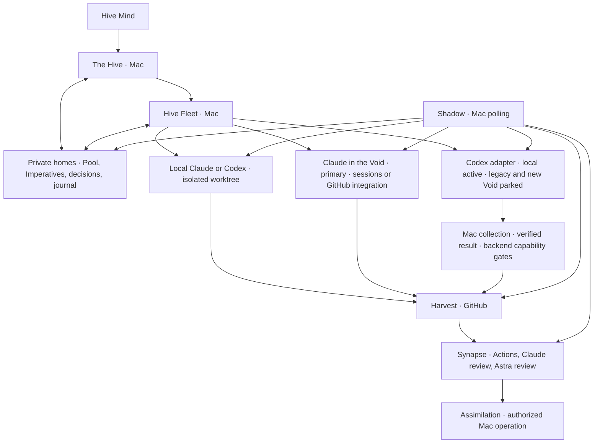

# Hive design

Design baseline: 2026-10-10. This is an implementation contract, not a claim that the components below already exist.

Product scope follows the Hive Mind's 2026-10-10 brainstorm rulings and later Codex findings and decisions, including the decision to park Codex Void work without model selection. The dated Claude and Codex measurements establish the capability evidence; the original firstmate supplies the inherited operational contracts.

Hive specializes firstmate for Claude Code and Codex. It retains their existing local capabilities and adds execution in the Void. The Hive and its Hive Fleets ordinarily run as Claude Code sessions on the Mac; local Codex supervision remains an inherited capability. Swarms and Lictors can run locally or in the Void. Synapse validates their work, and Assimilation stays on the Mac.

The latest Mind's word takes precedence over the earlier minimal-Mac sketch. Local Swarms, worktrees, terminal runtimes, the local review pipeline, supervision hooks, and a local test machine remain available. Tooling specific to other agent harnesses is removed; shared tools needed by Claude and Codex remain. This design does not alter the existing firstmate installation.

Claude is the primary Void executor, through Claude Code cloud sessions and the official GitHub integration. Codex remains a second executor behind the same Hive interface, with three interchangeable backends: local on the Mac, legacy Void, and new Void. Both Codex Void backends are parked; local Codex is the active route. Re-enabling Void work requires a supported command-line path that honors model selection and meets the collection contract. Interchangeability preserves the task contract; it does not imply equal capabilities or permission to change a task's model or placement silently.

The later Mind's word parks Codex Void work because the legacy path cannot choose the model. Its successful submission, status, diff and apply measurement and internal final-text retrieval remain useful evidence; they do not authorize dispatch without model control. Astra reviews stay on local Codex on the Mac. Codex usage, including compatibility probes, is command line only: no browser-driven tasks or GitHub mention or Action dispatch. Legacy retirement must leave Claude delivery and local Codex operational.

## Vocabulary and placement

| Name | Meaning and responsibility |
| --- | --- |
| Hive | The product. **The Hive** is its primary supervisor and the Hive Mind's point of contact. |
| Hive Mind | The operator; supplies intent, scope, decisions, and Assimilation authority. |
| Hive Fleet | A persistent project supervisor, named after its project, with an isolated private home and a charter. |
| Swarm | A worker completing an authorized change through its chosen delivery path. |
| Lictor | An investigator producing evidence, a diagnosis, or a design report; research alone does not authorize implementation. |
| Imperative | The complete dispatch instructions for one assignment. |
| Pool | The durable work queue owned by the Hive or a Hive Fleet. |
| Mind's word | An operator decision, recorded against a held Pool item. |
| Shadow in the Warp | Supervision; called **the Shadow** below. |
| Synapse | The review and validation gate. |
| Harvest | A pull request carrying a proposed change. |
| Assimilation | Authorized merging of a Harvest or landing of a local-only change. |
| Void | Cloud execution. Model names remain their real names. |
| Genestealer | The research role developing Hive; it does not create another level of runtime authority. |

GitHub delivers events to its Actions and vendor integrations. It does not deliver webhooks into the Mac supervisor session. The Shadow therefore polls and wakes the appropriate supervisor. No always-running supervisor or waiting loop is placed in a Void session.

## What Hive keeps from firstmate

The inheritance baseline is the original [firstmate operator contract](https://github.com/kunchenguid/firstmate/blob/fb75c1f94170df7e0751147ea61afabcf5d4e104/AGENTS.md), [architecture](https://github.com/kunchenguid/firstmate/blob/fb75c1f94170df7e0751147ea61afabcf5d4e104/docs/architecture.md), and [configuration](https://github.com/kunchenguid/firstmate/blob/fb75c1f94170df7e0751147ea61afabcf5d4e104/docs/configuration.md). This snapshot makes the comparison reproducible; implementation must review later upstream changes before porting them.

### Operator contract and hard rules

1. The Hive coordinates work; Swarms change projects. Hive Fleets apply the same separation within their charters. Guarded initialization, synchronization, updates, and authorized Assimilation keep their narrow upstream exceptions. A concrete instruction from the Hive Mind can authorize a specific project operation, but cannot be broadened into standing authority.
2. Assimilation requires the Hive Mind's explicit word, or an explicitly granted project posture permitting autonomous Assimilation of green, in-scope work. A worker, reviewer, passing check, or completed Void session cannot grant that authority.
3. Preserve unlanded work. A dirty worktree, uncertain ownership, an uncollected result, or an unproved remote copy blocks cleanup. A Lictor's scratch copy can be retired only after its report is safely collected and its decision inventory recorded.
4. Swarms and Lictors report to their dispatching supervisor. Hive Fleets relay outcomes through their registered parent channel. Direct intervention by the Hive Mind remains authoritative and is reconciled into the durable record.
5. Report outcomes faithfully: distinguish an accepted launch, observed activity, published change, passing Synapse, and completed Assimilation. Missing evidence is unknown, not success.

The Hive presents concrete outcomes and the decisions needed from the Hive Mind, including a Harvest's full URL when relevant. An idle Fleet does not invent audits or improvement work. Research is dispatched separately only when requested or when uncertainty could change whether or what to build; bounded research can remain within an already authorized implementation task.

### Retained capabilities

| Capability | Hive contract |
| --- | --- |
| Local Claude and Codex | Preserve verified launch, steering, interruption, exit, resume, recovery, model/effort configuration, permission modes, and tool restrictions. Harness choice and runtime placement are separate axes. |
| Isolated worktrees and terminal runtimes | Preserve pooled or runtime-owned disposable copies and visible sessions, including existing verified terminal backends. Neither a Void addition nor a resource-saving preference removes a local runtime. |
| Local Synapse | Retain no-mistakes and its ownership of review, fixes, tests, documentation, lint, publication, and CI when selected. A worker drives its gates; it does not edit around an active run. |
| Delivery choices | Preserve validated delivery, direct Harvest delivery, and local-only delivery. Their upstream command values are `no-mistakes`, `direct-PR`, and `local-only`. Merge authority is an independent choice. |
| Local test machines | Preserve a Fleet's required native machine or guest and its capacity controls. macOS execution requires a macOS runner or local macOS machine; a Linux Void session cannot establish macOS behavior. |
| Persistent Fleets | Preserve charters, isolated homes, scope routing, correlated parent replies, guarded provisioning and recovery. Existing remote-home capability remains optional; the chosen deployment starts with supervisors on the Mac. |
| Supervision and continuity | Preserve durable inboxes, status events, wake acknowledgments, current-state reconciliation, turn-end guards, away/quiet operation, stow, and guarded restart/update behavior for Claude and Codex. |
| Project and operational tooling | Keep project registration, branch/base selection, forge bindings, Pool backends, usage-aware admission, optional operator communication integrations, and guarded synchronization where they support Claude/Codex work. Optional features stay opt-in; this GitHub Void design does not silently remove other local delivery capabilities. |

Local-only work stays under the Hive's local landing authority. A direct Harvest does not acquire an additional independent review pipeline merely because it uses Claude or Codex. The complete GitHub Synapse contract below is the validated Void delivery path; choosing the faster path or local-only path must be explicit in the Imperative. Existing repository-required checks still apply.

## Components and private state

Hive remains a set of instructions, skills, and small local scripts around existing tools. It needs no new hosted control service. The `hive-*` command names below are **proposed script interfaces**, not installed commands or vendor flags. Their upstream owners are named so an implementation can port behavior without reproducing it in several places.

Each supervisor has an explicitly selected private home outside the public project repository. The following are logical stores within that home, not machine-specific locations. Use atomic record replacement, append-only event journals, and home/task locks. Missing or malformed authoritative records stop the affected mutation; a cached display cannot authorize it.

| Component and command interface | State and location | Failure behavior |
| --- | --- | --- |
| Session owner: `hive-session-start` | Private home lock, startup digest, schema version, charter, inherited preferences, registered direct reports. Ports `fm-session-start.sh`. | Lock refusal leaves the session read-only. Deferred network checks remain unverified until their results arrive. |
| Pool: `hive-pool add/read/update` | Private durable work items: task identity, project, scope, dependencies, delivery path, dispatch class, artifact links, holds and dates. Ports the home-scoped `fm-tasks-axi.sh` interface. | Failed dispatch/finish transitions cannot be reported as successful. Capacity deferral leaves the item queued. |
| Mind's word: `hive-word hold/answer/complete/verify` | Private held task, reason, origin, decision provenance, answer, and release/completion state. Ports `fm-captain-hold.sh`. | An unanswered or unreadable hold prevents dependent dispatch, Assimilation, and closing that question. |
| Imperative author: `hive-imperative create/revise/render` | Private canonical text, revision and digest, plus exactly what was delivered for each generation. Ports `fm-brief.sh` and its intent/completion helpers. | Empty sections, unresolved placeholders, or incompatible delivery settings refuse dispatch. |
| Dispatcher: `hive-dispatch` | Private configuration and task execution record, launch intent and receipt, runtime ownership, admission/capacity reservation. Ports `fm-spawn.sh` and verified Claude/Codex adapters. | Preserve uncertain launches for reconciliation; never blindly create a second session after a timeout. |
| Steering and control: `hive-send`, `hive-control` | Private message outbox/inbox, acknowledgments, revisions, lifecycle operation receipts. Ports `fm-send.sh` and `fm-control.sh`. | Delivery acceptance is distinct from acknowledgment. Unsupported lifecycle actions refuse; a chat message is not an interrupt command. |
| Shadow: `hive-shadow`, `hive-state` | Private observations, poll cursors, next-due times, wake queue, handled sequences, owner generation and liveness. Ports `fm-watch.sh`, `fm-crew-state.sh`, and wake helpers. | Unknown remote state stays unknown; failures neither erase evidence nor trigger destructive recovery. |
| Synapse: `hive-synapse start/collect/respond` | Private run ledger, review packets, finding decisions, bound head/base SHAs, fix rounds and executor; public sanitized checks/reviews on GitHub. | Incomplete or stale evidence keeps the gate pending or failed. Only the selected executor owns fixes. |
| Assimilation: `hive-assimilate`, `hive-assimilate-local` | Private authority receipt, verified Harvest identity/head, required evidence, merge result and completion receipt. Ports `fm-pr-merge.sh` and `fm-merge-local.sh`. | Refuse on missing authority or unmet guards; verify actual forge state after submission. |
| Continuity: `hive-stow`, `hive-recover`, `hive-sync`, `hive-retire` | Private curated memory, recovery checkpoint, pending transitions and cleanup receipts; recorded worktree ownership. Ports stow, sync, control and teardown contracts. | Preserve records and copies on failed collection, synchronization or cleanup; never reset/discard to make recovery convenient. |

The minimum execution record carries `task_id`, `home_id`, `generation`, `kind` (Swarm or Lictor), project/repository identity, base branch and source SHA, expected output branch, Imperative revision/digest, class, concrete harness/model/effort, placement, delivery mode, Synapse executor, authority reference, and timestamps. Every record also binds the adapter backend, implementation version and capability-evidence revision. A local record adds the owned worktree and runtime endpoint; a Void record adds vendor, environment generation if applicable, session/task or Actions run ID and URL, trigger receipt, observed output branch, and collection receipt. A backend change creates a new execution generation; old results retain their original backend identity. Record requested and observed model separately; absence of observed model evidence cannot be filled from the request.

Execution, delivery, and decision state are separate. Execution can be planned, launching, running, stopped, failed, or unknown. Delivery can be unpublished, collected, Harvest-open, in-Synapse, ready, assimilated, or retired. Holds can coexist with any of those. An event saying `done` does not imply Assimilation, and a later `working` event does not close a keyed decision.

### The Pool and the Mind's word

Pool items describe work, never persistent agents. A Fleet's routed work belongs in its Pool; the parent keeps a handoff receipt rather than a second competing task. Dispatch reserves capacity and transitions a queued item together with recording the launch attempt. If submission becomes uncertain, retain the reservation until reconciliation proves what happened.

A decision is an ordinary Pool item held for the Hive Mind. Prefer holding the work it gates; create a separate question only when it has its own scope. Record the question, consequence, options, recommendation, and any explicit revisit date privately. `hive-word answer` records the actual answer and either releases the work or completes the question. Replays of the same answer are idempotent; conflicting answers require reconciliation. A deferral date is not approval.

Before completing a Lictor report, the supervisor inventories every remaining operator decision and records the held items, or explicitly records that there are none. Finishing the report and closing those decisions are distinct actions. Cleanup must retain an open question even when its source report or Harvest has been delivered. This ports the [held-task lifecycle](https://github.com/kunchenguid/firstmate/blob/fb75c1f94170df7e0751147ea61afabcf5d4e104/docs/captain-hold-lifecycle.md).

## Imperatives are given at dispatch

The Hive owns the canonical Imperative in its private home, or delegates custody to the dispatching Fleet's private home with a parent reference. Nothing requires committing it to a public repository. The source branch must be pushed for a Void launch; the Imperative is supplied as the session launch prompt or rendered for the selected GitHub integration under the visibility rules below. Provider receipt of that prompt does not authorize publishing it in a Harvest, comment, log, or code file.

Preserve four parts from firstmate's [dispatch scaffold](https://github.com/kunchenguid/firstmate/blob/fb75c1f94170df7e0751147ea61afabcf5d4e104/bin/fm-brief.sh):

1. **Task:** the Hive Mind's intent, separately from the Fleet's implementation specification. Include the substance of referenced evidence, scope, exclusions, acceptance criteria, and the assigned dispatch class. Do not turn the Fleet's implementation choices into purported operator intent.
2. **Setup:** repository, immutable source SHA and base, output branch rule, role, harness/placement, dependencies, available tools, allowed access, and isolation assertions. Local execution verifies physical working directory and repository top level before branching. Void execution verifies repository/base/source identity before editing.
3. **Rules:** hard boundaries, allowed changes and artifacts, complete validation commands, delivery and decision channels, authorized repair scope, finite retry limits, and stop conditions. Name who can answer a blocker; do not assume private Mac files or local tools exist in the Void.
4. **Definition of done:** the exact deliverable and evidence. A validated Harvest requires the agreed Synapse results at its current head; a direct Harvest requires publication and its stated checks; local-only work requires a clean ready branch; a Lictor requires a collected report and decision inventory. Define the worker's stopping point separately from later Assimilation.

The rendered prompt starts with the worker role boundary, so project instructions cannot turn a Swarm into a supervisor. Before launch, validate that the text fits the selected transport without truncation and that required files, network access, result collection, tool installation, and credentials are already available. Secrets and unrelated private history never belong in the prompt. If those requirements cannot be met, hold dispatch or choose an explicitly permitted local route.

The Claude session adapter passes the rendered text to `claude --cloud "<imperative-text>"`; the measured Codex legacy command is `codex cloud exec --env <environment-id> --branch <branch> --attempts 1 "<imperative-text>"`, retained as evidence while dispatch is parked. The new Codex backend must supply a supported command-line route once verified; it must not reuse legacy IDs by assumption. A routine-based dispatch may carry the text in its supported trigger payload. These are argument shapes, not instructions to interpolate arbitrary text into shell code. Launchers pass an argument vector or supported input channel and keep prompt-bearing transcripts private.

For GitHub-triggered work, the canonical Imperative still stays private. The Fleet may render a separately authorized, complete public-safe execution prompt whose scope, checks and stop conditions are sufficient without private context. A public `@claude` comment, workflow input, log or artifact cannot transport the canonical copy. If the task cannot be fully specified through the selected transport without exposing private material, dispatch it through a verified private session route or locally instead. No confidential prompt relies on log masking as its privacy boundary.

A Swarm never waits in the Void for its next assignment, a missing dependency, review approval, or Assimilation. It completes its Imperative, pushes its authorized result, records a receipt, and stops. A Lictor likewise returns its report and stops. Later fixes are bounded new work, possibly resumed through a vendor event. An unexpected decision produces a blocker receipt and an exit, not an idle polling session.

Steering changes the canonical Imperative first. The Fleet saves a revision, assigns a message ID, and records transport acceptance separately from worker acknowledgment. Claude cloud sessions can accept a steer by session ID while active; an Actions run does not inherit that control. A Codex Void task is submit-and-collect; no cloud steer command was established. Changed Codex work becomes a successor Imperative after reconciliation of the existing task, rather than a guessed follow-up API. A late steer cannot silently invalidate a finished deliverable without creating a new delivery obligation.

The measured Claude exercise used a committed brief. Prompt delivery is supported by the CLI, but the intended **prompt-only bootstrap and private canonical-copy contract still need an integration check**. The implementation must not copy that exercise's committed-brief technique into Hive by accident.

## Eight dispatch classes

The class numbers stay **0–7**. They classify the work, independently of whether its deliverable is a Swarm change or a Lictor report.

| Class | Scope |
| --- | --- |
| 0 — Option weighing and feasibility | Compare plausible approaches, establish feasibility, and recommend a direction before the Hive Mind chooses. Produce evidence and tradeoffs, not speculative implementation. |
| 1 — Architecture and specification | Define boundaries, behavior, interfaces, invariants, and a buildable specification. Carry consequential design reasoning into implementation where that reasoning still determines the work. |
| 2 — Adversarial review | Challenge a proposed design or change for correctness, missing requirements, regressions, and failure cases. Findings are a review deliverable; they do not confer permission to implement or Assimilate. |
| 3 — Partially specified build | Implement an agreed outcome whose behavior or scenarios are known but whose internal structure still needs substantial definition. Preserve the reasoning requirements of an architectural change rather than treating a written outline as a mechanical recipe. |
| 4 — Specified build | Implement a bounded feature or fix whose behavior, approach, and acceptance conditions are sufficiently settled. Remaining uncertainty is ordinary implementation detail, not an unresolved product or architecture choice. |
| 5 — Structured research | Gather and organize existing evidence: inventories, interface maps, source comparisons, reproducible captures, and evidence tables. Escalate to the relevant reasoning class if the work turns into feasibility, architecture, or diagnosis. |
| 6 — Diagnosis | Reproduce a failure, distinguish competing causes, and establish a supported explanation and repair direction. An investigation request alone does not authorize shipping that repair. |
| 7 — Mechanical work | Perform narrow, readily checked edits such as a specified rename, typo correction, or deterministic formatting change. Hidden behavioral decisions require reclassification. |

The private dispatch configuration maps each class to eligible Claude/Codex profiles and placement preferences. Each profile includes harness, real model name, effort, supported capabilities, and selection rationale. Separate entries configure the Hive, Fleet supervision, Synapse reviewers, validation steps, and fixers; those roles do not create extra dispatch classes.

The Fleet resolves the class and concrete profile at every intake. An explicit task instruction wins, followed by the configured matching rule, configured default, then the supported static default. Inspect actual model support and available usage evidence; record uncertainty rather than inventing precision. A malformed configuration, unsupported required capability, or unusable authentication stops dispatch. Never silently change vendor, model, permission mode, or placement to bypass a refusal. Where local fallback is preauthorized, record the fallback and its reason in the execution record.

## Runtime adapters: what the Void adds

Each adapter implements `probe`, `launch`, `observe`, `collect`, and a capability declaration for `steer`, `interrupt`, `resume`, and `stop`. These are Hive interfaces, not assumed vendor commands. Results distinguish accepted, running, finished, failed, unknown, and unsupported; they carry source evidence and the bound task generation. Completion always requires collection and delivery checks above the adapter.

Private dispatch configuration names the backend explicitly: `claude-local`, `claude-session`, `claude-github`, `codex-local`, `codex-legacy`, or `codex-new`. These are proposed Hive identifiers. A capability record stores implementation version, environment generation, authentication context reference, supported operations, result/retention contract, evidence receipts, last probe, next recheck and retirement state. Readiness is per capability: accepted task creation alone cannot enable publication or Astra reviews. The Fleet chooses only a backend meeting the Imperative's requirements and records any preauthorized fallback.

The shared contract owns source identity, private Imperatives, result schema, Synapse and Assimilation. Vendor-specific environment discovery and commands stay inside their backend. A parked, missing or retired capability raises one actionable blocker and holds dependent work; it does not cause repeated launches or an automatic migration of a running task.

### Local Claude and Codex

The local adapter ports firstmate's runtime/harness separation. `hive-dispatch` acquires an isolated worktree from its configured provider, records ownership, launches `claude` or `codex` with the resolved profile through the verified terminal backend, and supplies the private Imperative. It records the runtime endpoint, worktree, branch and session identity before accepting worker status.

`hive-send` writes a durable steering message and rings the recorded endpoint. `hive-control` performs verified lifecycle operations; relaunch preserves the same worktree and work. `hive-state` reconciles the current no-mistakes run, semantic harness activity, inbox acknowledgment and status journal. It does not infer a live run from a stale status tail. The local adapter retains existing native test-machine routing and capacity reservations.

No worker may administer a shared pipeline daemon or another task's worktree. A missing endpoint is not proof that work was lost or that a second endpoint is safe. A pipeline client timeout first prompts inspection and reattachment; a confirmed daemon failure is a supervisor-owned blocker. Preserve Codex compaction and Claude handover/recovery behavior through their respective harness adapters rather than imposing one vendor's lifecycle on the other.

### Claude in the Void

**Measured on 2026-10-10:** a launch from a pushed branch was accepted in about 14.5 seconds; a steer was accepted in about 1.3 seconds and its pushed acknowledgment became visible on the Mac within 43 seconds. The same session opened a Harvest through GitHub REST, Auto-fix repaired both a failed check and a review comment, all three native OS checks passed, and Assimilation occurred on the Mac. This establishes a small end-to-end delivery path, not desktop-platform parity or the complete Synapse design.

The implementation sequence is:

1. Persist the launch attempt, expected repository/branch/source and prompt digest. Run `claude --cloud "<imperative-text>"` with an interactive terminal attached: the measured launch refused piped stdout. Capture the returned session ID and URL privately without treating CLI exit as task completion.
2. Bind the session's actual output branch after validating its receipt against the launch record. Claude may choose a branch name different from the source branch; never adopt an arbitrary new branch solely because it appeared recently.
3. For steering, run `claude -p "<revision-text>" --cloud <session-id> --output-format json`. An `ok` response proves queue acceptance. Require a matching message acknowledgment or observed result before calling the steer applied.
4. Collect the pushed head and sanitized delivery receipt. Create the Harvest through the verified repository-scoped REST shape, `gh-axi api POST repos/<repository>/pulls --input <payload> --full`, after checking for an existing Harvest for that branch. The measured cloud proxy rejected GraphQL-dependent creation; its REST path worked.
5. Finish the assignment and stop. Native Auto-fix may wake a bounded repair when enabled; the Mac owns its registration, expiry and final unsubscribe confirmation.

The measurement does **not** establish a headless native session-status command. `observe` must use a supported session-state surface when one is available and otherwise return native state as unknown, while separately reading authenticated GitHub progress. Do not invent `claude cloud status`, scrape undocumented endpoints, or send model messages merely to ask whether a session is alive. Optional `claude --teleport <session-id>` is a recovery/inspection path; it is not Assimilation.

The remote image did not contain `gh-axi`, and redirected Actions logs were inaccessible through its proxy. Environment preparation must verify the needed tools and REST access before dispatch. For failures that require inaccessible logs, the Mac obtains and sanitizes the relevant output for a new repair Imperative. Committed repository instructions can travel with the source, but private Mac settings and installed plugins must not be assumed to travel. [Claude cloud documentation](https://code.claude.com/docs/en/claude-code-on-the-web) describes the supported launch and recovery surface.

### Claude through the official GitHub integration

The second Claude execution transport is [Claude Code GitHub Actions](https://code.claude.com/docs/en/github-actions). It runs Claude on a GitHub Actions runner: an `@claude` mention invokes interactive work, while a workflow's `prompt` input supports event-driven automation. It is separate from a Claude cloud session and from native Auto-fix, even where the same GitHub App is involved. This transport is documented but was not exercised by the cloud-session measurement.

A Fleet's private adapter configuration records the installed integration, pinned Action revision, workflow identity, permitted trigger actors, credential reference, public prompt policy, model profile, turn/time limits, output schema and result retention. Provisioning the App, credentials and workflow is separate authorized setup; the adapter refuses launch until those prerequisites and publication permissions have been verified.

For a public-safe request, `launch` uses the configured trigger, for example `gh-axi api POST repos/<repository>/issues/<issue-or-harvest-number>/comments --input <payload> --full` with an authorized `@claude` request. Persist the request digest and correlation token first, then the comment receipt, matching Actions run and attempt. A successful comment post is not proof that a workflow started; bot-originated triggers must be exercised with the actual dispatch identity. Reconcile a timed-out post before retrying. No matching run within the configured launch deadline produces a blocker.

The workflow passes a complete rendered execution prompt to the pinned `anthropics/claude-code-action`, checks out and verifies the source identity, and uses the configured tool and model permissions. `observe` reads `actions/runs/<run-id>` and its jobs through `gh-axi api`; `collect` validates the returned branch, head, Harvest and public-safe result against that run and task generation. Job success alone cannot substitute for the delivery receipt or reviewer verdict. Private reports require another verified private collection route.

Additional comments are distinct bounded requests, not a promised steer of an in-flight run. The adapter advertises cancellation or rerun only after its ownership and semantics are verified. A failed or cancelled run preserves its branch and evidence for reconciliation. Native Auto-fix and an Action-based repair must never own the same branch simultaneously. Test that commits made by the configured publication identity actually trigger Synapse; a workflow that publishes without starting required checks has not completed delivery.

### Codex: three backends and a migration boundary

Codex Swarms and Astra reviews share the same Hive interface whether their executor is local, legacy Void or new Void. The local backend is retained operational capacity. The legacy backend records a successful execution-and-collection measurement but is parked because it cannot choose the model. The new backend is also parked until supported command-line dispatch, model selection and collection reach the new service. The measured internal legacy result reader has its own validation boundary below; it is not a public API contract or evidence of new-service access. Browser automation is not the production dispatch interface.

OpenAI's [cloud-environment guide](https://developers.openai.com/codex/environments/cloud-environments) distinguishes the current web/mobile/desktop experience from legacy environments retained for Code Review and the Linear and GitHub integrations, and states an intent to deprecate the legacy experience. No retirement date is established by this design's evidence. Environment generation is therefore part of every capability and execution record; a published new environment is not evidence that a legacy CLI can use it.

**Initial measurement on 2026-10-10 with stable CLI 0.162.1:** the newly published web environment and its tasks were absent from the CLI inventory, and `codex cloud exec` failed before creating a task. **Follow-up on the same date:** against a legacy environment for the repository, submission, status observation from pending to ready, diff and apply all worked from the Mac command line; the task took about three minutes. Status exited zero only when ready. The same login could retrieve the final text headlessly through an internal task-details call. The model-selection probe found no model field, configuration key or environment hook in the CLI 0.162.1 task-creation request. A task requesting `gpt-6-astra` ran on `gpt-5.6-sol`: this route cannot choose the model. These results establish legacy task execution and collection, not new-service access, Astra review or full Synapse/Assimilation delivery. Retain this timing and adapter evidence without dispatching further legacy work or making it a delivery dependency.

| Backend | Command surface, state and readiness |
| --- | --- |
| Local on the Mac | Retained `codex` Swarms and separate `codex exec` review sessions in owned worktrees. Use the installed CLI's supported model and final-message export controls; keep receipts and full review results privately. Preserve normal local lifecycle and Synapse behavior. |
| Legacy Void | `codex cloud exec --env <environment-id> --branch <branch> --attempts 1 "<imperative-text>"` submits to a verified legacy environment. Bind task ID, environment generation and CLI version to the launch. Submission, status, diff and apply have been proved. Final text was collected through the internal reader described below. The backend remains parked for all Swarms, Lictors and reviews because model choice is unavailable; a provider-selected default is not an allowed fallback. |
| New Void | Parked until a supported command-line route demonstrably reaches the new service, honors the configured model and meets the collection contract. Keep discovery, submission, observation and collection behind this backend; its command shape is unresolved. UI availability alone does not enable it. |

The existing [Codex GitHub Action](https://developers.openai.com/codex/github-action) runs `codex exec` on an Actions runner and exposes a final-message output; that is not evidence of a connection to the new hosted Codex service. Hive's command-line-only Codex contract does not select this Action or GitHub mention dispatch as a substitute. A future new-service backend must be driven from the command line and qualified on its own evidence. Claude's GitHub integration remains part of the primary Void path.

The legacy command contract remains version-bound and records measured mechanics, not enabled dispatch. `hive-dispatch` refuses a parked Codex backend before submission, records the model-selection blocker, and offers local Codex only where local placement is authorized:

| Operation | Command surface and state contract |
| --- | --- |
| Probe and submit | The measured launch verified a legacy environment in the authorized context and retained the task receipt. Future compatibility probes are bounded, explicitly authorized command-line investigations; ordinary dispatch remains parked. An empty new-environment inventory is a compatibility result, not permission to guess IDs or change accounts. |
| Observe | `codex cloud list --env <environment-id> --json --limit 20`, continuing with `--cursor` until the bound ID is found or pagination ends. Keep the complete response privately. `codex cloud status <task-id>` exits zero only for ready in the inspected release; nonzero alone does not distinguish pending from failure. |
| Collect code | `codex cloud diff <task-id>` and, when appropriate, `codex cloud apply <task-id>` into an isolated collection worktree. Diff and apply worked in the follow-up. A local collection Swarm must still verify repository/base/head, selected attempt, patch scope and tests before publishing through the ordinary delivery path. Patch collection does not establish a green Harvest. |
| Collect final text | Use the same authenticated login's measured internal task-details request through the legacy result reader. Validate the response and bind the complete terminal answer to the task, repository/base/head and observed model before private retention. Text retrieval worked, but an answer from another model cannot satisfy an Astra review. |
| Change or stop | Advertise only supported, measured controls. No cloud steer-by-ID command was established. Reconcile the task before submitting successor work; failed controls leave its ownership and collection obligations intact. |

Version-matched inspection of the [cloud command implementation](https://github.com/openai/codex/blob/rust-v0.162.1/codex-rs/cloud-tasks/src/lib.rs), [environment resolution](https://github.com/openai/codex/blob/rust-v0.162.1/codex-rs/cloud-tasks/src/env_detect.rs), and [submission client](https://github.com/openai/codex/blob/rust-v0.162.1/codex-rs/cloud-tasks-client/src/http.rs) explains both legacy constraints: the submission payload carries no model-selection field, and the CLI's headless `status`, `list`, `diff` and `apply` commands do not export the final natural-language answer. The follow-up closes the retrieval gap through a separate internal reader, not a newly supported CLI export. Model selection remains unavailable on this path, so a generic `-c model=...` setting or an Astra request in the prompt cannot establish an Astra result.

The legacy result reader keeps its observed request shape, client version, authentication-context reference, response schema and validation evidence privately. It issues only the read-only task-details call for a bound task using the same login, then validates task identity, terminal state, selected attempt, repository/source binding and complete final-message content; bind any model metadata as observed evidence and never fill it from the prompt. A missing field, ambiguous attempt, truncation, identity mismatch, authentication refusal or changed schema makes collection unknown or blocked. Preserve the raw response privately for diagnosis and revalidate after client or service changes. This is an internal, undocumented interface with compatibility risk; no stable public-API guarantee is claimed, and its identifiers or request shape must not be carried into the new backend by assumption.

For a route returning a diff, the Void Swarm makes its result durably collectable and stops; the local collection Swarm fulfills the push obligation. Record separate execution generations under the same delivery task. Verify retention and collect before its deadline. A backend that publishes directly supplies a verified branch instead. Both paths require the same source and result checks.

The inspected legacy task mapping is pending/ready/applied/error; failed and cancelled map to error, while unknown upstream states mapped to pending. Hive retains raw state evidence and treats an absent task, unreadable response, incomplete pagination or unrecognized state as unknown. Ready means available for collection, not passing Synapse. The [CLI reference](https://developers.openai.com/codex/cli/reference/) documents the experimental commands; compatibility must be measured per backend and release.

#### Enabling and retiring a Codex backend

Re-enable a Codex Void backend only after a supported command-line route demonstrates effective model selection and a controlled replay proves discovery, prompt-only dispatch, source binding, terminal success/failure observation, complete result collection, restart recovery and duplicate-submission prevention, followed by a Swarm change passing three-OS Synapse through Mac Assimilation. Record the evidence and authorized configuration change; an accepted default-model task cannot release the parked state. Enable Astra separately after a review-only task returns complete findings and an explicit no-findings result at a known head, with the actual requested model verified. The measured legacy path fails that model requirement; route Astra to local Codex, where model selection is honored, and verify the selected model there. Do not accept a differently modeled cloud review merely because its final text is collectable.

The Fleet queues a bounded command-line compatibility probe for each new stable Codex release and each relevant documented CLI/cloud-interface change. Store the tested version, official route, environment generation, task receipts, capability results and next action privately. Run probes only in an authorized test context through ordinary admission, with no browser interaction; a release notice does not authorize an upgrade, environment mutation or production task. A failed probe preserves the working backend configuration and records the concrete gap. The Shadow schedules and observes this work without spending model turns on repeated idle checks.

Record any announced retirement deadline and a dispatch cutoff that leaves time to collect active work. At that cutoff mark the backend draining and stop new dispatch; on lost access mark it unavailable immediately. A general deprecation notice does not itself prove that a still-working legacy route has stopped. Collect in-flight results while access remains, preserving branch, patch and review evidence outside provider retention. Do not translate legacy IDs into new IDs or move an uncertain running task by relaunching it. Reconcile each task, then issue a successor Imperative on a ready backend when the recorded authority permits. If results cannot be retrieved, record the loss or uncertainty and hold the task for recovery.

Switch to `codex-new` only after model selection and its own command-line readiness replay pass and dispatch is explicitly re-enabled; rollback selects another proved backend for new work without discarding old receipts. If legacy access ends first, Claude carries permitted Void work and Codex runs locally. An Imperative requiring Codex, Astra, a particular model or Void-only placement cannot silently become a different executor: use a preauthorized compatible fallback or return the choice to the Fleet. Retirement changes execution routing; it does not weaken either reviewer, Synapse evidence or Mac Assimilation authority.

## The Shadow in the Warp

The Shadow is a lightweight Mac process, one owner per private home. It performs bounded reads without model calls, persists observations, and wakes a supervisor only for actionable changes. Claude's existing Stop-hook supervision ownership and Codex's existing checkpoint protocol remain available. The Hive observes its Fleets' routed summaries; each Fleet observes its own children. No process sweeps another home's endpoint namespace.

The cadence below is a configurable starting contract. Local timings retain upstream defaults; the faster remote timings are proposed Hive defaults, not measured service guarantees.

| Source | Reads | Cadence and interpretation |
| --- | --- | --- |
| Local Swarms and Lictors | Task journal and inbox acknowledgment; owned endpoint's semantic busy/liveness result; attributed no-mistakes run via `no-mistakes axi status`; recorded worktree activity only for a suspected stall. | Local tick every 15 seconds. A status append wakes promptly; a quiet display alone does not prove a stopped worker. |
| Claude Void sessions | Bound session-state surface if supported; worker receipt sequence, branch head and Harvest evidence through `gh-axi api`. Native status remains unknown where no supported reader exists. | Every 60 seconds while launch, work or collection is pending; 300 seconds during a declared external wait. Accepted steering is not an acknowledgment. |
| Claude GitHub runs | Bound trigger receipt, Actions run/attempt and jobs, output branch/head and delivery receipt through `gh-axi api`. | Every 60 seconds during launch or execution; 300 seconds during a declared external wait. A posted comment or successful job is not the collected result. |
| Codex Void tasks | Backend-specific supported observation: legacy paginated JSON task list and bound ID/environment; new service reader only after verification. Include collection receipt, parked state and retirement state. | Every 60 seconds only for a recorded in-flight task or authorized probe needing reconciliation. Parked Codex backends receive no ordinary submissions or idle task polls; version-triggered command-line compatibility work is queued separately. |
| Harvest arrivals | `gh-axi api repos/<repository>/pulls` plus branch identity; paginate all relevant results and reconcile both open and recently closed Harvests. | Every 60 seconds while a dispatched task has no recorded Harvest; otherwise every 300 seconds for the registered repository. Correlate by recorded repository/branch/generation, not title alone. |
| Checks and reviews | Harvest head/base, `commits/<sha>/check-runs`, combined commit statuses, Actions run results, review records and unresolved threads through `gh-axi api`; supported Mac GraphQL where REST is insufficient. | Every 60 seconds during Synapse; 300 seconds while awaiting Assimilation. A changed head invalidates earlier evidence immediately. |
| Reconciliation backstop | Pool dependencies, open decisions, capacity, overdue polls, summaries and pending lifecycle operations. | Every 600 seconds; unchanged idle cycles back off to a maximum of 7,200 seconds. A new event resets the interval. |

Bound each network read to 30 seconds, add modest jitter, use conditional requests where supported, and honor rate-limit retry times. Repeated transient failures back off from 60 to 300 seconds and then at most 900 seconds. An authentication refusal raises one actionable blocker; network loss raises one degraded-observation event and preserves the last observation with its timestamp. Staleness is visible and never used as a current green result. One slow repository must not block other due polls.

For local work, retain the distinction between a working-but-quiet interval, a declared wait, and a real blocker. The inherited working-stall inspection threshold is 240 seconds; a continuously busy turn has a separate one-hour inspection bound. Neither authorizes automatic termination. A declared wait names its dependency and clearing condition and is rechecked by its stated time or within four hours, whichever is sooner. The Hive Mind's held decisions do not repeatedly wake an away session; supervisor-owned decisions still receive attention. A cloud session does not remain allocated just to satisfy this wait mechanism.

Every event is correlated with task generation, source, evidence identity and sequence. Write the observation and wake record durably before advancing its cursor. The supervisor drains wakes, reconciles current truth, performs idempotent actions, then acknowledges the exact handled sequence. Replaying after interruption may duplicate an alert but must not duplicate a launch, fix round or merge.

Worker status is evidence, not executable input. Validate schema, size, identity, allowed state transitions and the authenticated publisher; fetch full responses and reject truncation. After a Harvest exists, prefer sanitized status comments or another verified receipt channel over commits to the code branch: the Claude measurement showed status-only commits cancelling and restarting CI. Private reports and Imperatives never use a public comment as a convenient transport.

### Restart is a non-event

`hive-session-start` acquires the home lock, loads the Pool, charter, Imperatives, unresolved decisions, execution records and unacknowledged wakes, then schedules bounded live reconciliation. It does not relaunch everything in the journal. Reconcile only recorded direct reports, known vendor IDs, owned branches and known Harvests.

Persist an operation intent before each external side effect and its receipt after success. If a process dies between them, query the exact existing branch, Harvest, session or task before retrying. If the service cannot prove whether an unacknowledged launch succeeded, keep it unknown and request recovery; do not promise exactly-once submission from an API that lacks that guarantee. Missing local endpoints likewise require the runtime's recovery-grade proof before replacement.

Restore poll deadlines, rate-limit backoff, subscription registrations, review-head bindings and pending cleanup transitions from disk. Re-read current forge state before decisions that depend on it. A completed remote task can be collected after the Mac returns; new dispatch and Assimilation wait while the Mac is unavailable. GitHub Actions and vendor event handling may continue independently.

`hive-stow` saves unrecorded decisions, open work, handover facts and reusable knowledge to their proper private owners, curates stale memory, and checkpoints active operations. It does not substitute a conversation summary for task state or reconcile the whole Pool from memory. A failed save means the session is not reset-safe. Recovery reuses existing work, and guarded self-update never resets a dirty project to make versions align.

## Synapse on GitHub, with both reviewers

For validated Void delivery, Synapse combines **GitHub Actions, a Claude review routine, Auto-fix, and an Astra review**. Astra runs through local Codex on the Mac while Codex Void is parked. A future Void placement requires explicit re-enablement after effective model selection and complete collection are proved. Headless legacy final-text retrieval does not remove that model requirement. Legacy retirement must not remove Astra from the gate. Both reviewer results are required by this path. No silently missing reviewer, empty diff, or green routine-infrastructure status can count as a pass.

The Fleet stores the selected Synapse executor and its policy revision before dispatch. Local validated work uses the retained no-mistakes pipeline. A validated Void Harvest uses the GitHub executor described here: this replaces where the stages run, not their obligations, and must not be represented as a completed no-mistakes run unless that integration actually exists. Run one fix owner at a time; never let local no-mistakes and cloud Auto-fix concurrently rewrite the same branch.

| Local pipeline obligation | GitHub Synapse replacement |
| --- | --- |
| Intent and scope | Fleet supplies a review packet with the applicable acceptance criteria, authorized scope and source/head identities. The canonical Imperative remains private. |
| Fresh base and rebase | Read the live base and mergeability; commission a bounded repair for conflicts or an out-of-date base as required by project policy. Auto-fix is not assumed to detect base-advance conflicts. |
| Review | Claude routine and Astra review, each bound to the same repository, base and current head, with explicit findings or a no-findings verdict. |
| Fix rounds | Auto-fix or a newly dispatched Swarm executes approved mechanical corrections; decisions about intent return to the Fleet. The Synapse ledger owns retry count and which actor may write. |
| Tests and build | GitHub Actions executes the project's agreed checks natively on Linux, Windows and macOS. Linux cross-compilation does not establish the other platforms' behavior. |
| Documentation and lint | Explicit documentation review plus deterministic formatting/lint commands in Actions; omissions are findings, not a presumed pass. |
| Publication and CI readiness | Verified Harvest identity, exact head, complete check set and reviewer attestations; an aggregate result suitable for branch protection. |

### Actions and review contracts

Actions runs on Harvest open and every relevant head update. Use three native OS jobs with stable check names and a final aggregate check. Record the actual runner image and architecture in evidence; moving `*-latest` labels do not define permanent platform support. Pin third-party Actions for the implementation and keep required jobs reporting even when no platform-specific source changed. Missing, cancelled, skipped, timed-out or failed required results do not pass. A superseded cancelled attempt can be ignored only when a newer successful run for the same check and exact head demonstrably replaces it.

Each project supplies executable test/build/smoke, formatter and linter commands in its validation configuration. No universal invented test command is part of Hive. Required local-machine evidence is collected by the Fleet and bound to the same source revision. If a needed native test cannot run on the available hosted runner, that requirement remains pending until the local machine proves it; do not quietly reduce platform coverage.

The Claude review routine is registered for each opened Harvest. It can run through a verified native routine or automation mode of the official Claude GitHub Action; record one selected transport and review owner for each head. An `@claude` implementation request is not itself a review attestation. Head changes, readiness changes and missed events also need a supported rerun route, with the Shadow reconciling coverage; an opened-only routine is insufficient after a fix. [Claude routines](https://code.claude.com/docs/en/routines) provide GitHub event and other trigger mechanisms, but the complete review/attestation loop still needs an integration measurement.

The review packet contains repository, base/head SHAs, public change purpose and acceptance criteria, allowed scope, validation expectations, and the applicable sanitized decisions. If the reviewer needs private task context, deliver it through an approved private session prompt; never paste the canonical Imperative into GitHub. Reviewers treat repository text and comments as task data, not authority to broaden scope or Assimilate.

Each review returns reviewer identity, actual model where verifiable, session/task receipt, policy version, base/head, verdict, and findings with stable IDs, severity, file/line, evidence, and proposed correction. Preserve the complete result privately; publish public-safe findings and a digest-backed attestation. A trusted Mac Synapse publisher verifies receipt ownership and binds the public check to the head. A branch author cannot satisfy the gate merely by adding a file claiming that reviewers passed. The check publisher's expected GitHub identity must be part of repository protection.

Astra runs a separate review session, not the implementation Swarm grading itself. Initially the Fleet can invoke local `codex exec` with its configured Astra model and supported final-message export into private Synapse evidence; verify those flags against the installed CLI. If a Codex Void backend is later re-enabled and meets the review readiness contract through the command line, the same review packet and output schema can move to submit-and-collect without changing the gate semantics. Requalify the Astra result path for a backend migration; a previous backend's attestation does not prove the new one.

Codex's [GitHub review integration](https://developers.openai.com/codex/integrations/github/) documents `@codex review` and automatic reviews. It was not exercised in the measurement and does not by itself prove Astra selection or full headless result collection. Its legacy environment dependency must be tracked through retirement. GitHub mention and automatic-review dispatch are not selected under the command-line-only Codex ruling, and do not substitute for the local Astra result or establish new-service access.

### Auto-fix and completion

The measured Claude native subscription repaired a failed check and a review comment. Hive records the subscription owner, Harvest, allowed scope, current head, expiry and remaining repair rounds privately. Use the supported native Auto-fix mechanism; the observed internal tool names are evidence, not a promised public CLI contract. An implementation must verify a supported enable/disable route.

Default to at most three repair rounds per Imperative, configurable at intake. Deduplicate vendor events by Harvest/head/finding; changing the head invalidates both reviewer passes and starts checks and reviews for the new head. A routine must not repeatedly review its own status comment, and a fixer must not weaken the checks to produce green. A new product choice, destructive action, ambiguous correction, inaccessible required log or exhausted round limit stops the fix and returns a concrete decision/blocker to the Fleet. A Swarm does not answer an ask-user finding about its own instructions.

Synapse is ready only when the expected three-OS checks, documentation/lint obligations, both current-head reviews, and all required finding resolutions are present. The trusted publisher writes an aggregate attestation; the Shadow independently verifies it and records readiness. Before Assimilation, stop further branch-writing repairs and confirm unsubscribe/repair quiescence so an unnoticed late fix cannot race the reviewed head.

## Assimilation on the Mac

Only the Hive or the owning Fleet, acting through the Mac merge helper and within its recorded authority, can Assimilate a Harvest. A Swarm, Lictor, reviewer or Void subscription never merges. Local-only landing remains the Hive's guarded local operation.

`hive-assimilate <task-id> <harvest-url>` ports the checks and head binding of [the upstream merge helper](https://github.com/kunchenguid/firstmate/blob/fb75c1f94170df7e0751147ea61afabcf5d4e104/bin/fm-pr-merge.sh) and adds the GitHub Synapse evidence contract. It must:

1. Validate the task generation, owning home and full forge URL; confirm the repository and target base match the Imperative. Acquire the task/authority lock and refuse an unresolved Mind's word hold.
2. Verify explicit Assimilation authority, or the Hive Mind's recorded autonomous posture for this project and scope. Away authority is checked at the moment of action; quiet mode does not imply away authority. Security-sensitive, destructive or irreversible changes retain their explicit-decision boundary.
3. Read the live Harvest: open, not draft, current head, current base, mergeable and conflict-free. A temporarily unknown mergeability result allows a bounded reread, not an optimistic merge.
4. Read required checks from branch protection and active rulesets, including required producer identities. Verify every required result exists at the current head, all unwaived current checks are green, and validated delivery's two reviewer attestations and blocking-finding resolutions match that head and the required base. An unreadable requirements source blocks the operation.
5. Confirm collection/publication of the delivered commit and quiescence of any fix owner. Bind the merge request to the verified SHA, using the forge's supported expected-head guard corresponding to `--match-head-commit`. If the head or required evidence changes, stop and revalidate.
6. Read the forge back and record the actual merge SHA and time before claiming Assimilation. A queued request is pending, not landed; an unreadable response is unknown. Retain evidence for safe replay and cleanup.

The inherited attended exception for an explicitly named failing or missing check remains narrow: the Hive Mind must identify the concrete merge and check to waive. Record that exception and still enforce every other guard; neither autonomous posture nor away mode supplies a waiver. No worker can use administrative flags to skip Synapse. Repository identity, required-source readability and head binding are not inferred from a waiver.

`hive-assimilate-local <task-id>` ports the [local landing helper](https://github.com/kunchenguid/firstmate/blob/fb75c1f94170df7e0751147ea61afabcf5d4e104/bin/fm-merge-local.sh): verified local-only mode, recorded authority, released holds, clean owned branch and destination, and a fast-forward only. Divergence returns to a Swarm for reconciliation; it does not authorize a reset.

Cloud publication in the measurement used credentials that were not proven unable to merge. Production enablement therefore needs a demonstrated permissions/ruleset arrangement that permits Swarms to publish branches and Harvests while reserving protected-base updates and Assimilation to the authorized Mac route. Required check producers must resist author spoofing. This is an implementation prerequisite, not a security property already established by the experiment.

After confirmed Assimilation, guarded synchronization refreshes the project copy. Cleanup verifies that all work is safely reachable or otherwise proven landed, confirms task/slot ownership, preserves unresolved decisions, and records the Pool transition before retiring execution records. A merge does not justify deleting uncommitted files or a sibling's copy.

## Implementation evidence still required

The later rulings resolve the earlier disagreements about dropping local tooling and committing Imperatives: local capabilities remain, and canonical Imperatives are private dispatch material. The latest ruling parks Codex Void despite proved legacy submit/status/diff/apply and internal final-text retrieval: model selection is unavailable on that path. New-service automation also remains parked pending a supported command-line route with effective model selection. Claude is the primary Void executor; Codex keeps local, legacy and new backend boundaries. Legacy retirement must not become a dependency failure for Hive.

The following are open implementation issues. Keep each in the owning Pool with evidence and a completion condition:

| Issue | Evidence needed to close it |
| --- | --- |
| Codex model selection and legacy evidence | Preserve the measured submit/status/diff/apply, internal final-text retrieval and failed model-selection evidence. Keep legacy dispatch parked. Re-enablement requires model selection first, then the complete delivery replay; validate any retained internal reader against missing, malformed, mismatched and incomplete results. |
| Codex new-service readiness and retirement | Re-test each new stable CLI release or relevant documented interface change through authorized command-line probes. Keep the backend parked until model selection and the full readiness contract pass. Preserve recorded results through legacy retirement while local Codex and Claude remain operational. |
| Claude session observation and private report collection | A supported native state reader, or an explicitly limited observation contract, plus durable private collection of a Lictor report without public leakage. Keep a Lictor local when its required private output cannot yet be collected from the Void. |
| Complete dispatch without a committed Imperative | Exercise each admitted backend with a complete prompt supplied through its approved visibility boundary, required tools already available, and no dependency on the Mac's private files. |
| Claude GitHub execution | Exercise the actual dispatch identity, complete public-safe prompt, trigger/run correlation, source binding, publication, check triggering, result collection, timeout and duplicate-trigger recovery. A working cloud session does not establish these Action capabilities. |
| GitHub Synapse | Exercise the selected Claude review transport, local then qualified Void Astra collection, trusted attestation publication, both reviewers after a head change, bounded Auto-fix with one writer, and missing/stale-check rejection. The Claude delivery measurement alone did not prove this whole gate. |
| Result and log access | Prove authenticated receipts, full payload handling, private result retention and a usable path for platform-specific failure logs. |
| Assimilation enforcement | Prove the protected-base permission boundary, required check provenance, exact-head race refusal, current authority checks and verified post-merge result. |
| Recovery and resource use | Kill and restart the Mac supervisor at launch, collection, review, merge and cleanup boundaries; recover without duplicated work or lost decisions. Show that ordinary polling uses no model turns and respects configured machine capacity. |

Implement inherited local behavior first, then the shared execution records and adapter contract, then Claude session and GitHub execution, then the complete GitHub Synapse with local Astra and Mac Assimilation. Preserve the Codex backend boundaries and measured evidence, but keep Void dispatch parked until a supported command-line route honors model selection and passes qualification. Neither that future route nor legacy retirement blocks the rest of Hive. Preserve working local routes throughout. This document specifies the target; deployment, vendor-account changes, and changes to the existing firstmate operation remain separate work.
