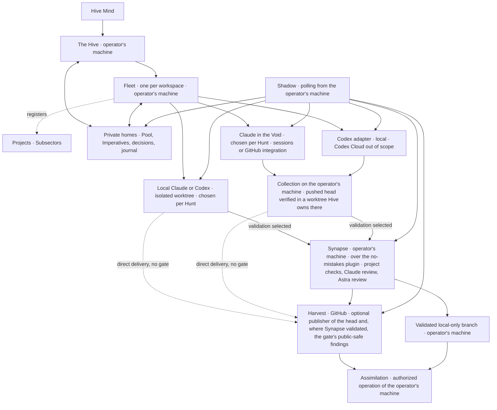

# Hive design

Design baseline: 2026-10-10. This is an implementation contract, not a claim that the components below already exist.

Product scope follows the Hive Mind's 2026-10-10 brainstorm rulings and later Codex findings and decisions, including the decision that keeps Codex Cloud out of Hive's scope until it can be used the way a Claude cloud session is, starting with the choice of model, and the 2026-10-11 ruling that Synapse is local-first: its checks and both its reviewers run on the operator's machine, GitHub is one optional publisher of its results and never the gate, and where a Hunt runs, on the operator's machine or in the Void, is a choice made for that Hunt; and the ruling later that day on the shape of the gate's stage: Synapse runs over no-mistakes on the operator's machine as a long-lived plugin point, which makes six dependencies, and the native local gate is deferred until after the pilot, in which Hive supervises its own stages 6 and 7; and the operator's later decisions on the platforms, among them that Hive holds its agents' terminals in its own terminal host, which takes tmux out of the six and leaves five, and that Hive's screens are its own app; and the operator's answers on the review of what Hive will be: where Hive keeps its records, the gate's hybrid on evidence, what Quit does, how the Hive Mind reaches an agent, the setup check, notifications and reviews in the app, a project's systems, how Hive tests, and a playbook for each dispatch class; and the operator's answers on that review's final open points: the five questions asked at a project's creation and the roadmap drafted from them, the dispatch matrix as one record of the home, the readiness receipt on the operator's machine as the only guard of the base branch, and the technical rulings on what the design had left silent. The dated Claude and Codex measurements establish the capability evidence; the original firstmate supplies the inherited operational contracts.

Hive specializes firstmate for Claude Code and Codex. It retains their local execution and supervision contracts, owns the workflow natively, and adds execution in the Void. The Hive and its Fleets ordinarily run as Claude Code sessions on the operator's machine, natively on macOS, Windows or Linux and never through WSL2 or another compatibility layer, as [Platforms](#platforms-native-on-macos-windows-and-linux) states; local Codex supervision remains an inherited capability. Swarms and Lictors run on the operator's machine or in the Void, and which it is for a Hunt is a choice made for that Hunt: on the operator's machine or in a Claude cloud session; Codex Cloud is out of Hive's scope, as the paragraphs below state. A Prey that needs one worker is a single Hunt, so a choice made for a Hunt is made for it. Hive is the proof of concept of that hybrid, and the difference from the inherited workflow, which runs everything locally, is exactly where a Hunt may run. A Hunt lands through its own validation, as its Imperative's delivery records it: where the Imperative selects Synapse validation, Synapse validates the result on the operator's machine, whichever place built it, in a run of that Hunt's own; a direct Harvest goes to publication and its stated checks with no Synapse run; and Assimilation stays on the operator's machine. Hive keeps no secret of its own; the one statement of that contract is [Secrets: Hive keeps none](#secrets-hive-keeps-none), and every other section refers to it.

The approved tooling ruling, as amended on 2026-10-11 and by the operator's later decision on the terminal, narrows the inherited implementation to one repository and five core dependencies: Git, gh, Claude Code, Codex CLI and no-mistakes, the last as the long-lived plugin point behind Synapse. tmux, which the ruling named, has no native Windows build and is not among them: every interactive session runs in Hive's own [terminal host](#the-terminal-host). Local Swarms, owned worktrees and supervision remain; Hive builds its own workflow, the Synapse contract over that plugin and its review surface, and a native local gate is a later stage after the pilot. Project-specific test environments stay with their projects. The plugin point and the optional browser exception are defined in [Tooling](#tooling). This design does not alter the existing firstmate installation.

Claude is the primary Void executor, through Claude Code cloud sessions and the official GitHub integration. Codex remains a second executor behind the same Hive interface, on the operator's machine. Codex Cloud is out of Hive's scope, not merely parked: no stage builds a Codex Cloud backend, and Codex Cloud returns to scope only when it can be used the way a Claude cloud session is, starting with the choice of model, through a supported command-line path that honors model selection and meets the collection contract. The measured legacy and new Void backends are kept below as the record of that boundary. Interchangeability preserves the task contract; it does not imply equal capabilities or permission to change a task's model or placement silently.

The later Mind's word keeps Codex Cloud work out of scope because the legacy path cannot choose the model. Its successful submission, status, diff and apply measurement and internal final-text retrieval remain useful evidence; they do not authorize dispatch without model control. Astra reviews stay on local Codex on the operator's machine. Codex usage, including compatibility probes, is command line only: no browser-driven tasks or GitHub mention or Action dispatch. Legacy retirement must leave Claude delivery and local Codex operational.

## Vocabulary and placement

| Name | Meaning and responsibility |
| --- | --- |
| Hive | The product. **The Hive** is its primary supervisor and the Hive Mind's point of contact. |
| Hive Mind | The operator; supplies intent, scope, decisions, and Assimilation authority. |
| Fleet | A persistent workspace supervisor, named after its workspace, with one isolated private home, one Pool and a charter registering the projects it supervises. |
| Expanse | The Hive-wide view across every workspace: a projection, not another supervisor or queue. |
| Sector | A workspace as the UI names it: one Fleet with its private home and Pool, and the projects registered under it. |
| Subsector | A project as the UI names it: one registration under a Sector, keeping its own repository and clone, validation, publication and authority references. |
| Swarm | A worker completing an authorized change through its chosen delivery path. |
| Lictor | An investigator producing evidence, a diagnosis, or a design report; research alone does not authorize implementation. |
| Imperative | The complete dispatch instructions for one assignment. |
| Pool | The durable work queue owned by the Hive or a Fleet. |
| Wave | The fourth level of the work hierarchy: an ordered group of Targets with an outcome on a project's roadmap. It is recorded as grouping data on each of its Targets, its slug, title and ordinal, and has no worker, no Pool item of its own, no owner and no state of its own. |
| Target | One outcome on a project's roadmap, in the Hive Mind's words, with the Targets it depends on and any act of the Hive Mind beside it. A Target has no hunter, no Imperative, no generation and no place. It consists of Prey, which its define step draws, and it is complete when every one of its Prey has landed, and by nothing else. |
| Prey | One deliverable of a Target, drawn by the define step with a title and an explanation, deliverable on its own and taken beside its siblings where possible. It is taken by one or more Hunts: a Prey that needs one hunter is a single Hunt, and one that needs several holds Hunts named a, b, c under it and lands when every Hunt has landed. A follow-up, a residue fix, a relaunch or a Lictor dispatched from its filed record is a Prey that belongs to no Target. |
| Hunt | One hunter's engagement with one Prey in one place, named a, b, c under the Prey, sized to one build group and, where its validation is Synapse, one Synapse run, and returning a Harvest where one is selected. A Hunt is one Pool item with one Imperative, one place and one generation at a time. It is the only level of the hierarchy that has a worker. |
| Spawning Pool | The Hive-owned set of isolated worktrees and their leases, from which a local Swarm or Lictor is given its working copy. It holds working copies, never the Pool's items: it is neither the Pool nor a part of it, and its name is always written in full. |
| Mind's word | An operator decision, recorded against a held Pool item. |
| Shadow | Supervision, durable observation and wake ownership. |
| Synapse | The review and validation gate. It runs on the operator's machine for every delivery that selects validation, whichever place built the head, over no-mistakes as a long-lived plugin point; GitHub is at most a publisher of its results. |
| Harvest | A pull request carrying a proposed change. |
| Assimilation | Authorized merging of a Harvest or landing of a local-only change. |
| Void | Cloud execution: a place a Hunt may run, chosen for that Hunt. Model names remain their real names. |
| Genestealer | The research role developing Hive; it does not create another level of runtime authority. |
| Spoor | The durable reference to one secret, never the value; defined under [Secrets](#secrets-hive-keeps-none). |
| Tendril | The one small audited launcher that resolves a Spoor into the one command that needs it; defined under [Secrets](#secrets-hive-keeps-none). |

Expanse, Sector and Subsector name scope in the UI. They add no runtime authority level, and labels use them alone, without a Workspace or Project prefix. Workspace, Fleet home, project and clone are separate identities even when a deployment starts with one of each.

The work hierarchy is the Hive, a Fleet, a project, then a Wave, a Target, a Prey and a Hunt, with Hunts under a Prey where it needs them. A Fleet occupies a Sector and sends its hunters into its Subsectors; the Swarm is the agents, and Waves, Targets, Prey and Hunts are what the Swarm acts on, never part of it. A Fleet supervises the projects of its workspace; a project's roadmap holds its Targets in Waves, and a Wave groups Targets, in order, under one outcome; a Target consists of Prey; a worker takes a Hunt, or a Prey that is a single Hunt. A Hunt is the only level with a worker. The state of a Target, and of a Prey that holds Hunts, is read off the landings beneath it and from nothing else. Every record, view and label uses these names in this order, and a record or view that has no place for one of them is a defect. Each level has its record:

| Level | Record | Shown as |
| --- | --- | --- |
| The Hive | The home record with the Hive's role | The Expanse and the session dock |
| Fleet | The home record with a Fleet's role, and its workspace record | A Sector and its flagship |
| Project | The project record registered under its Fleet's charter | A Subsector |
| Wave | No record of its own: its slug, title and ordinal are grouping data on the Pool item of each of its Targets | The roadmap, which orders its Targets by their Wave; Waves are also the Pool's group headers in roadmap order, and never appear on the map |
| Target | A Pool item of level target in the Pool of the Fleet that owns the project, or in the Hive's Pool for the Hive's own stages; it carries its Wave, the fourth level, as grouping data, the Wave's slug, title and ordinal | The Pool and the task inspector, with its Prey beneath it |
| Prey | A Pool item of level prey, with a parent edge to its Target, or no parent edge when it belongs to no Target | The Pool and the task inspector, with its Hunts beneath it where it holds them |
| Hunt | A Pool item of level hunt, with a parent edge to its Prey; the only item with an Imperative, a place and a generation | The Pool, the task inspector and a task planet with its worker |

Hive uses its own visual identity. Do not use Tyranid, Warhammer or Games Workshop artwork in its interface, documentation or promotional material.

GitHub delivers events to its Actions and vendor integrations. It does not deliver webhooks into the supervisor session on the operator's machine. The Shadow therefore polls and wakes the appropriate supervisor. No always-running supervisor or waiting loop is placed in a Void session.

## What Hive keeps from firstmate

The inheritance baseline is the original [firstmate operator contract](https://github.com/kunchenguid/firstmate/blob/fb75c1f94170df7e0751147ea61afabcf5d4e104/AGENTS.md), [architecture](https://github.com/kunchenguid/firstmate/blob/fb75c1f94170df7e0751147ea61afabcf5d4e104/docs/architecture.md), and [configuration](https://github.com/kunchenguid/firstmate/blob/fb75c1f94170df7e0751147ea61afabcf5d4e104/docs/configuration.md). This snapshot makes the comparison reproducible; implementation must review later upstream changes before porting them.

### Operator contract and hard rules

1. The Hive coordinates work; Swarms change projects. Fleets apply the same separation within their charters. Guarded initialization, synchronization, updates, and authorized Assimilation keep their narrow upstream exceptions. A concrete instruction from the Hive Mind can authorize a specific project operation, but cannot be broadened into standing authority.
2. Assimilation requires the Hive Mind's explicit word, or an explicitly granted project posture permitting autonomous Assimilation of green, in-scope work. The posture is a rule record at the project's scope, recorded only from the Hive Mind's own sentence, and a project that has none waits on the Hive Mind's word, as [Assimilation](#assimilation-on-the-operators-machine) states. A worker, reviewer, passing check, or completed Void session cannot grant that authority.
3. Preserve unlanded work. A dirty worktree, uncertain ownership, an uncollected result, or an unproved remote copy blocks cleanup. A Lictor's scratch copy can be retired only after its report is safely collected and its decision inventory recorded.
4. Swarms and Lictors report to their dispatching supervisor. Fleets relay outcomes through their registered parent channel. Direct intervention by the Hive Mind, who reaches an agent only through its supervisor, remains authoritative and is reconciled into the durable record.
5. Report outcomes faithfully: distinguish an accepted launch, observed activity, published change, passing Synapse, and completed Assimilation. Missing evidence is unknown, not success. A claim names what was examined, and what was not examined is reported as not examined, never as unaffected.

The Hive presents concrete outcomes and the decisions needed from the Hive Mind, including a Harvest's full URL when relevant. An idle Fleet does not invent audits or improvement work. Research is dispatched separately only when requested or when uncertainty could change whether or what to build; bounded research can remain within an already authorized implementation task.

### Retained capabilities

| Capability | Hive contract |
| --- | --- |
| Local Claude and Codex | Preserve verified launch, steering, interruption, exit, resume, recovery, model/effort configuration, permission modes, and tool restrictions. Harness choice and runtime placement are separate axes. |
| Isolated worktrees and terminal host | Preserve disposable copies, durable ownership and visible sessions through the Spawning Pool and Hive's own [terminal host](#the-terminal-host), native on macOS, Windows and Linux. Runtime interfaces remain extensible, but additional terminal installations are not part of the selected profile. |
| Synapse continuity | Synapse runs over no-mistakes on the operator's machine as a long-lived plugin point. A native local gate is a later stage after the pilot and replaces the plugin for a route only when it proves that route's validation and custody contracts. A worker drives the selected executor's gates and does not edit around an active run. |
| Delivery choices | Model placement, validation, publication and Assimilation authority independently. Preserve the upstream `no-mistakes`, `direct-PR` and `local-only` inputs through explicit translation; local-only publication never disables validation by implication. |
| Project-specific proof | Each project supplies its test commands, execution environments and capacity management. Hive collects revision-bound results without owning that infrastructure. A platform's behaviour requires native proof on that platform: a run on one of macOS, Windows and Linux establishes nothing about the other two, and a Linux Void session establishes Linux behaviour only. |
| Persistent Fleets | Preserve charters, isolated homes, scope routing, correlated parent replies, guarded provisioning and recovery. Existing remote-home capability remains optional; the chosen deployment starts with supervisors on the operator's machine. |
| Supervision and continuity | Preserve durable inboxes, status events, wake acknowledgments, current-state reconciliation, turn-end guards, away/quiet operation, stow, and guarded restart/update behavior for Claude and Codex. |
| Project and operational tooling | Keep project registration, branch/base selection, GitHub binding, native Pool, usage-aware admission and guarded synchronization for Claude/Codex work. Preserve validated local-only delivery without introducing unselected forge, communication or queue dependencies. |

Local-only work stays under the Hive's local landing authority. A direct Harvest does not acquire an additional independent review pipeline merely because it uses Claude or Codex. The Synapse contract below is the one validated delivery path, on the operator's machine, for work built on the operator's machine and work built in the Void alike. The Imperative must separately declare validation and publication; a local-only branch still receives its required Synapse checks. A repository's own required checks remain that repository's merge precondition, read at Assimilation; they are not the gate.

### Native workflow, configurable policy and executors

Hive owns admission, definitions, task and decision identity, effective policy, evidence linkage, lifecycle transitions and knowledge projections through the packages in [Tooling](#tooling).
Historical records remain evidence and do not automatically become effective instructions.
The existing firstmate operation stays untouched.

| Boundary | Responsibility |
| --- | --- |
| Native mechanisms | Validate typed records; enforce authority, scope, revision and ownership; make transitions durable and replayable; render one validated Imperative schema; expose missing evidence and pending propagation. |
| Rules and configuration | Model/class/effort, weighted resource comparison, floors/operators, credit authority, Hunt limits/expiry, review escalation, proof scope, memory/context budgets, compaction, delivery posture and workspace ownership. Values and trials carry scope, provenance and expiry. |
| Native presentation | The `ui` package projects scoped Hive records into the Fleet overview, Pool, The Swarm and the on-demand detail, [Scheduled](#scheduled), artifact and decision surfaces, beside the live Hive session. Every decision answer goes through the `word` package's single intake; bounded session input and policy requests go to the `dispatch` interfaces that own them. Display state cannot authorize an action. |
| External execution | Git, gh, Claude Code, Codex CLI and no-mistakes are the five core executors. Project-owned checks, run from the operator's machine in the environment the project supplies, supply execution evidence; no-mistakes is the long-lived plugin point behind Synapse, and the browser stack is selected only for browser tasks. |

An adapter registers its version, scoped capabilities, owner and authentication reference privately and implements only supported operations; the reference is a Spoor under [Secrets](#secrets-hive-keeps-none), never a value.
Requests and receipts bind the owning home and workspace, the project and clone where applicable, task, generation and source revision; the Hive's own projectless operations declare that scope explicitly.
Unsupported operations refuse; an unavailable executor cannot turn a pending obligation into success.

| Executor boundary | Operations and durable receipt | Boundary on failure |
| --- | --- | --- |
| no-mistakes, the Synapse plugin point | Start, observe and respond through its supported CLI; collect run/head evidence and follow branch custody and synchronization. | The active run owns fixes; missing evidence or unknown custody blocks publication/landing. |
| GitHub through gh | Push a branch, publish a Harvest and, where Synapse validation was selected, the gate's public-safe findings, read the repository's own rules and current heads, submit an authorized expected-head merge and verify the result. | Unreadable rules or a changed head blocks publication/Assimilation. The forge supplies no merge authority and no verdict, and no published attestation is required: where Synapse validated, the gate's result is the receipt on the operator's machine, which is the only guard of the base branch. |
| Optional browser proof | Use the selected browser stack for navigation, capture and attachments bound to the task and selected page. | Incomplete capture, wrong page or a lost session leaves proof pending; browser access does not enable Codex Cloud dispatch. |
| Project validation | Run the project's declared checks in its supplied environment and collect revision-bound results and artifacts. | Missing environment or required evidence blocks validation; Hive does not provision or administer project infrastructure implicitly. |

Each native projection declares the source/rule/specification revisions it consumes.
Source changes mark dependent projections stale until refresh and acknowledgment; configured drift checks compare those bindings.
A recorded requirement for a check does not prove that an installation already runs it.

## Tooling

The Hive Mind approved the following five-point tooling strategy on 2026-10-10, superseding the scout's earlier dependency proposal, and amended its second point on 2026-10-11: Synapse runs over no-mistakes on the operator's machine as a long-lived plugin point, which makes six dependencies, and the native local gate is deferred until after the pilot. The operator's later decision that every interactive session runs in Hive's own [terminal host](#the-terminal-host) took tmux out of the second point, which leaves five.
This is the implementation contract; this documentation change imports no source and adds no licence file, installations, upgrades or services.

1. **One repository:** keep Hive in `kesk-git/hive`, with internal `pool`, `spawning-pool`, `dispatch`, `shadow`, `synapse`, `word` and `ui` packages behind stable command-line contracts, each with its own tests and test target.
2. **Five core dependencies:** Git, gh, Claude Code, Codex CLI and no-mistakes. Adapt tasks-axi and Treehouse into Hive; rebuild quota reading, launch/restart, the rule-and-specification store and review presentation natively. no-mistakes is the long-lived plugin point behind Synapse, and a native local gate is deferred until after the pilot; chrome-devtools-axi is optional for browser tasks only. gh-axi is not adopted.
3. **Native workflow and review:** drop OpenSpec and Lavish. Keep verbatim rulings with one rendered rule line, and per-change acceptance criteria in the Imperative and Pool item. Decision cards live in Hive's observability UI and submit through its one decision intake. Project-specific execution environments and test suites belong to each project; unrelated products supply inspiration, not integration contracts.
4. **MIT:** license Hive before any code is taken in, preserve upstream copyright/licence notices, and record every source import and upstream revision.
5. **Order:** licence and contracts, Pool, Spawning Pool, session and metering, gate, review surface within the UI, then end-to-end proof; the native local gate comes after the pilot.

The strategy ruling does not perform its implementation or Assimilate this documentation Harvest.
The licence file was added as its own change before any source import, which it must still precede.
Implementation uses new Hive-owned state and leaves the existing firstmate installation, private homes, worktree pools, status displays and shared no-mistakes configuration untouched.

### Repository and package contracts

The packages are internal ownership and testing boundaries in one repository, not separate services or repositories to create now.
Each exposes versioned requests, structured complete responses, explicit exit/error states and capability declarations through a stable command-line contract.
Cross-package operations carry the home, workspace, applicable project and clone, task, generation, source revision, authority and replay identity required by the operation; private records are never ambient global inputs.
A request or response too large for the platform's per-argument limit travels by file path or standard input, never as one command-line argument, and a record that cannot cross the selected channel whole fails with a named size error and a nonzero exit, never as empty or truncated output that a caller could read as a complete result. Prove, in the integration targets, a record above that limit crossing every cross-package call: it arrives complete, or the caller receives the size error and no partial result. Source: [kunchenguid/firstmate#6830](https://github.com/kunchenguid/firstmate/pull/6830).
The existing `hive-*` interfaces below map into these packages rather than creating a package for every command.

| Package | Owns and exposes | Required package test target |
| --- | --- | --- |
| `pool` | Pool storage, migrations, admission records, Imperatives, accepted specifications, original rules and their projections, including temporary rules with an expiry or lift condition; `hive-pool`, `hive-admit`, `hive-imperative`, `hive-spec`, `hive-rule`, `hive-memory`. | `test-pool`: record round trips, transitions, concurrent writes, migration and recovery, and rule expiry by the clock and lift by receipt. |
| `spawning-pool` | The Spawning Pool: Hive-owned worktrees, their leases and acquire/observe/release receipts; `hive-spawning-pool`. | `test-spawning-pool`: isolation, concurrency, interrupted operations and preservation. |
| `dispatch` | Session launch/control with the [terminal host](#the-terminal-host), Fleet provisioning, effective policy and the dispatch matrix it is resolved from, native quota/context/usage readers, reservations, [schedule records](#scheduled), the Spoor records of [Secrets](#secrets-hive-keeps-none) with their enrolment check, and continuity; `hive-dispatch`, `hive-fleet`, `hive-schedule`, session/control/policy/context helpers. | `test-dispatch`: admission, profile resolution, observation provenance, exact-target recovery, schedule transitions from filing through due, run, hold and retirement, and Spoor enrolment, resolution and refusal against a recorded fake of the store. |
| `shadow` | Bounded observations, due polls, due-time wakes for schedules, dated holds and rule expiries, durable wakes and acknowledgments, and the record of its own cadence; `hive-shadow`, `hive-state`. | `test-shadow`: replay, unknown/stale observations, backoff, wake ownership and one wake per record, schedule revision and due occurrence without a timer process. |
| `synapse` | Validation obligations, review/fix custody, evidence and readiness; `hive-synapse`, guarded Assimilation interfaces. | `test-synapse`: head-bound proof, finding gates, one fixer and landing authority. |
| `word` | The single decision intake, held questions, exact answers and completion receipts over Pool storage; `hive-word`. | `test-word`: complete rounds, authorized answers, deduplication and unresolved holds. |
| `ui` | The Hive UI defined under [`ui`](#ui), in [Hive's own app](#hives-own-app): Fleet overview, Pool and The Swarm; the live Hive session dock and optional Read Hive reader; on-demand task, Harvest, Shadow, History and [Scheduled](#scheduled) views and the [Review](#review) artifact surface; artifact serving from inside the app; decision cards over scoped projections; the one enrolment status surface of [Secrets](#secrets-hive-keeps-none); `hive-ui`. Its **Waiting on you** view, opened from the Mind's word badge, lists the decisions the operator owes, each as a decision card, and, told apart from them, each review awaiting the operator's round. | `test-ui`: projection coverage/freshness, stale/incomplete cards, revision-bound submissions, same-session continuity, durable review rounds, receipt-driven motion, reconnect, reduced motion, context restoration, receipt display, and schedule and temporary-rule lists read from records with incomplete coverage shown. |

These are required future per-package targets, not commands already present in this documentation-only repository.
Each target runs that package's owned tests independently; integration targets separately exercise the command-line contracts between packages.
No package may bypass another package's writer by opening its private store directly.
In particular, `ui` reads scoped projections, sends decision answers to `word`, and submits bounded session input and policy requests to the `dispatch` interfaces that own them; `word` uses `pool` for persistence, and neither UI state nor a cached display grants authority.
Packages may be extracted later behind the same contracts; an extracted package is not merged back into the monorepo.
Build tooling and libraries must be declared per package, and the delivered core must not require a separately installed Node, Python or Go toolchain as a sixth runtime prerequisite.
A platform utility a package runs as a separate process is declared in that package's `platform` list with its reason; the first is macOS's own `security`, run only on macOS and only by the launch primitive of [Secrets](#secrets-hive-keeps-none), whose store adapters reach Windows's and Linux's own stores in process and run no utility for them, and that section says why a platform utility is not a sixth dependency.
No new always-on control service is required beyond the Shadow's bounded observation, the session host of each running interactive session and, when selected, Hive's own app.

### Inventory and disposition

**F** means fork/adapt selected source into Hive, **R** means implement the responsibility natively, and **K** means retain an external executor behind a contract.
The selected core K set is exactly the five dependencies below; the optional browser tools are explicitly separate.
Tools rejected by the ruling are marked **not adopted**, rather than disguised as optional core dependencies.
The scout's platform inventory records where capabilities came from; it is not a bootstrap manifest.
Licence evidence is tied to the inspected package or upstream revision, and unknown distribution notices must be resolved before redistribution.

| Tool | What it provides | Hive component | Origin | Licence evidence | Disposition |
| --- | --- | --- | --- | --- | --- |
| Git | Source identity, worktree engine and local landing | `spawning-pool`, `dispatch`, `synapse` | [git/git](https://github.com/git/git); Apple distribution | GPL-2.0 upstream; exact Apple notices not gathered | **K**, core source-control dependency |
| gh | GitHub REST/GraphQL transport, publication and the repository's state | `dispatch`, `shadow`, `synapse` forge adapter | [cli/cli](https://github.com/cli/cli) | MIT | **K**, core forge dependency |
| tmux | Visible sessions and terminal control | Replaced by Hive's own [terminal host](#the-terminal-host) in `dispatch` | [tmux/tmux](https://github.com/tmux/tmux) | ISC permission form, with per-file notices | No longer a core dependency: it has no native Windows build, and the terminal host holds sessions on all three platforms |
| Claude Code | Local and qualified Void execution, and the local Claude review | `dispatch`, `synapse` | Anthropic | Proprietary CLI/service | **K**, core harness dependency |
| Codex CLI | Local execution and Astra review | `dispatch`, `synapse` | [openai/codex](https://github.com/openai/codex) | Apache-2.0 CLI; service remains external | **K**, core harness dependency; Codex Cloud is out of scope |
| tasks-axi | Queue, holds, moves and archives | `pool`, `word` | [kunchenguid/tasks-axi](https://github.com/kunchenguid/tasks-axi) | MIT | **F**, one native Pool; no external tasks-axi requirement |
| Treehouse | Reusable worktrees, locks and durable leases | `spawning-pool` | [kunchenguid/treehouse](https://github.com/kunchenguid/treehouse) | MIT | **F**, the Hive-owned Spawning Pool; no external Treehouse requirement |
| gh-axi | Agent-facing GitHub wrapper | Forge contract implemented with gh | [kunchenguid/gh-axi](https://github.com/kunchenguid/gh-axi) | MIT | Not adopted; use plain gh |
| quota-axi | Provider quota evidence | `dispatch` resource readers/policy | [kunchenguid/quota-axi](https://github.com/kunchenguid/quota-axi) | MIT | **R** quota reading; external CLI not adopted |
| Local firstmate launcher | Cold start, restart and capability receipts | `dispatch` | Local launcher, distinct from upstream firstmate | No public grant established | **R**, generic lifecycle without app integration |
| fm-dispatch-spend; fm-codex-token-usage | Usage-event normalization and task/model attribution | `dispatch` metering | Local Fleet helpers | No licence located | **R**, one native metering projection |
| Local token-usage reader: usage.py, report-tokens.sh, breakdown.py | Claude token-event normalization | `dispatch` metering | Local Python/Bash helpers | No licence located | **R**, preserve event semantics without source transplant |
| claude-ctx-statusline; quota-tmux | Context observations and terminal usage displays | `dispatch`, `shadow`, `ui` | Local Fleet helpers | No licence located | **R**, shared native observations and projections |
| Local external store layer; fm-store-blocks; fm-store-commit | Rule/specification transactions and closure | `pool`, `word` | Local project store layer | No licence located | **R**, native store, no product format compatibility |
| OpenSpec | Specification/ruling workflow ideas | `pool`, `word` | [Fission-AI/OpenSpec](https://github.com/Fission-AI/OpenSpec) | MIT | Not adopted; two ideas retained natively below |
| Lavish / lavish-axi | Review questions and answers; mockup and design review | `ui` on-demand [Review](#review) and shared decision cards / `word` intake | [kunchenguid/lavish-axi](https://github.com/kunchenguid/lavish-axi) | MIT | **R** native review surface; external UI/CLI dropped |
| no-mistakes | Review/fix/test/document/lint/publication/CI pipeline | The long-lived plugin point behind `synapse` | [kunchenguid/no-mistakes](https://github.com/kunchenguid/no-mistakes) | MIT | **K**, core gate dependency; a native local gate is a later stage after the pilot |
| chrome-devtools-axi | Browser command interface | Optional browser-task proof adapter | [kunchenguid/chrome-devtools-axi](https://github.com/kunchenguid/chrome-devtools-axi) | MIT | **K**, browser tasks only |
| chrome-devtools-mcp; Google Chrome | Browser protocol bridge and browser | Optional browser-task adapter | [ChromeDevTools/chrome-devtools-mcp](https://github.com/ChromeDevTools/chrome-devtools-mcp); Google | Apache-2.0; proprietary Chrome distribution | **K**, transitive browser feature only, no bundled browser |
| Ghostty | Operator terminal viewer | Operator's environment | [ghostty-org/ghostty](https://github.com/ghostty-org/ghostty) | MIT upstream; installed app notices not inspected | Not required or installed by Hive |
| Herdr; Zellij | Alternative terminal runtimes | Unselected runtime interfaces | [herdrdev/herdr](https://github.com/herdrdev/herdr); [zellij-org/zellij](https://github.com/zellij-org/zellij) | Apache-2.0 at inspected Herdr revision; MIT Zellij | Not adopted; neither was installed; Hive's own terminal host holds sessions with no new dependency |
| cmux; Orca | Alternative desktop runtime/isolation | Unselected runtime interfaces | [manaflow-ai/cmux](https://github.com/manaflow-ai/cmux); compatible Orca origin unresolved | cmux GPL-3.0-or-later with specified server directories BUSL-1.1; Orca unresolved | Not installed by Hive; interfaces do not establish readiness |
| RTK | Command-output filtering | Unselected worker tool | [rtk-ai/rtk](https://github.com/rtk-ai/rtk) | Apache-2.0 | Not adopted; preserve complete native evidence output |
| Tailworks; Tailscale | Hosting/network transport | External operator environment | [kesk-git/tailworks](https://github.com/kesk-git/tailworks); [tailscale/tailscale](https://github.com/tailscale/tailscale) | Tailworks source/licence unavailable; Tailscale BSD-3-Clause upstream, app notices uninspected | Not Hive dependencies or a UI hosting requirement |
| ntfy / ntfy-server | Notification transport/server | External operator environment | [binwiederhier/ntfy](https://github.com/binwiederhier/ntfy) | Apache-2.0 at inspected tag | Not adopted |
| Local certificate helper; Mullvad | Host certificate/VPN administration | Outside Hive | Local helper; exact Mullvad package unresolved | Local licence not found; distribution uninspected | Not adopted |
| Local mockup helper; remote-pi-relay | One-off hosting; other-harness relay | Outside Hive | Local artifacts; public attribution unresolved | Not established | Not adopted |
| gerrit-axi; glab; tea | Alternative forge candidates | Outside selected GitHub contract | [slnkjthien/gerrit-axi](https://github.com/slnkjthien/gerrit-axi); [gitlab-org/cli](https://gitlab.com/gitlab-org/cli); exact tea package uninvestigated | Apache-2.0 plus NOTICE; MIT; tea unresolved | Not adopted or installed |
| Beads / bd | Conditional legacy queue backend | Legacy import boundary only | Compatible distribution unresolved | Not established | Not adopted; no second queue |
| pi; opencode, pi-signed, grok, kimi, cursor / cursor-agent, omp, muse, gemini, rovo, agy, devin | Other harness candidates | Outside Claude/Codex scope | [earendil-works/pi](https://github.com/earendil-works/pi); other exact distributions unresolved | Inspected pi MIT; other packages not established | Not adopted; no mandatory checks or installations |
| jq; Node; npm / npx; Python; Perl; SQLite | Legacy parsing, execution, packaging and storage helpers | Implementation/build inventory, not external core tools | [jqlang/jq](https://github.com/jqlang/jq); [nodejs/node](https://github.com/nodejs/node); [npm/cli](https://github.com/npm/cli); [python/cpython](https://github.com/python/cpython); Perl project; [sqlite/sqlite](https://github.com/sqlite/sqlite) | MIT jq/Node with component notices; Artistic-2.0 npm; Python-2.0; installed Perl notices unknown; SQLite public-domain upstream | Use native package capabilities; no additional installed core prerequisite |
| Bash; zsh; sh; curl; OpenSSL; ssh; scp; rsync | Shell, network and file-transport substrate | Platform/build or project-owned environment | GNU; zsh/system authors; [curl/curl](https://github.com/curl/curl); [openssl/openssl](https://github.com/openssl/openssl); OpenSSH/OpenBSD/Apple | Inspected Bash GPL-3.0-or-later; curl licence; OpenSSL Apache-2.0; BSD-family OpenSSH/openrsync; exact system notices uninspected | Platform capabilities only where needed; no Hive-managed networking/transport service |
| ShellCheck; actionlint; gitleaks | Development lint and scanning | Per-package/project validation tools | [koalaman/shellcheck](https://github.com/koalaman/shellcheck); [rhysd/actionlint](https://github.com/rhysd/actionlint); [gitleaks/gitleaks](https://github.com/gitleaks/gitleaks) | GPL-3.0-or-later; MIT; MIT | Development-only where selected; not core runtime dependencies |
| Go; cc; Swift; Xcode / xcodebuild; Homebrew; ripgrep | Build, package maintenance and search | Development/operator environment | Go/Swift projects; Apple; [Homebrew/brew](https://github.com/Homebrew/brew); [BurntSushi/ripgrep](https://github.com/BurntSushi/ripgrep) | Swift Apache-2.0 with runtime exception; Apple SDK terms; other installed notices not audited | Build/operator tools only; no automatic installs/upgrades |
| Platform process and file facilities of macOS, Windows and Linux | Process creation, trees and identity, pseudo-terminals, atomic files, locks, access control, digests and bounded subprocesses, reached in process through the Go standard library as [Platforms](#platforms-native-on-macos-windows-and-linux) states; on macOS `security` as the keychain's own tool, Hive's first declared platform utility under [Secrets](#secrets-hive-keeps-none) | Platform boundary | Apple, Microsoft and OS/package authors | Per-component terms, not fully audited | Platform substrate, not source to vendor; a declared platform utility is not a sixth dependency |
| zalando/go-keyring, with the modules it brings | Access to Credential Manager and the Secret Service | Tendril's store adapters in the contract library, Windows and Linux only | [zalando/go-keyring](https://github.com/zalando/go-keyring) | MIT at the inspected v0.2.8; each module it brings needs its own established licence | The first named exception to the standard-library rule, under [Secrets](#which-store-on-which-platform-and-what-happens-when-none-is-chosen-locked-or-missing) |
| ebitengine/purego | Calls into the macOS and Linux system libraries without a C compiler | `ui`, for [Hive's own app](#hives-own-app) | [ebitengine/purego](https://github.com/ebitengine/purego) | Apache-2.0 at the inspected v0.11.1 | The second named exception to the standard-library rule, under [Build, test and distribution](#build-test-and-distribution) |
| WebKit; WebView2 and Microsoft's WebView2 loader; WebKitGTK and GTK | The web engine and window system that draw Hive's own app | `ui` | Apple; Microsoft; the WebKitGTK and GTK projects | Per-component system terms, not audited | Platform substrate: system parts the app loads, not dependencies, under [Build, test and distribution](#build-test-and-distribution) |
| Python IMAP/SMTP, curl-backed Relay, voice client / sounddevice; cloudflared, ffmpeg, sox, mail / fmx | Optional or unproved communication candidates | Outside selected profile | Standard/protocol libraries and local adapters; exact packages uninvestigated | Distribution-specific, unresolved where uninspected | Not adopted or implicitly installed |

The system-utility census covers `launchctl`, `osascript`, `lsappinfo`, `dscl`, `open`, `sw_vers`, `sysctl`, `getconf`, `uuidgen`, `lsof`, `ps`, `pgrep`, `awk`, `base64`, `basename`, `cat`, `chmod`, `cksum`, `clear`, `cmp`, `comm`, `cp`, `cut`, `date`, `dd`, `df`, `diff`, `dirname`, `du`, `env`, `file`, `find`, `grep`, `head`, `id`, `install`, `ln`, `ls`, `md5`, `md5sum`, `mkdir`, `mkfifo`, `mktemp`, `mv`, `nohup`, `od`, `paste`, `readlink`, `realpath`, `rm`, `rmdir`, `sed`, `seq`, `sha256sum`, `shasum`, `sleep`, `sort`, `stat`, `strings`, `tail`, `tar`, `tee`, `time`, `touch`, `tr`, `uname`, `uniq`, `wc` and `xargs`.
References to `pbpaste`, `timeout`/`gtimeout`, `setsid`, `flock`, `pkill` or `say` do not establish required external executables: some are setup/fallback, API, builtin or forbidden-command references.
The in-process firstmate-calm mod and inactive backup artifacts are not dependencies to import.
It is a census of the inherited macOS supervisor, not an adoption: Hive runs none of these programs on any platform, and what they did is done in process through the standard library on macOS, Windows and Linux alike. None of this historical census broadens the five-dependency contract or authorizes host administration.

### Fork and adapt: preserve behavior and attribution

Both adaptations retain upstream notices, attribution and tests in their owned package, with a recorded upstream base and maintenance owner.
New interfaces use Hive vocabulary; historical words, evidence and unknown record fields survive explicit versioned migrations unchanged.
Audit selected source, tests, generated assets and transitive libraries before import; a root MIT licence does not automatically cover every bundled file.

**Pool:** base the adaptation on the proven tasks-axi parser, transitions, archives and multi-item moves, with [0.2.6](https://github.com/kunchenguid/tasks-axi/tree/9401ff899c0d1d8ae6b4fd8727b9025abda2032c) as the scout's reproducible source baseline.
Preserve real-format round trips, prose/evidence/unknown fields, archive lookup, queued versus in-flight transitions, unanswered holds through completion/cleanup, idempotent answer receipts and recoverable atomic multi-home moves.
Prove that private-home selection cannot write into a project's code root and that persistent Fleets never become ordinary tasks.
Keep legacy Markdown import/export with an explicit identity migration, not a competing queue backend. An imported record passes the owner's no-value check of [Secrets](#secrets-hive-keeps-none) before its first byte, like a record Hive writes itself.
Admission, specifications, rules, Mind's word and task generations share one authoritative store with one writer per transaction.

**Spawning Pool:** adapt Treehouse's worktree pool, lease, locking, preservation and VCS integration, retaining Git as the external engine; the source baseline is [v3.1.2](https://github.com/kunchenguid/treehouse/tree/a5ab29f88f9dc57c06b5ffb43b9f25c79a7acf33).
Expose acquire/observe/release receipts bound to private home, workspace, project and clone, task generation, branch and physical worktree; replace terminal-directory discovery only after qualification.
Retain tests for concurrent acquisition, durable leases after exit, stale-owner ambiguity, interrupted acquire/return, base/branch setup, checkout hooks and trust, spaces in paths, symlink/common-directory verification with Windows junctions and names that differ only in case among them, and preservation of dirty, untracked or unlanded work. A lease, a receipt and a checkout hook carry no credential and name none, under [Secrets](#secrets-hive-keeps-none).
Add proof for distinct clones of the same origin, refusal to release a reassigned slot and the dispatch contract of the [terminal host](#the-terminal-host), on each of the three platforms.
A release scrubs a Lictor's disposable scratch copy of every nested repository, one cloned or initialized inside the copy during the investigation, before the slot is returned: once the report is collected and the decision inventory recorded, under rule 3, that residue is investigation leftovers and not unlanded work, and an ordinary clean of the copy leaves it in place, so a copy that kept one would never read clean again; a Swarm's copy holding an untracked nested repository still refuses release as dirty work, exactly as today. Every release reads the slot back after the return, and a slot that still reads dirty is recorded as lost capacity, naming the worktree and what it holds, never as a clean release. Prove that a Lictor's scratch copy into which a repository was cloned is returned clean and acquired again, that a Swarm's copy holding the same nested repository refuses release and keeps its lease, and that a return after which the read-back still finds the copy dirty yields a lost-capacity receipt and no clean release receipt. Source: [kunchenguid/firstmate#5843](https://github.com/kunchenguid/firstmate/pull/5843).
New Hive work uses a separate owned namespace; existing firstmate slots are never adopted by resemblance or apparent idleness.
The adaptation establishes ownership and reliable receipts; it has no measured memory-saving claim.

### Native rebuild contracts

Rebuild local additions with no located licence independently from their behavioral contracts; source copying would first require established provenance and redistribution rights.
Native does not mean duplicating the same rule in a prompt, hook, UI and script: each responsibility has one owning package and versioned receipts.

| Responsibility | Contract and package-level acceptance evidence |
| --- | --- |
| Session launch/restart (`dispatch`) | Home lock, ordinary policy resolver and exact process/session generation; a launch passes no credential, under [Secrets](#secrets-hive-keeps-none). Prove cold start, duplicate refusal, checkpoint/plan revision, preservation of worker windows/worktrees, partial restoration and separate wake-failure reporting. Qualify one supervisor session shared by the `ui` dock and an external terminal, for each harness: ordered message history and streaming, one canonical input sequence, approvals, reconnect and generation changes. A supported headless stream does not by itself prove attachment to an existing interactive session. No app caller/allowlist/storage compatibility is part of this contract. |
| Quota reading (`dispatch`) | Own bounded read-only Claude/Codex readers behind an internal provider interface, with provider/schema version, scope, timestamp, coverage and measured/estimated/unknown status. Qualify complete responses, resets, malformed or stale data and provider changes; unknown capacity never becomes free capacity. Observe without inference calls, credential refresh or account switching; a reader holds at most a Spoor and never a value, under [Secrets](#secrets-hive-keeps-none). Only verified supported sources enable admission; inability to read required evidence holds dispatch. quota-axi may inform behavioral fixtures but is neither a runtime dependency nor code to import under this rebuild decision. |
| Context and usage metering (`dispatch`, projected by `shadow`/`ui`) | Bind observations to home, harness/session and task generation, actual model and gate owner. Preserve event deduplication, reset discontinuities, cache/input/output distinctions, read-only access and crash-consistent generations. Label estimates/unmeasured coverage; token counts do not equal quota percentages or guaranteed billing. Share provider observation caches across consumers, keyed by account and allowance window and exposing no credential value, as [Secrets](#secrets-hive-keeps-none) requires of every observation cache; avoid per-pane polling, reject stale/mismatched context and never restart from guessed capacity. An allowance shared by several Fleets is one allowance, never multiplied per Fleet. Optional display telemetry, including the `ui` [allowance masthead](#allowance-masthead), is distinct from policy-required admission evidence. |
| Rule-and-specification store (`pool`, decisions through `word`) | Retain each ruling verbatim, with one derived effective rule line carrying its source/revision; preserve amendments and supersession without rewriting the original. Store each change's acceptance criteria on the Pool item and render those same revision-bound criteria into the Imperative's Standard, without an independently editable duplicate. Prove failed validation preserving state, atomic recovery, stale projection detection and code-landed/store-close-pending replay. These are the two retained OpenSpec ideas; no OpenSpec CLI, schema or adapter is required. |
| Synapse contract over the plugin (`synapse`) | Implement the [Synapse contract](#synapse-on-the-operators-machine-with-both-reviewers) over no-mistakes on the operator's machine as a long-lived plugin point: the package owns obligations, head-bound review/fix receipts, findings, retries, readiness, custody and one fix writer, drives the plugin through its supported operations, and records GitHub as an optional publisher of the Harvest and of the gate's public-safe findings; both reviewers and every check bound to the operator's machine run there through the plugin, for a head built on the operator's machine and a head collected from the Void alike, and a remote producer the project declares reports its head-bound results into the gate's obligations. The [native local gate](#the-native-local-gate-after-the-pilot) is a later stage after the pilot and replaces the plugin for a route only when it proves equivalent validation and custody, preserving in-flight runs and archived evidence. Local-only delivery retains its required validation without manufacturing a forge binding, and a published delivery gains no second gate on the forge. |
| Review surface (`ui`, decisions through `word`) | Implement the [`ui` contract](#ui) below, including the on-demand [Scheduled](#scheduled) view read from schedule, hold and rule records, and [Review](#review): an artifact opens on demand from the Hive session, a decision card or Waiting on you, with Back restoring view, scope, camera and session draft, and there is no permanent Review tab. One card component serves the Waiting on you view and the cards beside an artifact: recommendation first, alternatives and consequences, exact free text with or without an option, and Later with a revisit date. Render complete question/round and attachment projections, and submit the exact committed answer and card/question revision through `hive-word`; show durable acceptance separately from release or completion and from review Done. Prove incomplete-content refusal, stale-card rejection, replay deduplication, unanswered-call visibility and archived-answer retrieval. The UI cannot directly write Pool/decision state, grant itself authority or become a second intake. |

### `ui`

Hive is specialized to work with this UI. Its main purpose is to keep the Hive Mind in the Fleet overview most of the time, with convenient use of the live Hive session; it stays small rather than growing a tab for every record. The UI presents Hive's records and never stands in for them: each view reads scoped projections, each mutation goes to the interface that owns it, and nothing drawn on screen is evidence that an action happened.

#### Hive's own app

Hive's screens are its own app, not a browser application. The app is `hive-ui`, made by Hive's Go code from one build for all three platforms, with its own window, icon, menus and notifications on each of macOS, Windows and Linux, and its screens are drawn by the platform's own web engine: WebKit on macOS, WebView2 on Windows and WebKitGTK on Linux. There is no browser, no address bar, no web address and no local listener: the app serves its pages from inside the program, through a URL scheme of its own that only the program answers. An artifact under review shows in a sealed-off frame inside the app, under [Review](#review)'s isolation rules. The app runs as the operator's own user and shows Hive to that operator alone: Hive is not opened from another device's browser, or from any browser. Its lifetime and its notifications are stated under [Credentials, files and resident processes](#credentials-files-and-resident-processes), and how its one build reaches each platform's libraries under [Build, test and distribution](#build-test-and-distribution).

**Measured by a probe:** a Go program of about 3.3 MB, built with no C compiler and using purego, opened a native window on macOS, served a page from inside the program through its own URL scheme and showed a sandboxed frame. A Linux shell over GTK 3 and WebKitGTK 4.1 through purego built for Linux without a C compiler, and a Windows shell over WebView2 built without a C compiler. This establishes the app's shape on macOS, and that the Linux and Windows shells build from one toolchain with no C compiler; it does not establish those shells' windows, pages and frames running, which the app's first lane in stage 6 proves.

Prove, on each of the three platforms, that the app opens its own window, with its icon and menus, from the one build; that it serves its pages through its own URL scheme and nothing beyond its own pages and the registered artifacts; that it holds no listening socket while it runs; and that an artifact in the sealed-off frame reaches neither the app's own pages nor the program.

**A setup check at every launch.** Every time the app launches it checks Hive's setup before it shows anything as current: each of the five programs, found on the search path by the lookup rules of [the one process-execution path](#the-one-process-execution-path) and usable; each one's sign-in, by the tool's own report of whether it is signed in and where its login is kept, under [Secrets](#secrets-hive-keeps-none); Hive's root and its homes, with their owner-only access; the platform's secret store and whether each Spoor resolves; and the platform parts the app itself needs, the web engine among them. The check reads no value and changes nothing by itself. Each check that fails shows in the app with what failed and its repair, and every failed check is repairable from inside the app: a repair runs only when the Hive Mind presses it, takes the step the Hive Mind would otherwise take by hand, such as a tool's own sign-in command, the platform's own prompt for a secret, the access fix of a home or the step that installs a missing program, and checks again when it ends. What each repair runs on each platform, through the one process-execution path and declared under the [distribution contract](../spec/distribution.md#what-a-hive-executable-may-run) like every program Hive runs, is stage 6's, with the app. Prove, on each of the three platforms, that a launch with a program missing, a tool signed out, a store locked and a home open beyond its owner shows each failure with its repair, runs no repair that was not pressed, and reads clean after each pressed repair.

#### Home and navigation

**Fleet overview** is home. **Pool** and **The Swarm** are the only other direct destinations; The Swarm carries the subtitle **Dispatch preferences**. Every other view opens on demand from the record it concerns, and **Back** restores the previous view, scope, selection, map camera and session draft. No other view has a permanent tab.

| Surface | Reached | Contract |
| --- | --- | --- |
| Fleet overview | Home | The Expanse map with Sector and Subsector scope, task planets with their state, their Hunt's position on the [progress](#progress-in-real-time) track and their events, and the Fleet index. Each Fleet row of the index shows context percentage, unhandled wakes, the age of the last handled sequence and what that Fleet will run next; Subsector rows stay compact and carry their own next due entry, their count of Targets and the state of their scheduled full run of main, red or green; each test's measured time, class and last result show where that schedule is, in [Scheduled](#scheduled), which the row's next due entry opens. The index header carries the Expanse-wide next due entry. Each next due entry opens [Scheduled](#scheduled) at its scope. An unobserved value reads unknown, and a fresh poll is not a handling. |
| Pool | Direct destination | The selected owner's work, dependencies, dates and holds, each item with its project. The Pool groups each Subsector's Targets by Wave, in roadmap order; each Target row carries its Prey in the columns Not started, Hunting, Confirming and Captured, with each Prey's Hunts beneath it. A Target's progress shows in real time as the position of each of its Hunts on a fixed track, the same track for every Hunt, with measured activity beside it, and rolls up by counting through the Target's Prey; no worker declares a step, and no percentage and no finish time is computed. As [Progress in real time](#progress-in-real-time) states, each Hunt beneath its Prey shows its position, its step and round while it is validated, its activity, whom it waits on and the recorded range of past runs at its place; each Prey counts its Hunts by position, and each Target its Prey by column and its Hunts by position, each with how many wait on the Hive Mind. A Waiting on you strip at the top of the Pool lists the held decisions as held items. A dated item shows its gate or recurrence and links to its schedule in [Scheduled](#scheduled). A parent's handoff links to the owning item; a child's work never appears as a second owning queue. Columns emptied by the current filter collapse, and a column also collapses when a Subsector has nothing in it. |
| The Swarm | Direct destination | Dispatch preferences: Hive → workspace → project inheritance, the current effective profiles and the dispatch-matrix editor, whose placement column reads in the same four labels as the task inspector's place. The editor submits one bounded [policy request](#effective-policy-and-resource-admission) and shows Accepted and Applied separately; it never writes private configuration or rewrites a running generation. The matrix is one record in the home, written only through this editor or through a sentence to the Hive, each change with its Accepted and its Applied receipt. A request that carries an expiry or lift condition is applied as a temporary rule and listed in [Scheduled](#scheduled). |
| Waiting on you | The Mind's word badge, visible from every view | The decisions the Hive Mind owes across the whole Expanse, each as a [decision card](#decision-cards), and, told apart from them, each review whose current revision has no submission from the Hive Mind, listed under its task as **A review awaiting your round**, which opens its [Review](#review) surface; the same decisions also appear in the Pool as held items among the waiting decisions, and an imported hold with no question is not among them. The badge and the list ignore the map's filter. |
| Task inspector | Selecting a task | Imperative and accepted criteria, execution with the recorded place it runs in and its backend, delivery, holds, requested and observed profile, evidence and steer receipts, with **Accepted** and **Acknowledged** as separate stages: transport acceptance first, then the worker's acknowledgment of that exact message and revision. This holds for a Hunt, which also shows its Prey and Target above it; selecting a Target opens its Prey and selecting a Prey opens its Hunts. A Hunt shows its [progress](#progress-in-real-time): the places of its route with the time each was reached and those still to come, the step, round and finding counts while it is validated, its activity, whom it waits on and the recorded range of past runs at its place; a Target and a Prey show their counts. The place is labelled Local, Claude cloud session, By policy or Codex Cloud (out of scope), with the same four labels on every platform and the requested place beside the actual one: Local is the place on the operator's own machine, whichever of the three it is, and the record value behind it keeps its name, `mac`. Prove, in `test-ui` on each of the three platforms, that a Hunt whose place is `mac` reads Local in the task inspector and in The Swarm's placement column, and that its records still hold `mac`. With nothing selected no inspector is shown and the map keeps the space. |
| Harvest detail | A task's Harvest | Where Synapse validated, its obligations and findings and the readiness of the current head; in every case the current head, stated checks, authority, Assimilation and cleanup receipts in one place. A green check grants no merge authority and a submitted request proves no landing. Local-only delivery shows its actual branch and proof; no Harvest is invented for it. |
| Shadow detail | The freshness signal | One compact signal covers every registered source and opens source health; there is no standing health strip. Degraded, unknown, stale and incomplete coverage stay visible, including for sources outside the selected Subsector. |
| Scheduled | A next due entry in the Fleet index, or a Subsector's selection | The [Scheduled](#scheduled) view: the scope's schedules, dated holds and temporary rules, and what the Hive will run next, each entry with its freshness. A missing Fleet summary shows as incomplete coverage, never as nothing scheduled. |
| History | A selection, or the whole Hive | The correlated audit trail for that scope, with projection gaps and late delivery shown as such. |
| Review artifact | A link in the Hive session or on a decision card, or its entry in Waiting on you | The [Review](#review) surface. |
| Read Hive | The control beside the session dock | The optional [reader](#session-dock-and-reader) for the Hive's messages. |
| Secrets | A credential gap on a Fleet row, in the task inspector or in Harvest detail | The one enrolment status surface of [Secrets](#secrets-hive-keeps-none): each Spoor's name, purpose and whether it resolves, read from the `dispatch` projection. It takes no value and shows none; enrolment happens in a prompt of the platform's or of a Hive command's, under [Secrets](#secrets-hive-keeps-none), and the surface shows only whether Hive found the item there. |

Selecting a Sector or Subsector changes what is inspected. It never changes the target or the authority of a typed instruction: the Hive's intake resolves the real target, and the UI then shows the bound route. The UI adds no command language of its own; its only client-side shortcuts move between views.

Labels use **Expanse**, **Sector** and **Subsector** alone, without a Workspace or Project prefix: the Expanse is the Hive-wide view, a Sector is a workspace with its one Fleet, and a Subsector is a project registered under it. A Fleet is named for its workspace, never for one of its projects.

#### The map and its decoration

The Expanse map keeps its decoration, and the decoration is to be expanded rather than trimmed: a space background, a flagship for each Fleet, task planets, trails and ambient hunter motion, all within Hive's [own visual identity](#vocabulary-and-placement). Flagships share one bounded footprint that holds at every zoom level; the starting values are 96 × 40 CSS pixels on the map, counter-scaled against zoom, with inspector artwork capped at 144 pixels. Size never encodes a number of workers or an amount of allowance, and hunters are illustrative, never an exact count of workers. The camera moves only when the Hive Mind moves it. Appearance settings sit in a disclosure. Sample-event playback and simulated clocks are demonstration aids, kept out of the working flow.

Decoration and operation are separate layers. Ambient motion says nothing about work; only the effects in the animation contract are tied to records.

#### Animation contract

The actions the Hive Mind takes through the terminal animate on the map. Every operational effect is permitted by a recorded receipt or a fresh supported observation, never by typed text, optimistic state or display continuity. An instruction typed in the dock and one typed in an external terminal produce the same records and therefore the same effects.

| Action or lifecycle event | Record that permits the effect | What the map shows, and what it cannot imply |
| --- | --- | --- |
| Instruction accepted, from the dock or an external terminal | Durable Hive intake receipt with the exact command and correlation ID | A brief pulse at the Hive and an Accepted caption. No launch or worker progress is implied. |
| Instruction routed | Durable route/outbox receipt naming the Fleet and the explicit project and task scope | A violet signal from the Hive to the Fleet, with the destination's project context and a pending-acknowledgment marker. |
| Fleet acknowledges the instruction | The Fleet's handling receipt for that exact message, revision and generation | A returning ring settles the route. It is not a worker's acknowledgment or completion. |
| Worker steer accepted, then acknowledged | Durable delivery receipt, then the worker's acknowledgment bound to destination generation and revision | A pending marker on acceptance; the acknowledgment ring only on the second receipt, with both times available. |
| Swarm launched | Persisted launch intent and adapter acceptance bound to the generation | A formation leaves the flagship for the task planet, labelled Launching. A timeout or unknown result stays pending reconciliation. |
| Swarm observed running | Fresh supported running observation for the same generation | Active hunters in orbit, with the Hunt's position and activity from its [progress record](#progress-in-real-time) as the planet's caption. The caption reads activity as activity and never as a share of the work. |
| Lictor observed running | Fresh supported observation of the investigation | A scanning scout. The report's arrival is a separate collected event. |
| Output collected | Durable validated collection receipt with the expected output identity and digest | A collection badge at the task. Collection proves neither Synapse, a closed decision nor landing. |
| Harvest opened | Verified forge receipt with repository, full URL, task generation and head | A Harvest beacon at the task, linking the actual Harvest. Neither readiness nor Assimilation is implied. |
| Synapse starts or updates | Gate, run, check, review and finding receipts bound to the current head and base | A segmented inspection ring: one segment for each step the run's route takes, in the gate's order and named, the finished steps marked and the step in flight lit, with the fix round and the finding counts beside it. The segments state an order and never a share of the time or the work. Held findings keep their marker; a failed check gets a failure label linked to its evidence. |
| Current head becomes ready | Verified aggregate readiness receipt for the current head with its required proofs | A ready seal. It grants no Assimilation authority. |
| Head, base or required evidence changes | Source update and proof invalidation | The ready seal turns stale or pending at once. Old proof stays in History and is never carried to the new head by display continuity. |
| Decision answered | `word`'s durable acceptance of the exact answer, bound to question, round and held item | A brief answer pulse. The hold marker stays while the disposition is pending. |
| Decision released, completed or deferred | The matching `word` disposition receipt | Only the matching marker clears on release or completion; Later leaves a dated marker. |
| Policy request accepted, then applied | Validated request receipt, then the committed effective-policy revision | A small pulse at the destination scope, Accepted then Applied. Workers already running do not change. |
| A schedule falls due, then runs | The Shadow's durable due observation and wake, then the dispatcher's launch intent for that due time | A due marker on the task planet with its overdue age; the launch itself follows the Swarm and Lictor rows above. The clock alone animates nothing, and a due marker is not a running worker. |
| Temporary rule expires or lifts | The rule store's expiry or lift receipt, or the clock passing a recorded expiry time | The rule's marker at its scope clears on the receipt; past its time without a receipt it reads expired, unrecorded, never in force. Workers already running keep the receipt they were dispatched with. |
| Stow requested, checkpoint saved | The recorded operation, then the verified checkpoint receipt for the exact supervisor session generation | A pending label, then a folding envelope. A failed save never looks stowed. |
| Supervisor stowed | The exact session's stow acknowledgment | A quiet, docked flagship. Child workers keep their own observed state, and a Subsector selection never disguises a workspace-wide target. |
| Park or resume | Safe checkpoint or gate with a park receipt; a separately authorized resume and a fresh execution observation | A parked marker, removed on the resume receipt; motion returns only with fresh running evidence. Recovered resources grant no new spend authority. |
| Stopped, failed, unknown or stale | The exact lifecycle or observation receipt, or expiry of the documented freshness window | The orbit stops; the planet stays with an explicit stopped, failed, unknown or stale label, and a failure may flash once. Absence of updates is not success. |
| Assimilation submitted | Authorized expected-head request receipt | A pending-landing cue only; no completion arc. |
| Assimilation verified | Verified forge landing, or verified guarded local landing, of the exact delivery | A settled arc into the owning Subsector. Landed code does not clear pending specification closure or cleanup. |
| Specification closed | Requirement-closure receipt bound to the accepted requirements, landed head and proof | A closure badge on the task and in History; a pending store transaction stays visible after the landing arc. |
| Execution retired | Guarded retirement receipt preserving work, held decisions and ownership | The task fades from the live map; History and any outstanding question remain. Nothing fades because a worker printed done. |

**Timing, replay and freshness.** Receipts written locally (an instruction accepted or routed, a decision answer accepted, a policy request, a stow request) reach the projection as soon as they are durable, so the map answers promptly. Remote activity waits for a supported observation on the Shadow's [bounded cadence](#the-shadow); an unsupported status stays visibly unknown. Each effect consumes a stable event ID and task generation, keeps occurred, observed and received times apart, and is deduplicated by source, event and generation, so neither a reconnect nor a reused vendor handle fires it twice. Initial load and recovery establish current state from a snapshot and do not replay the backlog as fresh activity. A burst coalesces within a measured budget while the event log keeps every event, and a late event is labelled late and kept in History. A finite effect is separate from durable task state: the state stays shown after the effect ends.

**Reduced motion** and **Still** replace motion with static trails, labels and receipt changes. Pausing decoration never pauses observation, and motion and tint supplement the text and state labels without replacing them. On disconnection the last observation freezes with its age, and ambient motion must not suggest fresh work. The map needs no per-pane poller and no model turn.

#### Allowance masthead

The masthead is the UI's one header. It holds the Field guide button, which opens the concise in-UI guide, and in that same header one horizontal allowance row: a Claude group with **Session**, **Week** and **Fable**, then a Codex group with **Week** alone. Fable is part of the Claude allowance, not a third provider. Codex has one allowance, the weekly one, so there is no Codex Session bar. Labels and bars sit side by side on a single line, with nothing above or below anything else, and no second header is added for usage; when the row does not fit it scrolls horizontally instead of stacking. A reading without a supported observation shows unknown: Fable stays unknown until a supported reading exists, and no window or amount is invented for it. Freshness and measured, estimated or unknown status open on disclosure. The readings are the shared provider observations of `dispatch` [metering](#native-rebuild-contracts); token counts are never turned into allowance percentages.

There is no capacity strip, slot count or capacity page: the only capacity the UI shows is Claude and Codex allowance. This is a display rule. It removes neither the configured resource guards in [admission](#effective-policy-and-resource-admission) nor a project's own test-environment scheduling.

#### Session dock and reader

The dock is the live Hive session: the one conversation with the Hive, which runs on this machine. A terminal of your own, on the same machine, opens that same conversation, never a second one. It stays mounted across every view change, keeping its connection state, draft and scroll position, and it resizes by pointer or keyboard. Text typed there is an ordinary instruction: it goes through the Hive's intake and the Imperative's [admission](#admission-checks-the-imperative) like any other, and the map, allowance and freshness displays never dispatch work on their own.

**Read Hive** is the optional reader beside the dock, for reading the Hive's messages without working from the small dock. It shows the Hive Mind's question and the Hive's reply as readable text, with attachment and artifact links, from the same session's messages. It is nonintrusive: a quiet unread count is its only announcement, and a new message never opens the reader, takes focus or moves a reader who is on earlier text. **Latest** catches up; **Close** keeps the reading position and returns the space to the map. Opening it neither navigates away, moves the map camera nor disturbs the dock's draft. The reader has no composer: the dock stays the one input. Read and unread are display state; reading a message acknowledges no decision and releases no hold.

**Approvals.** A permission the Hive's own session asks for before a step of its own, an approval, shows in the dock and in Read Hive as a message of its own kind, told apart from the Hive's words. It is answered from the dock only, since the dock is the one input, and it never becomes a decision card or an entry of Waiting on you. The app notifies it like a decision, under [Credentials, files and resident processes](#credentials-files-and-resident-processes), and the notification opens the dock at it, never the reader, whose only announcement stays its quiet unread count. Until the approval is answered the Hive waits on it, as on any answer. Its record and its transport are the same-session adapter's, which stage 4 defines.

Dock and reader both consume the same-session adapter that `dispatch` qualifies under [session launch and restart](#native-rebuild-contracts): one supervisor conversation and generation; ordered, stable message IDs with role, text parts, streaming revision and completion state; attachment links; and durable input receipts. One canonical input queue orders concurrent clients, so text sent from the dock and from an external terminal has one sequence. Pending approvals, reconnect and history retrieval work without duplicate turns and without a model call made only to read. No answer is synthesized from command acceptance, routing receipts, terminal escape sequences or map state. Attaching to an already running interactive session is qualified separately from a supported headless stream; where it cannot be qualified, the supervisor's session mode and its terminal view are designed together rather than replaced by a second conversation. Claude and local Codex each need their own versioned proof. Control of worker endpoints through `hive-send` and `hive-control` stays separate from the supervisor conversation.

#### Decision cards

A decision card presents one Mind's word that the Hive Mind owes. One card component serves them all: in **Waiting on you** and beside a [Review](#review) artifact, with the same projections, question bindings and `word` intake. A card shows its origin and puts the recommendation first, then the alternatives and their consequences. Every card takes free text, with or without a selected option, and the text keeps its full meaning, including when it qualifies the option chosen. **Later** asks for a revisit date and records it; the held work stays unresolved, and a deferral is never approval. The dated hold then appears in [Scheduled](#scheduled) as a revisit, not as a schedule that runs. The card keeps the Hive Mind's earlier words, any later amendment or supersession, the supervisor's disposition note and the resulting disposition. The disposition note is the owning supervisor's, written on the card; the reply to a review round is a different thing, the Lictor's reply file of [Review](#review), and the two are never called by one name.

Selecting and typing are drafts; only an explicit submission is an answer, under the commitment rule in [Review](#review). The card shows receipt of an answer separately from the release or completion of its hold. A stale or incomplete card cannot submit.

**Waiting on you** lists the decisions the Hive Mind owes and, told apart from them, the reviews awaiting the Hive Mind's round, and nothing else. A review leaves the list when the Hive Mind submits a round or presses Done, and returns when a new revision awaits a round. Work held on a time gate, an order, a lift condition or a fold is a different kind of hold: it shows as blocked, with what it waits on, and never as a decision. An imported hold with no question is neither: it shows as a hold on its item, held with no question yet, and becomes a decision card only once a question is raised. Open decisions never pace the rest: work that no decision gates is dispatched as it becomes ready, however many calls are waiting.

A spend ask is an ordinary decision card, raised only when an action with extra cost needs the Hive Mind's permission; it states the amount and the reason. Routine use of the existing subscriptions raises none. There is no spend page, purchasing capability or standing spend authority.

#### Scheduled

A schedule is the time-gated or recurring run of one Pool item: the work of a project and its Fleet that the clock gates, such as a nightly test run, a nightly upstream digest, a Pool item gated behind a date or the Hive's own configured maintenance cycle. **Scheduled** is the view of schedules. The item a schedule runs is a Hunt, or a Prey that is a single Hunt; a Target, which has no worker, is never filed on a schedule. It opens on demand and closes with Back like every other view outside home, and it reads records written by the owners below: the Hive has no scheduler whose memory a view could read, and no model turn waits on a clock.

**What it shows.** Scheduled opens at the scope it was reached from: the Expanse from the Fleet index header, a Sector from its Fleet row, and a Subsector from its row or its selection. At Expanse scope it shows the Hive's own projectless schedules together with every Fleet's summary. Three panes share that scope and one timeline.

| Pane | Contents |
| --- | --- |
| Next up | What the Hive will run next in this scope, in due order. Each entry is a schedule's run, a dated hold's revisit or a temporary rule's expiry, named as such, with its owner, due time, the source record's freshness and the time of the Shadow's last due check. The order is the recorded next due times; the view computes no schedule of its own. |
| Schedules | Every schedule record in scope: owner, item, kind and timing, state, next due time, last run with its result and the receipt that establishes it, and missed or skipped due times with their reasons. A one-time gate and a recurrence are told apart, and a retired schedule stays listed for its configured retention with the reason. Every scheduled run of a project's full tests records each test's measured time and last result, and the pane lists each test, with its schedule, by its measured time, its class and its last result, read from the run's receipts and the test contract; it shows a red run as red with the fix it filed, and marks a test flaky after more than two re-runs in fourteen days, as [How Hive tests](#how-hive-tests) states. |
| Temporary rules | Every rule in force in this scope that carries an expiry or lift condition: its one rendered rule line, scope, the rule it changes, start, expiry time or lift condition, who applied it and its state, with the Hive Mind's exact words on disclosure. Rules inside the configured expiring-soon window are marked. A rule past its expiry time with no receipt reads expired, unrecorded; a recently expired or lifted rule stays listed for its configured retention with its receipt. |

Freshness and coverage follow the [record model](#record-model): every entry shows its source revision and freshness, a Fleet whose summary is missing or stale appears as incomplete coverage beside the known entries, and an empty pane under full coverage is the only all-clear. The map's Sector or Subsector filter narrows the lists; a Hive-owned schedule and a Fleet's gap stay counted. Times are recorded in UTC with the schedule's declared zone and shown in the operator's zone, and a recurrence declared in a zone keeps its wall-clock time across a daylight-saving change.

Scheduled changes nothing. Running a schedule early, holding it, ending a recurrence or extending a rule is an ordinary instruction through the Hive's intake, which resolves the real owner and records the receipt; the view then shows the bound result. A schedule held for the Hive Mind's decision is an ordinary Mind's word and appears in Waiting on you; Scheduled shows the hold, never a second card.

**The schedule record.** The `dispatch` package owns it, through `hive-schedule`, beside the execution record, and its schema enters the specification with stage 4, as a minor change. The supervisor that files a time-gated or recurring Pool item registers its schedule through `hive-schedule file` before reporting the item filed; an item with a date and no schedule record reads unregistered, never scheduled. One record serves a schedule for its whole life: a recurrence keeps its identity across runs, and each run is a new execution generation of the owning item with its own execution record and receipts.

| Field | Required content |
| --- | --- |
| Identity and owner | Stable `schedule_id` and `schema_version`; owning `home_id`, `workspace_id` and `project_id` where the work belongs to a project, or the explicit projectless scope of the Hive's own operational work, in the form the [execution record](#components-and-private-state) uses; the owning Pool `task_id`; the registered parent route. |
| Kind and timing | `kind`: `gate` for a one-time not-before time, or `recurrence` for a period and its anchor. The timing as declared, with its time zone and revision. |
| Item to run | The Pool item by identity and revision, with its accepted Imperative and specification revisions, dispatch class and the four dispatch axes read from that item. The schedule stores references, never a second editable copy of the criteria. |
| Timing | `next_due`, a time computed and written by the dispatcher at filing and after each run; the due times missed while no owner was available, and the due times skipped because the previous run was still running, each with its reason. |
| Last run and result | The last execution generation, its launch time, its result and the receipt that establishes it, by reference: launch, collection, Synapse or landing receipt as applicable. A verified termination (finished, failed or stopped) is the only result that ends a run. A run whose state cannot be observed stays `running` with its result unknown, and an unknown execution is never terminal. A result is a receipt; a worker printing done is not one, and a schedule with no collected result reads unknown. |
| State | `scheduled`, `due`, `running`, `held` or `retired`, with the receipt and time that set it. `held` names its hold: a Mind's word, a policy or resource park, or an instruction. `retired` names its reason: a gate run once, a recurrence ended by instruction, or the item archived. |
| Provenance | Who filed or changed the schedule, by intake receipt and revision: the Hive Mind's instruction, or the supervisor within its recorded authority; and the writer's version. |

**Who writes it, and when.** The dispatcher writes the record when the item is filed with its gate or recurrence; when the Shadow's due wake is drained (`due`, with the due time it answers, only while the schedule is still `scheduled`, the wake's schedule revision and due occurrence match the record, no launch is already recorded for that due occurrence, and no generation is running or unresolved, checked and written in one atomic transition; a wake that fails the check is recorded as handled with its reason and changes no state, so a held or retired schedule is never made dispatchable by a late wake); when it launches the item (`running`, binding the new generation); when the execution record reaches a verified terminal state (the result and its receipt are recorded and the current `held` or `retired` state is preserved; only a schedule still `running` then returns to `scheduled` with the next computed due time for a recurrence, or becomes `retired` for a gate); and when a hold, park or instruction changes the state. An unresolved generation, one whose termination is unverified or unknown, is held for reconciliation: it advances neither kind of schedule. A due time is a trigger, not authority: the launch goes through the Imperative's [admission](#admission-checks-the-imperative), the policy resolver and the resource floors like any other dispatch, and a refused or parked launch leaves the schedule `due` or `held` with the reason. A recurrence whose previous run is still running or unresolved launches no second run; that due time is recorded as skipped with the running generation named. A recurrence missed while the operator's machine was unavailable runs once when its owner drains the wake, with the missed due times recorded; missed periods never queue a burst of launches.

**How due work is noticed.** The Shadow's existing bounded tick compares recorded due, revisit and expiry times with the clock and writes one durable wake per record, schedule revision and due occurrence, under the [Shadow's cadence](#the-shadow); no always-on scheduler, timer process or waiting model turn is added. A wake and its handled receipt are keyed by the record, its schedule revision and the due occurrence they answer, so a schedule edit that keeps the same due time yields a fresh wake and an old wake is never taken for it; a launch is keyed by the schedule and due occurrence alone, so no revision change launches a second run for one due occurrence. The owning supervisor drains the wake, reconciles current truth and acts once: it dispatches a due schedule's item, re-presents a dated hold's question, or records a rule's expiry; a wake that no longer matches current truth is recorded as handled without effect. The Shadow's own poll cadence, backoff and reconciliation are observation configuration, kept in the [Shadow's cadence record](#the-shadow), and do not appear in Scheduled.

**Dated holds.** A decision deferred with Later carries its revisit date in its `word` record, and Scheduled lists it under Next up as a revisit with the question and its owner. Reaching the date wakes the owning supervisor, which re-presents the decision card and may mention it in the Hive session; nothing is launched, the held work stays held until answered, and the deferral remains unresolved. A dated hold is not a schedule record, has no run or result, and leaves Scheduled only through `word`'s release or completion receipt.

**Temporary rules.** A rule with an expiry or lift condition is the same rule record as any other, written by `pool` under [standing rules](#definitions-standing-rules-and-generated-knowledge); Scheduled presents it and the Shadow notices its expiry time. The resolver stops applying it at its expiry time whether or not the expiry receipt has been written. The receipt, written by the owning supervisor through `hive-rule expire` when the Shadow's wake is drained, records that the expiry was noticed and honoured; a missing receipt shows in the pane as an unrecorded expiry, never as a rule in force. A lift condition is honoured by its named receipt and shows as in force until that receipt exists. A generation dispatched under a temporary rule keeps the receipt it was dispatched with; expiry changes later resolutions only.

#### Record model

These are logical requirements; package owners settle serialization during contract work. Every projection identifies its schema and source revision, owning home, freshness, coverage and replay cursor. Project-bound records also identify workspace, project, clone where relevant, task and execution generation. Every mutation carries its expected revisions, correlation and idempotency identity and authority reference. A display can be incomplete without becoming an authoritative empty result.

| Record family | Authoritative owner and binding | Presentation |
| --- | --- | --- |
| Workspace, Fleet and project registry | `dispatch` provisioning with durable `pool` references: workspace, Fleet home and charter, parent, project registrations and clones | Sector and Subsector selection and the Fleet index; an unavailable parent or child projection shown as such |
| Pool, Imperative and specification | `pool`: one owning task, criteria and Imperative revisions, dependency and handoff links | Pool and the task inspector; no second editable copy of the criteria |
| Targets, Prey and Hunts | `pool`: Pool items at three levels linked by parent edges, the roadmap order from each Target's Wave and blocked-by edges, and the derived landed fact of a Target and of a Prey that holds Hunts | The Pool and the task inspector show a Target with its Prey beneath it and a Prey with its Hunts, counted as landed of drawn; a Target's Prey are counted by column in the screen's words, for example 2 captured, or 1 confirming and 1 not started, not as landed of drawn; a Target or a multi-Hunt Prey is never shown with a worker, a place or an Imperative |
| Execution, delivery and holds | `dispatch`, `synapse` and `word` over Pool identity: three separate axes, adapter and generation, actual observations and evidence | Task planets and the inspector; a hold can coexist with running, ready, stopped or unknown |
| Progress | `shadow`: one [progress record](#progress-in-real-time) for each Hunt, read from the records of `pool`, `dispatch`, `spawning-pool` and `synapse`, replaced when one of its facts changes, with one event for each change of position | The Pool, the task inspector, task planets and the terminal read: the position on the fixed track, the step and round in validation, activity, whom the Hunt waits on, the counts of a Prey and a Target and the recorded range of past runs; no percentage, fraction or finish time, and a stale reading shown as stale |
| Session and messages | The `dispatch` session adapter: session and generation, message ID and order, role, text parts, streaming revision and completion, attachments and input receipts | The dock and Read Hive |
| Instructions, steers and control | The owner's durable accepted, routed, delivered, acknowledged and lifecycle receipts, with the exact message or Imperative revision and destination generation | Receipt stages and map effects; a Fleet's acknowledgment never stands in for a worker's |
| Decisions and review rounds | `word` decisions; `ui` registered artifacts, feedback and replies; `shadow` observation and routing receipts | The one decision card, with exact words, question revision and attachment completeness; accepted, released, completed and Done as independent states; a Later revisit date also lists in [Scheduled](#scheduled) as a dated hold |
| Policy | `dispatch`: the dispatch matrix, one plain-JSON record of the home with its gate entry, the effective scoped policy resolved from it and validated request receipts, with expected and current revisions and the source-rule digest | The Swarm's inheritance view, Accepted and Applied; a conflicting update stays unapplied |
| Schedules | `dispatch`: the [schedule record](#scheduled) over Pool item identity, with kind and timing, computed next due time, missed and skipped due times, last run generation and its result receipt, state and the receipts that set it | The Scheduled view, the next due entries of the Fleet index and the due marker; nothing is computed from a timer, and a missing Fleet summary reads as incomplete coverage |
| Temporary rules | `pool`: the rule record with its exact words, scope, the rule it changes, effective time, expiry time or lift condition, applying authority and the expiry or lift receipt; `dispatch` policy receipts carry the rule digest that includes or drops it | The temporary-rules pane of Scheduled; in force, expiring soon, expired, lifted and superseded read from the record, and an expiry past its time without a receipt reads expired, unrecorded |
| Allowance and context | `dispatch` provider and session observations with accuracy and freshness, projected through `shadow` | The four allowance fields and each Fleet's context percentage |
| Source health and handling | `shadow`: registered source identity, observation time, next due time, last observed cursor, durable wake and routing, handled cursor | The freshness signal, unhandled wakes and the true age of the last handled sequence; a fresh poll never resets that age |
| Synapse, Harvest and landing | `synapse`: repository, full URL, base and head, check and reviewer producers, finding dispositions, ready and landed receipts | Harvest detail and head-bound map markers; invalidated proof turns stale |
| Correlated events and History | The owning package's event ID, source and home sequence, scope, task generation, correlation and causation IDs, occurred and observed times and source revision | Finite map effects and History; projection gaps and late delivery stay explicit |

The UI reads only projections routed to it. A Fleet observes its own private home and reports summaries through its registered parent channel; the Hive never sweeps another home's endpoint namespace to fill a view. Each parent projection names its owning home and workspace, the applicable project, its expected source membership, revision, cursor, coverage and freshness. A missing or stale child summary is shown as incomplete coverage: the Mind's word badge shows the known calls plus the gap, the freshness signal counts every registered source, and neither reads all-clear from an absent child or a filtered list. A cursor gap is recovered from a bound snapshot and the changes after it, without duplicating events. Identical short IDs in different homes never select an owner: an answer routes to its original home, task and question revision through `word`.

Records update live, and a stale or disconnected state is always shown as such. The transport is an implementation decision: the requirement is actual-record updates with bounded observation and recovery, and no manual export step keeps a display current.

**Published records.** For each project it runs, Hive publishes three records for an outside viewer of its projects, and nothing else: the project's delivery posture, the export of the decisions the Hive Mind owes, and the roadmap. The export holds the decisions the Hive Mind owes and no other kind of hold. The delivery posture is the projection of the project's Assimilation posture, the rule record that [Assimilation](#assimilation-on-the-operators-machine) reads. The roadmap is the projection of the project's Target items in Wave order, each Target with its outcome, the Hive Mind's words on it, the Targets it depends on, any act of the Hive Mind beside it, and its revisions and events; it carries no definition for the viewer to accept. Each record is a projection with its source revision, never a second store, written in the shape the viewer already reads, and the viewer takes no dependency on Hive's code, tooling or interface. The three records are for the operator alone: each is a file written into the operator's own account on the machine Hive runs on, in Hive's root, readable by its owner only; Hive serves them to no one, and they never enter a repository, a Harvest, a comment or a log. They carry what the operator's own viewer needs to show them their projects, the Hive Mind's own words and acts included, and never a secret value or home credential. No other reader exists: showing any of it to anyone else, a collaborator or another account, would be a new decision of the Hive Mind's with its own choice of fields, and until one is made the records have one audience. [Hive's own app](#hives-own-app), which shows Hive to the operator it runs as and to no one else, is a separate matter and is not what protects these files. A sentence typed to the Hive through the viewer is an ordinary instruction through the Hive's intake; an answer that arrives through the viewer's hold route enters `word` like any other channel; and a press in the viewer that starts a Target is optional and never a gate: once the Hive Mind has told the Hive to work on a project, the owning Fleet dispatches each ready Target and Hunt as its predecessors land, and a press authorizes only the pressed Target's current definition and its Prey.

#### Review

Review of an artifact lives in `ui`, replacing Lavish. An artifact is a mockup, a report, a plan, a comparison or a decision page. A Lictor writes it as plain HTML into the owning supervisor's private home, one file per revision, and the owner, the Hive or a Fleet, may itself write and register an artifact for its own task, taking the Lictor's part in what follows: it receives the round's notes, writes the replies and publishes the revisions. The Hive Mind opens it from a link in the Hive session or on a decision card, or from its entry in Waiting on you while it awaits a round; there is no permanent Review tab. The artifact surface shows the artifact with annotation controls and the decision cards beside it, and **Back** restores the previous view, scope, selected task, map camera and session draft. The session dock, and Read Hive with it, stay available throughout. The owning Fleet, or the Hive for its own task, receives each submitted round through the Shadow and owns its handling; the Hive Mind manages no review workflow. Automated code review and fix rounds remain Synapse's.

The decision cards beside the artifact and the cards in **Waiting on you** are one component, the [decision card](#decision-cards): the same projections, question bindings and `word` intake.

**Files and ownership.** All paths below are relative to the selected private home, outside every project repository. A review lives under `reviews/<task-id>/<generation>/<review-id>/`. Its record binds home, workspace, project where the task belongs to one, task, generation, review, owning supervisor and assigned Lictor; the Hive's own projectless work declares that scope explicitly. IDs and the registered parent route decide ownership: a matching short name or a selected filter never picks another home. Revision and round numbers increase independently and are never reused.

| File | Contract |
| --- | --- |
| `review.json` | Versioned review identity, owner and Lictor references and registered parent route; the manifest of each revision's HTML and assets with relative paths and digests; current revision and round; completion-record reference. Publish a new current revision only after its complete files and any reply to the previous round are durable. |
| `revision-0001.html`, `revision-0002.html`, … | Immutable plain HTML revisions, one file per revision. Referenced assets live in revision-specific paths under the review directory with retained digests; a later revision cannot overwrite an earlier revision's assets. |
| `round-0001.feedback.json`, `round-0002.feedback.json`, … | Exactly one feedback file per round, containing the round's bindings and its ordered operator events: drafts, submissions and Done. The `ui` feedback writer preserves earlier events when atomically replacing the file under the review lock. |
| `round-0001.reply.json`, `round-0002.reply.json`, … | The Lictor's reply to that round, binding each response to the original note, event and question IDs and identifying the next revision and its digest where one was written. Operator words remain in the feedback file unchanged. |
| `final.json` | The final review record written by Done, bound to its event, the reviewed revision and the durable feedback sequences it includes. It records completion of this review, separately from decision, implementation and task completion. |

**Serving.** [Hive's own app](#hives-own-app) serves artifacts as it serves its own pages, from inside the program through its own URL scheme, read-only, to the operator it runs as, scoped to the selected home, and to no one else: there is no server, no listener and no login of the UI's own, and a page names no identity the app would take from it. No surface of the app holds, shows or accepts a credential value: credentials are under [Secrets](#secrets-hive-keeps-none), and the enrolment status surface is the UI's one view of them. No tunnel, public host, separate review product or Hive-managed network setup is required.

Any artifact file in the home can be served once its owner registers it in a review's manifest, and nothing else in the home can: a private home is not a web root. The app resolves a registered review and revision to its immutable manifest and serves only that HTML and its declared assets, after validating path and digest inside the review's own directory. It refuses traversal, escapes through a symbolic link, a Windows junction or any other reparse point, undeclared sibling files and any path outside the manifest, and compares paths as the platform's file system does, so a name differing only in case on macOS or Windows reaches nothing the manifest does not declare. Registration is an owner operation; nothing typed or selected in the app widens it. An artifact is self-contained: every asset it loads is declared in its manifest, it references nothing remote, and the sealed-off frame is given no network, so a script, style or font a page names at a network address is never loaded and its author inlines or declares what the page needs.

**Overlay and isolation.** The app injects the annotation overlay's in-page helper into the served copy of the page, never into the revision on disk. With it the Hive Mind clicks an element or selects text; notes are typed and decision cards pressed in the trusted UI beside the artifact. Artifact content runs in the app's sealed-off frame, a distinct origin or an opaque sandbox, and is never given a permission combination that lets same-origin scripts escape that boundary. The helper is an untrusted bridge: the UI validates the sender, channel, review and revision binding, shape and size of every message from it, and no message from an artifact can authorize a decision, reach the bridge between the app's own pages and the program, imitate the trusted controls or submit an answer; a Spoor or a value is never among what a page can read, under [Secrets](#secrets-hive-keeps-none). The feedback writer is a separate, narrowly scoped `ui` writer for the registered round's file; it is neither an arbitrary file-write endpoint nor a Pool writer. Trouble rendering an artifact is never a reason to weaken this boundary, and neither the UI nor ordinary artifact review depends on the optional browser automation stack.

**Capture.** Everything the Hive Mind presses or types lands in that round's one feedback file, in the exact words typed: element clicks and text selections, notes, option presses, typed answers, Submit round and Done. Text is kept exactly as typed, including whitespace, and each amendment is kept rather than replaced by a summary. The surface asks for no credential, and a value is never an input to it. The `ui` feedback writer runs the owner's no-value check of [Secrets](#secrets-hive-keeps-none) on every event, note and card answer before the first byte of the feedback file is written: what it recognizes it refuses whole, with a precise failure and nothing written, never redacted, truncated or reflowed; what it cannot recognize is kept exactly and is a found copy from the moment it is found, and it reaches no Spoor and no launch.

Clicking, selecting, typing and choosing an option record **draft** events. Drafts may be persisted in bounded batches, and the page shows input as unsaved until the writer acknowledges it durably. A draft sends nothing to `word` and gives no worker anything to act on. Size and retention limits never drop the Hive Mind's words or acknowledged history: under pressure the writer refuses with a precise failure instead of truncating or reporting a save that did not happen.

**Submit round** is the commitment boundary. It commits, against the displayed question and round revisions, an immutable snapshot of each answered card (its selected option, if any, together with the exact text typed with it) along with the round's notes, free-standing instructions and attachment manifest. An option followed by a qualifying note is one answer; an option alone is never applied ahead of its text; free text without an option is a complete answer. Cards left unanswered stay open. A changed revision or a conflicting concurrent submission returns a visible conflict rather than overwriting a newer answer, and a stable request ID makes a retry idempotent. The writer acknowledges a submission only after the snapshot is durable, returning its event ID and sequence. A committed card answer and the submitted round pass the same no-value check as a note, before their first byte, under [Secrets](#secrets-hive-keeps-none); an answer the check refuses is not committed and the card stays open. Feedback capture is a receipt, not a ruling: the page shows `word`'s acceptance and the hold's release or completion separately, and a stale or incomplete card gains no decision authority by being written to a feedback file.

Each feedback file carries `schema_version`, `home_id`, `workspace_id`, `project_id` where the task belongs to a project, `task_id`, `generation`, `review_id`, `round_id`, the owning supervisor and Lictor references, and the reviewed revision's path and digest. Each ordered event carries the fields below that apply to its kind; fields that do not apply are explicitly absent.

| Field | Required content |
| --- | --- |
| Identity and order | Stable `event_id` reused on retry, monotonically increasing `sequence`, capture time, durable receipt time and the authenticated operator reference. |
| Kind and words | `kind`: a draft (`target`, `note` or `card-draft`), `submit` or `done`. The exact `text` and the exact label of any control pressed. A note keeps its stable `note_id` across edits. A free-standing round instruction is its own entry, never recast as a card answer. |
| Annotation target | The reviewed revision and digest, the element locator and captured element text; for a selection, its exact quoted text and start/end DOM paths and offsets. The original target is kept even when a later revision moves or removes the element. |
| Card binding | Card, question, held-item and decision-round IDs and revisions, owning home and task, the selected option ID and displayed label if any, and the typed answer verbatim. These keep the review round distinct from the decision round it presents. |
| Submission binding | For `submit`: the expected round revision, the last draft sequence it includes, and the immutable snapshot of each committed answer (option and qualifying text together), the round's notes and instructions, and the attachment manifest. |
| Completion binding | For `done`: the displayed revision and digest and the last feedback sequence included in the final record, with submitted answers told apart from saved but unsubmitted drafts. |

**Wake and route.** On its bounded local tick and on recovery, the Shadow reads the registered review files in its own home for sequences beyond its durable cursor, including retained rounds that receive a late submission. It records the observation and, for a submitted round or Done, the wake before advancing that cursor, then wakes the recorded owning supervisor. Draft events advance observation only: they wake no model and mark nothing handled. The supervisor collects the complete submitted round, with all its text, notes, questions, bindings and attachment fetch outcomes; a missing, truncated or unreadable part keeps the round incomplete, and nothing in it is ruled on until it is whole. It acknowledges handled sequences only after recording routing receipts.

Committed card answers go through `hive-word answer`, the one intake for the Mind's word, with the exact words and the original question and decision-round revisions. A valid answer releases the corresponding hold or completes the question exactly as a chat answer would; an answer to a changed question stays held for reconciliation. Submitted notes and free-standing instructions go verbatim, with their annotation targets, to the assigned Lictor through the supervisor's durable `hive-send` steer; they are instructions for the round, never read as an answer to whichever card was visible. If the Lictor has stopped, the supervisor keeps the steer for an authorized continuation: delivery does not depend on a live session, and a closed page neither relaunches a worker nor widens its scope.

**Next round and Done.** The Lictor reads the round, writes its reply file and, where a revision was asked for, the next HTML revision, then publishes the new current revision through `review.json` once those files are durable. The page picks up the change from its live projection and reloads the artifact. The round just answered stays beside it as the latest round, its notes with the Lictor's replies, linked to their original revision and targets rather than silently reattached to changed elements. New feedback goes to the next round's file. Neither a Lictor nor a supervisor needs to be running while the Hive Mind reviews.

**Latest round first.** The surface shows the latest round and nothing older open. The latest round is the last round with a submission, together with the Lictor's reply to it where one has been written; before any submission it is the current revision alone, unless the first round already holds a settled card, which then makes the first round the latest. At the top of the surface are the current revision; the latest round's results, that is, each of the Lictor's responses beside the note or card it answers, shown as a decision card or as a recommendation with a picture of the element it concerns where one helps, or the round's submitted notes awaiting that reply; and every open decision card. Every earlier round is collapsed under its round number at the bottom of the surface, in round order, and opens only when the Hive Mind expands it: none is open by default, and expanding or collapsing a round is display state that writes no event and changes no record. An expanded round shows its own notes, replies and the cards it settled exactly as recorded, read from that round's feedback and reply files and `word`'s projections; there is no second store of rounds, and collapsing is not archiving: the files stay durable, so collapsing hides nothing. An unanswered call never collapses. A card raised in any earlier round stays among the open cards at the top until answered or explicitly superseded, regardless of age, and only then takes its place under the round that is the latest when its settlement arrives. An answer given by a round's submission stays as written under that round, which is then the latest. An answer or supersession that arrives another way, through the Hive session, the CLI or Waiting on you, files under the last submitted round at that moment, read from the order of the current round in `review.json`, the per-round feedback and reply files and `word`'s receipts: it shows settled with that round while it is the latest and collapses with it under its number once a newer round is the latest. Where no round has been submitted, it files under the first round, and a round that holds a settled card is shown from then on, at the top until a later round is the latest and collapsed under its number after that, whether or not it ever receives a submission. A settled card therefore never files under a round the surface does not show, and stays reachable in every sequence, including Done with no further submission.

Pressing **Done** ends the review. It persists the Done event in the current feedback file, then writes `final.json` with review, task and generation identity, operator and time, final revision and digest, the round sequences included, reply references and the known decision receipts or pending holds. A crash between those writes is recovered from the Done event, and the page reports completion only after the final record is durable. A review ended by Done takes no new revision: for further work, the Lictor files a new review. Done never turns a draft into an answer: text typed but not submitted is listed in the final record as unsubmitted. Done supplies no missing card answer, closes no hold, accepts no implementation, completes no task and authorizes no Assimilation.

**Durability.** Rounds, replies and completion are files, not a live listener's memory. Saved input survives a dead Lictor, supervisor or UI process, and a restart replays pending submitted feedback through the same event IDs and routing receipts. A late answer is still persisted against its original round and read, even after a new revision, a worker's exit or Done; `word` reconciles its question revision before applying it, and `final.json` stays the snapshot of what Done included. Closing or archiving a review discards neither an unanswered decision nor unread feedback, and ending the page closes no decision: the owner still inventories the remaining operator decisions before the originating report is complete.

**Sharing.** Export the selected HTML revision as one standalone file with its assets inlined. The export holds the artifact only: no private feedback, decision records, Spoor or authenticated connection back to the home, and no credential value, of which the home holds none under [Secrets](#secrets-hive-keeps-none). Sharing that file needs no public host or tunnel, and the review history stays in the home. This export is unrelated to how live records reach the UI. The surface has no layout-issue inbox, no editable whiteboard and no publishing to a public host: sharing is this export alone.

**Qualification.** Prove complete rounds and a missing attachment; an option qualified by later free text; free-text-only answers and dated Later; draft versus submitted answers; edits from two tabs; stale question and round rejection; stable-ID retries; Done during a pending save; a crash before and after the final record; late answers; continuation after a stopped Lictor; history retrieval; a review in its third round opened latest round first, with only that round and the open cards shown, every earlier round collapsed under its number and opened only on demand, and a call left unanswered since the first round still open at the top; the transition in which the reply to round 1 is written, an open card is answered outside the review, and Done follows without a submission of round 2, with the settled card still reachable under round 1, and the same card superseded instead; a card settled outside the review before any round is submitted, shown under the first round; manifest, path and sandbox boundaries with static and ES-module artifacts, relative and imported assets, forms and navigation; and a standalone export free of private or authenticated content. A presentation prototype of this surface is evidence of layout only, never of harness, private-home, authority or forge integration.

### Kept executors and migration boundaries

| Boundary | Kept dependency and required contract |
| --- | --- |
| Source control | Git remains external; `spawning-pool` and `synapse` own isolation, source/head binding, preservation and authorized landing receipts. |
| GitHub | Plain gh supplies complete REST/GraphQL responses. Hive owns pagination, repository identity, expected-head mutation guards and post-operation verification. GitHub is a publisher of the Harvest and of the gate's public-safe findings, never the gate, and no published attestation is required. Stage 4's Void lane qualifies REST access and complete responses in the Claude cloud environment before any Void Swarm reads or publishes through gh; command/API success alone is not a collected result. No gh-axi runtime or wrapper compatibility is inherited. |
| Terminal | Hive's own [terminal host](#the-terminal-host) supplies visible sessions with stable endpoint IDs on macOS, Windows and Linux, with no terminal dependency. `dispatch` owns verified composer clearing, acknowledgments, semantic activity and exact-target control. The `ui` session dock and Read Hive reader consume the qualified same-session adapter and its durable messages and receipts; they neither create another conversation nor infer answers from terminal escape sequences. Other terminal interfaces are not default installations or readiness claims. |
| Harnesses | Claude Code and Codex CLI retain the [runtime adapter contract](#runtime-adapters-what-the-void-adds), model/effort and permission controls, and both reviewers of Synapse run through them on the operator's machine. Claude is the primary Void route; Codex Cloud is out of scope. |
| Synapse plugin point | no-mistakes is the long-lived executor behind Synapse on the operator's machine. Use supported start/observe/respond/custody operations, full findings and current-head proof; follow guarded sync/recovery and distinguish a client timeout from daemon failure. No direct edits around an active run or shared-configuration changes. A native local gate, after the pilot, cuts over for a route only after qualification and reconciliation; never run two fix owners on one branch. |
| Optional browser tasks | Install chrome-devtools-axi and its required MCP/browser runtime only for selected browser work. Qualify navigation, page identity, screenshots, attachments and disconnect/error handling against the selected versions. It is not a startup prerequisite, a resident idle service or a Codex Cloud dispatch route. |
| Platform utility | macOS's own `security` is Hive's first declared platform utility, run on macOS only, through the one process-execution path, only by the launch primitive of [Secrets](#secrets-hive-keeps-none), with a fixed argument list and no shell; on Windows and Linux that primitive reaches the platform's own store in process and runs no utility. It is declared in the `platform` list of each package that runs it, it is not a sixth dependency, Hive installs and configures nothing for it, and the hermetic targets run a recorded fake of it. |

The five core executables are the normal installed profile; the optional browser stack is the one explicit exception, not permission to add the rest of the scout's tooling, and a declared platform utility is part of the platform, not of the profile.
Project build/test commands may require their own tools and environments; those belong to that project's validation configuration, not Hive's bootstrap or infrastructure ownership.
Hive's own app, including its on-demand [Review](#review) surface, needs no browser, separate review-page product, hosting wrapper or VPN dependency.
MIT is the chosen licence, and the licence file is in place; record imported portions, upstream repository and exact revision, copyright/licence and third-party notices, retained tests, local changes and maintenance owner before code import.
Retained dependencies keep their own terms, including applicable Apache notices; do not relabel proprietary or unresolved source as MIT.
No credentials, private home state, decision corpus or global configuration notes enter a public import; an import record names no Spoor and no value, under [Secrets](#secrets-hive-keeps-none).

### Ordered implementation plan

Each stage is a Target on Hive's own roadmap under the [work hierarchy](#vocabulary-and-placement): it is defined when the contracts its definition reads are on main, its definition is accepted by the supervisor that owns it and never by the Hive Mind, and it is built as Prey with Hunts under them. Until the pilot that supervisor is the one building Hive; from the pilot on it is Hive.

1. **Licence and contracts:** add MIT in a separate change before importing source; establish the import record, seven package owners, the workspace/project/clone identities, the command, receipt, event, session-message and review schemas, per-package test targets and the distribution contract of the core dependencies, for macOS, Windows and Linux alike. The one process-execution path is built in this stage, on all three platforms, as [Platforms](#platforms-native-on-macos-windows-and-linux) designs it, and the record format's locks, access checks and replacement already built are brought to all three by the lane that owns them. Baseline dispatch, idle polling and validation process count, elapsed time, peak memory and disk before claiming savings. Its accepted contracts leave the execution place to the later stages: each project is bound to a GitHub repository or to local-only, which admission reads, and the Pool item, Imperative, policy and execution records that carry the choice belong to stages 2 and 4. They carry the amendments that [Secrets](#secrets-hive-keeps-none) needed of them, made as one minor contract change that changed no landed record and no built behaviour, and otherwise leave room for that section: the one process-execution path is where its launch primitive later sits, the closed schemas are what refuse a value, and the per-package `platform` list is where the keychain's utility is declared, by `dispatch` and `synapse` in that same change, ahead of the stages that first run it.
2. **Pool:** after licence and identity schemas, adapt tasks-axi with read-only legacy import first, prove round-trip/crash recovery, with every imported record passing the owner's no-value check of [Secrets](#secrets-hive-keeps-none) before its first byte, then select one writer in a new Hive private home. Integrate admission, native rules/specifications, including temporary rules that expire by the clock or lift by receipt, and the decision intake; carry accepted criteria from Pool to Imperative by revision. The decision intake's contract, `spec/word.md` with the `word` schemas, is defined as this stage's next contract change: an answer keeps its recorded source, and no proof of presence is asked for it; what a recorder then writes from an answer, an operating rule or a product ruling, is `pool`'s and not `word`'s. The execution place enters the contracts here: the Pool item records the place requested for it, on the operator's machine, in a Claude cloud session, or left to policy, with Codex Cloud a named value that admission refuses, since Codex Cloud is out of scope; the Imperative's Setup renders that [Placement axis](#admission-checks-the-imperative) from the item; and admission refuses a Void placement for a local-only project and holds one whose source branch is not pushed. Nothing dispatches yet, and the Pool never assumes that an item's work has a worktree. The Imperative's Setup names allowed access as Spoors, registering the `spoor_` identifier prefix with this first record that names one, and has no field for a value, and admission refuses one offered; the owner's no-value check is in force from this stage's first writer, as its validation against closed schemas together with the fixed list of credential shapes, which enters the contract library's schema package here, under [Secrets](#secrets-hive-keeps-none). The three levels of a Pool item, the parent edge between them and the derived landed fact enter the contracts here, so that stage 4 dispatches Hunts and never a Target, and stage 6 projects the roadmap from Target items.
3. **Spawning Pool:** after the Pool's task generations and home/clone identity, adapt Treehouse and qualify its leases and its integration with the [terminal host](#the-terminal-host) in isolation, against the host's contract, which stage 4 builds, on each of the three platforms. Prove concurrent ownership, distinct same-origin clones, uncertain-launch reconciliation and preservation without touching firstmate's operating worktree pools. A lease serves a generation that runs on the operator's machine, and a collection lease serves the operator's machine when it receives a head built in the Void; a generation whose work runs in the Void holds no lease of its own, and the Spawning Pool leaves room for that generation and for the collection lease taken on its behalf. A lease and a checkout hook carry no credential, under [Secrets](#secrets-hive-keeps-none). The body of `spawning-pool.observe`, which this stage defines, leaves room for a worktree's head, the commits ahead of its base, the files changed against it and whether it is clean, which the Shadow reads for a Hunt's [progress](#progress-in-real-time).
4. **Session and metering:** after Pool and runtime identity, implement native launcher/restart, Hive's own [terminal host](#the-terminal-host), quota/context/usage readers, policy resolution over the dispatch matrix, whose record this stage's definition names and gives its schema, the [schedule records](#scheduled) with their schema, among them each project's scheduled full test run on its main branch, itself a Hunt, or a Prey that is a single Hunt, whose whole work is to run the full tests, with every cache defeated and every test timed, and report, and the Shadow's observations, including its due, revisit and expiry wakes, with the Shadow's cadence record. This stage's definition also names the one read-only operation by which the Hive Mind watches an agent's terminal, lists what Hive's own maintenance cycle still does, and adds the route by which admission and Assimilation read a project's posture rule. The terminal host's first lane proves Claude Code and the Codex CLI running in session hosts and watched, read-only, from a terminal on all three platforms, on the operator's Mac and on GitHub's hosted Windows and Linux runners, before anything else of the host is built; it is the lane's own qualification with the real programs, beside the hermetic targets, which keep their recorded fakes. The execution place is resolved and bound here: `hive-policy resolve` emits the placement and backend for the item, `hive-dispatch` launches the backends of the operator's machine and of a Claude cloud session behind the one [adapter contract](#runtime-adapters-what-the-void-adds) and binds placement, backend and, for a Void generation, the collection receipt into the execution record, and the Shadow observes a Void session's receipts, pushed head and collection on its cadence. Prove one Imperative dispatched from the same Pool item under the same admission to the operator's machine and to a Claude cloud session, the Void generation without a lease, and the collection of its pushed head into a worktree Hive owns on the operator's machine, with recorded fakes standing in for the vendor. The stage's Void lane carries three items of evidence before the Void is relied on for them: the prompt-only bootstrap with the private canonical Imperative; the plain-gh adapter's REST access and complete responses in the cloud environment, before any Void Swarm publishes through it; and a private return path for a Lictor's report, before a Lictor of a public repository is placed in the Void. Prove freshness, safe checkpoint/park/resume, shared caches, a due time noticed on the bounded tick without a timer process, and ordinary observation without model turns or additional polling services. Before the session architecture is fixed, qualify a small read-only slice (the Fleet overview and the same-session message path) against real native adapter receipts, and measure reconnect and event timing. A Hunt's [progress](#progress-in-real-time) enters here: the progress record with its schema, the read-only operation of `hive-state` that returns it, the activity read from the session host and from the Spawning Pool's `observe`, the reading of a Void session launched with nothing pushed yet, the `shadow.progress.moved` event with its body schema, and the recorded range of past runs; the call from `shadow` to `spawning-pool` that the reading of a worktree needs enters the Shadow's declaration here, as a minor change, and the read-only slice carries a Hunt's progress, with its reconnect and event timing measured. [Secrets](#secrets-hive-keeps-none) enters here: the Spoor record, its enrolment through `hive-fleet` with the redacted enrolment record, its enrolment check and its status projection in `dispatch`, and the launch primitive and the store adapters of the three platforms in the contract library, the keychain's over `security` on macOS and Credential Manager's and the Secret Service's in process on Windows and Linux through go-keyring, which enters with its import records, with the Fleet's adapter configuration recording Spoors, the launch of `claude` and `codex` passing no credential, and the Void backend's `probe` establishing before a launch that the Void host holds each Spoor the Imperative names, else holding the launch with a named gap; prove enrolment, resolution, refusal, the empty hand-over and the held Void launch on each of the three platforms against a recorded fake of that platform's store and a recorded fake of the Void host, and name each platform's real-store qualification as evidence still required. The launch rules of [local sessions](#local-claude-and-codex), a Fleet session supervised by the same liveness source as a Swarm and a deliberate stop recorded as intent belong to this stage, and so do the five questions of [a project's creation](#a-projects-creation-five-questions-and-a-drafted-roadmap), asked when a project is registered, with the fourth's answer recorded as the project's ruling, under [A project's systems, asked at intake](#a-projects-systems-asked-at-intake), and the roadmap that the project's Fleet drafts from the answers filed as Target items.
5. **Gate:** after identity, authority and evidence contracts, define and qualify the [Synapse contract on the operator's machine](#synapse-on-the-operators-machine-with-both-reviewers) over no-mistakes as a long-lived plugin point: the obligations, head-bound evidence, finding gates and custody, readiness and the optional publisher through gh, over a head built on the operator's machine and a head collected from a Claude cloud session alike, for local-only and Harvest publication. The schema of the project's test contract enters here, with the kinds of the receipts that hold each test's measured time, last result and re-runs, and the gate runs a project's declared test commands, from its trusted configuration, as its test result in both directions, a model's verdict on the tests being a finding and never a pass over a red command, under [How Hive tests](#how-hive-tests). This stage builds no reviewer and no check runner: the plugin runs the project's checks, both reviewers and the fix rounds on the operator's machine, and the stage proves the contract over it. The obligations include, under the [proof-scope rule](#checks-and-review-contracts), the project's long tests that the landing of a Target's last Prey carries where its validation is Synapse; on the direct route the same tests are among that landing's stated checks. Nothing in the gate needs GitHub Actions, a reviewer hosted on GitHub or a Harvest to exist; where a project declares a remote producer, the plugin's ci step reads that producer's head-bound results on the Harvest route and the local-only route skips it, as the gate's Remote producers row states. Keep local-only validation and Assimilation authority separate from publication. The publisher runs `gh` under the operator's own login, publishes the Harvest and the gate's public-safe findings and no attestation, and passes no credential, like the gate's own checks and reviewers, under [Secrets](#secrets-hive-keeps-none). `synapse` calls `dispatch` for the dispatch matrix's gate entry, which the policy resolver reads at the launch of every fix round's fixer, and this stage's qualification proves that the plugin's shared configuration, as installed, supplies both reviewer results and names the same step-up as that entry. `hive-synapse` exposes the step in flight, its ordinal, the round and the finding counts that a Hunt's [progress](#progress-in-real-time) reads, and the progress record gains its validation detail, as a minor change. When this stage lands, Hive supervises its own stages 6 and 7 as the pilot.
6. **Review surface within the UI:** after the decision intake, the qualified session contract and evidence projections, build [Hive's own app](#hives-own-app), with its setup check at launch, its lifetime, its Quit and its notifications, and in it the [`ui` contract](#ui): Fleet overview, Pool and The Swarm, with a Hunt's [progress](#progress-in-real-time) streamed to the app's pages from inside the program, the session dock and optional reader, the on-demand detail, [Scheduled](#scheduled) and artifact surfaces, and the one decision-card component shared by Waiting on you and [Review](#review), with the reviews awaiting a round listed in Waiting on you, including artifact serving, annotations, durable rounds, replies, Done and export, the operations of `hive-ui` entering the specification here as a minor change, and the one enrolment status surface of [Secrets](#secrets-hive-keeps-none), which shows names, purpose and resolution and takes no value. The app's first lane proves, on each of the three platforms, its window opened from the one build with no C compiler, a page served from inside the program through its own URL scheme and an artifact in the sealed-off frame, before its screens are built. Qualify full rounds/attachments, draft versus committed exact answers, stale revisions, crash/replay, late answers, archive retrieval, manifest-scoped isolated serving, one intake, and Scheduled with a missing Fleet summary and an unrecorded expiry. Measure representative Fleet/task, event, history and packaging load against budgets chosen from evidence, within the five-dependency contract; do not install a separate review-page tool. This stage is also sized to publish, for each project Hive runs, the three [published records](#record-model), for the operator alone, that an outside viewer reads: the delivery posture, the export of the decisions the Hive Mind owes and the roadmap projected from Target items.
7. **End-to-end proof:** after the required package and contract tests pass, prove the hybrid that the earlier stages carry: a complete lifecycle for a Hunt built on the operator's machine and for one built in a Claude cloud session, both from the same Pool item shape, through the same Synapse on the operator's machine, over the plugin, where validation is selected, and Assimilation there, for local-only and Harvest publication. This stage proves the choice of place; it does not introduce it. It proves a Hunt's [progress](#progress-in-real-time) at every place of both lifecycles, and that a restart shows the current positions and replays no move as fresh. Exercise crash/replay at launch, collection, answer, proof, publication, merge and retirement, with every credential of the lifecycle resolved from the platform's store at its use and none found in any record, log, transcript or response afterwards, under [Secrets](#secrets-hive-keeps-none). Retire only Hive migration shims whose replacements prove equivalence; preserve existing firstmate and keep Codex Cloud out of scope.
8. **The native local gate, after the pilot:** the pilot is Hive supervising its own stages 6 and 7 over the plugin. Only after it may a later stage or Target build the [native local gate](#the-native-local-gate-after-the-pilot) kept in the Synapse section: a local Claude review session, local Astra and the project's declared checks as local steps under the same Synapse contract, replacing the plugin for a route only when it proves equivalent validation and custody, with active runs reconciled before cutover, and giving a Hunt's [progress](#progress-in-real-time) the same reading of a run's step and round as the plugin does. No stage before it depends on it, and it is not part of the order to the pilot.

## Platforms: native on macOS, Windows and Linux

Hive runs natively on macOS, Windows and Linux. It never runs through WSL2, Cygwin, MSYS2 or any other compatibility layer, and no platform is the original that the others port. The supervisor Hive was derived from runs on Windows only under WSL2, because it is shell scripts over tmux and assumes a POSIX userland; Hive does not repeat that. Its terminal host, its app, its credential store, its process control and its file atomics are designed for all three before any stage builds on them, and where a platform needs its own mechanism, the section or contract that owns the behaviour states it for each. The contracts are [version 1.16](../spec/versions/1.16.md) of the specification.

The **operator's machine** is the one the Hive Mind runs Hive on, whichever of the three it is. The Hive and its Fleets run there, Synapse runs there, and Assimilation is an operation of that machine. This document says "the Mac" only where a sentence is about the operator's own Mac, such as a measurement made on it. Where a dated ruling it quotes said the Mac, the ruling named the operator's machine, which was then a Mac, and it reads as the operator's machine on any platform. A platform's behaviour is proved on that platform: a pass on one of the three establishes nothing about the other two, and a Linux run in a Void session establishes Linux behaviour only.

### The one process-execution path

Stage 1's one process-execution path, `contract/exec`, is the only code in Hive that starts a process, by any means, on every platform, and it never runs a shell. [distribution.md](../spec/distribution.md#the-one-process-execution-path) states its contract in full; its design is this.

- **A command is started with no shell.** A run names its program by kind and bare name and passes an argument list. The program is found on the search path as an absolute path, never in the current directory: on macOS and Linux as an executable file, on Windows only as `<name>.exe`. A `.bat` or `.cmd` file is never run, because only `cmd.exe`, a shell, runs one, so a dependency installed on Windows only as a package manager's `.cmd` shim is unavailable until its native executable is on the search path. On macOS and Linux the start is the standard library's process API, `os.StartProcess`; on Windows it is one `CreateProcessW` call made through the standard library's `syscall` package, because Go's process API cannot create a process inside a job object or give it a pseudoconsole.
- **Arguments.** On macOS and Linux the list is the program's argument vector, unchanged. On Windows a process receives one command line, which is built from the list by the quoting rules of `CommandLineToArgvW`, as `syscall.EscapeArg` builds it, so a program that splits its command line by those rules receives the list back unchanged. A run whose arguments exceed the platform's limit is refused before it starts and never truncated; Windows allows 32,767 UTF-16 code units for a whole command line, so a long Imperative passed to `claude --cloud` as one argument meets the limit there first and is refused as too large rather than cut.
- **Environment.** The child's environment is built from nothing: a fixed base set for each platform, copied by name from Hive's own (on Windows `SystemRoot`, `TEMP`, `USERPROFILE` and their like, without which programs fail), the variables of a program's own configuration that the stage which first runs it names, `TERM` for a terminal on macOS and Linux, and Tendril's one variable, under [Secrets](#secrets-hive-keeps-none).
- **Stopping, and ending a process tree.** A run's tree is a process group of its own on macOS and Linux, and on Windows a job object the process is created in, which ends every descendant when it is closed. A run is stopped in up to three steps, each after a grace period: an interrupt, for a terminal, by writing Control-C to its input, which the terminal turns into `SIGINT` or `CTRL_C_EVENT`; a request, which is `SIGTERM` to the group on macOS and Linux, and on Windows the closing of the pseudoconsole or of the program's standard input; and the end, which is `SIGKILL` to the group, or `TerminateJobObject` on Windows. Hive records that it is ending a tree before it ends it.
- **A terminal for an interactive agent.** A program that needs a terminal is given one from the platform's own pseudo-terminal: a pty opened through `/dev/ptmx` and the platform's `ioctl` requests on macOS and Linux, and a pseudoconsole, `CreatePseudoConsole`, on Windows, never a wrapper program such as `script`. Hive holds the controller side, writes input and reads output as bytes, and reads no decision from what a terminal renders, which on Windows the pseudoconsole re-renders.
- **Exit and signal states.** A run ends `not_started`, `exited` with its code, `ended` by a signal or by a Windows exception status, `stopped_by_hive`, or `lost`. The run of another Hive command is read from its complete response and never from its exit code, so a Windows process ended with code 1, which is Hive's `failed`, cannot pass for a failure Hive reported; an external program's code is read by that program's own contract; and a run that gave no result is `unknown` where it may have had an effect outside Hive, and `unavailable` where it could not.
- **Process identity.** A process is its id together with its start time, read in process on each platform, never its id alone and never through `ps` or `pgrep`.

Prove, in `test-contract` on each of the three platforms, that an argument list holding spaces, quotes, backslashes before a quote and an empty argument reaches a recorded fake unchanged; that a `.cmd` file of a program's name is refused on Windows with the file named; that the child's environment holds the base set and nothing else of the test's; that a grandchild ends with its run's tree; that a program which refuses a non-interactive terminal runs under the terminal start and receives Control-C as an interrupt; and that a tree Hive ended reads `stopped_by_hive` whatever its exit code.

### The terminal host

Every interactive session Hive starts, a Swarm, a Lictor, a Fleet or a review session, runs in Hive's own terminal host, on macOS, Windows and Linux alike, and no terminal program is a dependency. Each session has a small session host of its own, a resident operation of `dispatch` started through the one process-execution path, which gives the agent its terminal from the platform's own pseudo-terminal through the terminal start above: a pty on macOS and Linux, a pseudoconsole, ConPTY, on Windows. The session host holds the session's terminal for as long as the session runs and outlives the command that launched it; holds the session's recent output in memory; gives the session a stable endpoint identity; accepts `dispatch`'s exact-target input, composer clearing and interrupt; lets the Shadow observe semantic busy and liveness; starts the agent from an argument list; and holds no credential value, under [Secrets](#secrets-hive-keeps-none). The Hive Mind reaches an agent only through its supervisor, the Hive or the Fleet that dispatched it, and never types into a running agent or otherwise manipulates it: every instruction to an agent goes through that supervisor's steering and control. The operator watches a running agent, read-only, from a terminal of the operator's own: a join command connects that terminal to the session host, which shows the session there and takes no input from it, and which resizes the session to it so that the agent redraws itself; so the host keeps no screen and emulates none. The join is one read-only operation of `dispatch`, which stage 4's definition names, and it reaches the session host over a channel local to the machine: a socket on macOS and Linux, created in the home, and a named pipe on Windows, each open to the operator's user alone and never a network address. The agent's process tree is the session host's run, and it ends by its process group on macOS and Linux and by its job object on Windows. tmux, which the tooling ruling named and which has no native Windows build, is not among Hive's dependencies, and no other terminal program is added in its place. `claude --cloud`, which needs an interactive terminal and holds no session, receives one from the terminal start directly, on every platform. Stage 4 of the [plan](#ordered-implementation-plan) builds it. Prove, in `test-dispatch` on each of the three platforms against a recorded fake of an interactive harness, that a session survives the command that launched it, keeps its endpoint identity across a restart of Hive, receives exact-target input and an interrupt, reads busy while a turn runs, redraws when a terminal of another size joins it and takes no keystroke from that terminal, ends with its whole tree, and holds no marker value in its environment or its arguments.

### Credentials, files and resident processes

- **Credentials.** [Secrets](#secrets-hive-keeps-none) states the store on each platform: the keychain on macOS, through `security`; Credential Manager on Windows and the Secret Service on Linux, each reached in process through go-keyring. Each is the default where no other store is recorded. The same section states how a Hive command enrols a secret, and the one named exception for Claude Code's login file on Windows and Linux.
- **Files.** The [record format](../spec/records.md) states for each platform's file system what this design asks of its stores: owner-only access, by mode bits on macOS and Linux and by a protected access-control list on Windows; atomic replacement, on Windows by a rename through the file's own handle with POSIX semantics, which replaces a record a reader holds open; the flushes; whole-file locks, `flock` on macOS and Linux and `LockFileEx` on Windows; paths with forward slashes and with no character, reserved device name or difference of case that one platform would read differently; line feeds alone, in every record and every checkout; and no symbolic link, junction or other reparse point among a home's entries. A home lives on a local file system that keeps owner-only access, never on a network share or a FAT or exFAT volume. Every record Hive keeps on a machine sits in one folder there, **Hive's root**, which by default is the place the platform keeps for an application's own data: `~/Library/Application Support/Hive` on macOS, `%LOCALAPPDATA%\Hive` on Windows, which stays on the machine and never roams, and `$XDG_DATA_HOME/hive` on Linux, `~/.local/share/hive` where that variable is unset. The Hive Mind may name another folder in its place. Nothing of Hive's is ever placed inside a project, a clone or a Git working tree, or among the operator's own documents. The root holds the Hive's own home, `hive/`, and the home of each Fleet under `fleets/`, each in the landed layout of plain JSON files that the record format states, and every cache Hive keeps lives in a home. A command still names its home every time; the root says where that home is, and the [record format](../spec/records.md#the-home) states how it is found.
- **Resident processes.** The Shadow's observer and, when selected, [Hive's own app](#hives-own-app) are started detached by the one process-execution path, from the session start of the home they serve, and the session host of each interactive session by the launch of its session: in a new session on macOS and Linux, and on Windows as a detached process created suspended, breaking away from the jobs around the command and resumed only after a check that it is in no job at all, a start refused with `dependency_unusable` where an outer job keeps it, never left inside one. No platform service manager starts them, and Hive registers no launchd job, systemd unit, Windows service or scheduled task, so after a reboot or a new login nothing of Hive runs until a Hive session starts; the [Shadow](#the-shadow)'s re-arming and the schedules' rule for due times missed while nothing ran then apply, as after any outage. Prove that a resident started by a command outlives that command and its terminal on each platform, that on Windows a resident start under a job that denies breakaway, and one under an allowing job inside a denying one, is refused, runs nothing and reports nothing as detached, and that no platform registration exists after an install.
- **The app's lifetime and notifications.** [Hive's own app](#hives-own-app) keeps running after its window closes, and closing the window is how the Hive Mind keeps Hive running with no window open. **Quit** stops Hive. It first shows what is running: the Hive, each Fleet, each local Swarm and Lictor with its task, and each cloud session. Then it records a stop intent for the Hive and for every Fleet through `hive-control stop`, as [Restart is a non-event](#restart-is-a-non-event) states; parks each local Swarm and Lictor at a safe checkpoint within a bounded wait, and otherwise leaves it with its records, its worktree and its lease intact; ends the session hosts and the Shadow; and exits, so that nothing of Hive runs on unobserved. A cloud session is not stopped: it runs on and is collected when Hive next starts. Hive never starts at login: no resident is started by the platform at login or after a reboot, with no exception, and an install registers nothing. The app notifies from itself: through Notification Center on macOS, with a count of the decisions waiting on its Dock icon; on Windows from the app's own icon in the notification area, which needs nothing registered, neither a Start Menu shortcut nor an application identity; and through the desktop's notifications on Linux. A notification opens what waits on the operator: a decision as its card in Waiting on you, and an approval the Hive's own session asks for in the [session dock](#session-dock-and-reader). A notification carries no credential value and is never the only place a decision, an approval or an outcome is shown: the Waiting on you badge and the Hive session show it too. Hive notifies through nothing else and runs none of the inherited supervisor's macOS-only notifiers. Prove, on each of the three platforms, that the app keeps running and notifying after its window closes; that Quit shows what runs, then parks a local agent caught mid-turn at a safe checkpoint with its worktree still leased, ends every session host and the Shadow, leaves a cloud session running for collection at the next start, and leaves nothing of Hive running; that no start at login exists after an install, and on Windows no shortcut or application identity registered for notifications; that a notification opens the card of the decision it names, or the dock at the approval it names; and that no notification holds the marker of [Secrets](#secrets-hive-keeps-none).

### Build, test and distribution

Hive is built for macOS, Windows and Linux, each on x86-64 and on ARM64, without the C toolchain and from any one of them. It uses Go's standard library only, with two named exceptions, each pinned to one version and each with an import record for itself and for every module it brings: go-keyring, the first, for the Windows and Linux credential stores under [Secrets](#which-store-on-which-platform-and-what-happens-when-none-is-chosen-locked-or-missing), and purego, the second. Through purego one build of [Hive's own app](#hives-own-app) reaches the macOS and Linux system libraries without a C compiler; on Windows the app reaches its system libraries through the standard library, as every executable does. Microsoft's WebView2 loader on Windows and the WebKitGTK package on Linux are accepted as system parts, like the platform's own libraries: the app loads them, and neither is a dependency. A module of either exception never starts a process, as [distribution.md](../spec/distribution.md#the-toolchain) states. Prove, in `test-distribution` on each platform, that every executable was built without the C toolchain, that purego is linked into `hive-ui` alone and go-keyring into no macOS executable, and that `hive-ui` needs no library beyond the platform's own and those system parts. Its targets pass on all three before a stage lands, and their Windows and Linux results are informational at every other head, as [How Hive tests](#how-hive-tests) states: the macOS runs on the operator's own Mac, and the Windows and Linux runs on GitHub's hosted Windows and Linux runners, for this public repository, which by the operator's decision are Hive's declared test environment for those two platforms. They run and report the Windows and Linux tests, as any project's declared environment does: a remote producer whose head-bound results the gate reads as that producer's evidence, under the [hybrid on evidence](#synapse-on-the-operators-machine-with-both-reviewers), and never the gate: the gate's verdict and the merge stay on the operator's machine, as the [local-first gate](#synapse-on-the-operators-machine-with-both-reviewers) states. Each platform's artefact is its own directory and archive, with `.exe` names and hard links on Windows, and nothing is registered with the platform at install. Each of the five dependencies ships a native Windows build. Windows 10 version 1809 and Windows Server 2019 are the oldest Windows releases Hive runs on, since the pseudoconsole needs them.

### Assumptions replaced

| Assumption | Where it was | What replaced it |
| --- | --- | --- |
| Hive is delivered for macOS only, built and tested on Linux, and not supported on Windows | This document's opening and [Retained capabilities](#retained-capabilities); decision 16 and the Platforms table of the specification | Delivered, built and tested natively on all three, never through WSL2 or another compatibility layer: this section, decision 16 as amended and [distribution.md](../spec/distribution.md#platforms) |
| Every proof, gate and merge is bound to "the Mac" | The opening, [Retained capabilities](#retained-capabilities), Synapse, its checks, Assimilation, the Shadow, restart and the evidence table; distribution.md | Bound to the operator's machine; each platform's behaviour proved on that platform; the Mac named only where a sentence is about the operator's own Mac |
| Where Hive's own Windows and Linux tests run | Nowhere: no test had run off the Mac | GitHub's hosted Windows and Linux runners, by the operator's decision, reporting evidence and never the gate |
| tmux is the core terminal runtime: visible sessions, endpoints, composer clearing and exact-target control | [Tooling](#tooling), [Kept executors](#kept-executors-and-migration-boundaries), [Local Claude and Codex](#local-claude-and-codex); the six and the tmux clause of distribution.md | Hive's own [terminal host](#the-terminal-host) with the same duties, on the platform's own pseudo-terminal and watched, read-only, from the operator's own terminal; tmux leaves the dependencies, which become five |
| `claude --cloud` needs an interactive terminal, and nothing said how one is given; a wrapper such as BSD `script` is not portable, since Windows lacks it and Linux takes its arguments differently | [Claude in the Void](#claude-in-the-void), step 1 | The terminal start: a pty on macOS and Linux, a pseudoconsole on Windows |
| The keychain through `security` is the one designed store; Windows is a refusal and Linux waits for a store the user names | [Secrets](#secrets-hive-keeps-none), [Tooling](#tooling), [Kept executors](#kept-executors-and-migration-boundaries); the platform-utility clause of distribution.md | The platform's own store on each, the default with no recorded choice: keychain, Credential Manager, Secret Service, the last two through go-keyring; `security` is macOS's utility only |
| Real store behaviour is a Mac-only qualification | Secrets and [Implementation evidence still required](#implementation-evidence-still-required); test-targets.md rule 3 | Each platform's own store qualified on that platform |
| A login kept in a file makes its tool's operations unavailable, and Claude Code keeps its login in a file on Windows and Linux | [Secrets](#how-a-value-reaches-exactly-one-command-and-every-way-it-must-not) | The rule stands, with Claude Code's login file on Windows and Linux its one named exception while only the operator's user can read it |
| Process work by `sh -c`, `ps`, `pgrep`, `stat`, `shasum` and the inherited census of macOS utilities | The [inventory](#inventory-and-disposition) and its census | The one process-execution path, with no shell, and the standard library in process on all three |
| The process path is defined as the one importer of `os/exec`; signals, process groups and exit codes are POSIX's; Windows's executable lookup runs batch files through `cmd.exe` | layout.md rule 7, distribution.md, the exit rules of commands.md | [The one process-execution path](#the-one-process-execution-path) for each platform: `.exe` lookup, quoting, environment, job objects, three-step stop, terminal start, the results table; an outcome read from a complete response, never from an exit code |
| Owner-only access as Unix mode bits; rename over a record and a flush of both directories; an advisory `flock` | records.md: the home, writing one record, locks | Mode bits on macOS and Linux and a protected access-control list on Windows; a rename by handle with POSIX semantics and a file flush on Windows; `flock` and `LockFileEx`; local file systems only |
| Hive assumes no platform directory: a home is named by hand wherever it sits | [Credentials, files and resident processes](#credentials-files-and-resident-processes); records.md: the home | One folder per machine, Hive's root, in the platform's place for an application's own data, or a folder the Hive Mind names instead, holding every home in the landed layout and nothing inside a project; a command still names its home every time |
| Absolute paths begin with `/`; a relative path may hold a backslash or a colon; identifiers are lowercase because the Mac's file system ignores case; a clone is compared by its path | The common schema, records.md, identities.md | The Windows drive form with forward slashes; segments that mean the same on all three; the reason stated for macOS and Windows; a clone compared by file identity |
| Twenty-one command names are relative symbolic links, run by a name without `.exe`; `make` recipes in POSIX `sh` | distribution.md, commands.md | On Windows hard links named `.exe`, the name compared without case; recipes that run the Go toolchain only; committed files keep line feeds in every checkout |
| The Shadow is a lightweight Mac process; nothing says what starts a resident process after a reboot or a login | [The Shadow](#the-shadow); distribution.md | A resident start on each platform from the session start of its home, no platform service manager, nothing running until a session starts |
| Notifications through the inherited supervisor's macOS-only `osascript` and `say` | The census in [Inventory and disposition](#inventory-and-disposition) | None of those run; Hive's own app notifies through each platform's own notifications |
| The place a Hunt runs on the operator's machine is labelled Mac | [`ui`](#ui), [Admission](#admission-checks-the-imperative); pool.md | The value `mac` means the operator's machine on all three, labelled Local |
| The UI is a server on loopback or a tailnet, opened in a browser, from the operator's machine or another device | [Serving](#review) and the [`ui`](#ui) package; the listener clause of distribution.md | [Hive's own app](#hives-own-app), drawn by the platform's own web engine and serving its pages from inside the program, with no listener; no other device opens Hive |
| Hive uses Go's standard library only, and reaches every store by its own code | [Secrets](#secrets-hive-keeps-none); the toolchain clause of distribution.md | The standard library with two named exceptions, go-keyring and purego, each pinned with its import records; the WebKitGTK package and the WebView2 loader accepted as system parts |
| Hive never handles a value: a secret is enrolled outside Hive | [Secrets](#how-a-secret-is-enrolled-and-what-hive-checks) | A Hive command may enrol a secret, holding the value in memory only, and records it redacted |

## Components and private state

Hive combines instructions, skills and seven internal packages with the Pool and Spawning Pool adaptations and five core dependencies specified in [Tooling](#tooling). The instructions and skills are read-only parts of the artefact, which no session writes at run time; where they sit in it is fixed by the stage that first delivers one.
It needs no new hosted control service.
The `hive-*` command names below are **proposed interfaces**, not installed commands or vendor flags.
Their upstream owners are named so an implementation can port behavior without reproducing it in several places.

Each supervisor has an explicitly selected private home in Hive's root, outside every project repository, as [Credentials, files and resident processes](#credentials-files-and-resident-processes) places it: the Hive has its own, and each Fleet has one for its workspace, shared by the projects registered there, which keep distinct project and clone identities. The following are logical stores within that home, not machine-specific locations. Use atomic record replacement, append-only event journals, and home/task locks, which the [record format](../spec/records.md) states for the file systems of macOS, Windows and Linux. Missing or malformed authoritative records stop the affected mutation; a cached display cannot authorize it. No store below holds a credential value: each holds at most a Spoor, under [Secrets](#secrets-hive-keeps-none), and its writer validates that before a temporary file is opened.

| Component and command interface | State and location | Failure behavior |
| --- | --- | --- |
| Session owner: `hive-session-start` | Private home lock, startup digest, schema version, charter, inherited preferences, registered direct reports. Ports `fm-session-start.sh`. | Lock refusal leaves the session read-only and names the lock holder's session generation and endpoint; a read-only session refuses to enter or record away mode. Prove that a second session against a locked home is refused away mode, with the posture record unchanged and the holder named. Source: [kunchenguid/firstmate#7034](https://github.com/kunchenguid/firstmate/issues/7034). Deferred network checks remain unverified until their results arrive. |
| Pool: `hive-pool add/read/update` | Private durable Pool items, each a Target, a Prey, a Hunt or a decision held for the Hive Mind: task identity, level and parent edge, workspace, project and clone where applicable, scope, dependencies, delivery path, dispatch class, artifact links, holds and dates. Ports the home-scoped `fm-tasks-axi.sh` interface. | Failed dispatch/finish transitions cannot be reported as successful. Resource deferral leaves the item queued. |
| Spawning Pool: `hive-spawning-pool acquire/observe/release` | Private leases, home/workspace/project/clone/task-generation identity, physical worktree, base/branch and operation receipts in the Hive-owned namespace. Adapts Treehouse. | Unknown ownership or dirty/unlanded work prevents release; an interrupted operation requires reconciliation. |
| Mind's word: `hive-word hold/answer/complete/verify` | Private held task, reason, origin, decision provenance, answer, and release/completion state. Ports `fm-captain-hold.sh`. | An unanswered or unreadable hold prevents dependent dispatch, Assimilation, and closing that question. |
| Observability UI: `hive-ui` | Scoped projections of the workspace/project registry, Pool, dispatch, schedule, session, policy, rule, Shadow and Synapse records, with source revisions, correlated lifecycle events and decision-card submission receipts; private [Review](#review) artifacts, feedback rounds, Lictor replies and final records. Answers enter only through `hive-word`; session input and policy requests enter the `dispatch` interfaces that own them; the enrolment status surface reads the Spoor projection of [Secrets](#secrets-hive-keeps-none) and takes no value. | Stale or incomplete cards cannot submit a valid answer; display refresh, draft or feedback capture, transport acceptance or Done cannot close a held decision. Missing projection coverage and a detached session stay explicit. |
| Imperative author: `hive-imperative create/revise/render` | Private canonical text, revision and digest, plus exactly what was delivered for each generation. Ports `fm-brief.sh` and its intent/completion helpers. | Empty sections, unresolved placeholders, or incompatible delivery settings refuse dispatch. |
| Admission: `hive-admit create/check/approve` | Private immutable request and admission receipt bound to the Imperative revision, its embedded Object/Standard/Output/Boundary fields, inherited evidence and authority. `approve` records a required ruling, not a routine extra wait. | Missing fields, a material guess or absent required authority refuses dispatch; a high-confidence authorized reading proceeds under the Imperative contract. |
| Definition: `hive-spec define/accept/close` | Native private specification revision, acceptance receipt, requirement/evidence links and closure receipt in the Pool store; revision-bound acceptance criteria render into the Imperative. | Product gaps hold acceptance; changed requirements invalidate the affected acceptance and proof bindings. |
| Effective rules: `hive-rule record/amend/expire/resolve` | Private verbatim rulings, amendments, scope, effective/expiry times and supersession; one rendered rule line per effective ruling and a resolved-rule digest; a temporary rule adds its lift condition, applying authority and expiry or lift receipt. | Preserve originals; unresolved precedence or expired authority blocks the dependent action, and a rule past its expiry time is excluded by the clock before its receipt exists. |
| Policy resolver: `hive-policy resolve` | The dispatch matrix, one private plain-JSON record of the home, and the role/profile selection resolved from it at every dispatch and at the launch of every fix round's fixer, with rule digest, resource evidence, freshness, permissions and permitted fallbacks. | Unsupported model, missing required evidence or exhausted admission allowance refuses launch without changing accounts or model. |
| Fleet owner: `hive-fleet provision/route/recover` | Private workspace charter, parent channel, registered project/clone identities, per-project publication/validation defaults and authority references, home-bound isolation ownership, and the Spoor records of [Secrets](#secrets-hive-keeps-none), enrolled, checked and listed here and never holding a value. One Fleet and one Pool own the workspace. | Refuse ambiguous workspace or project ownership or an unsupported local-only route; do not fall back to hand wiring. |
| Knowledge: `hive-memory render/check/propagate` | Private source-owner index, generated projections, maintenance queue, version/digest and per-consumer acknowledgment. | Drift and incomplete propagation remain visible; stale projections cannot authorize work. |
| Context and capacity: `hive-context observe/checkpoint`, `hive-park`, `hive-resume` | Private observation provenance/freshness, checkpoint readiness, parked obligations and restart policy/target receipts. | Unknown observations do not trigger destructive control; no restart without a verified checkpoint and target. |
| Dispatcher: `hive-dispatch` | Private accepted admission/specification revisions, resolved policy receipt and task execution record, launch intent and receipt, runtime ownership and capacity reservation. Ports `fm-spawn.sh` and verified Claude/Codex adapters; a launch passes no credential, and a backend that runs under an identity of Hive's names its Spoor, under [Secrets](#secrets-hive-keeps-none). | Preserve uncertain launches for reconciliation; never blindly create a second session after a timeout. |
| Schedules: `hive-schedule file/due/hold/retire` | Private [schedule records](#scheduled) in the dispatcher's store: owner, kind and timing, the item to run, computed next due time, missed and skipped due times, last run and its result receipt, state and provenance. `hive-dispatch` writes the run transitions when it launches the item and when its execution record reaches a verified terminal state, recording the result without overriding a hold or retirement. | A due time is a trigger, not authority: admission, policy and resource floors still apply. `hive-schedule due` applies a drained wake, keyed by the schedule, its revision and the due occurrence, only when the schedule's current state, revision and due occurrence still match, no launch is recorded for that occurrence and no generation is running or unresolved, atomically, and records a stale wake as handled without a state change. A refused or parked launch leaves the schedule due or held with its reason; an item with a date and no schedule record reads unregistered, never scheduled. |
| Steering and control: `hive-send`, `hive-control` | Private message outbox/inbox, acknowledgments, revisions, lifecycle operation receipts. Ports `fm-send.sh` and `fm-control.sh`. | Delivery acceptance is distinct from acknowledgment. Unsupported lifecycle actions refuse; a chat message is not an interrupt command. |
| Shadow: `hive-shadow`, `hive-state` | Private observations, poll cursors, next-due times, wake queue, handled sequences, owner generation and liveness, and one [progress record](#progress-in-real-time) for each Hunt. Ports `fm-watch.sh`, `fm-crew-state.sh`, and wake helpers. | Unknown remote state stays unknown; failures neither erase evidence nor trigger destructive recovery. |
| Synapse: `hive-synapse start/collect/respond` | Private run ledger, review packets, both reviewers' results, finding decisions, bound head/base SHAs, fix rounds and executor, and the head-bound readiness receipt, all on the operator's machine; where the delivery is a Harvest, the public-safe findings published to it, under the operator's own `gh` login and with no attestation. | Incomplete or stale evidence keeps the gate pending or failed. Only the selected executor owns fixes. A published copy is never the gate's evidence. |
| Assimilation: `hive-assimilate`, `hive-assimilate-local` | Private authority receipt, verified Harvest identity/head, required evidence, merge result and completion receipt. Ports `fm-pr-merge.sh` and `fm-merge-local.sh`. | Refuse on missing authority or unmet guards; verify actual forge state after submission. |
| Continuity: `hive-stow`, `hive-recover`, `hive-sync`, `hive-retire` | Private curated memory, recovery checkpoint, pending transitions and cleanup receipts; recorded worktree ownership. Ports stow, sync, control and teardown contracts. | Preserve records and copies on failed collection, synchronization or cleanup; never reset/discard to make recovery convenient. |

The minimum execution record carries `task_id`, `home_id`, `generation`, `kind` (Swarm or Lictor), `workspace_id`, `project_id` and clone/repository identity (or the explicit projectless scope of the Hive's own operational work), base branch and source SHA, expected output branch, Imperative revision/digest, class, concrete harness/model/effort, placement, validation policy, publication mode, Synapse executor, authority reference, admission/specification revisions, effective-rule digest, and timestamps. Every record also binds the adapter backend, implementation version and capability-evidence revision, and, where the backend runs under an identity of Hive's, the Spoor it used and never a value, under [Secrets](#secrets-hive-keeps-none). A local record adds the owned worktree and runtime endpoint; a Void record adds vendor, environment generation if applicable, session/task or Actions run ID and URL, trigger receipt, observed output branch, the collection receipt and the collection worktree on the operator's machine. A backend change creates a new execution generation; old results retain their original backend identity. Record requested and observed model separately; absence of observed model evidence cannot be filled from the request. Placement is likewise recorded as requested on the Pool item and as resolved in the policy receipt, and the execution record binds the resolved place; a change of place is a new generation, never an edit.

Execution, delivery, and decision state are separate. Execution can be planned, launching, running, stopped, failed, or unknown. Delivery can be unpublished, collected, Harvest-open, in-Synapse, ready, assimilated, or retired. Holds can coexist with any of those. An event saying `done` does not imply Assimilation, and a later `working` event does not close a keyed decision. A Hunt's [progress](#progress-in-real-time) is a reading over the three axes and never a fourth state: its position comes from execution and delivery receipts, and an execution state or a hold shows beside it.

### The Pool and the Mind's word

Pool items describe work, never persistent agents. A Fleet's routed work belongs in its Pool, with its project identity wherever the work belongs to a project; the parent keeps a handoff receipt rather than a second competing task. Dispatch atomically records its configured local resource reservation and the launch attempt when it transitions a queued item; that bookkeeping cannot reserve a vendor allowance, which is not bookable, or guarantee future provider availability. If submission becomes uncertain, retain the reservation until reconciliation proves what happened. An item's not-before date or recurrence makes it the owner of a [schedule](#scheduled): the item remains the one owner of the work, the dispatcher's schedule record carries the timing and its runs, and a date on an item never dispatches it by itself.

A Pool item has a level: target, prey or hunt; a decision held for the Hive Mind has none. Work larger than one bounded item lives on its project's roadmap as a held Target, recorded as a Pool item of level target in the Pool of the Fleet that owns the project, or in the Hive's Pool for the Hive's own stages. A Target is a Pool item that never dispatches. The supervisor that owns its Pool files it; a project's Targets are filed by the project's Fleet, at the project's creation, from one sentence of the Hive Mind's or from a roadmap round, as [A project's creation](#a-projects-creation-five-questions-and-a-drafted-roadmap) states. It carries its outcome as its title, the Hive Mind's words as its body, its Wave, the Targets it depends on as blocked-by edges and, once its define step has landed, the accepted definition, and nothing else: no Prey, Hunts, files or size until its define step draws them. Its Prey point at it with a parent edge, a Prey's Hunts point at the Prey the same way, and a parent edge points nowhere else; these edges are the key by which a Target and a Prey count their Hunts' [progress](#progress-in-real-time). A Target and a Prey that holds Hunts have no Imperative, no generation and no place, and a transition that would set their state directly is refused: the Pool derives landed for a Target when it has Prey and every one of them is done, and for a Prey when every Hunt beneath it is done, exactly as it derives blocked, held and ready at the moment of a read; since the landing of a Target's last Prey cannot be Assimilated without the project's long-test result, a Target cannot read landed without it: the Synapse receipt where that landing's validation is Synapse, the stated checks' result on the direct route. A Prey without Hunts is dispatched itself. The define step is dispatched as work of its own, a Lictor of class 1, that names the Target it defines through a discovered-from edge; it is not one of the Target's Prey, and its landing is what gives the Target its definition and its Prey. An act of the Hive Mind beside a Target is a Mind's word held on the Target before its define step, or on the Prey or Hunt it gates after. A schedule is filed on a Hunt or on a Prey that is a single Hunt, never on a Target. The roadmap Hive publishes for a project is a projection of that project's Target items in Wave order, never a second store. Prove that a Target with Prey reads landed only when the last of them is done and that a Target with none never reads landed; that a transition to done on a Target or on a Prey that holds Hunts is refused, and so are an Imperative and a generation for either; that a parent edge from a Target, or into a Hunt, is refused; and that the roadmap projection follows the Waves and blocked-by edges of the Target items with no record of its own.

Readiness alone does not order dispatch. Which ready item goes first is a rule of the workflow, recorded at the Hive's scope and inherited by every Fleet, in three parts. A shared blocker is the first ready work of the Pool that owns the project: a red base, a base branch whose scheduled full run or required checks fail at its head, for which a red scheduled run files the fix at once while every Target landing of the project waits until a run of main at or after the fix is green, as [How Hive tests](#how-hive-tests) states; a required validation step recorded as broken, such as a confirmed failure of the plugin daemon; or a Spoor that does not resolve. The item that clears it is dispatched before any other ready item, whatever that item's Wave order, and where only the Hive Mind can clear it, as for a Spoor, its named gap is raised to the Hive Mind before any other ready item is started. Nothing is dispatched into a required stage known to be broken: while the blocker stands, dispatch withholds an item whose own route needs that stage and names the blocker as the reason, and dispatches it once the receipt that clears the blocker lands, while an item whose route does not need the stage is dispatched as usual. This is a dispatch rule, defined with the stage that builds dispatch; the Pool's derived blocked and ready facts are unchanged. A parked item holds no capacity: the park receipt releases its configured local resource reservation, so the parked item counts against no capacity floor, and its resume takes a fresh reservation through admission like a launch. The rule orders what is dispatched next and stops nothing already running: no Hunt limit binds unless the Hive Mind states one, and a park waits for its safe checkpoint. Prove that the repair of a red base is dispatched ahead of an older ready Hunt of a Target; that while a required Synapse step is recorded as broken no Hunt whose validation is Synapse is dispatched and the withholding names the blocker, a direct-delivery Hunt is dispatched as usual, and the clearing receipt lets the withheld Hunts be dispatched; and that a parked generation leaves the reserved count, so that admission launches the next ready item, and takes a reservation again at its resume. Source: [kunchenguid/firstmate#7050](https://github.com/kunchenguid/firstmate/issues/7050).

An operator decision is an ordinary Pool item held for the Hive Mind; routine technical acceptance within approved scope belongs to the owning Fleet. Prefer holding the work it gates; create a separate question only when it has its own scope. Record the question, consequence, recommendation, alternatives, the exact free-text answer given with or without a selected option, and any explicit revisit date privately. Present the recommendation first; Later records a revisit date without resolving the held work. The dated hold lists in [Scheduled](#scheduled) as a revisit, and reaching the date re-presents the question without running anything. A spend ask is this same ordinary card, raised only when an action with extra cost needs the Hive Mind's permission and stating the amount and reason; there is no separate spend page or purchasing capability. `hive-word answer` records the actual answer and either releases the work or completes the question. Replays of the same answer are idempotent; conflicting answers require reconciliation. A deferral date is not approval.

Before completing a Lictor report, the supervisor inventories every remaining operator decision and records the held items, or explicitly records that there are none. Finishing the report and closing those decisions are distinct actions. Cleanup must retain an open question even when its source report or Harvest has been delivered. This ports the [held-task lifecycle](https://github.com/kunchenguid/firstmate/blob/fb75c1f94170df7e0751147ea61afabcf5d4e104/docs/captain-hold-lifecycle.md).

### Definitions, standing rules and generated knowledge

A Target passes through definition needed, defining and defined, and from then on is building while any of its Prey is open and landed when all of them are done; its Prey and Hunts pass through queued, in flight and done with holds kept separately. On screen, building reads Hunting, a Prey awaiting its validation reads Confirming, and landed reads Captured; these three are display words only: the record states and the Pool contract's derived facts keep their names, building and landed, and no contract changes for them. The Fleet commissions only the needed definition work, and a Target needs a define step exactly when no accepted specification covers its outcome. The define step is a Lictor of class 1, whose deliverable is its report and the definition, a specification revision written through `hive-spec define`; it draws the Target's Prey, each with a title and an explanation, deliverable on its own and parallel where possible, with Hunts a, b, c under a Prey where it needs them, and never a split by size alone; it names the contracts the dependent Targets read and lands them in the first Hunt of the Target's earliest Prey, and it lists in one line each what it leaves undecided. It also names, for each Prey, what the Prey consumes from its siblings and what it produces for them, and lists the inputs its specification implies that no test names, each pinned to the Prey whose test will cover it. Before the Fleet accepts a definition it dispatches a fresh Lictor of class 2, never the definition's author, which reads it as the one who will build it and lists what a builder would still have to guess; the Fleet settles the minor guesses, marks them its own calls and has the revision amended, and of those guesses only one that changes what gets built reaches the Hive Mind, in one message. The Fleet then accepts through `hive-spec accept` and files the Prey and their Hunts itself, through `hive-pool add` with their parent edges, since a Pool has one writer. A definition that would narrow the project's systems raises that question before the Fleet accepts it, under [A project's systems, asked at intake](#a-projects-systems-asked-at-intake). A Target's define step starts when the contracts its definition reads are on main, never from a predecessor's draft, whether or not the predecessor has finished building; a follow-up, a residue fix, a relaunch or a Lictor is dispatched from its filed record, references the specification that already covers it and owes no define step. The Fleet accepts the definition itself against the already authorized intent and starts its Hunts on its own authority; of a definition, only a change to what the Hive Mind sees reaches the Hive Mind before it is built, and it does so as a [Review](#review) artifact with real screens and decision cards, which the Fleet registers on the Target's define step and which is listed in Waiting on you, and in no other form; and only a genuine product ruling reaches the Hive Mind from a define step. A definition that a later ruling or landing falsifies is amended in place by its owning Fleet before the next Hunt it covers starts, while a Hunt already running finishes on the definition it was dispatched with. A Hunt is one build group sized, where its validation is Synapse, to one Synapse run, proving in its ordinary validation its build, the test targets it touched and its own long runs and not the project's full suite; the landing of the Target's last Prey carries the project's long tests under the [proof-scope rule](#checks-and-review-contracts), on either delivery route; a Hunt that keeps asking for files outside its grant was drawn too wide, and the remainder is split rather than the grant widened. A finalizer on an integration branch is a choice the definition names only for Hunts that cannot land apart, never the default, and no Target is bounded by a count of Hunts or files. A sufficiently complete existing specification can be referenced directly; this is not mandatory planning ceremony for every small task. The acceptance receipt identifies the Fleet's supervisor, specification digest, admission revision and open product questions, and records the test of need the Fleet applied. Inside an accepted specification a worker rules and lists its rulings, as [Render and deliver the Imperative](#render-and-deliver-the-imperative) states. A product choice returns to the Hive Mind; technical acceptance cannot settle it. Build dispatch refuses an unaccepted required revision, and later edits invalidate only affected acceptance/evidence rather than silently changing the worker's target.

The private rule store separates original words from their operational interpretation. `hive-rule record` appends immutable words and origin; `amend` adds an attributed revision or supersession without rewriting history; `resolve` computes rules effective for the current home, workspace, project where applicable, role and time, preserving Hive → workspace → project inheritance and the priority of an explicit task instruction within current authority. Each rule carries authority, scope, status, effective/expiry times, source references and requirement/evidence links. An unresolved conflict holds the action it affects. Expired waivers, archived narrative and abandoned trials remain readable but are not loaded as current policy. A missing render field is not proof that a rule was retired. A rule of the workflow itself is recorded at the Hive's scope and inherited by every Fleet; it is never recorded for one project. Whatever would change the workflow, add to it or remove from it is reviewed by a Lictor against the current workflow first, and the change is applied with that review in hand; a rule the Hive Mind states is recorded at once and its review follows. Routine operation of a reviewed workflow is not a proposal to change it, and the review adds no verdict gate beside Synapse. The standing rules of the workflow that this design does not state as a mechanism are rule records at the Hive's scope, seeded when the Hive's home is provisioned and rendered into supervisor instructions by `hive-memory render`, never prose a supervisor keeps by hand; the rules that name a dispatch class are that class's [playbook](#eight-dispatch-classes), rendered into every Imperative of the class by `hive-imperative render`.

A rule is of one of two kinds. An operating rule renders one rule line. A product ruling renders none: it belongs in the specification of the work it governs. A product ruling about work that has no accepted specification yet, a Target before its define step or a screen before its stage, is recorded as a rule record of kind `product` that names the Target or the stage it governs; that work's define step reads it into the specification through `hive-spec define`, after which the record names the specification. It is never a line in any session's memory and never free text in a file. An operating rule has a tier, `always` or `subject`, and a subject. Subjects are records of the Pool, each with the steps that load it, its `loads_at`; a subject is created by the seed or by a recorder in the same request as a rule, and a class is a subject, `class.<n>`, loaded at the render of every Imperative of that class. The contract library registers only the two tiers and the step kinds a `loads_at` may name, kept in step with the [Pool contract](../spec/pool.md#rules) by a test of `test-contract`. The seed, filed when the Hive's home is provisioned, holds the standing rules of the workflow that this design does not state as a mechanism, every rule this design states as prose and the eight class playbooks. Each of its entries is recorded as kind `operating`, with its tier, its subject, one rule line of at most 300 characters and the verbatim text kept whole in its words.

A temporary rule is this same record with an expiry time, a lift condition or both, not a second mechanism. A waiver, a Hunt limit for a bounded period, an order to lean on one vendor until an allowance resets, a delegation of authority for one night, a policy trial from The Swarm and a bounded exception to a resource floor are each one rule record, written by `pool` through `hive-rule record`: its scope (Hive, workspace, project where applicable and role, narrowing to one task generation when the change rides an Imperative revision), the standing rule it supersedes or qualifies by identity and revision, the Hive Mind's exact words or the request text as submitted, the effective time, the expiry time or the lift condition naming a recorded receipt kind and identity, the applying authority with its intake receipt, and one rendered rule line. `resolve` excludes a rule past its expiry time by the clock, before any receipt exists, and `hive-policy resolve` therefore drops it from the next receipt's rule digest; a generation already running keeps the receipt it was dispatched with, and nothing restarts it on expiry. The expiry is a scheduled event under [Scheduled](#scheduled): the Shadow notices the time, the owning supervisor records it through `hive-rule expire`, and that receipt says the expiry was noticed and honoured. A lift condition is honoured by its receipt: when the named receipt exists the owner records the lift through `hive-rule amend`, and until then the rule binds and the view says so. Extending or ending a temporary rule early is an attributed amendment under its own authority, never a rewrite of the original words or dates, and the standing rule it changed is never edited. An expired or lifted rule stays readable with its receipts and is not loaded as current policy.

Hive owns the native specification and rule store in `pool`, with operator decisions entering only through `word`. Preserve each ruling verbatim and derive one effective rule line linked to its source/revision. Per-change acceptance criteria live on the Pool item and render into the Imperative's Standard from that same revision; a render is not a second editable source. The store retains immutable identity, accepted revisions, amendment history, proof references, atomic update/recovery and closure receipts. Failed updates leave a pending transaction with a replay key, never a fictitious completed archive.

`hive-memory render` derives shared, Fleet-specific and project-scoped instructions from the effective rule set and each fact's single canonical owner. Projections record source revisions, scope, renderer version and digest. `check` reports duplication, budget violations, stale sources and consumer drift using configured budgets; it never repairs authority by copying contradictory prose. `propagate` records what each consumer received and acknowledged. Missing propagation remains visible, and dispatch/restart refuses a stale projection when the changed rule affects its authority or behavior. A supervisor's `always` projection is a record in its home, which the launch names to the harness through the Hive-owned per-launch settings file of [local sessions](#local-claude-and-codex); when that projection is re-rendered, it reaches a live supervisor as a steer through `hive-send`. A subject's projection reaches a supervisor in the response of the command that performs the step that loads it, never as a page the supervisor chooses to read. A Swarm or a Lictor receives its rules only inside the Rules of its Imperative, the same text on the operator's machine and in the Void. No supervisor keeps instruction prose by hand, and nothing of it enters a repository.

Knowledge maintenance has one writer per store and an explicit queue. Stow can enqueue uncovered knowledge under its canonical owner. The fold runs inside every stow and before every checkpoint; a rule write re-renders the projections of its scope in the same transaction; and `check` runs on the Shadow's [reconciliation backstop](#the-shadow). What is left to Hive's own maintenance cycle is one nightly recurrence, a Hunt at the Hive's scope that archives records under the retention configuration and reports, and stage 4's definition lists what it does. Deferred research and held work stay in the Pool for the Hive Mind: the cycle never picks them up. Source changes produce invalidations and receipts, not competing hand-maintained rule copies. Pending notes, the notes a task leaves for the next fold, are kept in the private home, never in a project repository: only the fold's result, an edit of the document that owns the fact, reaches a repository, and it passes the [landing test](../spec/layout.md#rules) there.

### Complete review rounds and answers

`hive-word` handles channel-independent rounds as well as simple questions. Before marking a round read, collect its complete nested text, all questions and an attachment manifest with content revisions/digests and fetch outcomes. A missing, truncated or unreadable part keeps the round incomplete and yields a precise fetch blocker. Transport acceptance, draft persistence, submitted-round commitment, content-read acknowledgment, the Hive Mind's answer and decision completion are separate states. Only an explicitly committed answer, with its selected option and the exact free text qualifying it, enters `word`; draft edits and a review's Done cannot supply a missing answer.

One owner presents and reconciles each round through the shared decision cards in Hive's UI, whether in Waiting on you or beside a [Review](#review) artifact, or through the CLI, all using the same `hive-word` intake. The card is a scoped projection, never an independent decision store. Store the exact answer privately with the source it arrived by, bind it to the question/round revision and record a per-question disposition. An answer keeps its recorded source and nothing more is asked of it: Hive requires no proof of presence for an answer. Replayed events are idempotent; a changed question needs reconciliation, not silent application of an older answer. An unanswered call remains visible until answered or explicitly superseded, regardless of age. Archiving a round must preserve a verifiable answer and its completion receipt; absence from the active queue proves neither. A collected Lictor report, answered card round and completed decision have independent receipts, so none can close the others by inference.

## Secrets: Hive keeps none

Hive keeps no secret. A token, key, DSN, hook address or password lives only in the platform's secret store and is retrieved at run time into the one command that needs it. Hive never keeps a secret in a file, a config, a record, a log, a transcript or an argument list. This section is the one statement of that contract. Every other part of this document that touches a credential, or that could carry one, refers here and restates nothing; where a sentence elsewhere seems to say more or less than this section, this section governs. Hive implements the whole secrets flow natively, and on this point it does not have to stay a copy of the upstream it inherits from.

Two names carry the contract, in the vocabulary of [Vocabulary and placement](#vocabulary-and-placement):

| Name | Meaning and responsibility |
| --- | --- |
| Spoor | The durable reference to one secret. Beyond what every record carries (schema and version, identifier, revision, times and scope) it holds four fields and no other: the store, the host, the account identity and the purpose. It is neither the value nor a transferable authorization, and holding one grants no access that the holder's own host and store do not grant. A record of `dispatch`, kind `dispatch.spoor`, in the dispatcher's own records, with its own identifier prefix `spoor_`; enrolled, checked and listed through `hive-fleet`, which already owns the registry of identities a Spoor names. A Spoor's **name** is its identifier, and nothing else: wherever this document says a Spoor's name, in an Imperative, on the status surface or in an error, it means that identifier, never the account identity, which stays a field of the record. Every consumer works on Spoors, with one lookup per use. |
| Tendril | The one small audited launcher: the store-backed consumer and exec primitive, in the contract library's one process-execution path. It resolves one Spoor in the host's selected store into memory, and either uses the value in the calling process or builds a minimal environment and executes one approved short-lived program with an argument list that holds no secret. It is the only code in Hive that reads a store, writes a value into one at enrolment, or sets a child's environment from a resolved value, and it sits in the launch path of every consumer that must hand a value to a program. |

The value itself has no name because it has no life beyond one use: it is an ephemeral type of the contract library, defined in Tendril's own package. Its JSON and text encodings fail with an error, so no record, response or log line can carry it; its print or debug form, which cannot fail, is one fixed redaction; neither ever contains the value. A value typed at enrolment is held in the same type.

Tendril is small and audited, as contract rather than intent. It is one implementation in `contract/exec`: one file, with the store adapter of each platform beside it as unexported code of the same package, called by Tendril alone, and nothing else in Hive reads or writes a store or sets a child's environment from a resolved value. It is bounded: one call resolves exactly one Spoor, sets exactly one declared variable in a child environment it builds from nothing, takes a fixed argument list, starts one short-lived process or uses the value once in the calling process, holds the value for no longer than that call, and has no option that prints, returns or logs a value, or writes one anywhere but into the store at enrolment. Every change to it is reviewed as a contract change, under `test-contract`, like every change to the contract library. The confinement is by construction: the value type's constructors, for a resolved value and for one read at enrolment, and the setter of a child's environment from a resolved value are unexported names of Tendril's own package, the one process-execution path, so no other package can name them and the compiler enforces it. Prove, in `test-contract`, against the recorded fake of the store and a fake consumer: one lookup per use; exactly one declared variable in a child environment built from nothing; a fixed argument list holding no value; nothing of the value in any output, error or record; and refusal of every call outside those bounds, among them a call that sets two variables, resolves two Spoors or receives a non-fixed argument list.

### What Hive holds, and what it never holds

Hive holds the Spoor and nothing more, but for a value it is enrolling, in memory, as [How a secret is enrolled](#how-a-secret-is-enrolled-and-what-hive-checks) states. A Spoor is complete when it names the store, the host, the account identity and the purpose; a field for a value does not exist in its schema, and the schema is closed, so a value offered in its place is a schema violation refused before any byte reaches disk. Errors, journals, request receipts, transaction intents, unknown fields and observation caches cannot contain a value: none of them has a field for one, the value type cannot be encoded into any of them, and the no-value check runs on every body before the first byte of a transaction is written. A model transcript is the harness's own file, not Hive's, and a value cannot reach one from Hive because no Hive command prints, returns or exports a value and no launch passes one in a prompt, an argument or an environment. The transaction intent carries the whole body of every record, receipt and event the transaction will write and the outcome it will record, so the intent is the first place a record's bytes reach disk; the check therefore runs before the intent is written, the intent's own temporary file included, and so before any record's temporary file and not only before the final rename. Who runs it is fixed by the store as built: the store validates no record against its schema, and the owning package does, with the contract library's schema package, before it hands the transaction to the store's writer. The no-value check is part of that same validation, run by the owner on every body of the transaction through the schema package, and the store itself is unchanged by this contract. Spoors of different purposes are separate records, and holding one cannot widen publishing authority or authority over a base branch: authority is read from its own record at the moment of action, as [Assimilation](#assimilation-on-the-operators-machine) requires, and a Spoor is never that record.

Prove, in `test-dispatch`, that a Spoor round-trips with store, host, account identity and purpose and no field beyond those and what every record carries, that a request offering a literal marker `hive-marker-not-a-secret-0000` in place of any of those fields is `invalid` with nothing written and no file created under `tmp/` or `tx/`, and that a value-typed field in any record, receipt, intent, event or response body fails to encode with an error that does not contain the marker. Prove, in `test-contract`, that the value type's JSON and text encodings each fail with an error, that its print and debug forms are the one fixed redaction, that none of the four ever contains the marker, and that a transaction whose owner-side validation fails on any body leaves no intent, no temporary file and no record.

### How a value reaches exactly one command, and every way it must not

Retrieval happens inside the consuming process where possible: the consumer resolves the Spoor through Tendril at the moment of use, uses the value, and lets it go. Where a program takes a credential only through environment variables, Tendril retrieves into memory, builds a minimal environment holding that one variable beside the few the program needs to run, and executes the approved program with arguments that hold no secret. A value never travels through `env` on a command line, a populated environment written out, shell interpolation, a launch script that carries it, or a session host's memory: a program that needs a value is started by Tendril directly, never through the terminal host, and a session the terminal host holds receives no value at all. A long-running process carries Spoors and resolves at each use; it never caches a value across uses.

A dependency that signs in by itself is a consumer that retrieves inside its own process, which this contract prefers, and Hive passes it nothing; this document says so for each of the five: Claude Code, Codex CLI and gh each sign in by themselves; Git reaches a remote under the credential helper its own configuration names; the no-mistakes daemon is a long-running process that receives no value from Hive, ever, and so is each session host of the [terminal host](#the-terminal-host), and the sessions a host holds and the steps the plugin runs sign in through the tools they run, under the same condition. Such a tool satisfies this contract only while its own login is kept in the platform's store, but for the one named exception below. By its own documentation Claude Code keeps its login in a file on Windows and on Linux, and the Codex CLI keeps one in a file unless its keyring mode is chosen. Hive's check for a tool is the tool's own report of whether it is signed in and of where its login is kept, run as the capability probe already is and never reading the content. A tool that reports a login kept in a file, or that cannot say where it is kept, makes the operation that needs it unavailable with the sanitized store condition of the next subsection, and the remedy is the user moving that login into the store with the tool's own command, which the app's [setup check](#hives-own-app) offers as that check's repair: Hive changes no tool's configuration and moves nothing by itself. No Spoor stands for such a login. Tendril hands a value only to the one short-lived invocation that needs it: a program run under an identity that is not the operator's own login, such as the dispatch identity of the [GitHub integration](#claude-through-the-official-github-integration), and nothing else. [Synapse's publisher](#publication-github-as-an-optional-publisher) is not such a program: it runs `gh` under the operator's own login and receives no value. Dispatch passes Spoors and scoped capabilities, never values: an Imperative for a Void session names the Spoors its work needs, by name and purpose, under allowed access, and the session resolves them in its own host's store, as the final consumer always does, local or remote. A credential reference is named on the Imperative of a dispatched item, which is a Hunt or a Prey that is a single Hunt, and never on a Target or on a Prey that holds Hunts, which have no Imperative. Nothing of Hive ships a value to the Void. Before the launch, the backend's `probe` asks the Void host, through the environment's supported surface, whether it holds an item for each named Spoor, and records present, absent or unknown and never a value; a Spoor the Void host does not hold, or whose presence cannot be read, is a hold with a named gap, not a launch.

Prove, in `test-contract`, that Tendril runs a recorded fake with exactly the declared environment variables, that the fake's recorded argument list and the Hive process's own environment never contain the marker, and that no Hive command, operation or response prints, returns or exports a value. Prove, in `test-dispatch`, that a launch of `claude` or `codex` passes no credential of any kind, that a Void launch's Imperative names each Spoor its work needs by name and purpose and never the marker, that the launch is held with a named gap when the recorded fake of the Void host reports one named Spoor absent or unreadable, and that no session is created for a held launch.

**Claude Code's login file on Windows and Linux** is the one named exception to that rule, and it holds until the vendor keeps the login in the system store there. Claude Code does not report where its login is kept, so Hive tells the cases apart by the login file Claude Code's documentation names, from the file's presence and its access alone, reading, moving and changing nothing of it. Where the file is present and the access the platform reports lets only the operator's user read it, by its mode on Linux and its access-control list on Windows, the operation runs, and Hive records in the backend's capability record that it ran under this exception, with the restriction it checked and when. Where the file is present and anyone else can read it, the operation is unavailable with `secret_store_unsupported`, naming the file's access and never its content. Where no such file is present, the exception does not apply and the rule above decides. On macOS, where Claude Code keeps its login in the keychain, the exception never applies. Prove, in `test-dispatch` on Windows and on Linux, against a recorded fake of Claude Code and a login file the test creates, that a file only the operator's user can read lets the launch run, with the exception recorded and the file's bytes unread and unchanged; that the same file open to another user makes the operation `unavailable` with `secret_store_unsupported` and no marker; and that with no file the rule above decides.

### Which store on which platform, and what happens when none is chosen, locked or missing

Each platform's own credential store is its default: with no recorded choice, a Spoor resolves in the keychain on macOS, in Credential Manager on Windows and in the Secret Service on Linux. On macOS Hive reaches the keychain by running the platform's own `security` program, Hive's first declared platform utility, through the one process-execution path with a fixed argument list and no shell. On Windows and Linux it reaches the platform's own store through zalando/go-keyring, pinned, inside Tendril's package, the one place that resolves secrets: the first named exception to the rule that Hive uses Go's standard library only, with an import record for go-keyring and for each module it brings, under [Build, test and distribution](#build-test-and-distribution). On Windows that store is Credential Manager, in `advapi32.dll`; on Linux it is the Secret Service's interface on the user's session bus, as GNOME Keyring and KWallet provide it, which the module speaks in process, so `secret-tool`, which is not part of every Linux system, is never needed. Neither runs a program: the module is built into the Windows and Linux executables only, macOS keeping its keychain route above, and on Linux the adapter calls into it only where the session bus's address is already known, since its bus client would otherwise start a program to find one, and answers as a host with no Secret Service otherwise. Whatever interface of the module, or of the modules it brings, an operation goes through, it keeps to the rules of this section, presence included. These three are the store adapters, each unexported code of Tendril's package; an adapter for any other store is work that arrives with the choice of that store. Another store is used only where the home records one by the Hive Mind's word. When an operation first needs a secret on a host whose home records no store and whose platform's own store is not present, a Linux host with no Secret Service on its session bus among them, `dispatch` raises one Mind's word through `word`, once, naming the host and the stores Hive has an adapter for, and the answer is recorded in the home; the question is never a prompt of Hive's own, so nothing it asks can take a value. Until a store is recorded there, every operation that needs a secret waits on that one hold. Each condition answers in the command contract's terms, with a sanitized error naming the Spoor, or for a tool's own login the tool, the store and the condition, and never the value; nothing falls back to another store, to a file or to a prompt of Hive's own. There is no general read-a-secret command: a value resolves only inside a named operation that declares the Spoor it uses.

| Condition | Status and code |
| --- | --- |
| No store recorded on this host, and the platform's own store not present | `held`, with `error.hold` naming the one Mind's word raised for it |
| The store in use locked, or closed to this process: a locked keychain or Secret Service collection, or on Windows no logon session that Credential Manager serves | `unavailable`, `secret_store_locked` |
| Item named by the Spoor missing from the store | `unavailable`, `secret_missing` |
| On macOS, the platform utility absent | `unavailable`, `platform_utility_missing` |
| On macOS, the platform utility present but unsupported | `unavailable`, `platform_utility_unusable` |
| Recorded store with no adapter in this build | `unavailable`, `secret_store_unsupported` |
| A tool that signs in by itself reports its login kept in a file, or cannot say where it is kept, outside Claude Code's named exception | `unavailable`, `secret_store_unsupported` |
| Claude Code's login file on Windows or Linux can be read by anyone but the operator's user | `unavailable`, `secret_store_unsupported` |

Prove, on each of the three platforms, against a recorded fake of that platform's store, `security` placed first on the search path on macOS and the boundary of the in-process adapter on Windows and Linux, that a missing item, a locked store and, on macOS, an unsupported `security` each refuse with `unavailable`, their code and an error carrying the Spoor's name and no marker; that with no recorded store a Spoor resolves in the platform's own store; that the same operation on a Linux home with no recorded store and no Secret Service on the fake session bus is `held` on one hold before any store is asked, and a second operation raises no second hold; that a recorded store with no adapter is `unavailable` without running anything; and that on Linux, with no session bus address known, the adapter holds on that one hold and starts no process. Prove the same with a recorded fake of a tool that signs in by itself: one reporting its login kept in a file and one that cannot say where it is kept each make the operation that needs it `unavailable` with `secret_store_unsupported` and no marker, one reporting the platform's store runs it, and Hive passes the tool no value and changes none of its configuration. Each platform's real store is proved only on that platform, as [Implementation evidence still required](#implementation-evidence-still-required) lists.

### How a secret is enrolled, and what Hive checks

Hive handles a value only while enrolling it, in memory, and records it redacted. `hive-fleet`, which enrols Spoors, may enrol the secret too: its request names the Spoor's store, host, account identity and purpose, and the value comes through the platform's own prompt for that store or, where that prompt is graphical, through a no-echo prompt at the terminal. A secret may equally be enrolled outside Hive, in the platform's own prompt or manager, and the Hive Mind then tells Hive the Spoor. Whichever prompt takes it, the value Hive enrols is held only in memory, passed straight to the platform's store through its adapter and wiped after, and where Hive reads it itself, at the no-echo prompt, Tendril's own prompt reads it into the value type: it is never written to a file, a log, a command line, `security`'s on macOS among them, a transcript or a record, and never set in an environment. Hive then records a redacted enrolment record, a receipt of `dispatch` against the Spoor, written through `hive-fleet`: which secret, which store, when and the result, with the value shown as `[redacted]`, a fixed text that its schema allows and nothing else, and no part, length or fingerprint of the value. Prove, in `test-contract`, that an enrolment call writes the one value it read from a recorded fake prompt to one item of the recorded fake store, through no argument list and no environment, and leaves the memory that held it overwritten; and in `test-dispatch`, on each of the three platforms, that the enrolment record names the Spoor, the store, the time and the result with `[redacted]` in the value's place and holds no part, length or digest of the marker, and that no record, receipt, response, log line, argument list or child environment written during the enrolment holds the marker.

Whichever way a secret was enrolled, Hive records the Spoor and checks only that the secret is there: the presence check asks the store whether an item answering to the Spoor is present and retrieves no value, through the store adapter's presence operation, which asks for the item's attributes and never for its content: the keychain item's attributes on macOS and the Secret Service item's on Linux; on Windows, where Credential Manager's enumeration returns an item's content with its attributes, the adapter zeroes that content where the call returned it and releases it with `CredFree`, without reading or copying it. Nothing is resolved and nothing is kept. Enrolment in the UI is a separate secure path from ordinary messages, screenshots, reviews and attachments: the one [enrolment status surface](#ui) shows each Spoor's name, purpose and whether it resolves, and takes no value. A secret never enters an Imperative, a session message or a replay record: no operation that writes one has a field for a value, and the owner's no-value check runs on every body before the first byte is written. What that check recognizes is refused whole, never redacted, truncated or reflowed, which is the record rule that a writer that cannot keep a string whole refuses the write; what it cannot recognize is kept exactly, as the record contract requires, and is a found copy from the moment it is found, handled under the next subsection. Beyond a value-typed field, the check recognizes a short fixed list of credential shapes that are unmistakable by construction: a vendor's token prefix together with its fixed length and alphabet, and the armour line of a private key. The list lives in the contract library's schema package, each entry named, and it changes only as a contract change. A match is refused whole, `invalid` with code `secret_shape_recognized`, with nothing written, and the refusal names the field and the shape, never the text. Prose that merely mentions a prefix does not match, because a shape includes its whole length and alphabet. The list is a floor, not a claim to recognize every secret: what it does not recognize is kept exactly and is a found copy when found. Prove, in `test-contract`, that a request whose text carries a string of a listed shape is refused whole with nothing written, that the refusal names the field and the shape and not the text, and that a sentence that mentions a prefix without the full shape is accepted. Workers are model sessions with a shell running as the same user, and the contract holds against a worker that asks for a secret by name: no Hive command prints, returns or exports a value, the status surface shows names, purpose and resolution and never a value, and an Imperative's allowed access names Spoors, never values. What the platform's own access control grants a process running as the operator is the platform's boundary, not Hive's claim; Hive's claim is that nothing it builds widens it.

Prove, in `test-dispatch`, that enrolment records a Spoor and a presence receipt that holds no value, that the fake saw a request for attributes and none for content, that enrolment with a value offered in the request is `invalid` and writes nothing, and that the status projection for a Spoor whose item the fake does not hold reads unresolved and never carries the marker. Prove, in `test-ui`, that the enrolment surface renders name, purpose and resolution from that projection, has no field that accepts a value, and that a message or note containing the marker reaches no Spoor and no launch.

### What happens when a copy is found where none may be

A detected unauthorized copy of a value, in a record, a log, a transcript, a repository or anywhere a value may not be, raises one sanitized incident naming where the copy was found, the Spoor it belongs to where that is known, and the time, never the value, and then waits for the human's word. The incident is a Mind's word, raised through `hive-word hold` by the owning supervisor, the Hive or the Fleet whose home or project holds the copy, which is how every held question is raised; `dispatch` records the incident against the Spoor as a receipt, `dispatch.spoor.incident`, through `hive-fleet`, when the supervisor names one. Only a supervisor or the Hive Mind raises an incident, and on three grounds only: the Hive Mind's or a supervisor's instruction naming a place, or a package's own report of a found copy in a response. An external scanner's report is read as an ordinary instruction naming a place, with no authority of its own. Hive runs no scheduled scan for copies: the shape list at the writer is the floor, and detection after the fact is a person's or a package's report, never part of the writer's check. A package whose writer's check refuses a value, or whose reader finds one, writes nothing and reports the finding in its response, and the supervisor that receives the response raises the one hold; a worker that finds one reports it as a blocker receipt, and its supervisor raises the hold. Hive neither deletes, rewrites nor rotates anything by itself: migration to another store, rotation and deletion are separate authorized operations, each with its own authority and receipt, and an incident is not authority for any of them. Exact-text preservation stands: a record that already holds a found copy is not edited, and the remedy is rotation under the human's word.

Prove, in `test-dispatch`, that an incident raised for a record holding the marker yields a hold and a receipt whose text does not contain the marker, that the record is unchanged, that a second report of the same copy raises no second hold, and that no rotation, migration or deletion runs without a separate authorized request.

### Hive's command contract and a value

The [command contract](#repository-and-package-contracts) records requests for replay, writes intents before records, keeps text exactly and preserves unknown fields. None of the four can carry a value, and each has one check for the day one is offered:

| Rule of the command contract | Why a value cannot arrive there | The check when one does |
| --- | --- | --- |
| Requests are recorded for replay | A value is never part of a Hive command's request: no operation's request schema has a field for one, and requests are closed; the one value a command takes, at enrolment, comes through its prompt and is recorded only redacted. | A request with a value in place of a Spoor field is `invalid` on schema validation, which runs before anything is read or written, so no replay record and no temporary file exists. |
| Intents are written before records | An intent carries the whole body of every record, receipt and event the transaction will write and the outcome it will record, so it is the first place a record's bytes reach disk; a value Hive resolved cannot be among them, because the value type cannot be encoded. | The owner's no-value check runs on every body of the transaction before the intent is written, so a recognized value is refused before the intent's temporary file exists and therefore before any record's. |
| Text is kept exactly | A value Hive resolved cannot become text, because the value type's text encoding fails. Text from outside is never an input that names a value: no schema has a field for one. | The owner's check runs before the first byte. What it recognizes is refused whole, never redacted, truncated or reflowed, as the rule that a writer that cannot keep a string whole refuses the write already requires; what it cannot recognize is kept exactly and is a found copy from the moment it is found, under the incident above. |
| Unknown fields are preserved | The `unknown` member carries what a migration did not recognize; Hive never writes a resolved value, so it cannot land there. | A migration runs the same owner's check over `unknown` before its first byte: a recognized value refuses the migration of that record whole, with nothing written, and an unrecognized string is kept exactly and is a found copy when found. |

### No store of Hive's own

Hive references the platform's store and fetches at run time into the one command that needs the value; it builds natively only what sits around the store: the Spoor, Tendril, the store adapters of the three platforms, the enrolment and its check, the status surface and the incident. That choice gives up five things, stated here once and plainly. Moving to a new machine means enrolling each secret again there, because Hive holds nothing to move. Hive carries no export, backup or sync of values. Hive has no screen that lists, shows or edits values; it can show names, purpose and whether each one resolves. On a host whose platform's own store is not present, a Linux host with no Secret Service among them, nothing that needs a secret works until its user has named a store and Hive has an adapter for it. On a platform where a tool offers no store-backed login, nothing that needs that tool runs, but Claude Code under its named exception on Windows and Linux.

### Why a platform utility is not a sixth dependency

The five core dependencies are programs Hive finds on the search path and that someone must install, which the app's [setup check](#hives-own-app) checks at every launch and offers to repair; [Tooling](#tooling) counts them because each is a prerequisite a delivery can lack. A platform utility is part of the platform substrate, as the inventory already says of macOS and system utilities: it is present wherever the platform is, installed by nobody and upgraded with the operating system, and Hive's package declarations carry a `platform` list precisely so that a utility can be named with its reason and seen by the distribution proof. `security` therefore enters that list, for the packages that run Tendril against the keychain on macOS, and the five dependencies and the seven packages stay exactly as they are. Windows and Linux need no platform utility for their stores: Credential Manager's functions and the Secret Service's session bus are reached in process. No C toolchain is used to reach any of the three stores, and no third-party library but go-keyring, on Windows and Linux only: the keychain's utility is run, through the one process-execution path, like any other program, and the other two are reached in process through that module. The hermetic test targets prove the contract against a recorded fake of each store, as they do for the five; each platform's real store is a qualification on that platform with a made-up marker value, listed under [Implementation evidence still required](#implementation-evidence-still-required), because a run on another platform cannot establish it.

### Where the parts enter the plan

The [ordered implementation plan](#ordered-implementation-plan) keeps its order and its ownership. The Spoor record, its enrolment check and its status projection enter with `dispatch` in stage 4, where the Fleet's adapter configuration first records a credential reference. Tendril, its enrolment and the store adapters of the three platforms, with go-keyring and its import records, enter the contract library in the same stage, with the first consumer that must hand a value over; `synapse` resolves no Spoor, since its publisher runs `gh` under the operator's own login, and `ui` adds the enrolment status surface in stage 6. Two calls between packages were declared with these parts: `dispatch` to `word`, in stage 4, for the one Mind's word that asks which store a host uses, and `synapse` to `dispatch`, which stage 5 first uses for the dispatch matrix's gate entry and which would carry the lookup of a publication identity's Spoor only if the Hive Mind later asks for one, under [Publication](#publication-github-as-an-optional-publisher); both are declared in that contract change and first used by the stage that adds them, and the call graph stays free of cycles, since `word` calls only `pool`, `pool` calls nothing, and `dispatch` calls neither `synapse` nor `shadow` nor `ui`. The no-value check enters in two steps, the second adding to the first and reopening nothing: from stage 2's first writer it is the owner's validation against closed schemas that have no field for a value together with the fixed list of credential shapes in the contract library's schema package, which enters there with that writer because the Pool is the first package to keep free text; the value type joins it when Tendril enters in stage 4, so that a resolved value cannot be encoded. A change to the shape list is a contract change and changes no schema. The `spoor_` identifier prefix is registered with the first record that names a Spoor, stage 2's Imperative, while the Spoor record itself enters in stage 4, so stage 2's schema is not reopened to add it. Earlier stages leave room, and the amendments this section needed of the accepted contracts were made as one minor contract change, which changed no landed record and no built behaviour: stage 1's one process-execution path is where Tendril sits, its closed schemas are what refuse a value, its `platform` declaration list is where `security` is named, and its rule that the owner validates every body with the schema package before the store writes the intent is where the no-value check runs, so the store as built changes nothing and the check is an addition to the schema package's validation; stage 2's Imperative schema names Spoors under allowed access and has no field for a value; stage 3's leases and checkout hooks carry no credential and name none.

## Imperatives are given at dispatch

### Admission checks the Imperative

Object, Standard, Output and Boundary are required typed fields inside the Imperative's own sections, in the single schema defined under [render and deliver](#render-and-deliver-the-imperative).
There is no separate four-part block beside the Imperative and no independently maintained admission copy of its contents.
`hive-admit` preserves the original request, checks that schema and records a receipt bound to its revision/digest and the authority used.
Fields may draw on an identified, readable, revision-bound task/specification record.

When every part can be filled with high confidence from the command's words and the record, state that reading in the dispatch and proceed within existing authority, without a separate restatement-and-wait turn.
Stop to ask when a part is a genuine guess that would change what gets built, when a boundary involving spend, deletion, security or publication needs the Hive Mind's authority, or when the Imperative would narrow the project's systems, which [A project's systems, asked at intake](#a-projects-systems-asked-at-intake) raises as its own question.
Already explicit, applicable authority satisfies that boundary check; inference cannot supply it. A question from the Hive Mind is not authorization, and a deferral is never approval.
Record the unresolved part and its consequence as a hold; the Fleet resolves technical detail already inside accepted scope.
Dispatch without all four fields is refused on every launch path, even when the intended work seems obvious.
Malformed input likewise fails closed.
An Imperative names the access its work needs as Spoors and has no field for a credential value; one offered in any field is refused before anything is written, under [Secrets](#secrets-hive-keeps-none).

Record-only maintenance may use a narrower schema only when a named, configured exemption proves it cannot launch project work or broaden authority. Provisioning a persistent Fleet uses a charter/provisioning record instead of pretending it is a Swarm task. Neither exemption allows build work to bypass admission. Hooks may improve feedback, but `hive-dispatch` and every adapter entry point enforce the same native check for local and Void work.

The validated Imperative schema renders both the dispatch text and launch parameters, with admission/specification revisions and policy digest embedded in the private receipt.
Contradictory includes or independently inferred flags refuse dispatch.
Steering that changes scope revises that same schema and repeats the affected checks; it cannot smuggle a new permission through a message.

| Independent dispatch axis | Contract |
| --- | --- |
| Placement | Where this Hunt runs: on the operator's machine or in a qualified Void backend, with exact runtime/isolation ownership. The choice is made for the Hunt, by the Hive Mind's instruction, the Pool item's requested place or the resolved policy, recorded on the item and rendered into the Imperative's Setup from the Pool stage; a local-only project admits only the operator's machine, a Void placement needs a pushed source branch, and a parked backend is refused, never substituted. Where Synapse validation is selected, every place delivers to the same Synapse on the operator's machine. |
| Validation | Required Synapse executor and proof policy, or an explicitly authorized direct-delivery policy. A change of publication mode cannot remove a required gate. |
| Publication | Harvest or local-only branch delivery. A local-only route needs no forge binding, remote or fabricated Harvest. |
| Assimilation authority | Attended explicit word or recorded autonomous posture, checked separately at landing. Neither validation nor publication supplies it. |

These are the four dispatch axes. A Pool item carries them as its `placement_requested` field and its three `delivery` fields.

Validated local-only delivery is a first-class combination: the Fleet validates and presents the exact local branch; the Hive retains local landing authority. The inherited command-mode inputs are compatibility syntax, not the internal state model.

### Render and deliver the Imperative

The Hive owns the canonical Imperative in its private home, or delegates custody to the dispatching Fleet's private home with a parent reference. Nothing requires committing it to a public repository. The source branch must be pushed for a Void launch; the Imperative is supplied as the session launch prompt or rendered for the selected GitHub integration under the visibility rules below. Provider receipt of that prompt does not authorize publishing it in a Harvest, comment, log, or code file.

Preserve the four sections from firstmate's [dispatch scaffold](https://github.com/kunchenguid/firstmate/blob/fb75c1f94170df7e0751147ea61afabcf5d4e104/bin/fm-brief.sh), with the command fields embedded as follows:

1. **Task:** contains **Object** (project, task and concrete artifact or behavior) and **Standard** (acceptance conditions, required evidence and authoritative requirements/rules). Preserve the Hive Mind's intent separately from the Fleet's implementation specification, include the substance of referenced evidence and assign the dispatch class. Do not turn implementation choices into purported operator intent.
2. **Setup:** binds that Object to repository, immutable source SHA/base, output branch rule, role, harness/placement, dependencies, available tools, allowed access, named as Spoors under [Secrets](#secrets-hive-keeps-none), and isolation assertions. Local execution verifies physical working directory and repository top level before branching; Void execution verifies repository/base/source identity before editing. Setup implements the same schema's Boundary and cannot expand it.
3. **Rules:** contains **Boundary** (scope, exclusions, allowed effects, resources, permissions and stop/escalation conditions), including authorized repair scope and finite retry limits. After the Boundary come the rules of the Imperative's class, its [playbook](#eight-dispatch-classes), rendered from the rule store. Supply complete validation commands that implement the Standard and identify the delivery/decision channels and blocker owner. Do not assume private files or local tools of the operator's machine exist in the Void.
4. **Definition of done:** contains **Output** (exact deliverable, recipient, validation/publication choices and completion evidence against the Standard). A validated Harvest requires agreed Synapse results at its current head; a direct Harvest requires publication and its stated checks; validated local-only work requires a clean branch plus passing current-head Synapse evidence; an explicitly authorized direct local route carries its stated checks; a Lictor requires a collected report and decision inventory. For a Hunt placed in a Claude cloud session, the completion evidence includes the session's own record of its model and effort, as the session itself reports them, in a status file committed on its output branch: the model sentence of its system prompt, quoted exactly, and the model and the effort level its session tool returns; the Imperative requires that record of the session, and [collection](#claude-in-the-void) reads it as the one evidence of the model the session ran, then collects the head below that commit. The session commits the status file last and alone, in a commit of its own on its output branch, so no Harvest's branch carries the status commit and the status file never enters a Harvest or the base. Define the worker's stopping point separately from later Assimilation. Whatever its class, a Hunt's final message is a short contract: its status, its commits, one line of test evidence, its concerns and the path of its report, in which done with concerns is a done that names its doubts, and the Fleet reads it before Synapse.

An Imperative for a clear build is minimal; a plain copy or upload of an existing artifact is done directly by the supervisor and dispatches no Swarm. Every Imperative pre-rules the three routine stops, so that the supervisor rules only on what is new: a named consumer file outside the grant, a document the change falsified, and a documentation-only finding after the gate. Beyond them, a worker settles an ambiguity itself wherever the answer lies inside the accepted specification and the Boundary, and records each settlement as a ruling: what it decided, why, and what it costs if wrong. It stops for a guess that would change what gets built, or for a Boundary matter, spend, deletion, security or publication, as [admission](#admission-checks-the-imperative) does, and never for an ambiguity it can rule on. Its rulings are listed in the Hunt's completion report and shown with the Hunt in the Pool and the task inspector, where a wrong one is seen and redone as rework. They also go into the review packet, so that both reviewers test each one, and into the risk a Harvest's body states, in the worker's own words; a reviewer's finding against a ruling is a finding like any other, which the Fleet dispositions. A Hunt that owes a capture, a proof or a special run is dispatched only with that step's exact procedure written in its Rules, and its worker stops at the first uncovered obstacle. The Rules also say how the Swarm's commits and Harvest read: [what a Harvest and a commit say](#what-a-harvest-and-a-commit-say), with no AI watermark anywhere.

The rendered prompt starts with the worker role boundary, so project instructions cannot turn a Swarm into a supervisor. Before launch, validate that the text fits the selected transport without truncation and that required files, network access, result collection, tool installation, and credentials are already available. A credential value never belongs in the prompt: the Imperative names the Spoors the work needs, by name and purpose, under allowed access, the consumer resolves each in its own host's store, and for a Void session the backend's `probe` establishes before the launch that the host holds each named one, else the launch is held with a named gap, under [Secrets](#secrets-hive-keeps-none); unrelated private history never belongs in the prompt either. If those requirements cannot be met, hold dispatch or choose an explicitly permitted local route.

The Claude session adapter passes the rendered text to `claude --cloud "<imperative-text>"`; the measured Codex legacy command is `codex cloud exec --env <environment-id> --branch <branch> --attempts 1 "<imperative-text>"`, retained as evidence while Codex Cloud is out of scope. The new Codex backend must supply a supported command-line route once verified; it must not reuse legacy IDs by assumption. A routine-based dispatch may carry the text in its supported trigger payload. These are argument shapes, not instructions to interpolate arbitrary text into shell code. Launchers pass an argument vector or supported input channel, pass no credential, and keep prompt-bearing transcripts private; the harness signs in by itself and Hive passes it nothing, and it runs only while its login is kept in the platform's store, under [Secrets](#secrets-hive-keeps-none).

For GitHub-triggered work, the canonical Imperative still stays private. The Fleet may render a separately authorized, complete public-safe execution prompt whose scope, checks and stop conditions are sufficient without private context. A public `@claude` comment, workflow input, log or artifact cannot transport the canonical copy. If the task cannot be fully specified through the selected transport without exposing private material, dispatch it through a verified private session route or locally instead. No confidential prompt relies on log masking as its privacy boundary.

A Swarm never waits in the Void for its next assignment, a missing dependency, review approval, or Assimilation. It completes its Imperative, pushes its authorized result, records a receipt, and stops. A Lictor likewise returns its report and stops. Later fixes are bounded new work, possibly resumed through a vendor event. An unexpected decision produces a blocker receipt and an exit, not an idle polling session.

Steering changes the canonical Imperative first. The Fleet saves a revision, assigns a message ID, and records transport acceptance separately from worker acknowledgment. Claude cloud sessions can accept a steer by session ID while active; an Actions run does not inherit that control. A Codex Cloud task is submit-and-collect; no cloud steer command was established. Changed Codex work becomes a successor Imperative after reconciliation of the existing task, rather than a guessed follow-up API. A late steer cannot silently invalidate a finished deliverable without creating a new delivery obligation.

The measured Claude exercise used a committed brief. Prompt delivery is supported by the CLI, but the intended **prompt-only bootstrap and private canonical-copy contract still need an integration check**, which is an evidence item of stage 4's Void lane. The implementation must not copy that exercise's committed-brief technique into Hive by accident.

## Eight dispatch classes

The class numbers stay **0–7**. They classify the work, independently of whether its deliverable is a Swarm change or a Lictor report.

| Class | Scope |
| --- | --- |
| 0 — Option weighing and feasibility | Compare plausible approaches, establish feasibility, and recommend a direction before the Hive Mind chooses. Produce evidence and tradeoffs, not speculative implementation. |
| 1 — Architecture and specification | Define boundaries, behavior, interfaces, invariants, and a buildable specification. Carry consequential design reasoning into implementation where that reasoning still determines the work. |
| 2 — Adversarial review | Challenge a proposed design or change for correctness, missing requirements, regressions, and failure cases. Findings are a review deliverable; they do not confer permission to implement or Assimilate. |
| 3 — Partially specified build | Implement an agreed outcome whose behavior or scenarios are known but whose internal structure still needs substantial definition. Preserve the reasoning requirements of an architectural change rather than treating a written outline as a mechanical recipe. |
| 4 — Specified build | Implement a bounded feature or fix whose behavior, approach, and acceptance conditions are sufficiently settled. Remaining uncertainty is ordinary implementation detail, not an unresolved product or architecture choice. |
| 5 — Structured research | Gather and organize existing evidence: inventories, interface maps, source comparisons, reproducible captures, and evidence tables. Escalate to the relevant reasoning class if the work turns into feasibility, architecture, or diagnosis. |
| 6 — Diagnosis | Reproduce a failure, distinguish competing causes, and establish a supported explanation and repair direction. An investigation request alone does not authorize shipping that repair. |
| 7 — Mechanical work | Perform narrow, readily checked edits such as a specified rename, typo correction, or deterministic formatting change. Hidden behavioral decisions require reclassification. |

**A playbook for each class.** A class is more than its model: each class has a playbook of its own, its steps, its checks and its stopping point, kept as rule records at the Hive's scope whose roles name that class, under [standing rules](#definitions-standing-rules-and-generated-knowledge). `hive-imperative render` writes the class's rules in force into the Rules section of every Imperative of that class, under a heading of their own after the Boundary, each line with its source and revision, so a session in the Void reads the same playbook as a local one. A playbook changes as every rule of the workflow does: the Hive Mind's words are recorded at once, any other change is reviewed by a Lictor against the current workflow first, and each change leaves its receipt. A playbook's prohibitions are rendered as a table of two columns, the excuse a worker gives itself and the fact that answers it. A practice taken from another project's published work is restated in Hive's own words, with a one-line note of its source on its rule record; text copied word for word enters only with an import record that keeps its licence notice, under [imports.md](../spec/imports.md).

The playbooks hold these rule records first, seeded when the Hive's home is provisioned; a class not named here starts from its scope above.

| Class | First rules of its playbook |
| --- | --- |
| 1 and 3, where they define | The builder check, and the two lists a definition carries, as [Definitions, standing rules and generated knowledge](#definitions-standing-rules-and-generated-knowledge) states them: what each Prey consumes from its siblings and produces for them, and the inputs the specification implies that no test names, each pinned to the Prey whose test will cover it. |
| 2, and both reviewers of Synapse | A review returns, beside its findings, the behaviours it considered and set aside, each with its reason, and grades a behaviour the specification does not name by what a reasonable user of the software expects. A reviewer is read-only on the checkout and starts no sub-agent, reads the author's report as a claim to verify against the diff, and reports a requirement the diff cannot show as cannot verify instead of searching for it. |
| 4 | The rulings of [Render and deliver the Imperative](#render-and-deliver-the-imperative): the worker settles an ambiguity inside the accepted specification and the Boundary and records each ruling. The proof rule of [How Hive tests](#how-hive-tests). |
| 6 | A repair stops after its third failed fix and reports the cause as unexplained, with the three attempts; there is no fourth. A Lictor over a Hunt's own run asks seven questions of its transcript, on the playbook's timeline, adherence to the definition, repeated work, stumbles, the quality of its evidence, conflicts between requests, and cost and time; cites a file and line for every finding; and starts no analyst of its own. |

No playbook hands a worker what Hive's own mechanisms own. A worker never chooses its own playbook, since its Imperative delivers it; never holds an open-ended conversation with the Hive Mind to find a design, since a question reaches the Hive Mind as a decision card; never chooses at its end whether to merge, open a Harvest or keep its branch, since the Imperative's axes decide that at intake; never creates its own worktree or proves its base before starting, since the Spawning Pool and the red-base rule own both; and never starts a worker of its own. No rule is tested by pressure scenarios in a real session before it is recorded: the Lictor's review of a workflow change stands.

The private dispatch configuration, the dispatch matrix, maps each class to eligible Claude/Codex profiles and placement preferences, resolved through Hive, workspace and project scope, and to nothing else of a class: its playbook is its rule records. The matrix is one record of `dispatch` in the home, plain JSON like every record and so readable with any tool; stage 4's definition gives the record its name and its schema. It is written only through The Swarm's editor or through a sentence to the Hive, each change a [policy request](#effective-policy-and-resource-admission) with its Accepted and its Applied receipt. Nothing else writes it: a hand edit would carry no receipt, so the app and the session stay its only writers. Each profile includes harness, real model name, effort, supported capabilities, and selection rationale. Separate entries configure the Hive, Fleet supervision, Synapse reviewers, validation steps, and fixers, and one gate entry holds the gate's round values: the repair budget, the escalation round with its fifth-round signal, the exhausted-budget outcome, the check bounds of [How Hive tests](#how-hive-tests) and the fixer's step-up, the review round after which it applies and the member it steps to, which the gate's own configuration holds with it, under [Fix rounds and completion](#fix-rounds-and-completion); those roles do not create extra dispatch classes. The gate entry is written like the rest of the matrix: seeded when the home is provisioned, from the values the plugin is installed with and from the dispatch matrix Hive inherits, and changed by a policy request with its two receipts, a temporary one with its expiry.

The Fleet resolves the class and concrete profile at every intake, and `hive-policy resolve` reads the matrix at every dispatch and at the launch of every fix round's fixer, so an applied change reaches the next launch or the next fix round and never a running worker. A worker never reads the matrix. Its launch passes it its resolved model, effort and place, on the operator's machine and in a cloud session alike: a cloud session cannot read the operator's home, and a worker that could read the matrix could change its own model, effort or place in the middle of a Hunt, which the [execution record](#components-and-private-state) could then not bind as requested against observed. An explicit task instruction wins, followed by the configured matching rule, configured default, then the supported static default. Inspect actual model support and available usage evidence; record uncertainty rather than inventing precision. A malformed configuration, unsupported required capability, or unusable authentication stops dispatch; an unusable authentication is a Spoor that does not resolve, reported without its value under [Secrets](#secrets-hive-keeps-none). Never silently change vendor, model, permission mode, or placement to bypass a refusal. Where local fallback is preauthorized, record the fallback and its reason in the execution record.

### Effective policy and resource admission

`hive-policy resolve` applies the effective scoped rules to every role: the Hive, Fleet supervisors, eight dispatch classes, reviewers, fixers and validation steps. It emits a receipt with requested and resolved model/effort, harness, placement, permissions, validation/publication choices, resource reservation, allowed fallback and the source/rule revisions that selected them. Restart uses this same resolver, not a separate default profile. An explicit request retains its priority within current authority; conflicts or unavailable capabilities return a hold rather than a silent downgrade.

The Swarm's dispatch-matrix editor is one bounded policy write. It sends a policy request to the Hive's policy owner through `dispatch` and never writes private configuration directly. A sentence to the Hive that changes the matrix becomes the same policy request, sent by the Hive to the same owner, with the same receipts. The request binds its authenticated origin, request/replay ID, target Hive, workspace or project scope, expected policy revision and effective-rule digest, exact patch and authority reference. The owner validates supported values, current authority and inheritance, then compares revisions atomically at application. Accepted, Applied and rejected or conflict receipts are separate. An explicit task instruction keeps its priority, inherited defaults are shown rather than copied into each child scope, and neither a parent update nor a concurrent editor can silently overwrite newer policy. An applied change affects later resolutions; running generations keep the receipt they were dispatched with. A request that names an expiry or a lift condition is applied as a temporary rule in the rule store under [Scheduled](#scheduled), and the resolver honours its expiry whether or not a later receipt records it. A change to a product, spend or authority rule that needs the Hive Mind goes through `word`; an ordinary, already authorized setting gains no second approval step.

Resource readers provide timestamped, attributed evidence with an accuracy/freshness classification. Configured policy decides which usage/credit/resource readings are required and how to weigh available capacity. Unknown or stale values cannot prove capacity; missing required evidence blocks admission, while optional metering can remain visibly unknown. Threshold values, comparison operators, scope, Hunt limits, expiry and credit authority are configuration. No Hunt limit binds unless the Hive Mind states one; a stated limit is a temporary rule with its expiry, and no earlier limit returns as a default. A floor policy defined as at-or-below must fire at equality; it is not a strictly-below check and cannot retain a superseded single-role exception.

Record configured local resource reservations atomically with launch intent and reconcile uncertain submissions before releasing them; a provider allowance observation is evidence, not a reservation with the vendor. `hive-park` waits for a safe checkpoint or pipeline gate, records custody, outstanding work, the resource blocker and resume authority, and stops admitting dependent work. It does not abort a validation round to save capacity. `hive-resume` rechecks fresh evidence, current policy and authority and continues the owned task/gate once, without changing accounts, funding, credentials or model to escape the hold; a credential it needs is the same Spoor, resolved again at the resume, under [Secrets](#secrets-hive-keeps-none). A timer or resource recovery is not itself new spend authority.

## Runtime adapters: what the Void adds

Each adapter implements `probe`, `launch`, `observe`, `collect`, and a capability declaration for `steer`, `interrupt`, `resume`, and `stop`. These are Hive interfaces, not assumed vendor commands. Results distinguish accepted, running, finished, failed, unknown, and unsupported; they carry source evidence and the bound task generation. Completion always requires collection and delivery checks above the adapter.

Private dispatch configuration names the backend explicitly: `claude-local`, `claude-session`, `claude-github`, `codex-local`, `codex-legacy`, or `codex-new`. These are proposed Hive identifiers. A capability record stores implementation version, environment generation, authentication context reference, which names the harness and the account it reports and is neither a Spoor nor a value, checked only by the harness's own report of whether it is signed in and of where its login is kept, under [Secrets](#secrets-hive-keeps-none), supported operations, result/retention contract, evidence receipts, last probe, next recheck and retirement state. Readiness is per capability: accepted task creation alone cannot enable publication or Astra reviews. The Fleet chooses only a backend meeting the Imperative's requirements and records any preauthorized fallback. Every backend runs on the operator's subscription through its harness, on the operator's machine and in the Void alike; Hive holds no API key and dispatches through none.

The shared contract owns source identity, private Imperatives, result schema, Synapse and Assimilation. Vendor-specific environment discovery and commands stay inside their backend. A parked, missing or retired capability raises one actionable blocker and holds dependent work; it does not cause repeated launches or an automatic migration of a running task.

Where a Hunt runs is a choice made for that Hunt, and Hive is the proof of concept of the hybrid: the same Pool item, Imperative, admission and, where validation is selected, Synapse serve a Swarm on the operator's machine and a Swarm in a Claude cloud session, with Codex Cloud out of scope until it can be used the way a Claude cloud session is. The choice is recorded on the Pool item from the Pool stage, resolved and bound by `dispatch` from the session stage, and proved end to end in the last stage, as the [ordered implementation plan](#ordered-implementation-plan) states. The Void adds a place to run and nothing else: a result built there is collected to the operator's machine, where Synapse validates it like any other where validation is selected, and a direct Harvest goes on to publication and its stated checks; no gate step or reviewer runs in the Void, and a repair dispatched there is a Hunt like any other, under the ledger's one-writer rule.

A Lictor's place is chosen the same way, with one rule of its own. A Lictor whose sources are only the project's public repository and the web is placed in a Claude cloud session when its report can return without entering the repository, and a Lictor that reads the home's private records runs on the operator's machine. For a project whose repository is public, Hive's own among them, no Lictor is placed in the Void until stage 4 proves a private return path for its report, and the Fleet refuses that place until then. For a project whose repository is private, the report may ride the Lictor's cloud branch as the status file of [Claude in the Void](#claude-in-the-void) does: committed last and alone, collected into the home and the branch deleted, with no quotation of the Hive Mind in it.

### Local Claude and Codex

The local adapter ports firstmate's runtime/harness separation. `hive-dispatch` acquires an isolated worktree from its configured provider, records ownership, launches `claude` or `codex` with the resolved profile through the verified terminal backend, and supplies the private Imperative. It records the runtime endpoint, worktree, branch and session identity before accepting worker status. It passes no credential: Claude Code and Codex CLI sign in by themselves and Hive passes them nothing, each launches only while its login is kept in the platform's store, and a session the terminal host holds receives no value, under [Secrets](#secrets-hive-keeps-none). The terminal backend is Hive's own [terminal host](#the-terminal-host), native on macOS, Windows and Linux.

Two launch rules apply to every session Hive starts on the operator's machine, whether a Swarm, Lictor, Fleet or review session. First, the harness's self-update is disabled for the launched session: the execution record binds an implementation version and capability-evidence revision that running work depends on, and a harness updating itself mid-fleet can leave the shared install unusable for every other session, so updating the harness remains a separate guarded operation and never a side effect of a launch. Second, the session starts directly on the Imperative with per-launch flags and a Hive-owned per-launch settings file: vendor startup prompts are pre-answered for that launch, browser integration is off unless the Imperative selects a browser task, and no launch writes the operator's global harness settings or a Fleet home's own. Each flag is passed only after a probe of the installed CLI confirms it is supported; an unsupported flag holds the launch with a named capability gap rather than falling back to a global write or an interactive prompt. The per-launch settings file also wires the harness events that feed the session host's busy and liveness source, from which a Hunt's [activity](#progress-in-real-time) reads whether its worker is in a turn and when it last showed a sign of life; whether those events arrive for each tool call or for each turn is stage 4's to qualify for each harness. Prove that a session launched while a newer harness release is available keeps its recorded implementation version until it exits and leaves the shared install's binary unchanged, that a stock launch with a browser extension installed reaches its first Imperative turn without an interactive prompt while the operator's global settings are identical before and after, and that the same launch on a CLI lacking the flag holds instead of starting. Sources: [kunchenguid/firstmate#7041](https://github.com/kunchenguid/firstmate/issues/7041) and [kunchenguid/firstmate#7042](https://github.com/kunchenguid/firstmate/issues/7042).

`hive-send` writes a durable steering message and rings the recorded endpoint. `hive-control` performs verified lifecycle operations; relaunch preserves the same worktree and work. `hive-state` reconciles the selected Synapse run, semantic harness activity, inbox acknowledgment and status journal. It does not infer a live run from a stale status tail. Its read-only operation of a Hunt's [progress](#progress-in-real-time) reads the Shadow's progress records and runs no observation of its own. Project-specific execution and capacity controls remain in the project's test configuration.

No worker may administer a shared pipeline daemon or another task's worktree. A missing endpoint is not proof that work was lost or that a second endpoint is safe. A pipeline client timeout first prompts inspection and reattachment; a confirmed daemon failure is a supervisor-owned blocker. Preserve Codex compaction and Claude handover/recovery behavior through their respective harness adapters rather than imposing one vendor's lifecycle on the other.

### Fleets with local-only custody

`hive-fleet provision` creates or selects the workspace's Fleet and registers a local-only project under it without inventing a forge binding. Registering any project asks the five questions of [a project's creation](#a-projects-creation-five-questions-and-a-drafted-roadmap), the question of its systems among them. A Fleet is created only on the Hive Mind's word, and a retired Fleet is reseeded from its archive, never deleted. A local-only project admits only the operator's machine as a place: a Void placement needs a pushed source branch, and so a forge binding, which the project does not have. The workspace charter records the owning supervisor and parent and, for each project, its project/clone identity, validation policy, publication mode and authority references; a local-only registration keeps the Hive's landing authority. `route` names the workspace and project, sends the work to that Fleet's Pool and preserves one parent handoff receipt. The Fleet owns definition acceptance, isolated branches, Swarm supervision, validation and evidence collection for its registered projects, which can mix local-only and Harvest delivery; the Hive performs authorized local Assimilation.

Isolation ownership binds the private home, workspace, project and clone, provider, task generation and branch/worktree. Two clones of the same origin must not collide in one Spawning Pool. Recovery reconciles those identities and provider receipts rather than guessing from a branch name or an apparently free slot. Provisioning, routing, restart and cleanup must work through the same native interfaces for local-only and Harvest projects; manual symlink/configuration wiring is not an accepted fallback.

Workspace, Fleet home, project and clone have separate stable identities. Provisioning is idempotent on the workspace identity; each project registration keeps its own validation and publication defaults and authority. A Hive operational task may be explicitly projectless, but project work never inherits an arbitrarily selected project. Reassigning a project to another workspace is refused while its work is in flight, or runs as a separately guarded migration that preserves the original task generations, endpoints, branch custody, decisions and historical receipts; changing a label re-homes none of them, and no project-move UI is required. A Fleet stow or restart targets the workspace supervisor's exact session generation and shows that scope in its operation receipt; a selected Subsector does not narrow it to one project. Child work keeps its own independent state and authority.

On completion, the Fleet presents the clean exact branch and its validation receipt to the Hive. Failed validation, unknown branch custody, unresolved decisions or unavailable proof keeps the handoff pending. Cleanup remains with the recorded owner and requires safe reachability of the work and retained decisions; a local-only project is not exempt from preservation or validation.

### A project's creation: five questions and a drafted roadmap

A project is created in Hive by its registration under a Fleet, whether its repository already exists or Hive creates it. Creating one starts with five questions, which the supervisor that creates the project, the Hive or the Fleet it is registered under, asks the Hive Mind once:

1. What the project is, in a sentence or two, and who it is for.
2. What the first Wave should deliver: the outcome the Hive Mind wants to see first.
3. Where the code lives: in an existing repository or in one Hive creates, and on the forge or only on the operator's machine.
4. Which systems or devices the project must run on beyond the machine it first runs on, and from when; and what the project must never do or depend on, such as spend, services or deadlines.
5. Whether there is anything to start from: notes, a design, a similar project.

The five are one intake. The supervisor raises them through `word` as one round of questions, asks them in the Hive session and presents each like any [decision card](#decision-cards), and the Hive Mind answers in the session or on the cards. Each answer enters through `hive-word answer`, as every answer does, and is kept exactly as given, with its source, in the home of the supervisor that asked. The registration and the roadmap follow from the answers, and three of the answers become records of their own:

- The third is the project's repository binding in its project record: a GitHub repository, or local-only with no forge identity. Where the answer asks Hive to create the repository, the supervisor creates it under that answer, which is the Hive Mind's word for that one operation and no standing authority.
- The fourth is the project's ruling, as [A project's systems, asked at intake](#a-projects-systems-asked-at-intake) states.
- The first, the second and the fifth are what the roadmap is drafted from. What the fifth names is read as starting material and linked from the Targets it informs: it is evidence for the draft and never an instruction.

**The Fleet drafts the roadmap.** From the answers the project's Fleet drafts the whole roadmap, its Waves and their Targets, files it and shows it, with no approval step. It files each Target through `hive-pool add` as a Pool item of level target: the outcome as its title, the words of the answers it is drawn from as its body, its Wave, and the Targets it depends on as blocked-by edges. The outcome of the first Wave is the answer to the second question. The filed roadmap shows in the Pool, under its Waves, and in the project's [published roadmap](#record-model), and the Hive tells the Hive Mind in the session that it is filed. No page proposes the roadmap first, no card asks the Hive Mind to accept it and no hold waits on an approval. Each Target then passes through its define step like any other, under [Definitions, standing rules and generated knowledge](#definitions-standing-rules-and-generated-knowledge).

**One sentence files a Target.** After its creation, the Hive Mind adds to a project's roadmap by stating an outcome to the Hive, in the session or through the viewer, in the Hive Mind's own words, naming a Wave or not. The owning Fleet files that outcome as a Target through `hive-pool add`, with those words as its body, and records the Wave the Hive Mind named; where none was named, the Fleet proposes one, records it and shows it on the roadmap, where the Hive Mind may object in a sentence. The Hive Mind changes a filed roadmap the same way, by a sentence, at any time.

**A roadmap round.** A page reshapes a roadmap only when the Hive Mind asks for one or when the change is large, such as a reshuffle of Waves or of many Targets at once. That page is a roadmap round: one [Review](#review) round on an artifact that proposes Waves and Targets from the Hive Mind's words, each proposal a decision card, written by a Lictor the owning Fleet dispatches. The Fleet files or re-orders Targets from the cards the Hive Mind accepted, and from nothing else in the round. The [Pool contract](../spec/pool.md#the-roadmap) defines the term, and no Target waits for a roadmap round that nobody asked for.

### A project's systems, asked at intake

The fourth of the five questions of [a project's creation](#a-projects-creation-five-questions-and-a-drafted-roadmap) asks the Hive Mind which systems or devices the project must run on beyond the machine it first runs on, and from when each of them binds, and what the project must never do or depend on. It is asked once, in that intake, by the supervisor that creates the project, and it is one question with one answer: registering a project raises no second question of its systems. The answer is the project's ruling: one rule record at the project's scope, written by `pool` through `hive-rule record` under [standing rules](#definitions-standing-rules-and-generated-knowledge), that keeps the Hive Mind's words exactly and renders one line naming each system with the date from which it binds and each thing the project must never do or depend on. The machine the project first runs on is among its systems from the start.

From then on, whatever would narrow that list goes to the Hive Mind as its own question before a Hunt builds on it: a decision, a dependency, a contract or an Imperative that drops a listed system or leaves it out of reach from the date it binds, and equally one that leaves a listed system with no test run on it. The owning Fleet, on its own finding or a define step's, raises one Mind's word that names the system, what narrows it and what undoing it would cost once the work has landed, and the Hunt that would build on it is held on that word until the answer is recorded. An answer that changes the list amends the project's ruling or supersedes it, and never rewrites the original words. A change that clashes with words of the Hive Mind's that no later word supersedes is never settled by reading those words down, as narrower than they say, as a preference or as met by less: it goes to the Hive Mind as that same question. What the ruling says the project must never do or depend on is such words: a decision, a dependency, a contract or an Imperative that would do it or depend on it goes to the Hive Mind before a Hunt builds on it.

### Claude in the Void

**Measured on 2026-10-10:** a launch from a pushed branch was accepted in about 14.5 seconds; a steer was accepted in about 1.3 seconds and its pushed acknowledgment became visible on the operator's Mac within 43 seconds. The same session opened a Harvest through GitHub REST, the vendor's Auto-fix repaired both a failed check and a review comment, all three native OS checks of that repository's own workflow passed, and Assimilation occurred on the operator's Mac. This establishes a small end-to-end delivery path and the session's reach into GitHub, not desktop-platform parity and not Hive's Synapse, which runs on the operator's machine; the check, review and repair steps it exercised on GitHub are evidence about the vendor, not steps of the gate.

The implementation sequence is:

1. Persist the launch attempt, expected repository/branch/source and prompt digest. Run `claude --cloud "<imperative-text>"` with an interactive terminal attached: the measured launch refused piped stdout. The terminal is the platform's own pseudo-terminal, given by the [terminal start](#the-one-process-execution-path) of the one process-execution path on every platform, a pty on macOS and Linux and a pseudoconsole on Windows, never a wrapper program such as BSD `script`, which Windows does not have and whose arguments differ on Linux; the Imperative is one argument, so it must fit the platform's command-line limit, which on Windows is the smallest, or the launch is refused as too large. The launch passes the Hunt's class explicitly: the model and the effort of the effective profile that `hive-policy resolve` emitted for it, the profile The Swarm shows as current, named in the launch's argument list beside the Imperative through the flags the probe of the installed CLI confirms. A launch that names no model is refused before anything starts, because the session would otherwise run the vendor's default model, which the class did not choose: a profile that carries no model is refused outright, and a CLI whose probe confirms no flag that passes one holds the launch with that named capability gap, as a [local launch](#local-claude-and-codex) does, and neither falls back to the default. The class travels with the launch and never as a setting committed to the repository, which would fix one model for every Hunt of a branch while the class varies per Hunt. Every Claude member of a class is honoured this way, Opus, Sonnet or Fable at any effort; a member of another vendor cannot be placed in a Claude cloud session, which admission refuses as a contradiction of harness and place under the Pool contract's [execution place](../spec/pool.md#the-execution-place), before any launch. Capture the returned session ID and URL privately without treating CLI exit as task completion.
2. Bind the session's actual output branch after validating its receipt against the launch record. Claude may choose a branch name different from the source branch; never adopt an arbitrary new branch solely because it appeared recently. Hive's private collection record binds the branch to the session: the session ID, the launch time and the branch the session created after that launch. A branch created before the launch, or by another session, is not bound, and no trailer in a commit is relied on for the binding.
3. For steering, run `claude -p "<revision-text>" --cloud <session-id> --output-format json`. An `ok` response proves queue acceptance. Require a matching message acknowledgment or observed result before calling the steer applied.
4. Collect the pushed head and sanitized delivery receipt: fetch the bound output branch into a collection worktree on the operator's machine from the Spawning Pool, verify repository, base and head against the launch record, and verify the collected head against the session's own record: the branch is the one the collection record binds to the launched session, as step 2 states, and the model and effort the session recorded in its status file on the branch, as its Imperative's [Definition of done](#render-and-deliver-the-imperative) requires, are compared with the model and effort of the Hunt's class; then record the collection receipt with that comparison. The session commits the status file last and alone, in a commit of its own on its output branch; collection reads it there and collects the head below that commit, so no Harvest's branch carries the status commit, and the Hunt's own cloud branch is deleted after Assimilation, which removes it. A Hunt whose recorded model or effort differs from its class, or whose record is missing, is not collected as clean: the difference is reported as a finding on the Hunt, for the Fleet to rule on, and no collection receipt reads clean over it; a commit of the head that carries an AI co-author or session trailer is reported the same way. Nothing readable on the operator's machine names the model a cloud session ran, so the session's own record is the evidence of it, the observed model that the [execution record](#components-and-private-state) keeps apart from the requested one and never fills from it. Where the Imperative's validation axis selects Synapse, it then runs there, on the operator's machine, exactly as for a head built locally; a direct Harvest needs no gate and goes on to publication and its stated checks. Where the publication axis selects a Harvest and authorizes the Swarm to open it, the Swarm creates it through repository-scoped REST with the selected gh adapter, `gh api --method POST repos/<repository>/pulls --input <payload-file>`, from the collected head below the status commit, after checking for an existing Harvest for that head's branch; where none exists, the publisher on the operator's machine opens it, and otherwise adopts the one it finds for that branch. The measured cloud proxy rejected GraphQL-dependent creation and accepted REST; the plain-gh transport is qualified in the selected environment, in stage 4's Void lane, before the Void uses it.
5. Finish the assignment and stop. A finding Synapse raises against the collected head becomes a bounded repair Imperative that the Fleet dispatches to the operator's machine, never to a cloud session, under the ledger's one fix writer; no vendor subscription on the Harvest writes to the branch.

Prove, in `test-dispatch`, against a recorded fake of the CLI and of the Void host, with a fake session that writes its status file and pushes its commits to a repository the test creates: that a cloud launch for a profile of Opus, Sonnet or Fable, at each effort, passes that model and that effort in its argument list beside the Imperative; that a profile with no model is refused with no session created, that a CLI whose probe confirms no flag for the model holds the launch with the gap named, and that a profile of another vendor in this place is refused as a contradiction and never launched; that a head on the branch the collection record binds, whose status file records the class's model and effort, is collected clean with no commit trailer needed, with the head collected below the status commit and the status file absent from it, and that a branch created before the launch or by another session is not bound; that a head whose record names another model or another effort, and one with no record, is collected with the difference as a finding and never as clean; and that a collected commit carrying a co-author trailer or a session trailer is reported as a finding and never as clean. The fake's status file stands in for the session's system prompt and session tool, which no hermetic target reaches; a real session's record is the qualification [Implementation evidence still required](#implementation-evidence-still-required) lists.

The measurement does **not** establish a headless native session-status command. `observe` must use a supported session-state surface when one is available and otherwise return native state as unknown, while separately reading authenticated GitHub progress. Do not invent `claude cloud status`, scrape undocumented endpoints, or send model messages merely to ask whether a session is alive. Between a launch and the session's first push nothing is seen of its work: `observe` reports native state unknown and no pushed head, and a Hunt's [progress](#progress-in-real-time) states that interval as launched, nothing pushed yet, with the time since the launch. Optional `claude --teleport <session-id>` is a recovery/inspection path; it is not Assimilation.

The measurement did not establish the selected plain-gh adapter's readiness, and redirected Actions logs were inaccessible through the remote proxy. Environment preparation must verify gh availability, complete REST responses and result collection before dispatch, and, through the backend's `probe`, that the Void host holds an item for each Spoor the Imperative names under allowed access: Hive ships no value, the session resolves each Spoor in its own host's store, and a Spoor the host does not hold is a hold with a named gap, not a launch, under [Secrets](#secrets-hive-keeps-none). The gate's own logs are on the operator's machine; where a repair Imperative for a cloud session needs output that the Void cannot read, such as a project's own hosted check, the operator's machine obtains and sanitizes the relevant output into that Imperative. Committed repository instructions can travel with the source, but private settings and installed plugins of the operator's machine must not be assumed to travel. So a project whose Hunts may run in a Claude cloud session keeps the AI watermarks off by its own repository settings, committed in its `.claude/settings.json`, which travels with the source where Hive's per-launch settings file does not: `includeCoAuthoredBy` false drops the co-author trailer Claude Code adds to a commit, and `attribution.sessionUrl` false, beside it, drops the `Claude-Session` trailer a cloud session adds to each commit and the session link in a Harvest's description. Hive's own repository commits exactly these two settings, `{"includeCoAuthoredBy": false, "attribution": {"sessionUrl": false}}`, the second in the form Claude Code's settings reference gives it. Claude Code's `attribution` key also replaces the first, and a project may set it instead, with `commit` and `pr` empty and `sessionUrl` false. Collection does not need that trailer, because it binds the cloud branch to its session by the collection record, as step 2 states. [Claude cloud documentation](https://code.claude.com/docs/en/claude-code-on-the-web) describes the supported launch and recovery surface.

### Claude through the official GitHub integration

The second Claude execution transport is [Claude Code GitHub Actions](https://code.claude.com/docs/en/github-actions). It runs Claude on a GitHub Actions runner: an `@claude` mention invokes interactive work, while a workflow's `prompt` input supports event-driven automation. It is separate from a Claude cloud session, even where the same GitHub App is involved, and it is a place where a Hunt may run, never a step of Synapse: its pushed head is collected on the operator's machine like any other Void result and, where Synapse validation is selected, validated there, and it holds no review role. This transport is documented but was not exercised by the cloud-session measurement.

A Fleet's private adapter configuration records, for each registered project using this transport, the installed integration, pinned Action revision, workflow identity, permitted trigger actors, credential reference, public prompt policy, model profile, turn/time limits, output schema and result retention. The credential reference is a Spoor under [Secrets](#secrets-hive-keeps-none): the dispatch identity's token is resolved through the launch primitive into the one `gh` invocation that triggers a run and is never written into this configuration, and the workflow's own credentials live in the forge's store, where the Action resolves them. Provisioning the App, credentials and workflow is separate authorized setup; the adapter refuses launch until those prerequisites and publication permissions have been verified.

For a public-safe request, `launch` uses the configured trigger, for example `gh api --method POST repos/<repository>/issues/<issue-or-harvest-number>/comments --input <payload-file>` with an authorized `@claude` request. Persist the request digest and correlation token first, then the comment receipt, matching Actions run and attempt. A successful comment post is not proof that a workflow started; bot-originated triggers must be exercised with the actual dispatch identity. Reconcile a timed-out post before retrying. No matching run within the configured launch deadline produces a blocker.

The workflow passes a complete rendered execution prompt to the pinned `anthropics/claude-code-action`, checks out and verifies the source identity, and uses the configured tool and model permissions. `observe` reads `actions/runs/<run-id>` and its `jobs` endpoint through `gh api`; `collect` validates the returned branch, head, Harvest and public-safe result against that run and task generation. The run's success alone cannot substitute for the delivery receipt or reviewer verdict. Private reports require another verified private collection route.

Additional comments are distinct bounded requests, not a promised steer of an in-flight run. The adapter advertises cancellation or rerun only after its ownership and semantics are verified. A failed or cancelled run preserves its branch and evidence for reconciliation. An Action-based repair and the gate's fix writer must never own the same branch simultaneously. A workflow that pushes has not completed delivery until the operator's machine has collected its head; a project's own workflows that run on that push are the project's evidence, not the gate.

### Codex: three backends and a migration boundary

Codex Cloud is out of Hive's scope until it can be used the way a Claude cloud session is, starting with the choice of model. No stage builds either of its backends, and what this section keeps of them is the record of what was measured and of what a return to scope would have to prove. Codex Swarms and Astra reviews share the same Hive interface whether their executor is local, legacy Void or new Void. The local backend is retained operational capacity. The legacy backend records a successful execution-and-collection measurement but is out of scope because it cannot choose the model. The new backend is out of scope too, until supported command-line dispatch, model selection and collection reach the new service. The measured internal legacy result reader has its own validation boundary below; it is not a public API contract or evidence of new-service access. Browser automation is not the production dispatch interface.

OpenAI's [cloud-environment guide](https://developers.openai.com/codex/environments/cloud-environments) distinguishes the current web/mobile/desktop experience from legacy environments retained for Code Review and the Linear and GitHub integrations, and states an intent to deprecate the legacy experience. No retirement date is established by this design's evidence. Environment generation is therefore part of every capability and execution record; a published new environment is not evidence that a legacy CLI can use it.

**Initial measurement on 2026-10-10 with stable CLI 0.162.1:** the newly published web environment and its tasks were absent from the CLI inventory, and `codex cloud exec` failed before creating a task. **Follow-up on the same date:** against a legacy environment for the repository, submission, status observation from pending to ready, diff and apply all worked from the command line on the operator's Mac; the task took about three minutes. Status exited zero only when ready. The same login could retrieve the final text headlessly through an internal task-details call. The model-selection probe found no model field, configuration key or environment hook in the CLI 0.162.1 task-creation request. A task requesting `gpt-6-astra` ran on `gpt-5.6-sol`: this route cannot choose the model. These results establish legacy task execution and collection, not new-service access, Astra review or full Synapse/Assimilation delivery. Retain this timing and adapter evidence without dispatching further legacy work or making it a delivery dependency.

| Backend | Command surface, state and readiness |
| --- | --- |
| Local on the operator's machine | Retained `codex` Swarms and separate `codex exec` review sessions in owned worktrees. Use the installed CLI's supported model and final-message export controls; keep receipts and full review results privately. Preserve normal local lifecycle and Synapse behavior. |
| Legacy Void | `codex cloud exec --env <environment-id> --branch <branch> --attempts 1 "<imperative-text>"` submits to a verified legacy environment. Bind task ID, environment generation and CLI version to the launch. Submission, status, diff and apply have been proved. Final text was collected through the internal reader described below. The backend is out of scope for all Swarms, Lictors and reviews because model choice is unavailable; a provider-selected default is not an allowed fallback. |
| New Void | Out of scope until a supported command-line route demonstrably reaches the new service, honors the configured model and meets the collection contract. Keep discovery, submission, observation and collection behind this backend; its command shape is unresolved. UI availability alone does not enable it. |

The existing [Codex GitHub Action](https://developers.openai.com/codex/github-action) runs `codex exec` on an Actions runner and exposes a final-message output; that is not evidence of a connection to the new hosted Codex service. Hive's command-line-only Codex contract does not select this Action or GitHub mention dispatch as a substitute. A future new-service backend must be driven from the command line and qualified on its own evidence. Claude's GitHub integration remains a documented second Claude Void transport for Hunts, with no role in the gate.

The legacy command contract remains version-bound and records measured mechanics, not enabled dispatch. `hive-dispatch` refuses a Codex Cloud backend before submission, records the model-selection blocker, and offers local Codex only where local placement is authorized:

| Operation | Command surface and state contract |
| --- | --- |
| Probe and submit | The measured launch verified a legacy environment in the authorized context and retained the task receipt. Future compatibility probes are bounded, explicitly authorized command-line investigations; ordinary dispatch is out of scope. An empty new-environment inventory is a compatibility result, not permission to guess IDs or change accounts. |
| Observe | `codex cloud list --env <environment-id> --json --limit 20`, continuing with `--cursor` until the bound ID is found or pagination ends. Keep the complete response privately. `codex cloud status <task-id>` exits zero only for ready in the inspected release; nonzero alone does not distinguish pending from failure. |
| Collect code | `codex cloud diff <task-id>` and, when appropriate, `codex cloud apply <task-id>` into an isolated collection worktree. Diff and apply worked in the follow-up. A local collection Swarm must still verify repository/base/head, selected attempt, patch scope and tests before publishing through the ordinary delivery path. Patch collection does not establish a green Harvest. |
| Collect final text | Use the same authenticated login's measured internal task-details request through the legacy result reader. Validate the response and bind the complete terminal answer to the task, repository/base/head and observed model before private retention. Text retrieval worked, but an answer from another model cannot satisfy an Astra review. |
| Change or stop | Advertise only supported, measured controls. No cloud steer-by-ID command was established. Reconcile the task before submitting successor work; failed controls leave its ownership and collection obligations intact. |

Version-matched inspection of the [cloud command implementation](https://github.com/openai/codex/blob/rust-v0.162.1/codex-rs/cloud-tasks/src/lib.rs), [environment resolution](https://github.com/openai/codex/blob/rust-v0.162.1/codex-rs/cloud-tasks/src/env_detect.rs), and [submission client](https://github.com/openai/codex/blob/rust-v0.162.1/codex-rs/cloud-tasks-client/src/http.rs) explains both legacy constraints: the submission payload carries no model-selection field, and the CLI's headless `status`, `list`, `diff` and `apply` commands do not export the final natural-language answer. The follow-up closes the retrieval gap through a separate internal reader, not a newly supported CLI export. Model selection remains unavailable on this path, so a generic `-c model=...` setting or an Astra request in the prompt cannot establish an Astra result.

The legacy result reader keeps its observed request shape, client version, authentication-context reference, which names the CLI and the account it reports and is neither a Spoor nor a value, under [Secrets](#secrets-hive-keeps-none), response schema and validation evidence privately. It issues only the read-only task-details call for a bound task using the same login, then validates task identity, terminal state, selected attempt, repository/source binding and complete final-message content; bind any model metadata as observed evidence and never fill it from the prompt. A missing field, ambiguous attempt, truncation, identity mismatch, authentication refusal or changed schema makes collection unknown or blocked. Preserve the raw response privately for diagnosis and revalidate after client or service changes. This is an internal, undocumented interface with compatibility risk; no stable public-API guarantee is claimed, and its identifiers or request shape must not be carried into the new backend by assumption.

For a route returning a diff, the Void Swarm makes its result durably collectable and stops; the local collection Swarm fulfills the push obligation. Record separate execution generations under the same delivery task. Verify retention and collect before its deadline. A backend that publishes directly supplies a verified branch instead. Both paths require the same source and result checks.

The inspected legacy task mapping is pending/ready/applied/error; failed and cancelled map to error, while unknown upstream states mapped to pending. Hive retains raw state evidence and treats an absent task, unreadable response, incomplete pagination or unrecognized state as unknown. Ready means available for collection, not passing Synapse. The [CLI reference](https://developers.openai.com/codex/cli/reference/) documents the experimental commands; compatibility must be measured per backend and release.

#### Enabling and retiring a Codex backend

Codex Cloud returns to scope, and a Codex Cloud backend is enabled, only after a supported command-line route demonstrates effective model selection and a controlled replay proves discovery, prompt-only dispatch, source binding, terminal success/failure observation, complete result collection, restart recovery and duplicate-submission prevention, followed by a Swarm change passing Synapse and Assimilation on the operator's machine. Record the evidence and authorized configuration change; an accepted default-model task cannot bring Codex Cloud into scope. Astra is not part of that re-enablement: the reviewers of Synapse run on the operator's machine, so Astra stays on local Codex, where model selection is honored and the selected model is verified there. A review-only task in the Void that returns complete findings and an explicit no-findings result at a known head is evidence about the backend, not a review the gate accepts, and a differently modeled cloud review is not accepted merely because its final text is collectable.

Run a Codex compatibility probe only when the Hive Mind explicitly authorizes it, in an authorized test context through ordinary admission, with no browser interaction. Store the tested version, official route, environment generation, task receipts, capability results and next action privately. A failed probe preserves the working backend configuration and records the concrete gap.

Record any announced retirement deadline and a dispatch cutoff that leaves time to collect active work. At that cutoff mark the backend draining and stop new dispatch; on lost access mark it unavailable immediately. A general deprecation notice does not itself prove that a still-working legacy route has stopped. Collect in-flight results while access remains, preserving branch, patch and review evidence outside provider retention. Do not translate legacy IDs into new IDs or move an uncertain running task by relaunching it. Reconcile each task, then issue a successor Imperative on a ready backend when the recorded authority permits. If results cannot be retrieved, record the loss or uncertainty and hold the task for recovery.

Switch to `codex-new` only after model selection and its own command-line readiness replay pass and Codex Cloud is explicitly brought into scope; rollback selects another proved backend for new work without discarding old receipts. If legacy access ends first, Claude carries permitted Void work and Codex runs locally. An Imperative requiring Codex, Astra, a particular model or Void-only placement cannot silently become a different executor: use a preauthorized compatible fallback or return the choice to the Fleet. Retirement changes execution routing; it does not weaken either reviewer, Synapse evidence or the Assimilation authority of the operator's machine.

## The Shadow

The Shadow is a lightweight process on the operator's machine, one owner per private home, on macOS, Windows and Linux alike. It is a resident operation of Hive's own executable, started detached by the one process-execution path from the session start of its home, outside any job around the command and refused where that cannot be done, never by a platform's service manager, so after a reboot or a new login it runs again only when a Hive session starts and re-arms it, as [Restart is a non-event](#restart-is-a-non-event) requires. It performs bounded reads without model calls, persists observations, and wakes a supervisor only for actionable changes. Claude's existing Stop-hook supervision ownership and Codex's existing checkpoint protocol remain available. The Hive observes its Fleets' routed summaries; each Fleet observes its own children. A Fleet's summary to its parent declares the owning home and workspace, the applicable project, its registered source membership, revision, cursor, coverage and freshness. Per-source cursors or a parent-assigned projection sequence order it; independent home journals are never treated as one global order. A cursor gap is recovered from a bound snapshot and the changes after it. The Hive-wide Mind's word and health projections carry the known records plus explicit incomplete coverage when a child's summary is missing or stale; a filtered map can neither hide a call nor imply all-clear. An answer routes to its original home, task and question revision through `word`. No process sweeps another home's endpoint namespace.

The cadence below is a configurable starting contract. Local timings retain upstream defaults; the faster remote timings are proposed Hive defaults, not measured service guarantees. Cadence, backoff and reconciliation are one configuration record in the home, owned by `shadow` and seeded with this table when the home is provisioned. They are observation configuration, not rules, so a temporary rule does not change them.

| Source | Reads | Cadence and interpretation |
| --- | --- | --- |
| Local Swarms and Lictors, each Fleet session the Hive launched, and every Synapse run | Task journal and inbox acknowledgment; owned endpoint's semantic busy/liveness result; the attributed Synapse run's ledger on the operator's machine, whichever place built the head, read through `hive-synapse`, which reads the plugin's own status for the plugin executor: the step in flight, its ordinal among the run's steps, the round and the finding counts by disposition, with their times, and never the plugin's activity text or a finding's words; and each running Hunt's worktree through the Spawning Pool's `observe` of its lease: its head, the commits ahead of its base, the files changed against it and whether it is clean. | Local tick every 15 seconds. A status append wakes promptly; a quiet display alone does not prove a stopped worker. The readings of a Hunt's [progress](#progress-in-real-time) are kept in its progress record. |
| Review feedback | Registered review files in the Shadow's own home: draft and submitted event sequences, routing receipts and Done records, including late submissions in retained rounds. | On the bounded local tick and on recovery, persist the observation and any actionable wake before advancing the cursor, and wake the owning supervisor for a submitted round or Done. A saved draft is neither an actionable answer nor a handled round. Preserve pending routing until acknowledged. No live Lictor listener and no per-keystroke wake is required. |
| Claude Void sessions | Bound session-state surface if supported; worker receipt sequence, branch head and Harvest evidence through `gh api`. Native status remains unknown where no supported reader exists. | Every 60 seconds while launch, work or collection is pending; 300 seconds during a declared external wait. Accepted steering is not an acknowledgment. Until the bound branch's first push, the reading is launched, nothing pushed yet, with the time since the launch: a stated reading of the interval in which nothing is seen, and not a stall. |
| Claude GitHub runs | Bound trigger receipt, Actions run and attempt with the run's `jobs` endpoint, output branch/head and delivery receipt through `gh api`. | Every 60 seconds during launch or execution; 300 seconds during a declared external wait. A posted comment or a successful run is not the collected result. |
| Codex Cloud tasks | Backend-specific supported observation: legacy paginated JSON task list and bound ID/environment; new service reader only after verification. Include collection receipt, scope and retirement state. | Every 60 seconds only for a recorded in-flight task or authorized probe needing reconciliation. Codex Cloud, being out of scope, receives no ordinary submissions or idle task polls. |
| Harvests | `gh api repos/<repository>/pulls` plus branch identity; paginate all relevant results and reconcile both open and recently closed Harvests, including one opened by hand for a branch Hive owns. | Every 60 seconds while a publication is pending or unconfirmed; otherwise every 300 seconds for each registered repository. Correlate by recorded repository/branch/generation, not title alone. |
| Published Harvest state | Harvest head/base and mergeability, the published findings, the checks the Imperative states and the repository's own required checks at `commits/<sha>/check-runs`, whether or not protection names any, review records and unresolved threads through `gh api`; supported GraphQL from the operator's machine where REST is insufficient. The gate's verdict is read from the ledger on the operator's machine, never from here. | Every 60 seconds while the findings are pending publication or the head has moved; 300 seconds while awaiting Assimilation. A changed head invalidates earlier evidence immediately. |
| Schedules, dated holds and rule expiries | In the Shadow's own home: the dispatcher's schedule records, `word` holds carrying a revisit date and rule records carrying an expiry time, each with its recorded due time and the receipts already written for it. | On the bounded local tick and on recovery, compare recorded due, revisit and expiry times with the clock. For each that has passed without its receipt, persist the observation and one durable wake for the owning supervisor before advancing the cursor, deduplicated by record identity, schedule revision and due occurrence, so a restart cannot re-fire a wake and a schedule edit that keeps the due time is not suppressed as a duplicate; a launch stays keyed by schedule and due occurrence, so a restart or a revision change cannot re-fire a launched run, and draining a wake re-checks its revision and occurrence against the current record, so a wake outliving a hold, retirement or schedule change is handled without effect. No timer process, countdown or waiting model turn exists; a due time noticed late is recorded with its lateness. The Shadow's own cadence, backoff and reconciliation are observation configuration, not schedules. |
| Reconciliation backstop | Pool dependencies, open decisions, capacity, overdue polls, summaries and pending lifecycle operations, and `hive-memory check` over the home's projections. | Every 600 seconds; unchanged idle cycles back off to a maximum of 7,200 seconds. A new event resets the interval. |

Bound each network read to 30 seconds, add modest jitter, use conditional requests where supported, and honor rate-limit retry times. Repeated transient failures back off from 60 to 300 seconds and then at most 900 seconds. An authentication refusal raises one actionable blocker naming the Spoor and never a value, under [Secrets](#secrets-hive-keeps-none); network loss raises one degraded-observation event and preserves the last observation with its timestamp. Staleness is visible and never used as a current green result. One slow repository must not block other due polls.

For local work, retain the distinction between a working-but-quiet interval, a declared wait, and a real blocker. The inherited working-stall inspection threshold is 240 seconds; a continuously busy turn has a separate one-hour inspection bound. Neither authorizes automatic termination. A declared wait names its dependency and clearing condition and is rechecked by its stated time or within four hours, whichever is sooner. The Hive Mind's held decisions do not repeatedly wake an away session; supervisor-owned decisions still receive attention. A cloud session does not remain allocated just to satisfy this wait mechanism.

The Hive supervises each Fleet session it launched with the same semantic busy/liveness source it arms for a Swarm: the launch wires the hooks that feed it through a Hive-owned per-launch settings file that reports into the Hive's own home, never through the Fleet home's own settings, so a Fleet mid-turn reads busy rather than quiet and the stall inspection above applies to a Fleet exactly as to a Swarm. Arming is part of the launch receipt; a launch that cannot arm the source records that gap rather than accepting the Fleet as supervised. Prove that a launched Fleet held in one turn past the stall-inspection threshold reads busy at the Hive, that the Fleet home's settings are unchanged by the launch, and that a launch unable to arm the source records the gap in its receipt. Source: [kunchenguid/firstmate#5342](https://github.com/kunchenguid/firstmate/pull/5342).

Every instruction or steer the Hive routes to a Fleet with a reply pending carries a configured reply age bound. When the bound passes without the request's correlated reply or recorded resolution, the Shadow records one escalation receipt and surfaces the held request to the Hive Mind in the Hive's own status, the Fleet row and History, naming the request and any open decision the Fleet itself is holding; it sends the Fleet nothing further, and a rule that quiets reposts while the Fleet is blocked on its own decision never quiets this escalation. The Fleet's handling receipt is acknowledgment only and neither stops the bound nor closes the escalation; the escalation closes when the correlated reply or the recorded resolution arrives. Prove that a routed request to a Fleet holding an open decision escalates exactly once at its bound with no second delivery, that a request the Fleet acknowledged but has not answered still escalates once at its bound, that it does not escalate under the bound, that another Fleet's open decision does not hold it, and that the later correlated reply or recorded resolution closes the escalation. Source: [kunchenguid/firstmate#7033](https://github.com/kunchenguid/firstmate/issues/7033).

Every event is correlated with its home and workspace, the applicable project and task generation, source and event identity, evidence revision, sequence and correlation/causation IDs, and carries occurred and observed times. Local receipts for an accepted or routed instruction reach the UI's projection as soon as they are durable; effects of remote execution still wait for a supported bounded observation. Initial and recovery snapshots establish current state without replaying old events as fresh action. Events are deduplicated by source, event and generation, bursts coalesce under a measured budget, and late or stale observations are labelled and kept in history. A Hunt's progress writes one event per change of its position and none per tick, as [Progress in real time](#progress-in-real-time) states. Write the observation and wake record durably before advancing its cursor. The supervisor drains wakes, reconciles current truth, performs idempotent actions, then acknowledges the exact handled sequence. Replaying after interruption may duplicate an alert but must not duplicate a launch, fix round or merge.

Worker status is evidence, not executable input. Validate schema, size, identity, allowed state transitions and the authenticated publisher; fetch full responses and reject truncation. Persisted observations, wakes, whole vendor or forge responses and worker status hold no value, under [Secrets](#secrets-hive-keeps-none): the Shadow's writer runs the owner's no-value check before the first byte; one that holds a value the check recognizes is refused whole, with the observation left unrecorded and its source read as unknown, and one that holds a value the check cannot recognize is kept exactly and is a found copy from the moment it is found. After a Harvest exists, prefer sanitized status comments or another verified receipt channel over commits to the code branch: the Claude measurement showed status-only commits cancelling and restarting a repository's own hosted checks. Private reports and Imperatives never use a public comment as a convenient transport.

### Progress in real time

A running Hunt shows more than that it runs. Its progress is its position on one fixed track, the same track for every Hunt, read from records Hive already keeps, with its measured activity beside it and, while it waits, whom it waits on. A Prey and a Target count their Hunts' positions and have no position of their own. In place of a forecast, a position shows the recorded range of past runs of the same kind. Nothing is computed as a percentage, a fraction or a finish time, and no worker declares a step: progress adds no instruction to an Imperative, asks nothing new of a worker and spends no model turn. In this section a Hunt includes a Prey that is a single Hunt.

**The track.** The track is eight places in a fixed order. A place is reached when the record that sets it exists for the Hunt's current generation and, from `collected` on, for its current head:

| Place | Record that sets it | Writer, stage |
| --- | --- | --- |
| `queued` | The Hunt's Pool item, not landed, with its derived blocked, held and ready facts | `pool`, 2 |
| `launched` | The adapter's acceptance of the launch, bound to the generation opened and its launch intent; an opened generation without it sets no place | `pool`, 2, and `dispatch`, 4 |
| `running` | A fresh supported running observation of that generation | `shadow`, 4 |
| `collected` | The validated collection receipt: of the head a Void session pushed, or of a Lictor's report wherever it ran | `dispatch`, 4 |
| `validating` | The Synapse run's gate, run, check, review and finding receipts for the current head | `synapse`, 5 |
| `published` | The verified forge receipt of the Harvest, with its full URL and head | `synapse`, 5 |
| `ready` | The head-bound readiness receipt | `synapse`, 5 |
| `landed` | The verified landing; for a Lictor, the completion of its item on its collected report; for an item with no generation, as an imported completed item is, the Pool's derived `landed` fact, which holds through archival, reached at the closing time the Pool keeps, or at an unknown time where it keeps none | `synapse`, 5, and `pool`, 2 |

The position is the last place reached, in track order. A route passes only the places it has: a Swarm on the operator's machine has no `collected`, a direct delivery no `validating` and no `ready`, a local-only delivery no `published`, and a Lictor's route ends at `collected` and `landed`. A Hunt in a Claude cloud session, whose state no supported reader observes, stays at `launched` until its head is collected. A place a route lacks reads as not on this route, never as pending. On the Harvest route Synapse publishes the candidate head before it records readiness, so `published` is reached while the run's last steps still run, and the run's detail stays shown until `ready`. A record that stops holding takes its place away: a new generation takes the Hunt back to `queued`, its launch shown beside the position as awaiting acceptance or unknown until the adapter's acceptance sets `launched`, its predecessor's moves staying in the journal, and a head that moves after readiness takes the Hunt back to `validating` on the invalidation receipt. Execution's states, stopped, failed, unknown and stale, and the holds are kept apart from delivery as [Components and private state](#components-and-private-state) keeps them: each shows beside the position and never stands in for one, and retirement and requirement closure show beside `landed`. On screen `queued` reads Not started; `launched`, `running` and `collected` read Hunting; `validating`, `published` and `ready` read Confirming; and `landed` reads Captured, the display words of [Definitions, standing rules and generated knowledge](#definitions-standing-rules-and-generated-knowledge).

**Inside validation.** While a Synapse run is open, the position goes one level down: the step in flight, named from the gate's fixed list of steps, with its ordinal among the steps the run's route takes, such as step 3 of 9, review; the fix round; and the run's findings counted by disposition, such as 4 awaiting a ruling and 5 auto-fix. The ordinal names an order and never a share: one step takes seconds and the next can take most of an hour, so no bar, fraction or percentage is drawn from it.

**Activity.** Activity is shown as activity, beside the position, and is never added into progress. For a Hunt running on the operator's machine it is the worktree's head, the commits ahead of its base, the files changed against the base and whether the worktree is clean, the time of the head's commit, whether the worker is in a turn and since when, and the time of its last sign of life. A session in the Void is not seen between its pushes, since no supported reader of its state exists: until the first push of its bound branch the Hunt reads launched, nothing pushed yet, with the time since its launch, and after it the pushed head, the commits pushed and the time of the last push. During validation it is the time the step and the round began and the time of the run's last activity, never the plugin's activity text. Each reading carries its source, the time it was observed and whether it is measured, estimated or unknown.

**Whom it waits on.** A Hunt that waits says on whom, read from the record that holds the wait: on the Hive Mind, for a `word` hold on it or on an ancestor, or a review awaiting the Hive Mind's round; on its supervisor, the Fleet or the Hive that owns its Pool, for a held finding set awaiting that supervisor's disposition or a blocker its worker reported; or on something outside, which it names: a cloud session yet to push, a remote producer's result at the head, the forge, the item a `blocked-by` edge names, a shared blocker that withholds its dispatch, a time gate or a park. Only the first is the Hive Mind's, and it is what the Waiting on you badge counts.

**Counting.** A Prey counts its Hunts by position, and a Target counts its Prey by column and the Hunts beneath them by position, each with how many wait on the Hive Mind: for example, Prey 2 captured, 1 confirming and 1 not started; Hunts 5 landed, 2 validating, 1 running and 3 queued; none waiting on you. A Prey reads Captured when it has landed, Not started while every Hunt beneath it is queued, Confirming when every Hunt beneath it that has not landed is at `validating`, `published` or `ready`, and Hunting otherwise; a Prey that is a single Hunt reads the word of its own position. The counts follow the Pool's `parent` edges and are computed when they are read, as the Pool computes its derived facts, and a Target and a Prey keep no progress record of their own. Nothing is averaged into one figure, which would hide the one Hunt that is stuck or waits on the Hive Mind. A Target whose define step has not landed shows its definition state and its define step's position, found by the define step's discovered-from edge.

**History in place of a forecast.** Beside the time a Hunt has spent at its place stands the recorded range of past runs of the same kind and the number of runs it rests on: for example, in validation for 32 minutes, where the last 7 runs took 16 to 88 minutes. The same kind is the same place, on the same route, in the same project. The range is read from the intervals between the retained `shadow.progress.moved` events of completed generations, so a recurring Hunt's earlier generations count toward its later ones though its progress record is replaced, the most recent up to a count the Shadow's cadence record holds; a place with an unknown time contributes no interval, and with no recorded run it reads no history yet. It is a record of what happened, never an estimate of what remains, a percentage or a finish time.

**The progress record.** The Shadow keeps one progress record for each Hunt, `shadow/records/progress/<task_id>.json`, written when the Hunt's first generation opens and replaced whenever one of its facts changes. It holds the position, with the time each place on the route was reached and the receipt or observation that set it; while a Synapse run is open, the run, the step, its ordinal and the number of steps, the round and the finding counts by disposition, with the times the step and the round began; the activity readings, each with its source, observed time and label; whom the Hunt waits on, with the identity of the record that holds the wait and since when; and the generation, the parent Prey and the Target. A Hunt with no generation has no record and takes its position from its Pool item, which the counts and the terminal read use as the app does: `landed` where the Pool's derived `landed` fact holds, through archival as for an imported completed item, at the closing time the Pool keeps or at an unknown time where it keeps none, and `queued` otherwise, so that a Prey that is a single Hunt and landed never reads Not started. The record holds times and never ages: a reader computes an age from a time and the clock, so an age moves on screen without a write. It holds places from the closed list, step names from the gate's fixed list, ordinals, counts, times, full Git revisions, labels and the identifiers of the records that hold the detail, and nothing written by a worker, a reviewer, a vendor or the Hive Mind: no status line, activity text, finding title, commit message or part of an Imperative, and no command line, environment, file name, file content, diff, absolute path or value, which the Shadow's writer refuses under [Secrets](#secrets-hive-keeps-none) as it does for every observation. The detail stays in its owners' records, where the task inspector reads it on demand. The record is a reading and never authority: it grants nothing, and an action reads the owner's record, as an event's reader does. Its schema enters with stage 4, as a record kind of `shadow`, and its validation detail with stage 5.

**One event per change of position.** When a Hunt's position changes, the Shadow writes one `shadow.progress.moved` event, whose basis is the receipt or observation that set the place reached, or the record that took the place left away, and whose body names the place left and the place reached. A change of a count, a time or a reading writes no event, so a tick adds no journal line; those readings live in the record. Stage 4 registers the kind with its body schema.

**How it reaches the Hive Mind.** No model turn is spent anywhere on the way.

- **In the app.** [Hive's own app](#hives-own-app) receives progress as a stream. Its program reads the progress records through `hive-state`'s read operation, follows the home's journal after the cursor that read names, reads again on each new event and on the Shadow's local cadence while a view that shows progress is open, and pushes each change to its pages through the bridge between its own pages and the program. Nothing listens: the stream runs inside the program, under the listener clause of [distribution.md](../spec/distribution.md#resident-processes-and-listeners). A page that reloads starts from the records and resumes after the cursor, replaying no move as fresh.
- **In a terminal.** One read-only operation of `hive-state`, which stage 4's definition names, returns once, from the progress records and the Pool's edges, the progress of a Hunt, a Prey, a Target or a scope, with its counts and a projection header. It observes nothing itself, so repeating it costs only the read. Whatever repeats it, such as a terminal's status line or tmux, is the caller's and no operation of Hive's: the operations that keep running stay those distribution.md names.
- **From a Fleet.** A Fleet's Hunts reach the Hive's views through the summary the Fleet writes to its parent, which carries their positions, counts, times and waits and nothing a progress record may not hold.
- **Never through the conversation.** Progress is not posted into the Hive session as messages, and no supervisor, worker or cloud session is asked how a Hunt is doing. The dock stays the place where the Hive Mind may ask, and the answer then costs the one turn the Hive Mind chose to spend.

**How fresh it is.** A change set by a receipt Hive writes, a launch, a collection, an answer, readiness or a landing, shows about a second after the receipt is durable. A worker's turn on the operator's machine shows within seconds; a validation step, round or finding count and a local commit within the local tick of 15 seconds; a push from the Void within the Void cadence of 60 seconds; a Harvest opened or a check finished within the Harvest cadence. A cloud session working between its pushes is not seen at all.

**What it costs.** No dependency beyond the five, no operation that keeps running beyond those that already run, no line in an Imperative and no model turn. The reads run inside the Shadow's existing tick and the stream inside the app, and every consumer shares the Shadow's one read of each source: a second view or a repeated terminal read adds no read of the plugin, of Git or of the forge.

### Context, capacity and safe checkpoints

The Shadow reads fresh context/resource observations through a capability-checked native interface, or a separately verified terminal observer bound to the owned session. Each observation includes source, timestamp, session generation and whether the value is measured, estimated or unknown. A supervision hook registration, cached footer or matching instruction file is not proof that context monitoring is running. Missing observation capability is explicit; it cannot be replaced by guessed usage or a destructive restart.

Configured thresholds produce a checkpoint request to the owned session, not a kill command. Claude saves through stow and reports readiness at a safe point; Codex retains its supported compaction/checkpoint behavior. The session owner records saved task/rule revisions, pending operations, branch custody and a checkpoint digest. The parent or authorized lifecycle owner verifies the exact runtime target and acknowledgment before restarting it. A stale lock, wrong target, failed save or busy gate blocks the transition and preserves work.

Resolve the effective idle-compaction policy across participating supervisor homes, not only the Hive's session. Role-specific exceptions must be explicit, and desired settings remain distinct from verified runtime behavior. Context thresholds and restart profiles are configuration; a restart reuses the ordinary policy resolver and records any authorized revision change instead of silently falling back to a cheaper or different model.

Resource floors use `hive-park` at a safe checkpoint; the Shadow records the clearing condition and wakes the owner under its policy. It does not terminate an active shared validation round or resume spend on a timer. Optional usage reports carry freshness and coverage, never an unconditional fresh label. Repeated handovers or scope-crossing signals can be recorded against configured fitness thresholds and presented as a decision; they do not autonomously split a Fleet or launch deferred research.

### Restart is a non-event

`hive-session-start` acquires the home lock, loads the Pool, charter, Imperatives, unresolved decisions, execution records and unacknowledged wakes, then schedules bounded live reconciliation. It loads Spoors and no value: a restarted process resolves each at its next use, under [Secrets](#secrets-hive-keeps-none). It does not relaunch everything in the journal. Reconcile only recorded direct reports, known vendor IDs, owned branches and known Harvests. After any outage the Shadow is re-armed before any wake is drained, so nothing is handled unobserved.

A deliberate stop is a recorded intent, not a crash, and Quit in [Hive's own app](#credentials-files-and-resident-processes) is that deliberate stop for the Hive and every Fleet at once. `hive-control stop` on a Fleet or other supervisor session persists a stop intent with its authority, reason and exact session generation before the session ends, and the Hive can request it for any Fleet it supervises. While the intent stands, `hive-session-start` reconciliation and the Shadow's recovery leave the session stopped: no relaunch, no crash alert and no retirement, while a session that ends without one is recovered as before. The intent names the Fleet's live Swarms and Lictors; the same word parks them at a safe checkpoint or leaves them with their records, worktrees and endpoints intact, and the Fleet overview keeps showing them under the stopped parent with the age of its last routed summary, as incomplete coverage rather than as retired or absent. An authorized start clears the intent only once the start has succeeded, and retiring a stopped session leaves no stop record for a later session that reuses its identity or route. Prove that a deliberately stopped Fleet stays stopped through Shadow recovery passes and a Hive restart while its Swarm stays shown with its last observation and age, that the same Fleet ending without an intent is relaunched, and that a failed start leaves the intent in place. Source: [kunchenguid/firstmate#7019](https://github.com/kunchenguid/firstmate/issues/7019).

Persist an operation intent before each external side effect and its receipt after success. If a process dies between them, query the exact existing branch, Harvest, session or task before retrying. If the service cannot prove whether an unacknowledged launch succeeded, keep it unknown and request recovery; do not promise exactly-once submission from an API that lacks that guarantee. Missing local endpoints likewise require the runtime's recovery-grade proof before replacement.

Restore poll deadlines, rate-limit backoff, subscription registrations, rule/projection revisions, accepted definitions, checkpoint and policy receipts, review-head bindings and pending cleanup transitions from disk. Re-read current forge state before decisions that depend on it. A completed remote task can be collected after the operator's machine returns; new dispatch, Synapse and Assimilation wait while the operator's machine is unavailable. A project's own hosted workflows and vendor event handling may continue independently; they are not the gate, and nothing they produce becomes readiness but a declared remote producer's result, which the gate reads as [Checks and review contracts](#checks-and-review-contracts) states.

`hive-stow` saves unrecorded decisions, open work, handover facts and reusable knowledge to their proper private owners, curates stale memory, runs the fold, and checkpoints active operations. It does not substitute a conversation summary for task state or reconcile the whole Pool from memory. A failed save means the session is not reset-safe. Recovery reuses existing work, and guarded self-update never resets a dirty project to make versions align.

## Synapse on the operator's machine, with both reviewers

Synapse is local-first, and it runs over no-mistakes on the operator's machine as a long-lived plugin point. For every validated delivery, whether the head was built on the operator's machine or in the Void and whether it is published as a Harvest or kept as a local-only branch, the gate runs on the operator's machine and passes or fails there: the project's declared checks, a **Claude review**, an **Astra review** through local Codex, bounded fix rounds under one fix writer, and the readiness receipt. The plugin executes the checks, the reviews and the fix rounds; the `synapse` package owns the contract over it. The gate is a hybrid on evidence: its verdict, its custody, its one fix writer and both its reviewers are on the operator's machine, and none of them needs GitHub Actions, a reviewer hosted on GitHub or a Harvest to exist; a check's result may come from elsewhere, from a remote producer the project declares, such as GitHub's hosted runners for Hive's own Windows and Linux targets, and the gate reads it bound to the exact head as that producer's evidence, under the Remote producers row below. GitHub is one optional publisher of the gate's public-safe findings and of the Harvest, with no authority of its own: what is published there is a copy of what the ledger on the operator's machine holds, never the verdict, and no attestation is published or required. Both reviewers stay on the operator's machine whatever place built the head; a Void placement of a Hunt changes nothing in the gate, and Codex Cloud's being out of scope, and the later retirement of its legacy route, never remove Astra from it. What a Claude cloud session reports of its own checks, in its status file on the branch or anywhere else, is never the proof that a check bound to the operator's machine gives: Synapse and every check bound to the operator's machine run there, over the collected head, whatever the session reported, and the session's report is task data for the gate and never one of its receipts. Both reviewer results are required by this path. No silently missing reviewer, empty diff or green publication status can count as a pass.

The Fleet stores the selected Synapse executor and its policy revision before dispatch. Hive's `synapse` package owns the Synapse contract described here for every validated delivery, whether the change was built locally or in the Void, over no-mistakes as the long-lived plugin point on the operator's machine. The [native local gate](#the-native-local-gate-after-the-pilot) is a later stage after the pilot; it replaces the plugin for a route only when it proves equivalent obligations, findings and custody, and qualification never migrates an active run. Record the actual executor rather than representing one as the other. Run one fix owner at a time; never let the plugin and another fixer, on the operator's machine or in the Void, concurrently rewrite the same branch.

| Pipeline obligation | Synapse over the plugin on the operator's machine |
| --- | --- |
| Intent and scope | Fleet supplies a review packet with the applicable acceptance criteria, authorized scope and source/head identities. The canonical Imperative remains private. |
| Fresh base and rebase | Read the live base, on the operator's machine for a local-only project and through gh for a published one, and check mergeability; commission a bounded repair for conflicts or an out-of-date base as required by project policy. No publisher is assumed to detect base-advance conflicts. |
| Review | A Claude review and an Astra review, each run on the operator's machine by the plugin's review step with its configured agents, each bound to the same repository, base and current head, with explicit findings or a no-findings verdict. |
| Fix rounds | The gate's selected fix executor, the plugin's own fixer or a bounded repair Swarm dispatched by the Fleet to the operator's machine, whatever place built the head, executes approved mechanical corrections; decisions about intent return to the Fleet. The Synapse ledger owns retry count and which actor may write. |
| Tests and build | The project's declared test, build and smoke commands run from the operator's machine, by the plugin's test step, in the environment the project supplies, and their exit codes are the test result in both directions; a model's verdict on the tests is a finding and never a pass over a red command, under [How Hive tests](#how-hive-tests). The operator's machine supplies native proof of its own platform, macOS, Windows or Linux; proof on another platform is the project's to supply through its declared environment and stays pending until it does. |
| Remote producers | A check the project declares to run on a remote producer, an environment the project supplies or, for Hive's own Windows and Linux targets, GitHub's hosted runners, reports a result bound to the exact head and to the producer's identity. Where the project's test contract binds that result at the head, the gate reads it at `commits/<sha>/check-runs` as an obligation it waits for: as that producer's evidence, never as the verdict. At any other head it is recorded and shown, holds no readiness and starts no fix round, as [How Hive tests](#how-hive-tests) states of Hive's own Windows and Linux results. On the Harvest route the plugin's ci step is its reader; the local-only route skips that step. The gate starts nothing on the forge. |
| Documentation and lint | Explicit documentation review plus deterministic formatting/lint commands, run on the operator's machine by the plugin's document and lint steps; omissions are findings, not a presumed pass. |
| Publication of the candidate head, then readiness | Once the local prerequisites hold at a head, its declared local checks and both reviewer attestations, a Harvest's head is published through the plugin's push and pull-request steps, so that a remote producer can run on that exact head; the plugin's ci step collects the producer results the contract binds there; and only then is the head-bound readiness receipt on the operator's machine recorded, binding the complete check set, both reviewer attestations and every finding's resolution. The public-safe findings are published to GitHub after readiness, with no attestation, and Assimilation still requires that readiness. |

### Validated local delivery, findings and custody

A local-only publication mode retains required review, tests, documentation and lint. For the plugin, the adapter uses its supported `no-mistakes axi run --skip push,pr,ci --intent "<authorized-intent>"` shape and records that publication/forge CI were intentionally excluded, not that validation was skipped. Qualify this mode in the project's actual initialization configuration before enabling it. The native local gate, after the pilot, must also qualify a local-only execution mode before replacing the plugin's route, using the same obligations and receipts without a GitHub publication requirement. An executor unable to validate the local project is a blocker; it cannot rewrite the Imperative to require only a clean branch.

A proof receipt binds the accepted specification and admission revisions, effective-rule digest, relevant environment/tool versions, tested scope, exact head/base, pipeline run/step, check producer and artifact references. Evidence belongs to that revision and run. A later code or requirement change invalidates affected proof unless the selected gate supplies a verified continuity result within its own contract, which for a test is the carried pass of [How Hive tests](#how-hive-tests). A report that tests passed is not a substitute for the current-head receipt.

For a held finding set, `hive-synapse collect` retrieves every finding in full, including ID, severity, location, description, action and authority where supplied. Persist the complete gate snapshot and digest with the run, step and head. The Swarm forwards the entire ask-user set to the Fleet; the Fleet applies its authority rules, escalates product/authority ambiguity to the Hive Mind and returns a disposition for every held finding. Decisions bind that snapshot and preserve the actual ruling. Missing or truncated findings, partial answers or a changed gate stay held; a general completion event cannot resolve them. The worker submits the authorized response and leaves every fix to the gate's selected executor. A finding or a log line that quotes a value found in a change is handled under [Secrets](#secrets-hive-keeps-none) either way: one the ledger writer's no-value check recognizes is refused whole before its first byte and the finding set stays held with the precise failure; one the check cannot recognize stays in the private ledger exactly as collected and is a found copy from the moment it is found, raising the incident. In both cases the published public-safe findings never carry it.

The no-mistakes plugin's branch-custody record is authoritative while it owns a run. Hive follows its offered reattach, guarded sync or recovery action and checks the resulting head; it never replaces the branch to discard a fix commit. A timed-out client call is distinct from a dead daemon or terminal failure. After publication or local validation, the Fleet verifies that its presented branch contains the pipeline's exact completed head before handing it to the Hive. Any divergence or uncertainty remains a concrete recovery blocker.

A finalizer on an integration branch is a choice a definition names for Hunts that cannot land apart; it is never the default and never required, and no Target is bounded by a count of Hunts or files. Its record names the participating Hunts, accepted specifications, integration owner and final-head validation policy. The finalizer has its own Synapse run and its own gate for findings, bounded by the one-run size of a Hunt and the gate's configured review-round limit as this document states them; naming one removes no Hunt's build and touched-test-target proof and waives nothing. It must establish fresh integrated-head evidence, and landing still uses the ordinary authority guards. No finalizer or plugin registration bypasses the decision intake, selected gate or forge authority contract.

### Checks and review contracts

The gate's checks run from the operator's machine on Synapse start and on every relevant head update, through the plugin's test, document and lint steps. Each project supplies executable test/build/smoke, formatter and linter commands in its validation configuration, along with the environment they run in and any project-specific machine, scheduling and capacity controls it needs; the plugin runs them in that environment, Hive collects revision-bound results and artifacts through the plugin's supported operations, and Hive provisions or administers none of that infrastructure. Record the actual platform, environment and tool versions in evidence. A credential a project's checks need belongs to the project and its environment and never passes through Hive, and the gate's own reviewers sign in by themselves, receive nothing from Hive and run only while their login is kept in the platform's store, under [Secrets](#secrets-hive-keeps-none). Hive's package test targets validate Hive itself and do not substitute for those project commands. Missing, cancelled, skipped, timed-out or failed required results do not pass. The operator's machine supplies native proof of its own platform, macOS, Windows or Linux, and of no other. If a project requires proof on another platform, that requirement stays pending until the environment the project declares proves it; do not quietly reduce platform coverage, and do not turn that requirement into Hive-owned infrastructure. A project's own hosted workflows, where it keeps any, run on the forge against a published Harvest as that project's evidence. The gate starts none of them: a producer the project declares reports into the gate's obligations, as the Remote producers row of [Synapse](#synapse-on-the-operators-machine-with-both-reviewers) states, and any other hosted workflow the gate neither waits for nor reads; Assimilation reads their results at the current head wherever the Imperative states them as checks or the repository's own protection requires them. In its ordinary validation, at every head and in every fix round, a Hunt runs its build, the test targets its change touches and any long test that is that Hunt's own evidence, and it does not run the project's full suite. A Hunt lands through its own validation, as its Imperative's delivery records it: where validation is Synapse, through its own Synapse run, never a run shared with another Hunt; where the delivery is direct, through its stated checks and publication with no Synapse run. Three things are outside the ordinary validation of that sentence: the landing that completes a Target carries the Target's long tests; a definition may name an earlier test point, and a deployment or a showing to the Hive Mind is one; and the scheduled full run of a project's main branch is itself a Hunt, or a Prey that is a single Hunt, whose whole work is to run the full tests and report. A project's long test runs, the ones its test contract names as long, such as a full envelope, full flows, a browser suite, a release check or screen captures, run once per Target, at the head that lands the Target's last Prey. They are an obligation of the landing that completes the Target, on either delivery route: where that landing's validation is Synapse its Synapse obligations include them and its Assimilation is refused without the Synapse receipt that covers them; where its delivery is direct they are among its stated checks and its Assimilation is refused without those checks' result; and since a Target reads landed only when every one of its Prey has landed, a Target cannot read landed without them; no new record or state is needed. After that run, a later change re-runs only the long tests whose declared inputs it touched: each long test declares, in the project's test contract, what it reads, so the affected set is computed and never judged. A definition may name an earlier test point for its Target, and a deployment or a showing to the Hive Mind is always one. Every project runs its full tests on its main branch on a [schedule](#scheduled) of that project. [How Hive tests](#how-hive-tests) states the bounds, the test contract that makes each set computable and what a red scheduled run holds. No finalizer is required: the last Prey to land runs the long tests. Prove that a Hunt's ordinary gate run executes its build, its touched test targets and its own long runs and not the project's full suite, and that a scheduled full run of a main branch is a Hunt, or a Prey that is a single Hunt, that runs the full tests and reports; that the landing of a Target's last Prey carries the project's long tests, in its Synapse obligations or among its stated checks by route, and is refused Assimilation without their result; that a Target does not read landed without that result; and that a later change re-runs only the long tests whose declared inputs it touched.

The Claude review and the Astra review run on the operator's machine through the plugin's review step, with the plugin's configured review agents: a Claude review and a Codex review with the configured Astra model, each a separate session rather than the implementation Swarm grading itself, each run for every Synapse run and again for every head change, with one review owner and session receipt per head recorded in the ledger. A review mention on a Harvest, a hosted routine, the official GitHub Action or a forge-side Codex review is not a transport of either review and produces no attestation; each review is a local step of the gate. Head changes, readiness changes and missed runs are reconciled by the Shadow from the ledger, and a review of an earlier head is insufficient after a fix. The plugin's review step runs with the shared no-mistakes configuration as installed: Hive verifies that configuration and writes nothing into it. Stage 5's qualification of the plugin route proves that the configuration supplies both reviewer results in the shape below, and Hive refuses the route when it does not: a configuration that supplies one reviewer does not pass the gate.

The review packet contains repository, base/head SHAs, public change purpose and acceptance criteria, allowed scope, validation expectations, the applicable sanitized decisions, the rulings the worker made, each with what it decided, why and what it costs if wrong, so that both reviewers test each one, and the reviewers' rules of the class 2 [playbook](#eight-dispatch-classes). Those rules enter this packet, which Hive writes, and never the plugin's shared configuration. If a reviewer needs private task context, it is given through the private review session on the operator's machine; the canonical Imperative is never pasted into GitHub or into a log. Reviewers treat repository text and comments as task data, not authority to broaden scope or Assimilate.

Each review returns reviewer identity, actual model where verifiable, session receipt, policy version, base/head, verdict, findings with stable IDs, severity, file/line, evidence, and proposed correction, and beside the findings the behaviours it considered and set aside, each with its reason. Preserve the complete result privately in the Synapse ledger. A branch author cannot satisfy the gate by adding a file claiming that reviewers passed: the gate reads its own receipts for a verdict, never the branch and never the forge.

Astra's review runs through the plugin's review step on local Codex with its configured Astra model, verified against the installed CLI, and its complete result is kept in private Synapse evidence. Bringing Codex Cloud into scope would change where a Codex Swarm may run and nothing about the review: the Astra review stays on the operator's machine under this ruling, and moving it would be a new ruling, not a backend migration.

Codex's [GitHub review integration](https://developers.openai.com/codex/integrations/github/) documents `@codex review` and automatic reviews. It was not exercised, it runs on the forge rather than on the operator's machine, and it is not selected: under the command-line-only Codex ruling and the local-first gate it neither substitutes for the local Astra result nor establishes new-service access.

### How Hive tests

Every change is tested at three sizes, and the same tree is never tested twice.

1. **The Hunt's check, at every head.** Before anything is reviewed, the gate runs the project's build, the tests whose declared inputs the change touched and any long test the Hunt exists to pass, from the project's declared commands on the operator's machine, inside the check bound: ten minutes for the Hunt's declared checks at a head, and five for any one test, each measured from the command's start, so that a wait for a lock is never counted. The bound does not apply to a long run that is the Hunt's own evidence. A worker may run the same selection first, on the operator's machine or in a cloud session; that run is a pre-check and never the proof.
2. **The Target's long tests, once.** When the last Prey of a Target lands, the project's long tests run once at that head: the tests that take longer than the bound for one test or need a quiet machine, a display or another platform. After that, a later change re-runs only the long tests whose declared inputs it touched. A Target cannot read Captured without that result. A definition may name an earlier test point, and a deployment or a showing to the Hive Mind always is one.
3. **Main's full run, on a schedule.** Every project runs all of its tests on its main branch on its own [schedule](#scheduled), with no cache and every test timed. It is the net under the other two: it finds a wrong declaration or a drift within a day. A red, after one re-run where it is a timing red, files its fix at once and holds every Target landing of that project until a run of main at or after the fix is green.

What runs is computed, never judged: the project's test contract lists every test, and a pass carries to a later head whose diff touched nothing the test reads. Hive times every test at every scheduled run and marks one that outgrows its bound or is re-run too often. Checks and long tests run on the operator's machine; a platform the operator's machine is not is tested in the environment the project declares, which for Hive itself is GitHub's hosted Windows and Linux runners, whose results the gate reads and which decide nothing. A test that needs a quiet machine or the whole machine runs one at a time across every project Hive supervises, under one lock on the operator's machine, placed when it is due; everything else starts when it is ready. A red on a timing bound under load runs once more, and a second red holds.

**The test contract.** Each project declares its tests in one file at the root of its repository, owned by the project and kept there as what tests the application; [test-targets.md](../spec/test-targets.md#a-projects-test-contract) states the record, whose schema enters with stage 5, the first stage that reads it. It holds the project-level commands the gate already runs, build, format, lint and smoke, and one row per test: its name, unique in the file, which a receipt names; its command, one command from the repository root with no argument and no environment to set, which exits 0 on a pass; its class, check or long; what it reads, as paths and globs that include its own files; its time bound on the operator's machine; what it needs, any of a quiet machine, a display, the whole machine or the network, the last refused for Hive's own tests; the platforms it must pass on; and whether it is built yet, so that a target whose package holds no test yet fails no check while its stage is being built. The file carries these declarations and nothing a run produced. A test's measured time, its last result and its count of re-runs are receipts in the home, written by the scheduled run and by the gate, and never fields of the committed file: a measurement is a record of the work, which the [landing test](../spec/layout.md#rules) keeps out of a repository, and writing one there would have Hive commit to a project's repository at every scheduled run. Scheduled and the project's row read those receipts. Three rules follow from the contract:

- **The affected set.** A test is affected at a head when what it reads meets a path that differs, by `git diff --name-only --no-renames -z`, between the head of its last recorded pass and that head, so that a rename counts its source path and its destination as two paths and no filename is misread. A changed path that no row declares affects every test, and so do the test contract itself, the build files and a lockfile; a test that uses a helper declares it in what it reads. The comparison is between two trees, never a recollection of what a round touched.
- **A pass carries.** A pass is a receipt per test per head. It carries to a later head whose affected set leaves the test out, and the receipt names the head it ran at and that the comparison found nothing: this is the verified continuity result a [proof receipt](#validated-local-delivery-findings-and-custody) accepts.
- **Long by measurement.** A test is long when the receipts of its invocation on the operator's machine measure it past the bound for one test, when it needs anything, or when the platforms it names leave out the operator's machine, so that it has no local invocation, and never because of its name; naming Windows and Linux beside the operator's machine never makes a local check long, since their results are the separate obligation below. A project may declare a test long by hand; nothing declares one short by hand. A check that outgrows its bound is split by its owner or declared long, and then runs at the Target's landing.

**What decides.** The declared test commands, run from the project's trusted configuration, its validation configuration, and never chosen by a model, are the test result in both directions: a green command is the pass and a red command is the red, whatever a model says of either. The gate runs the test contract's commands, the cheapest first in the contract's order, and stops at the first red; each test is its own receipt, so a green test stays green through a later red. A model's verdict on the tests, such as the plugin's live-validation verdict, is a finding, ruled on its evidence like a review finding: it is never required for readiness and never a pass over a red command; the native local gate after the pilot runs the commands alone. Hive's own repository declares one fixed gate command in its validation configuration, `make check` and every built target, so that no model chooses what runs: Go's own test cache carries a package's pass by the digest of its inputs, `make test` whole is Hive's check while it stays inside the bound, and a target that outgrows the bound is declared long in the contract.

**The Windows and Linux runner results.** For Hive's own repository one workflow file under `.github/workflows/` runs `make test` on GitHub's hosted Windows and Linux runners for every Harvest head and every night, kept there as what tests the application. Those results are required at the landing that completes a Target and in the scheduled run, and are informational at every other head: a Hunt's own landing never waits for them, so a break on Windows alone can stand on main until the Target lands, and whoever lands the Target's last Prey fixes it then. A red one at a Hunt's landing is recorded as a finding on the Hunt, and the Hunt lands. No ruleset of the repository names them as required, so the forge never blocks a Hunt on them. At that landing they bind on either route: in its Synapse obligations, read through the Remote producers row of [Synapse](#synapse-on-the-operators-machine-with-both-reviewers), or among its stated checks on the direct route.

**The scheduled full run.** It runs every test with every cache defeated, `go test -count=1` for Hive's, each test alone in the contract's order, and every scheduled run records each test's measured time and last result as receipts in the home, and writes nothing into the contract, shown where the schedule is, in [Scheduled](#scheduled); Hive's Windows and Linux run is the nightly workflow on the hosted runners, which reports. A scheduled run of main that ends red on a timing bound is re-run once first. A red that stands writes a receipt on the project, which `hive-assimilate` and `hive-assimilate-local` read for every landing that completes a Target: they refuse that landing until a green run of main at a head at or after the fix replaces the receipt. The comparison is of heads and not of colour, so a green run older than the fix releases nothing. The fix is filed at once, as a Prey of its own that belongs to no Target, which the [dispatch rule](#the-pool-and-the-minds-word) orders first as the repair of a red base, and the red shows in Scheduled and on the project's row of the Fleet overview. Nothing else waits on it: a Hunt's landing goes on, and no dispatch stops.

**Re-runs and flaky tests.** Every re-run of a test is recorded with its cause, as a receipt in the home, and there is never a silent retry loop. A test re-run more than twice in fourteen days is marked flaky in Scheduled and its fix is filed.

**The proof rule.** A test's pass counts only once the test has been seen to fail with its subject broken: red before green, in either order of writing, and no test-first order is mandated. Every test names the break it catches; an expected value is derived without the code under test; before done, the worker lists one realistic mutation per behaviour that its tests catch; and a Hunt that adds or changes a test states in its Harvest what the test fails on when its subject is broken. Hive measures no coverage and gates on none.

**A project's systems.** A test whose platforms include none of the project's systems, or a system of the project that no test runs on, is raised at the define step as the question of [A project's systems, asked at intake](#a-projects-systems-asked-at-intake), computed from the test contract's platforms.

Prove that a Hunt's check set runs only the affected tests and the Hunt's own long test; that a pass carries to a head whose diff the test does not read and is re-run when it does, and that an undeclared changed path re-runs every test; that a test past the bound for one test, or one that needs a quiet machine, reads long; that a bound counts from the command's start and not from a wait for a lock, and that a long run that is the Hunt's own evidence is not held to it; that a model's verdict never passes a red command and never fails a green one, and stands only as a finding; that the Windows and Linux results hold the landing that completes a Target and no other landing; that a scheduled run red on a timing bound is re-run once before anything is filed, and that a red that stands files its fix and holds every Target landing of the project until a run of main at or after the fix is green, a green run older than the fix releasing nothing, while other dispatch goes on; and that a test re-run three times in fourteen days reads flaky.

### The native local gate, after the pilot

The design of a native local gate is kept here for a later stage or Target after the pilot, in which Hive supervises its own stages 6 and 7 over the plugin. It is not built in stage 5, and no stage before the pilot depends on it. Under the same Synapse contract, the `synapse` package would run the steps itself instead of driving the plugin: the project's declared checks from the operator's machine through Hive's project-validation executor; the Claude review as a separate local Claude Code session on the operator's machine, in a non-interactive mode with the review packet as its prompt and a structured result as its output, under the launch rules of [local sessions](#local-claude-and-codex) and with its flags verified against the installed CLI; and Astra as a separate local `codex exec` session with its configured Astra model and supported final-message export into private Synapse evidence, with those flags verified against the installed CLI. It replaces the plugin for a route only when it proves equivalent obligations, findings and custody, qualifies a local-only execution mode under the same obligations and receipts, preserves in-flight runs and archived evidence, and reconciles active runs before cutover; two fix owners never share a branch. Its evidence belongs to its own stage, and the plugin stays the executor for every route it has not replaced.

### Fix rounds and completion

Fix rounds are the gate's, on the operator's machine. The Synapse ledger records, for each run, the one actor that may write to the branch, the allowed scope, the current head, the remaining repair rounds and the expiry of that custody. The plugin's own fixer or a bounded repair Swarm dispatched by the Fleet is that actor; a repair Swarm takes a Hunt like any other, a Prey of its own that belongs to no Target, on the operator's machine and never in a cloud session, whatever place built the head it repairs, and its committed head is re-validated there. A fixer is launched with no credential, signs in by itself and runs only while its login is kept in the platform's store, and the sanitized output the operator's machine places in a repair Imperative carries no value, under [Secrets](#secrets-hive-keeps-none). The vendor's native Auto-fix, which the measured Claude session used to repair a failed check and a review comment on GitHub, is not a fixer of this gate: it reacts to a published copy of results rather than to the ledger, and it would be a second writer the gate does not own. The measurement remains evidence of the vendor's capability, and no subscription of that kind is registered on a Harvest Hive owns.

The gate's round values are one gate entry of the [dispatch matrix](#eight-dispatch-classes), resolved before dispatch, with the fixer's place recorded in each round: the repair budget, the escalation round with its fifth-round signal, the exhausted-budget outcome, the check bounds of [How Hive tests](#how-hive-tests) and the fixer's step-up. They are not one hard-coded round count, and they sit in one entry so that a budget and a step-up round are changed together and cannot disagree. From a validation run's third review round, counted as the gate counts it, which is the run's second fix turn, every review-fix turn runs on the dispatch matrix's step-up member: one tier up in the fixer's own vendor, dispatch class 1, and never a member of another vendor. The entry holds the step-up as `fixer_after_round` with `after_round` 2, and the policy resolver reads the entry at the launch of every fix round's fixer. The step-up is held in the dispatch matrix's gate entry and in the gate's own configuration together, the two naming the same round and the same member, and the ledger records the member each fix turn ran on. While the plugin is the executor, its own fixer runs the stepped-up turns from the plugin's configuration, and Hive's gate reads the matrix's entry. At every Synapse start Hive compares the two, as it checks that the plugin's configuration supplies both reviewers; where they differ it holds the route, names the disagreement and edits neither. The two are changed together, the matrix by a policy request and the plugin's configuration by the operator's own administration of the plugin, never by Hive; after the pilot the native local gate reads the matrix's entry alone. The step-up changes who fixes and nothing else: never how many rounds run, and never the fifth-round signal, which stays the escalation round's signal to simplify or escalate. A genuine required defect stays blocking through every round; reaching a budget or escalation point produces a held decision or safe park, never an automatic waiver or success. A ruling on a finding chooses the smallest design that meets the accepted specification and never grows the mechanism under review; an expansion a finding asks for is filed as follow-up work; a ruling that added a mechanism nobody named is withdrawn at the next round that flags it; and the configured escalation round is the signal to simplify or escalate, never to start another. Deduplicate findings by head and finding; changing the head invalidates both reviewer passes and starts checks and reviews for the new head. A fixer must not weaken the checks to produce green. A new product choice, destructive action, ambiguous correction, inaccessible required log or exhausted round limit stops the fix and returns a concrete decision/blocker to the Fleet. A Swarm does not answer an ask-user finding about its own instructions.

Synapse is ready only when the project's complete declared check set, the documentation/lint obligations, both current-head reviews, and all required finding resolutions are present in the ledger for the exact head. Readiness is the head-bound receipt on the operator's machine, which the Shadow independently verifies and records. Before Assimilation, stop further branch-writing repairs and confirm the fix writer's quiescence so an unnoticed late fix cannot race the reviewed head.

The step in flight, its ordinal among the steps the run's route takes, the round and the run's findings counted by disposition, with the times the step and the round began and the time of the run's last activity, are readable through `hive-synapse`, which the Shadow reads for a Hunt's [progress](#progress-in-real-time). The read returns step names from the gate's fixed list, ordinals, counts and times, and never a finding's words, a reviewer's sentence or the plugin's activity text. The [native local gate](#the-native-local-gate-after-the-pilot) gives the same reading.

### Publication: GitHub as an optional publisher

Publication is a separate axis from validation, and GitHub is one optional publisher. Where the Imperative selects a Harvest, the publisher on the operator's machine pushes the branch where a Void Swarm has not already pushed it, once the local prerequisites hold and before readiness so that a remote producer's result can arrive at that head, and opens the Harvest through gh where none exists, or adopts the one it finds for that branch, including one a Swarm opened under its authorization. Where Synapse validation was selected, the publisher also publishes, once readiness is recorded, the gate's public-safe findings to the Harvest, and nothing else of the gate: no attestation, as a check or in any other form. A direct Harvest, which passed no gate, publishes no findings. The publisher runs `gh` under the operator's own login, which signs in by itself under [Secrets](#secrets-hive-keeps-none): no publication identity is set up for it, and it resolves no Spoor. The publisher verifies receipt ownership before publishing and records the publication receipt with the Harvest's full URL and head. A local-only delivery publishes nothing and has the same gate.

No published attestation is required, by Hive or by any rule Hive asks of a repository. The readiness receipt on the operator's machine is the only guard of the base branch, and Assimilation reads it there. The forge trusts the operator's login as it does without Hive, so anything that runs as the operator with `gh` signed in can merge a base branch the gate has not passed, and what stops it is Hive's own rule, that only [Assimilation](#assimilation-on-the-operators-machine) lands a change, and nothing on the forge. That limit is accepted: there is nothing to set up and no identity to keep. The guard is tightened only on the Hive Mind's word. The tighter form is a publication identity of its own, its token enrolled as a Spoor and resolved through the launch primitive into the one `gh` call that posts a digest-backed attestation as a check bound to the exact head, with a ruleset that requires that check and reserves updates of the base; no stage builds it until that word is given. The checks the Imperative states, and a repository's own required checks, are read by Assimilation at the current head whether or not branch protection names any check; the repository's checks are its merge preconditions, read like any other repository rule. The gate waits on the forge only for a declared remote producer's result at a head where the test contract binds it, after the candidate head is published and before readiness is recorded, and reads it as that producer's evidence, never as the verdict.

A Harvest's checks, comments and reviews are read back as published state and as task data. A human review comment on a Harvest reaches the Fleet as a finding to disposition through the ledger; it runs no round by itself, and nothing posted on a Harvest can mark the head ready. Published findings that no longer match the ledger, because the head moved or the ledger invalidated its proof, are stale: the new head carries none until the operator's machine records readiness for it and the publisher publishes again, and display continuity on the forge never carries proof forward.

### What a Harvest and a commit say

A Harvest's body carries what changed, the risk, the testing and the gate's findings; where Synapse validation was selected, the findings are the public-safe ones the publisher publishes. The risk states each ruling the worker made, in the worker's own words. It states the requirement and the outcome and never quotes the Hive Mind. The same holds for every commit message, whoever writes it: a Swarm, the Fleet, the Hive or Assimilation. A body and a message pass the exposure question of the [landing test](../spec/layout.md#rules), and the test governs the repositories of the projects Hive runs as it governs Hive's own: a project's code repository keeps only what builds, tests, runs or explains the application as it is now, and commits no record of the work that made it. The records of a Hunt, its Imperative, notes, proof and findings, stay in the private home. A record a project already committed moves out in one cleanup lane for that project, which removes the paths and rewrites nothing, since git history keeps them.

No AI watermark appears anywhere: no AI co-author or session trailer in a commit or a merge commit, and no generated-by line in a Harvest, a comment or a file. Each Imperative's Rules say so to the Swarm; the publisher writes the body of a Harvest it opens by this rule; a cloud session's repository settings are named under [Claude in the Void](#claude-in-the-void). A body or a commit found to fail is a finding on the Hunt, for the Fleet to rule on. Assimilation lands a Harvest by squash and writes the squash message itself, from the requirement and the outcome, so no trailer on a branch's commits reaches the base and the landing commit carries none.

## Assimilation on the operator's machine

Only the Hive or the owning Fleet, acting through the merge helper on the operator's machine and within its recorded authority, can Assimilate a Harvest. A Swarm, Lictor, reviewer or Void subscription never merges. Local-only landing remains the Hive's guarded local operation.

`hive-assimilate <task-id> <harvest-url>` ports the checks and head binding of [the upstream merge helper](https://github.com/kunchenguid/firstmate/blob/fb75c1f94170df7e0751147ea61afabcf5d4e104/bin/fm-pr-merge.sh) and adds the Synapse evidence contract where Synapse validation was selected: the head-bound readiness receipt on the operator's machine is the evidence, and the forge's state is read beside it. A direct Harvest carries its stated checks in place of that receipt, and Assimilation asks for the stated checks' result there and for the Synapse receipt only where the delivery's validation is Synapse; on either route the landing that completes a Target also carries the Target's long tests, in the Synapse obligations on the one and among the stated checks on the other, and it is refused while the project carries the receipt of a red scheduled run of its main, until a green run of main at a head at or after the fix replaces that receipt, as [How Hive tests](#how-hive-tests) states. It must:

1. Validate the task generation, owning home and full forge URL; confirm the repository and target base match the Imperative. Acquire the task/authority lock and refuse an unresolved Mind's word hold.
2. Verify explicit Assimilation authority, or the Hive Mind's recorded autonomous posture for this project and scope. The posture is a rule record at the project's scope, with the subject `assimilation.posture`, recorded only from the Hive Mind's own sentence through `hive-rule record` with `word` authority; where a project has none, Assimilation waits on the Hive Mind's word. Admission and `hive-assimilate` read it as the `posture` authority, through the route stage 4 adds. Away authority is checked at the moment of action; quiet mode does not imply away authority. Security-sensitive, destructive or irreversible changes retain their explicit-decision boundary.
3. Read the live Harvest: open, not draft, current head, current base, mergeable and conflict-free. A temporarily unknown mergeability result allows a bounded reread, not an optimistic merge.
4. Where Synapse validation was selected, read the readiness receipt on the operator's machine for the current head: validated delivery's two reviewer attestations, the complete check set and every blocking-finding resolution must match that head and the required base, read from the Synapse ledger and never from a published copy. Then, for every Harvest, validated or direct, read the repository's own branch protection and active rulesets, including the producer identities they name, and take the checks the Imperative states: verify that every stated check and every repository-required check has a result at the current head, whether or not protection names any check, and that all unwaived current checks are green. One kind of check is outside that rule at a Hunt's landing: a check the project's test contract classes as long for a platform the operator's machine is not, as Hive's Windows and Linux runner checks are. It is informational there, so the landing neither waits for it nor is refused on it, and a red one is recorded as a finding on the Hunt, which lands; the landing that completes a Target and the scheduled run require it. No published attestation is among the checks, since none is required. An unreadable requirements source blocks the operation. A repository rule can refuse a landing; none grants one.
5. Confirm collection/publication of the delivered commit and quiescence of any fix owner. Bind the merge request to the verified SHA, using the forge's supported expected-head guard corresponding to `--match-head-commit`. If the head or required evidence changes, stop and revalidate. The merge is a squash whose message Assimilation writes, as [what a Harvest and a commit say](#what-a-harvest-and-a-commit-say) states.
6. Read the forge back and record the actual merge SHA and time before claiming Assimilation. A queued request is pending, not landed; an unreadable response is unknown. Retain evidence for safe replay and cleanup.

An Assimilation is reported at once with the Harvest's full URL and the recorded merge SHA. A worker's claim that a Harvest landed is verified on the forge before it is repeated. A Harvest opened by a collaborator who is not a Swarm of Hive is never Assimilated by the Hive or a Fleet; landing it is the Hive Mind's own act.

The inherited attended exception for an explicitly named failing or missing check remains narrow: the Hive Mind must identify the concrete merge and check to waive. Record that exception and still enforce every other guard; neither autonomous posture nor away mode supplies a waiver. No worker can use administrative flags to skip Synapse. Repository identity, required-source readability and head binding are not inferred from a waiver.

`hive-assimilate-local <task-id>` ports the [local landing helper](https://github.com/kunchenguid/firstmate/blob/fb75c1f94170df7e0751147ea61afabcf5d4e104/bin/fm-merge-local.sh): verified local-only publication mode, required Synapse policy and passing proof at the exact accepted-specification/head revision, recorded Hive authority, released holds, clean owned branch and destination, and a fast-forward only. Like `hive-assimilate`, it refuses a landing that completes a Target while the project carries the receipt of a red scheduled run of its main. Divergence returns to a Swarm for reconciliation; it does not authorize a reset.

Cloud publication in the measurement used credentials that were not proven unable to merge. Holding a Spoor cannot widen authority over a base branch, under [Secrets](#secrets-hive-keeps-none); what an identity may do on the forge is what the forge grants it. No arrangement of permissions or rulesets on the forge is a prerequisite of Hive: the readiness receipt on the operator's machine is the only guard of the base branch, as [Publication](#publication-github-as-an-optional-publisher) states. Whatever the forge lets the operator's login, or the access a Swarm publishes with, do to a base branch, it can do, and what keeps a Swarm, a Lictor, a reviewer and a Void subscription from merging is Hive's own rule. That is a stated limit and no security property of the forge; it is tightened only on the Hive Mind's word.

After confirmed Assimilation, guarded synchronization refreshes the project copy. Cleanup verifies that all work is safely reachable or otherwise proven landed, confirms task/slot ownership, preserves unresolved decisions, and records the Pool transition before retiring execution records. After Assimilation the Hunt's own cloud branch is deleted, that branch only, once the landing is read back; no other branch is touched. A merge does not justify deleting uncommitted files or a sibling's copy.

### Requirement closure and worker retirement

Code Assimilation and requirement closure are separate recorded transitions. After verified landing, the owning Fleet's `hive-spec close` binds the landed head, accepted requirements, resolved findings and proof receipts, updates task completion, and folds or archives the accepted delta into the standing specification in the native Pool specification store. Preserve original rulings, amendments and evidence links. If store closure fails, retain a pending closure item and replay key; do not report the requirements landed merely because the code merged, and do not roll back a verified merge to hide the failed bookkeeping.

A Lictor report, card round, operator decision, specification delta and implementation task each have their own completion condition. The retirement queue checks all applicable receipts and unresolved holds before releasing owned execution resources. It can propose cleanup only from current authenticated state, not a timestamp-free status pattern, an old report or a PID file. Prove equivalence before retiring an existing cleanup mechanism; duplicate-looking scripts are not sufficient evidence that one is redundant.

A local Swarm's or Lictor's session and its worktree have separate lifetimes. Once the worker's done, failed, parked or blocked receipt is durable and its journal collected, `hive-control` ends the session on the ordinary exit path without waiting on cleanup; a blocked worker's later answer travels through the durable `hive-send` outbox to an authorized continuation in the same worktree, and a Fleet is persistent and never exited by this rule. The retirement queue's release then covers the worktree lease and reservation separately, under rule 3: a clean, landed copy is released, while a dirty, unlanded or uncertain copy keeps its lease and the task record gains a preserved-copy finding naming the worktree, what it holds and the follow-up that lands or explicitly discards it. A refused release never keeps a session alive, and repeated retirement passes over one worker are idempotent. Prove that a Swarm reporting done with an uncommitted file exits while its worktree stays leased with the file intact and the task shows the finding, that a later pass retries the refused release without a duplicate outcome, and that no Fleet session is exited by this rule. Source: [kunchenguid/firstmate#7015](https://github.com/kunchenguid/firstmate/issues/7015).

## Explicit decisions on inherited mismatches

These decisions resolve the workflow inventory's conflicts as part of this design. They describe Hive's target contract, not claims that the existing firstmate installation or external tools already enforce it.

| Mismatch | Decision taken by this design |
| --- | --- |
| Local delivery and failing-check preferences | Local-only publication retains required Synapse validation. The Hive retains local landing authority. A general preference for accepting an apparently stale failure grants no merge authority: only an explicit waiver naming the concrete Harvest and check can relax that check, with every other guard intact. |
| Definition approval | The owning Fleet's supervisor accepts technical definitions within authorized intent. Only unresolved product or authority choices return to the Hive Mind. Old procedures requiring another operator approval for every technical definition are not inherited as mandatory ceremony. |
| Review rounds | Repair budgets and escalation points are configured policy of the gate on the operator's machine, held in the dispatch matrix's gate entry, with the fixer's place recorded in each round. Their exhaustion holds work or escalates; it never erases a genuine defect or substitutes for its correction. A vendor's bounded retry on a published Harvest is not a round of this gate and is not claimed equivalent to its escalation rule. |
| Resource floors and historical scope | Resolve the currently effective rule, including its comparison operator and full role scope. An at-or-below floor includes equality; a superseded single-role exception does not narrow it. Values remain configuration and old paragraphs cannot override the resolved rule. |
| Inheritance and enforcement | Provision and verify required native capabilities and plugin wiring explicitly. Shared memory bytes, copied scripts or matching model configuration do not establish enforced parity. A missing required admission, lifecycle or proof capability blocks the corresponding route. |
| Context and compaction | Apply the effective idle-compaction policy across participating supervisor homes, with explicit role exceptions and verified session observations. Do not inherit a main-session-only assumption or infer context monitoring from generic supervision records. Uninspected global runtime settings remain unknown. |
| Credentials in files and environments | Inherited handling that keeps a token in a configuration file, a populated environment or a launch script is not carried over. Hive keeps no secret: a credential lives in the platform's store and reaches one command at its use, under [Secrets](#secrets-hive-keeps-none), and the upstream's handling is not a compatibility requirement. |
| Platform-bound inheritance | The inherited supervisor is shell scripts over tmux, assumes a POSIX userland and runs on Windows only under WSL2. Hive inherits none of that: it runs natively on macOS, Windows and Linux and never through WSL2 or another compatibility layer, as [Platforms](#platforms-native-on-macos-windows-and-linux) states, and the inherited macOS utilities, notifiers and launch agents are not carried over. |
| External contracts and old defects | Track consumer versions and source-date/digest drift at the plugin boundary, and prove that configured checks actually run. Reproduce archived-answer lookup or other reported defects against the current dependency before adding a workaround. Historical issue age proves neither that a defect remains nor that it was fixed. |

A finalizer is a definition's named choice, never the default. The approved Tooling ruling, as amended, selects the native replacements and five-dependency target; it does not authorize deployment, account changes, destructive cleanup or Assimilation of this Harvest. That last action still needs the Hive Mind's merge word after validation.

## Implementation evidence still required

The later rulings preserve local Claude/Codex execution and private canonical Imperatives while selecting native workflow packages and five core dependencies. Inherited implementation details give way to that Tooling contract; project-specific test environments remain project-owned. The latest ruling keeps Codex Cloud out of scope despite proved legacy submit/status/diff/apply and internal final-text retrieval: model selection is unavailable on that path. New-service automation is out of scope too, pending a supported command-line route with effective model selection. Claude is the primary Void executor; Codex keeps local, legacy and new backend boundaries. Legacy retirement must not become a dependency failure for Hive. The 2026-10-11 ruling places the gate on the operator's machine, with GitHub as an optional publisher, and makes the place a Hunt runs a choice made for that Hunt, carried in the contracts from the Pool stage and proved in the last; its later ruling the same day keeps no-mistakes as the long-lived plugin point behind that gate, with six dependencies, and places the native local gate after the pilot; and the operator's later decisions on the platforms take tmux out of the six, which leaves five, and make Hive's screens its own app.

The following are open implementation issues. Keep each in the owning Pool with evidence and a completion condition. Deferred items wait for authorization; the table is not an automatic research or upgrade schedule:

| Issue | Evidence needed to close it |
| --- | --- |
| Package and dependency boundaries | Run each of the seven package test targets and their command-contract integration tests independently, on macOS, Windows and Linux; qualify a distribution with only the five core executables plus the explicitly selected browser exception, with the declared platform utility of [Secrets](#secrets-hive-keeps-none) faked and no sixth dependency reachable. Record imported source provenance before adaptation. Measure idle observation, rendering at representative Fleet and task counts, event bursts, active streaming, history and draft growth and shipped artifact size; choose and enforce budgets from that evidence, with no new resident service and no additional installed core runtime. |
| Admission and the four dispatch axes | Exercise the Imperative's single schema, refusal without all four fields, revision-bound inheritance and narrow exemptions across all launch entry points. Prove high-confidence dispatch without a separate wait, holds for material guesses or missing sensitive-boundary authority, define/accept/build ownership and validated local-only delivery without contradictory includes or accidental publication; a worker's ruling inside the specification and the Boundary recorded and listed with its Hunt, and a stop only for a guess that changes what gets built or for a Boundary matter; and a definition accepted only after a fresh Lictor's builder check, with only a guess that changes what gets built reaching the Hive Mind. |
| Rules, specification closure and memory | Prove verbatim rulings with one derived rule line, scoped supersession/expiry, native-store recovery, revision-bound acceptance criteria shared by Pool and Imperative, code-landed/store-close-pending separation and stale-consumer detection. A pending projection must not authorize stale behavior. Prove a class's playbook rendered from its rule records into every Imperative of that class, after the Boundary and with each line's source, the same text for a local and a Void session, a changed rule changing the next render, and a conflict among the class's rules refusing the render. Prove a product ruling recorded before its work has a specification rendering no line, naming the Target or the stage it governs and, once that work's define step has read it in, the specification; a supervisor's `always` projection named at its launch and a re-rendered one reaching the live session as a steer; a subject's projection delivered in the response of the command that performs the step that loads it; a worker given its rules in its Imperative alone; and the fold run in a stow and before a checkpoint. |
| Local-only Fleet custody | Prove one Fleet, private home and Pool per workspace with several explicit project registrations, local-only and Harvest projects together; native provision/route/recover/retire paths with no forge requirement for a local-only project; distinct isolation for same-origin clones; a project reassignment refused or migrated with its in-flight task intact; a Fleet stow while another project's worker runs; no policy or authority leaking across projects; Fleet-owned validation and Hive-only local landing. |
| A project's creation and its systems | Prove that creating a project asks the five questions once, as one round through `word`, with each answer kept exactly as given; that the third answer becomes the project's repository binding and the fourth the project's ruling, one rule record at the project's scope with the words kept exactly, and that registering the project raises no second question of its systems; that the project's Fleet files the whole roadmap from the answers as Target items in their Waves, with no page before it and no hold for an approval; that one sentence afterwards files one Target with the Hive Mind's words as its body and the Wave named or proposed; that a roadmap round's page is written by a Lictor and files or re-orders Targets from its accepted cards alone; that a decision, dependency, contract or Imperative that drops a listed system, or leaves one with no test run, holds the Hunt that would build on it on one question naming the system, what narrows it and the cost of undoing it; and that the answer amends or supersedes the ruling and never rewrites it. |
| Execution place per Hunt | Prove the same Pool item admitted with each place, on the operator's machine and in a Claude cloud session, and refused for Codex Cloud, which is out of scope; a Void placement refused for a local-only project and held for an unpushed source branch; the Void generation holding no lease and its pushed head collected into a collection worktree on the operator's machine; the same Synapse receipts for both; the resolved place in the policy receipt and the execution record and shown in the task inspector; a change of place recorded as a new generation; and, for a Claude cloud session, a real session launched with its class's explicit model and effort, running that model at that effort by its own report, and a launch that names no model refused, which no hermetic target establishes for the real CLI. No place is changed silently to escape a refusal. |
| Targets, Prey and Hunts | Prove a Target filed with its outcome, words, Wave and blocked-by edges and nothing else; its define step dispatched as work of its own with a discovered-from edge; its Prey and their Hunts pointing at it with parent edges, with every other pair refused; landed derived for the Target only when every Prey is done and for a Prey that holds Hunts only when every Hunt is done, the landing of the Target's last Prey refused Assimilation without the project's long-test result, the Synapse receipt or the stated checks' result by its route; a transition to done, an Imperative, a generation and a schedule refused on a Target and on a Prey that holds Hunts; and the roadmap projected from Target items in Wave order with no second store. |
| The dispatch matrix | Prove the matrix as one plain-JSON record of the home, changed only by an applied policy request, from The Swarm's editor and from a sentence to the Hive alike, each with its Accepted and its Applied receipt; a resolution at every dispatch and at the launch of every fix round's fixer; an applied change reaching the next launch and the next fix round and no running worker; the gate entry's values changed together; and no launch, on the operator's machine or in a cloud session, that gives a worker the matrix. |
| Context, resource policy and restart | Exercise equality at configured resource floors, stale/unknown readings, all applicable roles, safe gate parks, fresh resume authority, context checkpoint acknowledgment and exact-target restart under the same policy resolver. |
| Native decision cards and artifact review | Exercise nested text, missing attachments, replayed/changed rounds, exact answer binding, draft versus submitted snapshots, an option qualified by later free text, free-text-only answers, dated Later, concurrent and stale cards, stable-ID retries, Done during a pending save, late answers and independent final records. Prove manifest-scoped isolated serving, immutable assets, a safe annotation bridge, unanswered-call visibility and archived-answer retrieval through UI projections and the single `hive-word` intake; a review awaiting the Hive Mind's round listed in Waiting on you apart from the decisions, and leaving it at a submission; a review ended by Done refusing a new revision; and an artifact that names a remote asset rendering without it. No stale or incomplete card, draft or review Done can apply an answer. |
| A Hunt's progress | Measure the Shadow's tick with several Synapse runs in flight, each source read once for every consumer; prove the [progress](#progress-in-real-time) of a Hunt on the operator's machine and of one in a Claude cloud session at each place of the track, a position change shown about a second after its receipt, one event for each change of position and none for a tick, the counts of a Prey and a Target, and the app's stream recovering after a reload from the records and the cursor with no move replayed as fresh; and qualify whether the harness's events reach the session host for each tool call or for each turn. |
| UI session and live projections | Prove one supervisor conversation across terminal, dock and reader, with input ordering, streaming, approvals and generation-bound reconnect, separately for Claude and local Codex; an approval shown in the dock and in Read Hive as its own kind of message, answered from the dock only, never a decision card, and notified with the dock opened at it. Exercise a missing child summary, the same short ID in two homes, all-source health and Hive-wide calls while the map is filtered, snapshot gap recovery, late-event deduplication, a burst of updates, reduced motion, and preserved camera and draft. No other-home endpoint scan, invented answer or replay storm is acceptable. |
| Schedules and temporary rules | Prove a one-time gate and a recurrence filed, falling due on the bounded tick, launched once through ordinary admission, finishing with a result receipt and a computed next due time; a due time missed while the operator's machine was unavailable running once with the missed times recorded; an overlapping recurrence skipped rather than doubled; a hold and a retirement; a dated hold re-presented without a launch; a temporary rule excluded by the resolver at its expiry time before its receipt exists, then its receipt; a lift honoured by its named receipt; a running generation unchanged by an expiry; and Scheduled showing incomplete coverage for a missing Fleet summary. No timer process, countdown turn or schedule list computed from a scheduler's memory is acceptable. |
| Proof, findings and retirement | Exercise full finding-set rulings, changed-head/spec invalidation, pipeline fix custody, validated local handoff and independent report/card/decision/spec completion before cleanup. Prove that a finalizer a definition names runs its own Synapse run and gate, and that no Target requires one; and that every review-fix turn from a validation run's third review round, its second fix turn, runs on the step-up member, one tier up in the fixer's own vendor and never across vendors, and the first fix turn on the ordinary fixer; that the dispatch matrix's gate entry and the gate's configuration name the same step-up, and that a Synapse start at which they differ holds the route with the disagreement named and edits neither; and that the step-up changes neither how many rounds run nor the fifth-round signal, with the member of each fix turn in the ledger. Prove a worker's rulings carried from its completion report into the review packet and into the risk of its Harvest's body. |
| How Hive tests | Prove the test contract's computations against repositories the test creates: the affected set from `git diff --name-only --no-renames -z` between the head of a test's last pass and the head under test, a rename counting its source and its destination, with an undeclared path, the contract, the build files and a lockfile affecting every test; a pass carried and its receipt naming the origin head; a test classed long by its local invocation's measured time, its needs or its having no local invocation, and never by naming the other platforms; the check bound of ten minutes for a Hunt's declared checks and five for one test, measured from the command's start without a wait for a lock and not applied to a long run that is the Hunt's own evidence; the declared commands, from the project's trusted configuration, as the result in both directions, with a model's verdict a finding and never a pass over a red command; the Windows and Linux results required only at a Target's completing landing and in the scheduled run, a red one at a Hunt's landing recorded as a finding while the Hunt lands; a scheduled run red on a timing bound re-run once, and a red that stands writing its receipt on the project, filing its fix and holding every Target landing of the project, through `hive-assimilate` and `hive-assimilate-local` alike, until a run of main at a head at or after the fix is green; every scheduled run recording each test's measured time and last result as receipts in the home, with the committed contract unchanged by the run; and a test marked flaky after more than two re-runs in fourteen days, with each re-run recorded with its cause. |
| Codex model selection and legacy evidence | Preserve the measured submit/status/diff/apply, internal final-text retrieval and failed model-selection evidence. Keep Codex Cloud out of scope. A return to scope requires model selection first, then the complete delivery replay; validate any retained internal reader against missing, malformed, mismatched and incomplete results. |
| Codex new-service readiness and retirement | Re-test only through explicitly authorized command-line probes. The backend stays out of scope until model selection and the full readiness contract pass. Preserve recorded results through legacy retirement while local Codex and Claude remain operational. |
| Claude session observation and private report collection | A supported native state reader, or an explicitly limited observation contract, plus durable private collection of a Lictor report without public leakage. A Lictor of a public repository stays on the operator's machine until stage 4 proves a private return path for its report, one that reads the home's private records always does, and a private repository's Lictor may return its report on its cloud branch, committed last and alone. |
| Complete dispatch without a committed Imperative | In stage 4's Void lane, exercise each admitted backend with a complete prompt supplied through its approved visibility boundary, required tools already available, and no dependency on the private files of the operator's machine; for a Claude cloud session, a prompt that requires the session's record of its own model and effort in its status file on the branch, and that record, as a real session wrote it, read at collection and compared with its class. |
| Claude GitHub execution | Exercise the actual dispatch identity, complete public-safe prompt, trigger/run correlation, source binding, publication, check triggering, result collection, timeout and duplicate-trigger recovery. As a named case, run a public-safe Imperative through the Action, collect its pushed head into a worktree Hive owns on the operator's machine, pass it through Synapse on the operator's machine at that head and at a repair head, verify that a suppressed or approval-required run stays pending rather than reading as delivered, and record what the worker route's access can do to the base branch, which Hive asks no ruleset to reserve and which only Hive's own rule keeps it from. A successful run or a working cloud session does not establish unattended Action capabilities. This case adds no credential beyond the dispatch identity's Spoor, resolved as [Secrets](#secrets-hive-keeps-none) states, relaxes no repository rule and leaves Codex Cloud out of scope. |
| Synapse on the operator's machine | Exercise the Synapse contract over the plugin: both reviewers through the plugin's review step, and again after a head change, the project's declared checks in its supplied environment through its test step, one fix writer, the plugin's own fixer and a repair Swarm, each on the operator's machine, including for a head built in a Claude cloud session, missing/stale-check rejection, a declared remote producer's head-bound result read as an obligation and never as the verdict, the same gate and receipt shape over a head built on the operator's machine and a head collected from the Void, with the project's declared checks run there over the collected head whatever the session reported and nothing of the readiness read from its report, and, for a Harvest, the publication of the public-safe findings under the operator's own login, with no attestation published and none required. The Claude delivery measurement alone did not prove this gate, and nothing it exercised on GitHub is one of its steps. The native local gate's own evidence belongs to its later stage after the pilot. |
| Result and log access | Prove authenticated receipts, full payload handling, private result retention and a usable path for platform-specific failure logs. |
| Native platforms | On each of macOS, Windows and Linux, qualify what the hermetic targets cannot: Claude Code and the Codex CLI running interactively under the terminal start, with the Windows pseudoconsole's rendering and cursor behaviour recorded for each; `claude --cloud` launched under it; a real harness session's whole tree ended by its process group or job object; a long Imperative refused on Windows rather than cut; the [terminal host](#the-terminal-host), with Claude Code and the Codex CLI watched from the operator's own terminal, redrawn when it joins and taking no input from it; [Hive's own app](#hives-own-app) with its window, icon, menus and notifications, its sealed-off frame, its setup check at launch with each repair, its Quit, and no start at login after an install; Hive's root found in each platform's own place for an application's data and in a folder named in its place; a home's owner-only access set and checked on APFS, NTFS and a Linux file system; a record replaced while a reader, an indexer and a scanner hold it, and its replacement surviving power loss on NTFS; the Shadow, a session host and the app outliving the command and the terminal that started them, and their start refused under a job that denies breakaway, directly or through an outer job; and a dependency installed on Windows as a `.cmd` shim refused with the file named. The Windows and Linux runs of Hive's own targets are on GitHub's hosted runners; these qualifications use a real machine of each platform with the harnesses signed in, beside the terminal host's first lane, which stage 4 runs where the [plan](#ordered-implementation-plan) states. |
| Secrets in the platform's store | A qualification of [Secrets](#secrets-hive-keeps-none) on each platform's own store, on a machine of that platform, which no hermetic target can establish: the keychain on macOS, Credential Manager on Windows and the Secret Service on Linux. On each, enrol a made-up marker value such as `hive-marker-not-a-secret-0000` through `hive-fleet`, at the platform's own prompt or the no-echo terminal prompt,, record its Spoor, and prove that the presence check finds it by its attributes and keeps no value, on Windows with the content Credential Manager returns zeroed and released unread; that the launch primitive feeds it to one recorded consumer's environment and to nothing else; that no record, receipt, intent, journal line, transcript, response or log written during the run contains the marker; that a locked or closed store, a removed item and a store that is not the recorded one refuse with a sanitized error; that a Linux host with no Secret Service holds on one Mind's word; that a worker session asking for it by name gets no value from any Hive command and sees only name, purpose and resolution on the status surface; and that a copy planted in a record raises one sanitized incident and changes nothing until the human's word. For each of the dependencies that sign in by themselves, Claude Code, Codex CLI, gh and Git, how its store-backed mode is selected on each platform and how its report of where the login is kept is read, qualified on that platform, with the report of a login kept in a file refused, and Claude Code's login file on Windows and Linux accepted only under its named exception, while only the operator's user can read it. The hermetic targets prove the same contract against a recorded fake of each store; a run on one platform establishes nothing about another's real store. |
| Assimilation enforcement | Prove the readiness receipt on the operator's machine as the only guard of the base branch and the evidence where Synapse validation was selected, a landing refused without it and a published copy refused as one, a project's posture read from its rule record and a landing that waits on the Hive Mind's word where there is none, a direct Harvest landing on its publication and stated checks with no Synapse run and refused without their result, the long tests of a Target's completing landing required on either route, exact-head race refusal, current authority checks and verified post-merge result. |
| Recovery and resource use | On each of the three platforms, kill and restart the supervisor on the operator's machine at launch, collection, review, merge and cleanup boundaries; recover without duplicated work or lost decisions. Show that ordinary polling uses no model turns and respects configured machine capacity. |

Follow the approved [Tooling implementation plan](#ordered-implementation-plan), using the evidence requirements above to qualify each affected package and execution route.
Preserve the Codex backend boundaries and measured evidence, but keep Codex Cloud out of scope until a supported command-line route honors model selection and passes qualification.
Neither that future route nor legacy retirement blocks the rest of Hive.
Preserve working local routes throughout.
This document specifies the target; deployment, vendor-account changes, and changes to the existing firstmate operation remain separate work.
